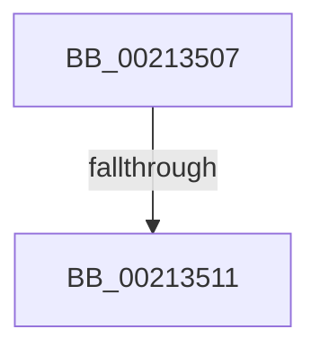

# sub_00213507

- RVA: `0x00213507`–`0x00213536` (길이 `47` bytes)
- VA: `0x0000000140213507`
- 실행 섹션: `.text`
- PDB 이름 있음: `아니요`; PDB Function 태그: `아니요`
- unwind 정보 RVA: `0x0005DF88`
- 디코드: `12`개 명령, `47/47` bytes 표시
- 미해석 바이트: `0` (있으면 어셈블리에 `.byte`로 보존)

> 이 문서는 커널 이미지의 기계어와 PDB 기호를 분석해 생성했습니다. 4번과 5번은 함수 원형과 자료형을 바이너리 사용 방식에서 추정한 C 해석이며 원본 소스 복구 결과는 아닙니다.

## 1. Dependencies

- 직접 호출 지점: **1**; 고유 호출 대상: **1**
- 직접 호출자로 확인된 함수: **0**
- RIP 상대 이미지 참조: **0**

### Outgoing calls
- `0x00213516` → [ExpAcquireResourceSharedLite](ExpAcquireResourceSharedLite_function_00212040.md) (function, `0x00212040`)

### Direct callers
- 이 함수 시작 RVA로 연결되는 직접 call은 확인되지 않았습니다. 간접 호출은 완전히 역산할 수 없습니다.

### Static image references
- 디코드된 RIP-relative 메모리 참조가 없습니다.

## 2. Other-region calls and transfers

- 다른 실행 섹션으로 향하는 call: **0**
- call이 아닌 외부 분기/꼬리 이동: **1**
  - `0x0021350F` → [sub_00213555 + 0x32](Unknown_function_00213555.md) (`tail-transfer`)

## 3. Assembly (complete function range)

```asm
00213507  48 89 7C 24 40                  mov qword ptr [rsp + 0x40], rdi
0021350C  F6 C1 01                        test cl, 1
0021350F  75 76                           jne 0x140213587
00213511  B2 01                           mov dl, 1
00213513  48 8B CB                        mov rcx, rbx
00213516  E8 25 EB FF FF                  call 0x140212040
0021351B  65 48 8B 04 25 88 01 00 00      mov rax, qword ptr gs:[0x188]
00213524  48 8B 7C 24 40                  mov rdi, qword ptr [rsp + 0x40]
00213529  48 8B 80 C8 01 00 00            mov rax, qword ptr [rax + 0x1c8]
00213530  48 83 C4 30                     add rsp, 0x30
00213534  5B                              pop rbx
00213535  C3                              ret
```

## 4. C-style interpretation (structured pseudocode)

```c
__int64 __fastcall sub_00213507(unsigned __int8 a1, __int64 a2, __int64 a3, __int64 a4, __int64 a5, __int64 a6, __int64 a7, __int64 a8)
{
    __int64 result;
    __int64 v_rsp;
    unsigned __int64 v_stack_p40;

    v_stack_p40 = v_rdi;
    result = ExpAcquireResourceSharedLite(v_rbx, 1, a3, a4);
    v_rsp = (v_rsp) + (48);
    return *(unsigned __int64 *)(*(unsigned __int64 *)(gs_base + (0 + 392)) + 456);
}
```

## 5. (Beta) C Style

```c
int64_t sub_00213507(uint8_t Arg1, int64_t Arg2, int64_t Arg3, int64_t Arg4, uint64_t Arg5, uint64_t Arg6, uint64_t Arg7, int64_t Arg8)
{
    int64_t result;
    int64_t local_rsp;
    uint64_t v_stack_p40;

    v_stack_p40 = local_rdi;
    result = ExpAcquireResourceSharedLite(local_rbx, 1, Arg3, Arg4);
    local_rsp = (local_rsp) + (48);
    return *(uint64_t *)(*(uint64_t *)(gs_base + (0 + 0x188)) + 0x1C8);
}
```

## 6. Execution-region graph

[열기: 2D/3D 그래프와 함수 탐색 컨트롤 패널](../../../control-panel.html?section=text&rva=0x00213507&view=graph)

- 2D 그래프는 위에서 아래로 흐르고, 3D 그래프는 빈 공간을 드래그해 회전합니다. Shift+드래그는 이동, 휠은 확대·축소, 함수 노드 선택은 대상 보고서 이동입니다.

### Static fallback


