# sub_00213555

- RVA: `0x00213555`–`0x0021361F` (길이 `202` bytes)
- VA: `0x0000000140213555`
- 실행 섹션: `.text`
- PDB 이름 있음: `아니요`; PDB Function 태그: `아니요`
- unwind 정보 RVA: `0x0005DFB0`
- 디코드: `49`개 명령, `202/202` bytes 표시
- 미해석 바이트: `0` (있으면 어셈블리에 `.byte`로 보존)

> 이 문서는 커널 이미지의 기계어와 PDB 기호를 분석해 생성했습니다. 4번과 5번은 함수 원형과 자료형을 바이너리 사용 방식에서 추정한 C 해석이며 원본 소스 복구 결과는 아닙니다.

## 1. Dependencies

- 직접 호출 지점: **7**; 고유 호출 대상: **5**
- 직접 호출자로 확인된 함수: **0**
- RIP 상대 이미지 참조: **0**

### Outgoing calls
- `0x00213555` → [ExpAllocateOwnerEntryForLegacyShim](ExpAllocateOwnerEntryForLegacyShim_function_00213B50.md) (function, `0x00213B50`)
- `0x00213566` → [ExAcquireFastResourceShared](ExAcquireFastResourceShared_function_00210F40.md) (function, `0x00210F40`)
- `0x00213572` → [ExIsFastResourceHeldExclusive](ExIsFastResourceHeldExclusive_function_00213450.md) (function, `0x00213450`)
- `0x00213580` → [ExFreePoolWithTag](../../poolcode/B8/ExFreePoolWithTag_function_00B82870.md) (function, `0x00B82870`)
- `0x002135B1` → [KeBugCheckEx](../4F/KeBugCheckEx_function_004FD660.md) (function, `0x004FD660`)
- `0x002135D8` → [KeBugCheckEx](../4F/KeBugCheckEx_function_004FD660.md) (function, `0x004FD660`)
- `0x00213619` → [KeBugCheckEx](../4F/KeBugCheckEx_function_004FD660.md) (function, `0x004FD660`)

### Direct callers
- 이 함수 시작 RVA로 연결되는 직접 call은 확인되지 않았습니다. 간접 호출은 완전히 역산할 수 없습니다.

### Static image references
- 디코드된 RIP-relative 메모리 참조가 없습니다.

## 2. Other-region calls and transfers

- 다른 실행 섹션으로 향하는 call: **1**
  - `0x00213580` → [ExFreePoolWithTag](../../poolcode/B8/ExFreePoolWithTag_function_00B82870.md) (`.text` → `POOLCODE`)
- call이 아닌 외부 분기/꼬리 이동: **2**
  - `0x00213579` → [sub_00213507 + 0x14](Unknown_function_00213507.md) (`tail-transfer`)
  - `0x00213585` → [sub_00213507 + 0x14](Unknown_function_00213507.md) (`tail-transfer`)

## 3. Assembly (complete function range)

```asm
00213555  E8 F6 05 00 00                  call 0x140213b50
0021355A  41 B0 01                        mov r8b, 1
0021355D  48 8B D0                        mov rdx, rax
00213560  48 8B CB                        mov rcx, rbx
00213563  48 8B F8                        mov rdi, rax
00213566  E8 D5 D9 FF FF                  call 0x140210f40
0021356B  84 C0                           test al, al
0021356D  74 0C                           je 0x14021357b
0021356F  48 8B CB                        mov rcx, rbx
00213572  E8 D9 FE FF FF                  call 0x140213450
00213577  84 C0                           test al, al
00213579  74 A0                           je 0x14021351b
0021357B  33 D2                           xor edx, edx
0021357D  48 8B CF                        mov rcx, rdi
00213580  E8 EB F2 96 00                  call 0x140b82870
00213585  EB 94                           jmp 0x14021351b
00213587  44 0F 20 C1                     mov rcx, cr8
0021358B  65 48 8B 14 25 88 01 00 00      mov rdx, qword ptr gs:[0x188]
00213594  80 F9 01                        cmp cl, 1
00213597  76 1E                           jbe 0x1402135b7
00213599  33 D2                           xor edx, edx
0021359B  44 0F B6 C1                     movzx r8d, cl
0021359F  B9 C6 01 00 00                  mov ecx, 0x1c6
002135A4  48 C7 44 24 20 00 00 00 00      mov qword ptr [rsp + 0x20], 0
002135AD  44 8D 4A 01                     lea r9d, [rdx + 1]
002135B1  E8 AA A0 2E 00                  call 0x1404fd660
002135B6  CC                              int3
002135B7  F6 82 C0 00 00 00 02            test byte ptr [rdx + 0xc0], 2
002135BE  74 1E                           je 0x1402135de
002135C0  45 33 C9                        xor r9d, r9d
002135C3  48 C7 44 24 20 00 00 00 00      mov qword ptr [rsp + 0x20], 0
002135CC  45 33 C0                        xor r8d, r8d
002135CF  B9 C6 01 00 00                  mov ecx, 0x1c6
002135D4  41 8D 51 06                     lea edx, [r9 + 6]
002135D8  E8 83 A0 2E 00                  call 0x1404fd660
002135DD  CC                              int3
002135DE  80 F9 01                        cmp cl, 1
002135E1  0F 83 6E FF FF FF               jae 0x140213555
002135E7  F7 42 74 00 04 00 00            test dword ptr [rdx + 0x74], 0x400
002135EE  0F 85 61 FF FF FF               jne 0x140213555
002135F4  83 BA E4 01 00 00 00            cmp dword ptr [rdx + 0x1e4], 0
002135FB  0F 85 54 FF FF FF               jne 0x140213555
00213601  45 33 C9                        xor r9d, r9d
00213604  48 C7 44 24 20 00 00 00 00      mov qword ptr [rsp + 0x20], 0
0021360D  45 33 C0                        xor r8d, r8d
00213610  B9 C6 01 00 00                  mov ecx, 0x1c6
00213615  41 8D 51 07                     lea edx, [r9 + 7]
00213619  E8 42 A0 2E 00                  call 0x1404fd660
0021361E  CC                              int3
```

## 4. C-style interpretation (structured pseudocode)

```c
__int64 __fastcall sub_00213555(void)
{
    __int64 result;
    unsigned __int64 v_stack_p20;

    result = ExpAllocateOwnerEntryForLegacyShim(a1, a2, a3, a4);
    result = ExAcquireFastResourceShared(v_rbx, result, 1, a4);
    if ((unsigned __int8)(result) == 0) goto loc_0021357B;
    result = ExIsFastResourceHeldExclusive(v_rbx, result, 1, a4);
loc_0021357B:
    a2 = 0;
    result = ExFreePoolWithTag(result, a2, 1, a4);
}
```

## 5. (Beta) C Style

```c
void sub_00213555(void)
{
    int64_t result;
    uint64_t v_stack_p20;

    result = ExpAllocateOwnerEntryForLegacyShim(a1, a2, a3, a4);
    result = ExAcquireFastResourceShared(local_rbx, result, 1, a4);
    if ((uint8_t)(result) == 0) goto loc_0021357B;
    result = ExIsFastResourceHeldExclusive(local_rbx, result, 1, a4);
loc_0021357B:
    a2 = 0;
    result = ExFreePoolWithTag(result, a2, 1, a4);
}
```

## 6. Execution-region graph

[열기: 2D/3D 그래프와 함수 탐색 컨트롤 패널](../../../control-panel.html?section=text&rva=0x00213555&view=graph)

- 2D 그래프는 위에서 아래로 흐르고, 3D 그래프는 빈 공간을 드래그해 회전합니다. Shift+드래그는 이동, 휠은 확대·축소, 함수 노드 선택은 대상 보고서 이동입니다.

### Static fallback

```mermaid
flowchart TD
  bb_00213555[BB_00213555]
  bb_0021356F[BB_0021356F]
  bb_0021357B[BB_0021357B]
  bb_00213587[BB_00213587]
  bb_00213599[BB_00213599]
  bb_002135B7[BB_002135B7]
  bb_002135C0[BB_002135C0]
  bb_002135DE[BB_002135DE]
  bb_002135E7[BB_002135E7]
  bb_002135F4[BB_002135F4]
  bb_00213601[BB_00213601]
  bb_00213555 -->|branch| bb_0021357B
  bb_00213555 -->|fallthrough| bb_0021356F
  bb_0021356F -->|fallthrough| bb_0021357B
  bb_00213587 -->|branch| bb_002135B7
  bb_00213587 -->|fallthrough| bb_00213599
  bb_00213599 -->|flow| bb_002135B7
  bb_002135B7 -->|branch| bb_002135DE
  bb_002135B7 -->|fallthrough| bb_002135C0
  bb_002135C0 -->|flow| bb_002135DE
  bb_002135DE -->|branch| bb_00213555
  bb_002135DE -->|fallthrough| bb_002135E7
  bb_002135E7 -->|branch| bb_00213555
  bb_002135E7 -->|fallthrough| bb_002135F4
  bb_002135F4 -->|branch| bb_00213555
  bb_002135F4 -->|fallthrough| bb_00213601
```


