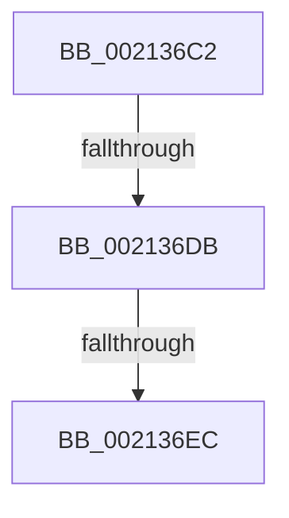

# sub_002136C2

- RVA: `0x002136C2`–`0x002136F8` (길이 `54` bytes)
- VA: `0x00000001402136C2`
- 실행 섹션: `.text`
- PDB 이름 있음: `아니요`; PDB Function 태그: `아니요`
- unwind 정보 RVA: `0x0005DFD8`
- 디코드: `14`개 명령, `54/54` bytes 표시
- 미해석 바이트: `0` (있으면 어셈블리에 `.byte`로 보존)

> 이 문서는 커널 이미지의 기계어와 PDB 기호를 분석해 생성했습니다. 4번과 5번은 함수 원형과 자료형을 바이너리 사용 방식에서 추정한 C 해석이며 원본 소스 복구 결과는 아닙니다.

## 1. Dependencies

- 직접 호출 지점: **0**; 고유 호출 대상: **0**
- 직접 호출자로 확인된 함수: **0**
- RIP 상대 이미지 참조: **0**

### Outgoing calls
- 직접 디코드된 call 명령이 없습니다.

### Direct callers
- 이 함수 시작 RVA로 연결되는 직접 call은 확인되지 않았습니다. 간접 호출은 완전히 역산할 수 없습니다.

### Static image references
- 디코드된 RIP-relative 메모리 참조가 없습니다.

## 2. Other-region calls and transfers

- 다른 실행 섹션으로 향하는 call: **0**
- call이 아닌 외부 분기/꼬리 이동: **3**
  - `0x002136D9` → [sub_00213726](Unknown_function_00213726.md) (`tail-transfer`)
  - `0x002136E6` → [sub_00213774](Unknown_function_00213774.md) (`tail-transfer`)
  - `0x002136F6` → [sub_002136F8 + 0x17](Unknown_function_002136F8.md) (`tail-transfer`)

## 3. Assembly (complete function range)

```asm
002136C2  4C 89 74 24 50                  mov qword ptr [rsp + 0x50], r14
002136C7  4C 8B B6 08 03 00 00            mov r14, qword ptr [rsi + 0x308]
002136CE  49 8B 5E 08                     mov rbx, qword ptr [r14 + 8]
002136D2  49 8D 7E 08                     lea rdi, [r14 + 8]
002136D6  48 3B DF                        cmp rbx, rdi
002136D9  75 4B                           jne 0x140213726
002136DB  49 8D 7E 20                     lea rdi, [r14 + 0x20]
002136DF  4D 8B 76 20                     mov r14, qword ptr [r14 + 0x20]
002136E3  4C 3B F7                        cmp r14, rdi
002136E6  0F 85 88 00 00 00               jne 0x140213774
002136EC  32 DB                           xor bl, bl
002136EE  4C 8B 74 24 50                  mov r14, qword ptr [rsp + 0x50]
002136F3  40 84 ED                        test bpl, bpl
002136F6  74 17                           je 0x14021370f
```

## 4. C-style interpretation (structured pseudocode)

```c
void __fastcall sub_002136C2(__int64 a1, __int64 a2, __int64 a3, __int64 a4, __int64 a5, __int64 a6, __int64 a7, __int64 a8, __int64 a9, __int64 a10)
{
    __int64 v_rbx;
    unsigned __int64 v_stack_p50;

    v_stack_p50 = v_r14;
    v_rbx = 0;
}
```

## 5. (Beta) C Style

```c
void sub_002136C2(int64_t Arg1, int64_t Arg2, int64_t Arg3, int64_t Arg4, uint64_t Arg5, uint64_t Arg6, uint64_t Arg7, uint64_t Arg8, uint64_t Arg9, int64_t Arg10)
{
    int64_t local_rbx;
    uint64_t v_stack_p50;

    v_stack_p50 = local_r14;
    local_rbx = 0;
}
```

## 6. Execution-region graph

[열기: 2D/3D 그래프와 함수 탐색 컨트롤 패널](../../../control-panel.html?section=text&rva=0x002136C2&view=graph)

- 2D 그래프는 위에서 아래로 흐르고, 3D 그래프는 빈 공간을 드래그해 회전합니다. Shift+드래그는 이동, 휠은 확대·축소, 함수 노드 선택은 대상 보고서 이동입니다.

### Static fallback


