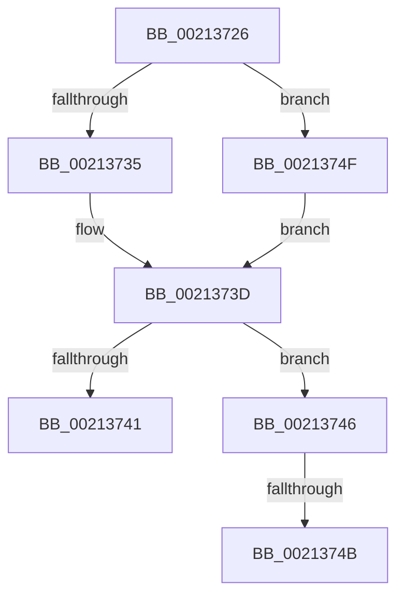

# sub_00213726

- RVA: `0x00213726`–`0x00213756` (길이 `48` bytes)
- VA: `0x0000000140213726`
- 실행 섹션: `.text`
- PDB 이름 있음: `아니요`; PDB Function 태그: `아니요`
- unwind 정보 RVA: `0x0005E000`
- 디코드: `17`개 명령, `48/48` bytes 표시
- 미해석 바이트: `0` (있으면 어셈블리에 `.byte`로 보존)

> 이 문서는 커널 이미지의 기계어와 PDB 기호를 분석해 생성했습니다. 4번과 5번은 함수 원형과 자료형을 바이너리 사용 방식에서 추정한 C 해석이며 원본 소스 복구 결과는 아닙니다.

## 1. Dependencies

- 직접 호출 지점: **2**; 고유 호출 대상: **2**
- 직접 호출자로 확인된 함수: **0**
- RIP 상대 이미지 참조: **0**

### Outgoing calls
- `0x00213738` → [RtlEqualUnicodeString](../../page/93/RtlEqualUnicodeString_function_00932A20.md) (function, `0x00932A20`)
- `0x0021374F` → [AuthzBasepEqualUnicodeStringCaseSensitive](../3A/AuthzBasepEqualUnicodeStringCaseSensitive_function_003A8A44.md) (function, `0x003A8A44`)

### Direct callers
- 이 함수 시작 RVA로 연결되는 직접 call은 확인되지 않았습니다. 간접 호출은 완전히 역산할 수 없습니다.

### Static image references
- 디코드된 RIP-relative 메모리 참조가 없습니다.

## 2. Other-region calls and transfers

- 다른 실행 섹션으로 향하는 call: **1**
  - `0x00213738` → [RtlEqualUnicodeString](../../page/93/RtlEqualUnicodeString_function_00932A20.md) (`.text` → `PAGE`)
- call이 아닌 외부 분기/꼬리 이동: **3**
  - `0x00213744` → [sub_002136C2 + 0x14](Unknown_function_002136C2.md) (`tail-transfer`)
  - `0x00213749` → [sub_002136C2 + 0x2A](Unknown_function_002136C2.md) (`tail-transfer`)
  - `0x0021374D` → [sub_002136C2 + 0x2C](Unknown_function_002136C2.md) (`tail-transfer`)

## 3. Assembly (complete function range)

```asm
00213726  48 8D 4B 20                     lea rcx, [rbx + 0x20]
0021372A  44 0F 20 C0                     mov rax, cr8
0021372E  49 8B D7                        mov rdx, r15
00213731  3C 02                           cmp al, 2
00213733  73 1A                           jae 0x14021374f
00213735  41 B0 01                        mov r8b, 1
00213738  E8 E3 F2 71 00                  call 0x140932a20
0021373D  84 C0                           test al, al
0021373F  75 05                           jne 0x140213746
00213741  48 8B 1B                        mov rbx, qword ptr [rbx]
00213744  EB 90                           jmp 0x1402136d6
00213746  48 85 DB                        test rbx, rbx
00213749  74 A1                           je 0x1402136ec
0021374B  B3 01                           mov bl, 1
0021374D  EB 9F                           jmp 0x1402136ee
0021374F  E8 F0 52 19 00                  call 0x1403a8a44
00213754  EB E7                           jmp 0x14021373d
```

## 4. C-style interpretation (structured pseudocode)

```c
__int64 __fastcall sub_00213726(void)
{
    __int64 result;

    if (((unsigned __int8)(v_cr8)) >= 2) goto loc_0021374F;
    result = RtlEqualUnicodeString(v_rbx + 32, v_r15, 1, a4);
loc_0021373D:
    if ((unsigned __int8)(result) != 0) goto loc_00213746;
loc_00213746:
loc_0021374F:
    result = AuthzBasepEqualUnicodeStringCaseSensitive(v_rbx + 32, v_r15, 1, a4);
    goto loc_0021373D;
}
```

## 5. (Beta) C Style

```c
void sub_00213726(void)
{
    int64_t result;

    if (((uint8_t)(v_cr8)) >= 2) goto loc_0021374F;
    result = RtlEqualUnicodeString(local_rbx + 32, local_r15, 1, a4);
loc_0021373D:
    if ((uint8_t)(result) != 0) goto loc_00213746;
loc_00213746:
loc_0021374F:
    result = AuthzBasepEqualUnicodeStringCaseSensitive(local_rbx + 32, local_r15, 1, a4);
    goto loc_0021373D;
}
```

## 6. Execution-region graph

[열기: 2D/3D 그래프와 함수 탐색 컨트롤 패널](../../../control-panel.html?section=text&rva=0x00213726&view=graph)

- 2D 그래프는 위에서 아래로 흐르고, 3D 그래프는 빈 공간을 드래그해 회전합니다. Shift+드래그는 이동, 휠은 확대·축소, 함수 노드 선택은 대상 보고서 이동입니다.

### Static fallback


