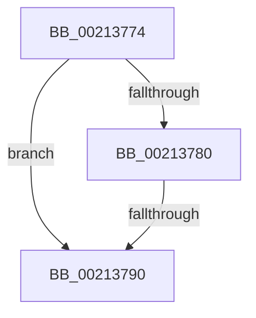

# sub_00213774

- RVA: `0x00213774`–`0x00213798` (길이 `36` bytes)
- VA: `0x0000000140213774`
- 실행 섹션: `.text`
- PDB 이름 있음: `아니요`; PDB Function 태그: `아니요`
- unwind 정보 RVA: `0x0005E024`
- 디코드: `11`개 명령, `36/36` bytes 표시
- 미해석 바이트: `0` (있으면 어셈블리에 `.byte`로 보존)

> 이 문서는 커널 이미지의 기계어와 PDB 기호를 분석해 생성했습니다. 4번과 5번은 함수 원형과 자료형을 바이너리 사용 방식에서 추정한 C 해석이며 원본 소스 복구 결과는 아닙니다.

## 1. Dependencies

- 직접 호출 지점: **1**; 고유 호출 대상: **1**
- 직접 호출자로 확인된 함수: **0**
- RIP 상대 이미지 참조: **0**

### Outgoing calls
- `0x00213787` → [AuthzBasepEqualUnicodeString](../3A/AuthzBasepEqualUnicodeString_function_003A8A80.md) (function, `0x003A8A80`)

### Direct callers
- 이 함수 시작 RVA로 연결되는 직접 call은 확인되지 않았습니다. 간접 호출은 완전히 역산할 수 없습니다.

### Static image references
- 디코드된 RIP-relative 메모리 참조가 없습니다.

## 2. Other-region calls and transfers

- 다른 실행 섹션으로 향하는 call: **0**
- call이 아닌 외부 분기/꼬리 이동: **2**
  - `0x0021378E` → [sub_00213726 + 0x20](Unknown_function_00213726.md) (`tail-transfer`)
  - `0x00213793` → [sub_002136C2 + 0x21](Unknown_function_002136C2.md) (`tail-transfer`)

## 3. Assembly (complete function range)

```asm
00213774  41 8B 46 28                     mov eax, dword ptr [r14 + 0x28]
00213778  49 8D 5E F0                     lea rbx, [r14 - 0x10]
0021377C  A8 01                           test al, 1
0021377E  75 10                           jne 0x140213790
00213780  48 8D 4B 20                     lea rcx, [rbx + 0x20]
00213784  49 8B D7                        mov rdx, r15
00213787  E8 F4 52 19 00                  call 0x1403a8a80
0021378C  84 C0                           test al, al
0021378E  75 B6                           jne 0x140213746
00213790  4D 8B 36                        mov r14, qword ptr [r14]
00213793  E9 4B FF FF FF                  jmp 0x1402136e3
```

## 4. C-style interpretation (structured pseudocode)

```c
__int64 __fastcall sub_00213774(void)
{
    __int64 result;

    if ((((unsigned __int8)((unsigned int)(*(unsigned int *)(v_r14 + 40)))) & (1)) != 0) goto loc_00213790;
    result = AuthzBasepEqualUnicodeString(v_r14 - 16 + 32, v_r15, a3, a4);
loc_00213790:
}
```

## 5. (Beta) C Style

```c
void sub_00213774(void)
{
    int64_t result;

    if ((((uint8_t)((uint32_t)(*(uint32_t *)(local_r14 + 0x28)))) & (1)) != 0) goto loc_00213790;
    result = AuthzBasepEqualUnicodeString(local_r14 - 16 + 32, local_r15, a3, a4);
loc_00213790:
}
```

## 6. Execution-region graph

[열기: 2D/3D 그래프와 함수 탐색 컨트롤 패널](../../../control-panel.html?section=text&rva=0x00213774&view=graph)

- 2D 그래프는 위에서 아래로 흐르고, 3D 그래프는 빈 공간을 드래그해 회전합니다. Shift+드래그는 이동, 휠은 확대·축소, 함수 노드 선택은 대상 보고서 이동입니다.

### Static fallback


