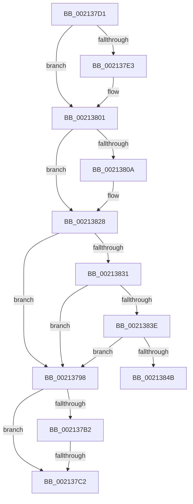

# sub_00213798

- RVA: `0x00213798`–`0x00213869` (길이 `209` bytes)
- VA: `0x0000000140213798`
- 실행 섹션: `.text`
- PDB 이름 있음: `아니요`; PDB Function 태그: `아니요`
- unwind 정보 RVA: `0x0005E038`
- 디코드: `49`개 명령, `209/209` bytes 표시
- 미해석 바이트: `0` (있으면 어셈블리에 `.byte`로 보존)

> 이 문서는 커널 이미지의 기계어와 PDB 기호를 분석해 생성했습니다. 4번과 5번은 함수 원형과 자료형을 바이너리 사용 방식에서 추정한 C 해석이며 원본 소스 복구 결과는 아닙니다.

## 1. Dependencies

- 직접 호출 지점: **7**; 고유 호출 대상: **5**
- 직접 호출자로 확인된 함수: **0**
- RIP 상대 이미지 참조: **0**

### Outgoing calls
- `0x00213798` → [ExpAllocateOwnerEntryForLegacyShim](ExpAllocateOwnerEntryForLegacyShim_function_00213B50.md) (function, `0x00213B50`)
- `0x002137A9` → [ExAcquireFastResourceShared](ExAcquireFastResourceShared_function_00210F40.md) (function, `0x00210F40`)
- `0x002137B5` → [ExIsFastResourceHeldExclusive](ExIsFastResourceHeldExclusive_function_00213450.md) (function, `0x00213450`)
- `0x002137C7` → [ExFreePoolWithTag](../../poolcode/B8/ExFreePoolWithTag_function_00B82870.md) (function, `0x00B82870`)
- `0x002137FB` → [KeBugCheckEx](../4F/KeBugCheckEx_function_004FD660.md) (function, `0x004FD660`)
- `0x00213822` → [KeBugCheckEx](../4F/KeBugCheckEx_function_004FD660.md) (function, `0x004FD660`)
- `0x00213863` → [KeBugCheckEx](../4F/KeBugCheckEx_function_004FD660.md) (function, `0x004FD660`)

### Direct callers
- 이 함수 시작 RVA로 연결되는 직접 call은 확인되지 않았습니다. 간접 호출은 완전히 역산할 수 없습니다.

### Static image references
- 디코드된 RIP-relative 메모리 참조가 없습니다.

## 2. Other-region calls and transfers

- 다른 실행 섹션으로 향하는 call: **1**
  - `0x002137C7` → [ExFreePoolWithTag](../../poolcode/B8/ExFreePoolWithTag_function_00B82870.md) (`.text` → `POOLCODE`)
- call이 아닌 외부 분기/꼬리 이동: **2**
  - `0x002137BC` → [SeSecurityAttributePresent + 0x5F](SeSecurityAttributePresent_function_00213660.md) (`tail-transfer`)
  - `0x002137CC` → [SeSecurityAttributePresent + 0x5F](SeSecurityAttributePresent_function_00213660.md) (`tail-transfer`)

## 3. Assembly (complete function range)

```asm
00213798  E8 B3 03 00 00                  call 0x140213b50
0021379D  41 B0 01                        mov r8b, 1
002137A0  48 8B D0                        mov rdx, rax
002137A3  48 8B CB                        mov rcx, rbx
002137A6  48 8B F8                        mov rdi, rax
002137A9  E8 92 D7 FF FF                  call 0x140210f40
002137AE  84 C0                           test al, al
002137B0  74 10                           je 0x1402137c2
002137B2  48 8B CB                        mov rcx, rbx
002137B5  E8 96 FC FF FF                  call 0x140213450
002137BA  84 C0                           test al, al
002137BC  0F 84 FD FE FF FF               je 0x1402136bf
002137C2  33 D2                           xor edx, edx
002137C4  48 8B CF                        mov rcx, rdi
002137C7  E8 A4 F0 96 00                  call 0x140b82870
002137CC  E9 EE FE FF FF                  jmp 0x1402136bf
002137D1  44 0F 20 C1                     mov rcx, cr8
002137D5  65 48 8B 14 25 88 01 00 00      mov rdx, qword ptr gs:[0x188]
002137DE  80 F9 01                        cmp cl, 1
002137E1  76 1E                           jbe 0x140213801
002137E3  33 D2                           xor edx, edx
002137E5  44 0F B6 C1                     movzx r8d, cl
002137E9  B9 C6 01 00 00                  mov ecx, 0x1c6
002137EE  48 C7 44 24 20 00 00 00 00      mov qword ptr [rsp + 0x20], 0
002137F7  44 8D 4A 01                     lea r9d, [rdx + 1]
002137FB  E8 60 9E 2E 00                  call 0x1404fd660
00213800  CC                              int3
00213801  F6 82 C0 00 00 00 02            test byte ptr [rdx + 0xc0], 2
00213808  74 1E                           je 0x140213828
0021380A  45 33 C9                        xor r9d, r9d
0021380D  48 C7 44 24 20 00 00 00 00      mov qword ptr [rsp + 0x20], 0
00213816  45 33 C0                        xor r8d, r8d
00213819  B9 C6 01 00 00                  mov ecx, 0x1c6
0021381E  41 8D 51 06                     lea edx, [r9 + 6]
00213822  E8 39 9E 2E 00                  call 0x1404fd660
00213827  CC                              int3
00213828  80 F9 01                        cmp cl, 1
0021382B  0F 83 67 FF FF FF               jae 0x140213798
00213831  F7 42 74 00 04 00 00            test dword ptr [rdx + 0x74], 0x400
00213838  0F 85 5A FF FF FF               jne 0x140213798
0021383E  83 BA E4 01 00 00 00            cmp dword ptr [rdx + 0x1e4], 0
00213845  0F 85 4D FF FF FF               jne 0x140213798
0021384B  45 33 C9                        xor r9d, r9d
0021384E  48 C7 44 24 20 00 00 00 00      mov qword ptr [rsp + 0x20], 0
00213857  45 33 C0                        xor r8d, r8d
0021385A  B9 C6 01 00 00                  mov ecx, 0x1c6
0021385F  41 8D 51 07                     lea edx, [r9 + 7]
00213863  E8 F8 9D 2E 00                  call 0x1404fd660
00213868  CC                              int3
```

## 4. C-style interpretation (structured pseudocode)

```c
__int64 __fastcall sub_00213798(void)
{
    __int64 result;
    unsigned __int64 v_stack_p20;

    result = ExpAllocateOwnerEntryForLegacyShim(a1, a2, a3, a4);
    result = ExAcquireFastResourceShared(v_rbx, result, 1, a4);
    if ((unsigned __int8)(result) == 0) goto loc_002137C2;
    result = ExIsFastResourceHeldExclusive(v_rbx, result, 1, a4);
loc_002137C2:
    a2 = 0;
    result = ExFreePoolWithTag(result, a2, 1, a4);
}
```

## 5. (Beta) C Style

```c
void sub_00213798(void)
{
    int64_t result;
    uint64_t v_stack_p20;

    result = ExpAllocateOwnerEntryForLegacyShim(a1, a2, a3, a4);
    result = ExAcquireFastResourceShared(local_rbx, result, 1, a4);
    if ((uint8_t)(result) == 0) goto loc_002137C2;
    result = ExIsFastResourceHeldExclusive(local_rbx, result, 1, a4);
loc_002137C2:
    a2 = 0;
    result = ExFreePoolWithTag(result, a2, 1, a4);
}
```

## 6. Execution-region graph

[열기: 2D/3D 그래프와 함수 탐색 컨트롤 패널](../../../control-panel.html?section=text&rva=0x00213798&view=graph)

- 2D 그래프는 위에서 아래로 흐르고, 3D 그래프는 빈 공간을 드래그해 회전합니다. Shift+드래그는 이동, 휠은 확대·축소, 함수 노드 선택은 대상 보고서 이동입니다.

### Static fallback


