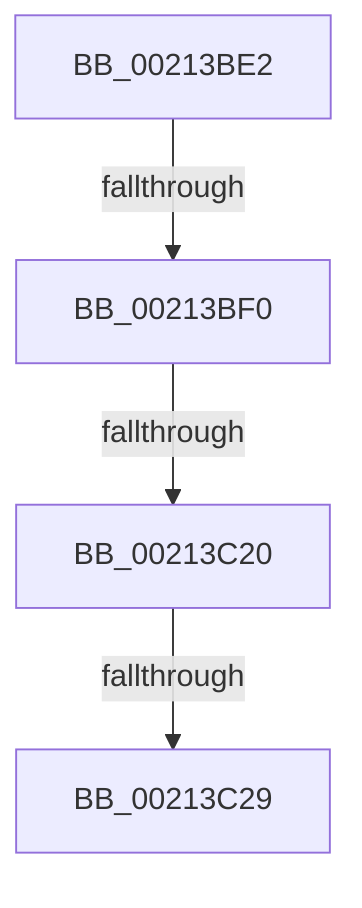

# sub_00213BE2

- RVA: `0x00213BE2`–`0x00213C43` (길이 `97` bytes)
- VA: `0x0000000140213BE2`
- 실행 섹션: `.text`
- PDB 이름 있음: `아니요`; PDB Function 태그: `아니요`
- unwind 정보 RVA: `0x0005E070`
- 디코드: `25`개 명령, `97/97` bytes 표시
- 미해석 바이트: `0` (있으면 어셈블리에 `.byte`로 보존)

> 이 문서는 커널 이미지의 기계어와 PDB 기호를 분석해 생성했습니다. 4번과 5번은 함수 원형과 자료형을 바이너리 사용 방식에서 추정한 C 해석이며 원본 소스 복구 결과는 아닙니다.

## 1. Dependencies

- 직접 호출 지점: **2**; 고유 호출 대상: **1**
- 직접 호출자로 확인된 함수: **0**
- RIP 상대 이미지 참조: **0**

### Outgoing calls
- `0x00213BF5` → [ExpAcquireResourceSharedLite](ExpAcquireResourceSharedLite_function_00212040.md) (function, `0x00212040`)
- `0x00213C2E` → [ExpAcquireResourceSharedLite](ExpAcquireResourceSharedLite_function_00212040.md) (function, `0x00212040`)

### Direct callers
- 이 함수 시작 RVA로 연결되는 직접 call은 확인되지 않았습니다. 간접 호출은 완전히 역산할 수 없습니다.

### Static image references
- 디코드된 RIP-relative 메모리 참조가 없습니다.

## 2. Other-region calls and transfers

- 다른 실행 섹션으로 향하는 call: **0**
- call이 아닌 외부 분기/꼬리 이동: **3**
  - `0x00213BEA` → [sub_00213D42 + 0x2B](Unknown_function_00213D42.md) (`tail-transfer`)
  - `0x00213C1A` → [sub_00213CA6](Unknown_function_00213CA6.md) (`tail-transfer`)
  - `0x00213C23` → [sub_00213D42 + 0x5B](Unknown_function_00213D42.md) (`tail-transfer`)

## 3. Assembly (complete function range)

```asm
00213BE2  48 89 74 24 40                  mov qword ptr [rsp + 0x40], rsi
00213BE7  F6 C1 01                        test cl, 1
00213BEA  0F 85 7D 01 00 00               jne 0x140213d6d
00213BF0  B2 01                           mov dl, 1
00213BF2  48 8B CB                        mov rcx, rbx
00213BF5  E8 46 E4 FF FF                  call 0x140212040
00213BFA  65 48 8B 04 25 88 01 00 00      mov rax, qword ptr gs:[0x188]
00213C03  66 FF 88 E4 01 00 00            dec word ptr [rax + 0x1e4]
00213C0A  90                              nop
00213C0B  48 8B 5F 30                     mov rbx, qword ptr [rdi + 0x30]
00213C0F  0F B7 4B 1A                     movzx ecx, word ptr [rbx + 0x1a]
00213C13  0F B6 C1                        movzx eax, cl
00213C16  24 41                           and al, 0x41
00213C18  3C 01                           cmp al, 1
00213C1A  0F 84 86 00 00 00               je 0x140213ca6
00213C20  F6 C1 01                        test cl, 1
00213C23  0F 85 74 01 00 00               jne 0x140213d9d
00213C29  B2 01                           mov dl, 1
00213C2B  48 8B CB                        mov rcx, rbx
00213C2E  E8 0D E4 FF FF                  call 0x140212040
00213C33  48 8B 74 24 40                  mov rsi, qword ptr [rsp + 0x40]
00213C38  48 8B 5C 24 48                  mov rbx, qword ptr [rsp + 0x48]
00213C3D  48 83 C4 30                     add rsp, 0x30
00213C41  5F                              pop rdi
00213C42  C3                              ret
```

## 4. C-style interpretation (structured pseudocode)

```c
__int64 __fastcall sub_00213BE2(unsigned __int8 a1, __int64 a2, __int64 a3, __int64 a4, __int64 a5, __int64 a6, __int64 a7, __int64 a8, __int64 a9)
{
    __int64 result;
    __int64 v_rsp;
    unsigned __int64 v_stack_p40;

    v_stack_p40 = v_rsi;
    result = ExpAcquireResourceSharedLite(v_rbx, 1, a3, a4);
    result = (unsigned __int8)(((unsigned __int8)(*(unsigned __int16 *)(*(unsigned __int64 *)(v_rdi + 48) + 26))) & (65));
    result = ExpAcquireResourceSharedLite(*(unsigned __int64 *)(v_rdi + 48), 1, a3, a4);
    v_rsp = (v_rsp) + (48);
    return result;
}
```

## 5. (Beta) C Style

```c
int64_t sub_00213BE2(uint8_t Arg1, int64_t Arg2, int64_t Arg3, int64_t Arg4, uint64_t Arg5, uint64_t Arg6, uint64_t Arg7, int64_t Arg8, int64_t Arg9)
{
    int64_t result;
    int64_t local_rsp;
    uint64_t v_stack_p40;

    v_stack_p40 = local_rsi;
    result = ExpAcquireResourceSharedLite(local_rbx, 1, Arg3, Arg4);
    result = (uint8_t)(((uint8_t)(*(uint16_t *)(*(uint64_t *)(local_rdi + 0x30) + 0x1A))) & (65));
    result = ExpAcquireResourceSharedLite(*(uint64_t *)(local_rdi + 0x30), 1, Arg3, Arg4);
    local_rsp = (local_rsp) + (48);
    return result;
}
```

## 6. Execution-region graph

[열기: 2D/3D 그래프와 함수 탐색 컨트롤 패널](../../../control-panel.html?section=text&rva=0x00213BE2&view=graph)

- 2D 그래프는 위에서 아래로 흐르고, 3D 그래프는 빈 공간을 드래그해 회전합니다. Shift+드래그는 이동, 휠은 확대·축소, 함수 노드 선택은 대상 보고서 이동입니다.

### Static fallback


