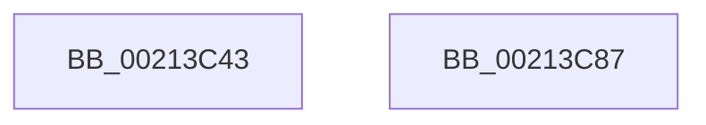

# sub_00213C43

- RVA: `0x00213C43`–`0x00213CA6` (길이 `99` bytes)
- VA: `0x0000000140213C43`
- 실행 섹션: `.text`
- PDB 이름 있음: `아니요`; PDB Function 태그: `아니요`
- unwind 정보 RVA: `0x0005E088`
- 디코드: `25`개 명령, `99/99` bytes 표시
- 미해석 바이트: `0` (있으면 어셈블리에 `.byte`로 보존)

> 이 문서는 커널 이미지의 기계어와 PDB 기호를 분석해 생성했습니다. 4번과 5번은 함수 원형과 자료형을 바이너리 사용 방식에서 추정한 C 해석이며 원본 소스 복구 결과는 아닙니다.

## 1. Dependencies

- 직접 호출 지점: **3**; 고유 호출 대상: **2**
- 직접 호출자로 확인된 함수: **0**
- RIP 상대 이미지 참조: **0**

### Outgoing calls
- `0x00213C5B` → [ExAcquireResourceSharedLite](ExAcquireResourceSharedLite_function_00211BC0.md) (function, `0x00211BC0`)
- `0x00213C77` → [ExAcquireResourceSharedLite](ExAcquireResourceSharedLite_function_00211BC0.md) (function, `0x00211BC0`)
- `0x00213CA0` → [KeBugCheckEx](../4F/KeBugCheckEx_function_004FD660.md) (function, `0x004FD660`)

### Direct callers
- 이 함수 시작 RVA로 연결되는 직접 call은 확인되지 않았습니다. 간접 호출은 완전히 역산할 수 없습니다.

### Static image references
- 디코드된 RIP-relative 메모리 참조가 없습니다.

## 2. Other-region calls and transfers

- 다른 실행 섹션으로 향하는 call: **0**
- 별도 외부 분기/꼬리 이동을 확인하지 못했습니다.

## 3. Assembly (complete function range)

```asm
00213C43  CC                              int3
00213C44  65 48 8B 04 25 88 01 00 00      mov rax, qword ptr gs:[0x188]
00213C4D  B2 01                           mov dl, 1
00213C4F  66 FF 88 E4 01 00 00            dec word ptr [rax + 0x1e4]
00213C56  90                              nop
00213C57  48 8B 4F 30                     mov rcx, qword ptr [rdi + 0x30]
00213C5B  E8 60 DF FF FF                  call 0x140211bc0
00213C60  65 48 8B 04 25 88 01 00 00      mov rax, qword ptr gs:[0x188]
00213C69  B2 01                           mov dl, 1
00213C6B  66 FF 88 E4 01 00 00            dec word ptr [rax + 0x1e4]
00213C72  90                              nop
00213C73  48 8B 4B 30                     mov rcx, qword ptr [rbx + 0x30]
00213C77  E8 44 DF FF FF                  call 0x140211bc0
00213C7C  48 8B 5C 24 48                  mov rbx, qword ptr [rsp + 0x48]
00213C81  48 83 C4 30                     add rsp, 0x30
00213C85  5F                              pop rdi
00213C86  C3                              ret
00213C87  CC                              int3
00213C88  45 33 C9                        xor r9d, r9d
00213C8B  48 C7 44 24 20 00 00 00 00      mov qword ptr [rsp + 0x20], 0
00213C94  4C 8B C3                        mov r8, rbx
00213C97  B9 C6 01 00 00                  mov ecx, 0x1c6
00213C9C  41 8D 51 0F                     lea edx, [r9 + 0xf]
00213CA0  E8 BB 99 2E 00                  call 0x1404fd660
00213CA5  CC                              int3
```

## 4. C-style interpretation (structured pseudocode)

```c
__int64 __fastcall sub_00213C43(__int64 a1, __int64 a2, __int64 a3, int a4, __int64 a5, __int64 a6, __int64 a7, __int64 a8, __int64 a9)
{
    __int64 result;
    __int64 v_rsp;
    unsigned __int64 v_stack_p58;

    result = ExAcquireResourceSharedLite(*(unsigned __int64 *)(v_rdi + 48), 1, a3, a4);
    result = ExAcquireResourceSharedLite(*(unsigned __int64 *)(v_rbx + 48), 1, a3, a4);
    v_rsp = (v_rsp) + (48);
    return result;
}
```

## 5. (Beta) C Style

```c
int64_t sub_00213C43(int64_t Arg1, int64_t Arg2, int64_t Arg3, int32_t Arg4, uint64_t Arg5, uint64_t Arg6, uint64_t Arg7, uint64_t Arg8, int64_t Arg9)
{
    int64_t result;
    int64_t local_rsp;
    uint64_t v_stack_p58;

    result = ExAcquireResourceSharedLite(*(uint64_t *)(local_rdi + 0x30), 1, Arg3, Arg4);
    result = ExAcquireResourceSharedLite(*(uint64_t *)(local_rbx + 0x30), 1, Arg3, Arg4);
    local_rsp = (local_rsp) + (48);
    return result;
}
```

## 6. Execution-region graph

[열기: 2D/3D 그래프와 함수 탐색 컨트롤 패널](../../../control-panel.html?section=text&rva=0x00213C43&view=graph)

- 2D 그래프는 위에서 아래로 흐르고, 3D 그래프는 빈 공간을 드래그해 회전합니다. Shift+드래그는 이동, 휠은 확대·축소, 함수 노드 선택은 대상 보고서 이동입니다.

### Static fallback


