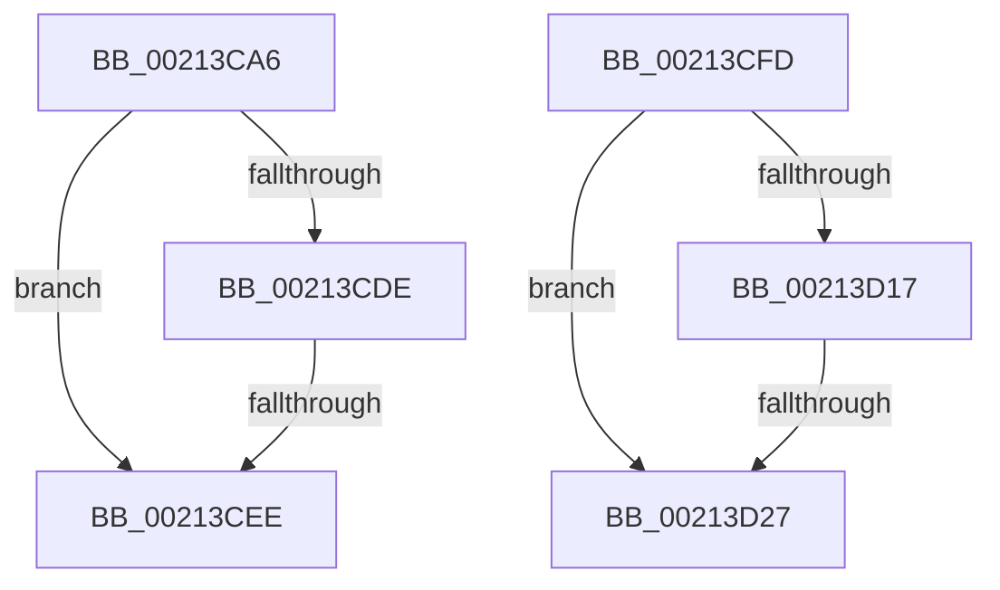

# sub_00213CA6

- RVA: `0x00213CA6`–`0x00213D41` (길이 `155` bytes)
- VA: `0x0000000140213CA6`
- 실행 섹션: `.text`
- PDB 이름 있음: `아니요`; PDB Function 태그: `아니요`
- unwind 정보 RVA: `0x0005E09C`
- 디코드: `43`개 명령, `155/155` bytes 표시
- 미해석 바이트: `0` (있으면 어셈블리에 `.byte`로 보존)

> 이 문서는 커널 이미지의 기계어와 PDB 기호를 분석해 생성했습니다. 4번과 5번은 함수 원형과 자료형을 바이너리 사용 방식에서 추정한 C 해석이며 원본 소스 복구 결과는 아닙니다.

## 1. Dependencies

- 직접 호출 지점: **9**; 고유 호출 대상: **5**
- 직접 호출자로 확인된 함수: **0**
- RIP 상대 이미지 참조: **0**

### Outgoing calls
- `0x00213CBE` → [KeBugCheckEx](../4F/KeBugCheckEx_function_004FD660.md) (function, `0x004FD660`)
- `0x00213CC4` → [ExpAllocateOwnerEntryForLegacyShim](ExpAllocateOwnerEntryForLegacyShim_function_00213B50.md) (function, `0x00213B50`)
- `0x00213CD5` → [ExAcquireFastResourceShared](ExAcquireFastResourceShared_function_00210F40.md) (function, `0x00210F40`)
- `0x00213CE1` → [ExIsFastResourceHeldExclusive](ExIsFastResourceHeldExclusive_function_00213450.md) (function, `0x00213450`)
- `0x00213CF3` → [ExFreePoolWithTag](../../poolcode/B8/ExFreePoolWithTag_function_00B82870.md) (function, `0x00B82870`)
- `0x00213CFD` → [ExpAllocateOwnerEntryForLegacyShim](ExpAllocateOwnerEntryForLegacyShim_function_00213B50.md) (function, `0x00213B50`)
- `0x00213D0E` → [ExAcquireFastResourceShared](ExAcquireFastResourceShared_function_00210F40.md) (function, `0x00210F40`)
- `0x00213D1A` → [ExIsFastResourceHeldExclusive](ExIsFastResourceHeldExclusive_function_00213450.md) (function, `0x00213450`)
- `0x00213D2C` → [ExFreePoolWithTag](../../poolcode/B8/ExFreePoolWithTag_function_00B82870.md) (function, `0x00B82870`)

### Direct callers
- 이 함수 시작 RVA로 연결되는 직접 call은 확인되지 않았습니다. 간접 호출은 완전히 역산할 수 없습니다.

### Static image references
- 디코드된 RIP-relative 메모리 참조가 없습니다.

## 2. Other-region calls and transfers

- 다른 실행 섹션으로 향하는 call: **2**
  - `0x00213CF3` → [ExFreePoolWithTag](../../poolcode/B8/ExFreePoolWithTag_function_00B82870.md) (`.text` → `POOLCODE`)
  - `0x00213D2C` → [ExFreePoolWithTag](../../poolcode/B8/ExFreePoolWithTag_function_00B82870.md) (`.text` → `POOLCODE`)
- call이 아닌 외부 분기/꼬리 이동: **3**
  - `0x00213CE8` → [sub_00213BE2 + 0x18](Unknown_function_00213BE2.md) (`tail-transfer`)
  - `0x00213CF8` → [sub_00213BE2 + 0x18](Unknown_function_00213BE2.md) (`tail-transfer`)
  - `0x00213D21` → [sub_00213BE2 + 0x51](Unknown_function_00213BE2.md) (`tail-transfer`)

## 3. Assembly (complete function range)

```asm
00213CA6  45 33 C9                        xor r9d, r9d
00213CA9  48 C7 44 24 20 00 00 00 00      mov qword ptr [rsp + 0x20], 0
00213CB2  4C 8B C3                        mov r8, rbx
00213CB5  B9 C6 01 00 00                  mov ecx, 0x1c6
00213CBA  41 8D 51 0F                     lea edx, [r9 + 0xf]
00213CBE  E8 9D 99 2E 00                  call 0x1404fd660
00213CC3  CC                              int3
00213CC4  E8 87 FE FF FF                  call 0x140213b50
00213CC9  41 B0 01                        mov r8b, 1
00213CCC  48 8B D0                        mov rdx, rax
00213CCF  48 8B CB                        mov rcx, rbx
00213CD2  48 8B F0                        mov rsi, rax
00213CD5  E8 66 D2 FF FF                  call 0x140210f40
00213CDA  84 C0                           test al, al
00213CDC  74 10                           je 0x140213cee
00213CDE  48 8B CB                        mov rcx, rbx
00213CE1  E8 6A F7 FF FF                  call 0x140213450
00213CE6  84 C0                           test al, al
00213CE8  0F 84 0C FF FF FF               je 0x140213bfa
00213CEE  33 D2                           xor edx, edx
00213CF0  48 8B CE                        mov rcx, rsi
00213CF3  E8 78 EB 96 00                  call 0x140b82870
00213CF8  E9 FD FE FF FF                  jmp 0x140213bfa
00213CFD  E8 4E FE FF FF                  call 0x140213b50
00213D02  41 B0 01                        mov r8b, 1
00213D05  48 8B D0                        mov rdx, rax
00213D08  48 8B CB                        mov rcx, rbx
00213D0B  48 8B F8                        mov rdi, rax
00213D0E  E8 2D D2 FF FF                  call 0x140210f40
00213D13  84 C0                           test al, al
00213D15  74 10                           je 0x140213d27
00213D17  48 8B CB                        mov rcx, rbx
00213D1A  E8 31 F7 FF FF                  call 0x140213450
00213D1F  84 C0                           test al, al
00213D21  0F 84 0C FF FF FF               je 0x140213c33
00213D27  33 D2                           xor edx, edx
00213D29  48 8B CF                        mov rcx, rdi
00213D2C  E8 3F EB 96 00                  call 0x140b82870
00213D31  48 8B 74 24 40                  mov rsi, qword ptr [rsp + 0x40]
00213D36  48 8B 5C 24 48                  mov rbx, qword ptr [rsp + 0x48]
00213D3B  48 83 C4 30                     add rsp, 0x30
00213D3F  5F                              pop rdi
00213D40  C3                              ret
```

## 4. C-style interpretation (structured pseudocode)

```c
__int64 __fastcall sub_00213CA6(__int64 a1, __int64 a2, __int64 a3, int a4)
{
    __int64 result;
    unsigned __int64 v_stack_p20;
    unsigned __int64 v_stack_p40;
    unsigned __int64 v_stack_p48;

    a4 = 0;
    v_stack_p20 = 0;
    result = KeBugCheckEx(454, a4 + 15, v_rbx, a4);
    result = ExpAllocateOwnerEntryForLegacyShim(454, a4 + 15, v_rbx, a4);
    result = ExAcquireFastResourceShared(v_rbx, result, 1, a4);
    if ((unsigned __int8)(result) == 0) goto loc_00213CEE;
    result = ExIsFastResourceHeldExclusive(v_rbx, result, 1, a4);
loc_00213CEE:
    a2 = 0;
    result = ExFreePoolWithTag(result, a2, 1, a4);
}
```

## 5. (Beta) C Style

```c
int64_t sub_00213CA6(int64_t Arg1, int64_t Arg2, int64_t Arg3, int32_t Arg4)
{
    int64_t result;
    uint64_t v_stack_p20;
    uint64_t v_stack_p40;
    uint64_t v_stack_p48;

    Arg4 = 0;
    v_stack_p20 = 0;
    result = KeBugCheckEx(454, Arg4 + 15, local_rbx, Arg4);
    result = ExpAllocateOwnerEntryForLegacyShim(454, Arg4 + 15, local_rbx, Arg4);
    result = ExAcquireFastResourceShared(local_rbx, result, 1, Arg4);
    if ((uint8_t)(result) == 0) goto loc_00213CEE;
    result = ExIsFastResourceHeldExclusive(local_rbx, result, 1, Arg4);
loc_00213CEE:
    Arg2 = 0;
    result = ExFreePoolWithTag(result, Arg2, 1, Arg4);
}
```

## 6. Execution-region graph

[열기: 2D/3D 그래프와 함수 탐색 컨트롤 패널](../../../control-panel.html?section=text&rva=0x00213CA6&view=graph)

- 2D 그래프는 위에서 아래로 흐르고, 3D 그래프는 빈 공간을 드래그해 회전합니다. Shift+드래그는 이동, 휠은 확대·축소, 함수 노드 선택은 대상 보고서 이동입니다.

### Static fallback


