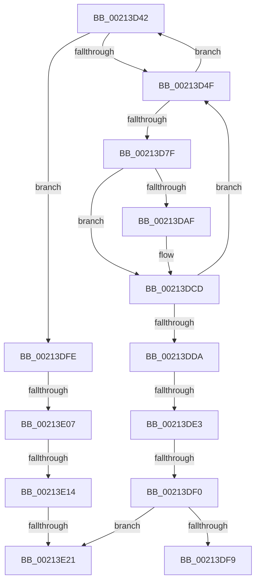

# sub_00213D42

- RVA: `0x00213D42`–`0x00213E3F` (길이 `253` bytes)
- VA: `0x0000000140213D42`
- 실행 섹션: `.text`
- PDB 이름 있음: `아니요`; PDB Function 태그: `아니요`
- unwind 정보 RVA: `0x0005E0C4`
- 디코드: `53`개 명령, `253/253` bytes 표시
- 미해석 바이트: `0` (있으면 어셈블리에 `.byte`로 보존)

> 이 문서는 커널 이미지의 기계어와 PDB 기호를 분석해 생성했습니다. 4번과 5번은 함수 원형과 자료형을 바이너리 사용 방식에서 추정한 C 해석이며 원본 소스 복구 결과는 아닙니다.

## 1. Dependencies

- 직접 호출 지점: **4**; 고유 호출 대상: **1**
- 직접 호출자로 확인된 함수: **0**
- RIP 상대 이미지 참조: **0**

### Outgoing calls
- `0x00213D67` → [KeBugCheckEx](../4F/KeBugCheckEx_function_004FD660.md) (function, `0x004FD660`)
- `0x00213D97` → [KeBugCheckEx](../4F/KeBugCheckEx_function_004FD660.md) (function, `0x004FD660`)
- `0x00213DC7` → [KeBugCheckEx](../4F/KeBugCheckEx_function_004FD660.md) (function, `0x004FD660`)
- `0x00213E39` → [KeBugCheckEx](../4F/KeBugCheckEx_function_004FD660.md) (function, `0x004FD660`)

### Direct callers
- 이 함수 시작 RVA로 연결되는 직접 call은 확인되지 않았습니다. 간접 호출은 완전히 역산할 수 없습니다.

### Static image references
- 디코드된 RIP-relative 메모리 참조가 없습니다.

## 2. Other-region calls and transfers

- 다른 실행 섹션으로 향하는 call: **0**
- call이 아닌 외부 분기/꼬리 이동: **6**
  - `0x00213DDD` → [sub_00213CA6 + 0x57](Unknown_function_00213CA6.md) (`tail-transfer`)
  - `0x00213DEA` → [sub_00213CA6 + 0x57](Unknown_function_00213CA6.md) (`tail-transfer`)
  - `0x00213DF9` → [sub_00213CA6 + 0x57](Unknown_function_00213CA6.md) (`tail-transfer`)
  - `0x00213E01` → [sub_00213CA6 + 0x1E](Unknown_function_00213CA6.md) (`tail-transfer`)
  - `0x00213E0E` → [sub_00213CA6 + 0x1E](Unknown_function_00213CA6.md) (`tail-transfer`)
  - `0x00213E1B` → [sub_00213CA6 + 0x1E](Unknown_function_00213CA6.md) (`tail-transfer`)

## 3. Assembly (complete function range)

```asm
00213D42  F6 82 C0 00 00 00 02            test byte ptr [rdx + 0xc0], 2
00213D49  0F 84 AF 00 00 00               je 0x140213dfe
00213D4F  45 33 C9                        xor r9d, r9d
00213D52  48 C7 44 24 20 00 00 00 00      mov qword ptr [rsp + 0x20], 0
00213D5B  45 33 C0                        xor r8d, r8d
00213D5E  B9 C6 01 00 00                  mov ecx, 0x1c6
00213D63  41 8D 51 06                     lea edx, [r9 + 6]
00213D67  E8 F4 98 2E 00                  call 0x1404fd660
00213D6C  CC                              int3
00213D6D  44 0F 20 C1                     mov rcx, cr8
00213D71  65 48 8B 14 25 88 01 00 00      mov rdx, qword ptr gs:[0x188]
00213D7A  80 F9 01                        cmp cl, 1
00213D7D  76 C3                           jbe 0x140213d42
00213D7F  33 D2                           xor edx, edx
00213D81  44 0F B6 C1                     movzx r8d, cl
00213D85  B9 C6 01 00 00                  mov ecx, 0x1c6
00213D8A  48 C7 44 24 20 00 00 00 00      mov qword ptr [rsp + 0x20], 0
00213D93  44 8D 4A 01                     lea r9d, [rdx + 1]
00213D97  E8 C4 98 2E 00                  call 0x1404fd660
00213D9C  CC                              int3
00213D9D  44 0F 20 C1                     mov rcx, cr8
00213DA1  65 48 8B 14 25 88 01 00 00      mov rdx, qword ptr gs:[0x188]
00213DAA  80 F9 01                        cmp cl, 1
00213DAD  76 1E                           jbe 0x140213dcd
00213DAF  33 D2                           xor edx, edx
00213DB1  44 0F B6 C1                     movzx r8d, cl
00213DB5  B9 C6 01 00 00                  mov ecx, 0x1c6
00213DBA  48 C7 44 24 20 00 00 00 00      mov qword ptr [rsp + 0x20], 0
00213DC3  44 8D 4A 01                     lea r9d, [rdx + 1]
00213DC7  E8 94 98 2E 00                  call 0x1404fd660
00213DCC  CC                              int3
00213DCD  F6 82 C0 00 00 00 02            test byte ptr [rdx + 0xc0], 2
00213DD4  0F 85 75 FF FF FF               jne 0x140213d4f
00213DDA  80 F9 01                        cmp cl, 1
00213DDD  0F 83 1A FF FF FF               jae 0x140213cfd
00213DE3  F7 42 74 00 04 00 00            test dword ptr [rdx + 0x74], 0x400
00213DEA  0F 85 0D FF FF FF               jne 0x140213cfd
00213DF0  83 BA E4 01 00 00 00            cmp dword ptr [rdx + 0x1e4], 0
00213DF7  74 28                           je 0x140213e21
00213DF9  E9 FF FE FF FF                  jmp 0x140213cfd
00213DFE  80 F9 01                        cmp cl, 1
00213E01  0F 83 BD FE FF FF               jae 0x140213cc4
00213E07  F7 42 74 00 04 00 00            test dword ptr [rdx + 0x74], 0x400
00213E0E  0F 85 B0 FE FF FF               jne 0x140213cc4
00213E14  83 BA E4 01 00 00 00            cmp dword ptr [rdx + 0x1e4], 0
00213E1B  0F 85 A3 FE FF FF               jne 0x140213cc4
00213E21  45 33 C9                        xor r9d, r9d
00213E24  48 C7 44 24 20 00 00 00 00      mov qword ptr [rsp + 0x20], 0
00213E2D  45 33 C0                        xor r8d, r8d
00213E30  B9 C6 01 00 00                  mov ecx, 0x1c6
00213E35  41 8D 51 07                     lea edx, [r9 + 7]
00213E39  E8 22 98 2E 00                  call 0x1404fd660
00213E3E  CC                              int3
```

## 4. C-style interpretation (structured pseudocode)

```c
__int64 __fastcall sub_00213D42(__int64 a1, __int64 a2, int a3, int a4)
{
    __int64 result;
    unsigned __int64 v_stack_p20;

    if (((*(unsigned __int8 *)(a2 + 192)) & (2)) == 0) goto loc_00213DFE;
loc_00213D4F:
    a4 = 0;
    v_stack_p20 = 0;
    a3 = 0;
    result = KeBugCheckEx(454, a4 + 6, a3, a4);
    if (((unsigned __int8)(v_cr8)) <= 1) goto loc_00213D42;
    a2 = 0;
    v_stack_p20 = 0;
    result = KeBugCheckEx(454, a2, (unsigned __int8)(v_cr8), a2 + 1);
    if (((unsigned __int8)(v_cr8)) >= = 1) {
        a2 = 0;
        a3 = (unsigned __int8)(v_cr8);
        a1 = 454;
        v_stack_p20 = 0;
        a4 = a2 + 1;
        result = KeBugCheckEx(a1, a2, a3, a4);
    }
    if (((*(unsigned __int8 *)(a2 + 192)) & (2)) != 0) goto loc_00213D4F;
    if ((*(unsigned int *)(a2 + 484)) == 0) goto loc_00213E21;
loc_00213DFE:
loc_00213E21:
    a4 = 0;
    v_stack_p20 = 0;
    a3 = 0;
    result = KeBugCheckEx(454, a4 + 7, a3, a4);
    return result;
}
```

## 5. (Beta) C Style

```c
int64_t sub_00213D42(int64_t Arg1, int64_t Arg2, int32_t Arg3, int32_t Arg4)
{
    int64_t result;
    uint64_t v_stack_p20;

    if (((*(uint8_t *)(Arg2 + 0xC0)) & (2)) == 0) goto loc_00213DFE;
loc_00213D4F:
    Arg4 = 0;
    v_stack_p20 = 0;
    Arg3 = 0;
    result = KeBugCheckEx(454, Arg4 + 6, Arg3, Arg4);
    if (((uint8_t)(v_cr8)) <= 1) goto loc_00213D42;
    Arg2 = 0;
    v_stack_p20 = 0;
    result = KeBugCheckEx(454, Arg2, (uint8_t)(v_cr8), Arg2 + 1);
    if (((uint8_t)(v_cr8)) >= = 1) {
        Arg2 = 0;
        Arg3 = (uint8_t)(v_cr8);
        Arg1 = 454;
        v_stack_p20 = 0;
        Arg4 = Arg2 + 1;
        result = KeBugCheckEx(Arg1, Arg2, Arg3, Arg4);
    }
    if (((*(uint8_t *)(Arg2 + 0xC0)) & (2)) != 0) goto loc_00213D4F;
    if ((*(uint32_t *)(Arg2 + 0x1E4)) == 0) goto loc_00213E21;
loc_00213DFE:
loc_00213E21:
    Arg4 = 0;
    v_stack_p20 = 0;
    Arg3 = 0;
    result = KeBugCheckEx(454, Arg4 + 7, Arg3, Arg4);
    return result;
}
```

## 6. Execution-region graph

[열기: 2D/3D 그래프와 함수 탐색 컨트롤 패널](../../../control-panel.html?section=text&rva=0x00213D42&view=graph)

- 2D 그래프는 위에서 아래로 흐르고, 3D 그래프는 빈 공간을 드래그해 회전합니다. Shift+드래그는 이동, 휠은 확대·축소, 함수 노드 선택은 대상 보고서 이동입니다.

### Static fallback


