# sub_00213F4F

- RVA: `0x00213F4F`–`0x002142EA` (길이 `923` bytes)
- VA: `0x0000000140213F4F`
- 실행 섹션: `.text`
- PDB 이름 있음: `아니요`; PDB Function 태그: `아니요`
- unwind 정보 RVA: `0x0005E0F4`
- 디코드: `227`개 명령, `923/923` bytes 표시
- 미해석 바이트: `0` (있으면 어셈블리에 `.byte`로 보존)

> 이 문서는 커널 이미지의 기계어와 PDB 기호를 분석해 생성했습니다. 4번과 5번은 함수 원형과 자료형을 바이너리 사용 방식에서 추정한 C 해석이며 원본 소스 복구 결과는 아닙니다.

## 1. Dependencies

- 직접 호출 지점: **10**; 고유 호출 대상: **8**
- 직접 호출자로 확인된 함수: **0**
- RIP 상대 이미지 참조: **5**

### Outgoing calls
- `0x00214125` → [ObfReferenceObjectWithTag](ObfReferenceObjectWithTag_function_00210710.md) (function, `0x00210710`)
- `0x00214164` → [KxWaitForLockChainValid](KxWaitForLockChainValid_function_00217AA0.md) (function, `0x00217AA0`)
- `0x00214185` → [KeWakeAddressAll](KeWakeAddressAll_function_00217C20.md) (function, `0x00217C20`)
- `0x00214196` → [KiFlushSoftwareInterruptBatch](../25/KiFlushSoftwareInterruptBatch_function_00252200.md) (function, `0x00252200`)
- `0x002141A2` → [KiCheckForThreadDispatch](../25/KiCheckForThreadDispatch_function_00250648.md) (function, `0x00250648`)
- `0x002141CA` → [ObpPushStackInfo](ObpPushStackInfo_function_002109E4.md) (function, `0x002109E4`)
- `0x00214272` → [KxWaitForLockChainValid](KxWaitForLockChainValid_function_00217AA0.md) (function, `0x00217AA0`)
- `0x0021428F` → [KeWakeAddressAll](KeWakeAddressAll_function_00217C20.md) (function, `0x00217C20`)
- `0x002142A8` → [KiReleaseQueuedSpinLockInstrumented](KiReleaseQueuedSpinLockInstrumented_function_002179F0.md) (function, `0x002179F0`)
- `0x002142C1` → [KiLowerIrqlProcessIrqlFlags](../4F/KiLowerIrqlProcessIrqlFlags_function_004F5698.md) (function, `0x004F5698`)

### Direct callers
- 이 함수 시작 RVA로 연결되는 직접 call은 확인되지 않았습니다. 간접 호출은 완전히 역산할 수 없습니다.

### Static image references
- `0x00213FC9` → RVA `0x00FC6D20` (`ALMOSTRO`; read)
- `0x00213FD5` → RVA `0x00FC6B06` (`ALMOSTRO`; read)
- `0x0021408C` → RVA `0x00FC6F88` (`ALMOSTRO`; read)
- `0x002141AE` → RVA `0x00FC5010` (`ALMOSTRO`; read)
- `0x00214296` → RVA `0x00F0DE58` (`.data`; read)

## 2. Other-region calls and transfers

- 다른 실행 섹션으로 향하는 call: **0**
- call이 아닌 외부 분기/꼬리 이동: **17**
  - `0x00213F8A` → [sub_002142F9 + 0x5EB](Unknown_function_002142F9.md) (`tail-transfer`)
  - `0x00213FCF` → [sub_002142F9 + 0x216](Unknown_function_002142F9.md) (`tail-transfer`)
  - `0x00213FE0` → [sub_002142F9 + 0xF](Unknown_function_002142F9.md) (`tail-transfer`)
  - `0x00213FF0` → [sub_002142F9 + 0x604](Unknown_function_002142F9.md) (`tail-transfer`)
  - `0x00214041` → [sub_002142F9](Unknown_function_002142F9.md) (`tail-transfer`)
  - `0x00214099` → [sub_002142F9 + 0x8B3](Unknown_function_002142F9.md) (`tail-transfer`)
  - `0x002140B1` → [sub_002142F9 + 0xAC0](Unknown_function_002142F9.md) (`tail-transfer`)
  - `0x002140EE` → [sub_002142F9 + 0x74B](Unknown_function_002142F9.md) (`tail-transfer`)
  - `0x00214131` → [sub_002142F9 + 0x2E](Unknown_function_002142F9.md) (`tail-transfer`)
  - `0x0021415A` → [sub_002142F9 + 0x49](Unknown_function_002142F9.md) (`tail-transfer`)
  - `0x0021417F` → [sub_002142F9 + 0x49](Unknown_function_002142F9.md) (`tail-transfer`)
  - `0x0021418A` → [sub_002142F9 + 0x49](Unknown_function_002142F9.md) (`tail-transfer`)
  - `0x002141E0` → [sub_002142F9 + 0x6F1](Unknown_function_002142F9.md) (`tail-transfer`)
  - `0x00214207` → [sub_002142F9 + 0x5A8](Unknown_function_002142F9.md) (`tail-transfer`)
  - `0x00214218` → [sub_002142F9 + 0x1F7](Unknown_function_002142F9.md) (`tail-transfer`)
  - `0x00214228` → [sub_002142F9 + 0x686](Unknown_function_002142F9.md) (`tail-transfer`)
  - `0x00214239` → [sub_002142F9 + 0x227](Unknown_function_002142F9.md) (`tail-transfer`)

## 3. Assembly (complete function range)

```asm
00213F4F  49 89 5B 18                     mov qword ptr [r11 + 0x18], rbx
00213F53  41 8B 98 A0 05 00 00            mov ebx, dword ptr [r8 + 0x5a0]
00213F5A  C1 EB 09                        shr ebx, 9
00213F5D  48 8B 80 A0 02 00 00            mov rax, qword ptr [rax + 0x2a0]
00213F64  83 E3 07                        and ebx, 7
00213F67  49 89 7B D8                     mov qword ptr [r11 - 0x28], rdi
00213F6B  4D 89 6B D0                     mov qword ptr [r11 - 0x30], r13
00213F6F  4D 89 7B C8                     mov qword ptr [r11 - 0x38], r15
00213F73  48 85 C0                        test rax, rax
00213F76  74 0B                           je 0x140213f83
00213F78  8B 80 3C 04 00 00               mov eax, dword ptr [rax + 0x43c]
00213F7E  3B D8                           cmp ebx, eax
00213F80  0F 4D D8                        cmovge ebx, eax
00213F83  B9 02 00 00 00                  mov ecx, 2
00213F88  3B D9                           cmp ebx, ecx
00213F8A  0F 8C 54 09 00 00               jl 0x1402148e4
00213F90  7F 02                           jg 0x140213f94
00213F92  8B D9                           mov ebx, ecx
00213F94  41 8B C4                        mov eax, r12d
00213F97  49 8D 7E 60                     lea rdi, [r14 + 0x60]
00213F9B  25 00 FF 00 00                  and eax, 0xff00
00213FA0  48 89 7D DF                     mov qword ptr [rbp - 0x21], rdi
00213FA4  89 45 F3                        mov dword ptr [rbp - 0xd], eax
00213FA7  41 8B C4                        mov eax, r12d
00213FAA  83 E0 04                        and eax, 4
00213FAD  44 23 E1                        and r12d, ecx
00213FB0  89 45 EF                        mov dword ptr [rbp - 0x11], eax
00213FB3  33 C0                           xor eax, eax
00213FB5  48 89 45 D7                     mov qword ptr [rbp - 0x29], rax
00213FB9  44 8B E8                        mov r13d, eax
00213FBC  90                              nop
00213FBD  44 89 65 6F                     mov dword ptr [rbp + 0x6f], r12d
00213FC1  45 0F 20 C7                     mov r15, cr8
00213FC5  44 0F 22 C1                     mov cr8, rcx
00213FC9  39 05 51 2D DB 00               cmp dword ptr [rip + 0xdb2d51], eax
00213FCF  0F 85 3A 05 00 00               jne 0x14021450f
00213FD5  F6 05 2A 2B DB 00 21            test byte ptr [rip + 0xdb2b2a], 0x21
00213FDC  44 88 7D E7                     mov byte ptr [rbp - 0x19], r15b
00213FE0  0F 85 22 03 00 00               jne 0x140214308
00213FE6  48 8D 55 D7                     lea rdx, [rbp - 0x29]
00213FEA  48 87 17                        xchg qword ptr [rdi], rdx
00213FED  48 85 D2                        test rdx, rdx
00213FF0  0F 85 07 09 00 00               jne 0x1402148fd
00213FF6  44 8B 45 EF                     mov r8d, dword ptr [rbp - 0x11]
00213FFA  45 85 C0                        test r8d, r8d
00213FFD  74 06                           je 0x140214005
00213FFF  66 41 83 4E 1A 04               or word ptr [r14 + 0x1a], 4
00214005  45 85 E4                        test r12d, r12d
00214008  74 06                           je 0x140214010
0021400A  66 41 83 4E 1A 02               or word ptr [r14 + 0x1a], 2
00214010  44 39 6D F3                     cmp dword ptr [rbp - 0xd], r13d
00214014  74 21                           je 0x140214037
00214016  0F B6 96 C3 00 00 00            movzx edx, byte ptr [rsi + 0xc3]
0021401D  41 0F B6 46 1B                  movzx eax, byte ptr [r14 + 0x1b]
00214022  0F BE CA                        movsx ecx, dl
00214025  3B C8                           cmp ecx, eax
00214027  7E 0E                           jle 0x140214037
00214029  B9 0F 00 00 00                  mov ecx, 0xf
0021402E  3A D1                           cmp dl, cl
00214030  0F 42 CA                        cmovb ecx, edx
00214033  41 88 4E 1B                     mov byte ptr [r14 + 0x1b], cl
00214037  41 8B 46 38                     mov eax, dword ptr [r14 + 0x38]
0021403B  49 8B 7E 30                     mov rdi, qword ptr [r14 + 0x30]
0021403F  A8 02                           test al, 2
00214041  0F 84 B2 02 00 00               je 0x1402142f9
00214047  48 83 E7 FC                     and rdi, 0xfffffffffffffffc
0021404B  48 85 FF                        test rdi, rdi
0021404E  0F 84 DE 01 00 00               je 0x140214232
00214054  45 85 C0                        test r8d, r8d
00214057  74 63                           je 0x1402140bc
00214059  A8 01                           test al, 1
0021405B  75 5F                           jne 0x1402140bc
0021405D  48 8B 87 20 02 00 00            mov rax, qword ptr [rdi + 0x220]
00214064  8B 8F A0 05 00 00               mov ecx, dword ptr [rdi + 0x5a0]
0021406A  C1 E9 09                        shr ecx, 9
0021406D  83 E1 07                        and ecx, 7
00214070  48 8B 80 A0 02 00 00            mov rax, qword ptr [rax + 0x2a0]
00214077  48 85 C0                        test rax, rax
0021407A  74 0B                           je 0x140214087
0021407C  8B 80 3C 04 00 00               mov eax, dword ptr [rax + 0x43c]
00214082  3B C8                           cmp ecx, eax
00214084  0F 4D C8                        cmovge ecx, eax
00214087  83 F9 02                        cmp ecx, 2
0021408A  73 30                           jae 0x1402140bc
0021408C  83 3D F5 2E DB 00 00            cmp dword ptr [rip + 0xdb2ef5], 0
00214093  41 BD 04 00 00 00               mov r13d, 4
00214099  0F 85 0D 0B 00 00               jne 0x140214bac
0021409F  BE 01 00 00 00                  mov esi, 1
002140A4  F0 0F C1 B7 E0 05 00 00         lock xadd dword ptr [rdi + 0x5e0], esi
002140AC  FF C6                           inc esi
002140AE  83 FE 01                        cmp esi, 1
002140B1  0F 84 02 0D 00 00               je 0x140214db9
002140B7  41 83 4E 38 01                  or dword ptr [r14 + 0x38], 1
002140BC  45 85 E4                        test r12d, r12d
002140BF  74 36                           je 0x1402140f7
002140C1  41 8B 46 38                     mov eax, dword ptr [r14 + 0x38]
002140C5  49 8D 4E 38                     lea rcx, [r14 + 0x38]
002140C9  A8 04                           test al, 4
002140CB  75 2A                           jne 0x1402140f7
002140CD  41 83 CD 02                     or r13d, 2
002140D1  B8 01 00 00 00                  mov eax, 1
002140D6  F0 0F C1 87 E4 05 00 00         lock xadd dword ptr [rdi + 0x5e4], eax
002140DE  FF C0                           inc eax
002140E0  83 F8 01                        cmp eax, 1
002140E3  75 0F                           jne 0x1402140f4
002140E5  0F B6 87 18 03 00 00            movzx eax, byte ptr [rdi + 0x318]
002140EC  84 C0                           test al, al
002140EE  0F 85 50 09 00 00               jne 0x140214a44
002140F4  83 09 04                        or dword ptr [rcx], 4
002140F7  83 7D F3 00                     cmp dword ptr [rbp - 0xd], 0
002140FB  74 17                           je 0x140214114
002140FD  0F BE 8F C3 00 00 00            movsx ecx, byte ptr [rdi + 0xc3]
00214104  41 0F B6 46 1B                  movzx eax, byte ptr [r14 + 0x1b]
00214109  3B C1                           cmp eax, ecx
0021410B  7E 07                           jle 0x140214114
0021410D  41 81 CD 00 FF 00 00            or r13d, 0xff00
00214114  45 85 ED                        test r13d, r13d
00214117  0F 84 11 01 00 00               je 0x14021422e
0021411D  BA 44 66 6C 74                  mov edx, 0x746c6644
00214122  48 8B CF                        mov rcx, rdi
00214125  E8 E6 C5 FF FF                  call 0x140210710
0021412A  F6 05 D5 29 DB 00 01            test byte ptr [rip + 0xdb29d5], 1
00214131  0F 85 F0 01 00 00               jne 0x140214327
00214137  0F 0D 4D D7                     prefetchw byte ptr [rbp - 0x29]
0021413B  48 8B 45 D7                     mov rax, qword ptr [rbp - 0x29]
0021413F  33 F6                           xor esi, esi
00214141  48 85 C0                        test rax, rax
00214144  75 23                           jne 0x140214169
00214146  48 8B 4D DF                     mov rcx, qword ptr [rbp - 0x21]
0021414A  48 8D 45 D7                     lea rax, [rbp - 0x29]
0021414E  F0 48 0F B1 31                  lock cmpxchg qword ptr [rcx], rsi
00214153  48 8D 4D D7                     lea rcx, [rbp - 0x29]
00214157  48 3B C1                        cmp rax, rcx
0021415A  0F 84 E2 01 00 00               je 0x140214342
00214160  48 8D 4D D7                     lea rcx, [rbp - 0x29]
00214164  E8 37 39 00 00                  call 0x140217aa0
00214169  48 8D 48 08                     lea rcx, [rax + 8]
0021416D  48 89 75 D7                     mov qword ptr [rbp - 0x29], rsi
00214171  48 8B 55 DF                     mov rdx, qword ptr [rbp - 0x21]
00214175  48 8B C2                        mov rax, rdx
00214178  48 87 01                        xchg qword ptr [rcx], rax
0021417B  32 C2                           xor al, dl
0021417D  A8 04                           test al, 4
0021417F  0F 84 BD 01 00 00               je 0x140214342
00214185  E8 96 3A 00 00                  call 0x140217c20
0021418A  E9 B3 01 00 00                  jmp 0x140214342
0021418F  49 8D 8D D8 35 00 00            lea rcx, [r13 + 0x35d8]
00214196  E8 65 E0 03 00                  call 0x140252200
0021419B  0F B6 55 7F                     movzx edx, byte ptr [rbp + 0x7f]
0021419F  49 8B CD                        mov rcx, r13
002141A2  E8 A1 C4 03 00                  call 0x140250648
002141A7  44 8B 65 6F                     mov r12d, dword ptr [rbp + 0x6f]
002141AB  45 33 FF                        xor r15d, r15d
002141AE  44 39 3D 5B 0E DB 00            cmp dword ptr [rip + 0xdb0e5b], r15d
002141B5  45 8B EF                        mov r13d, r15d
002141B8  74 15                           je 0x1402141cf
002141BA  33 D2                           xor edx, edx
002141BC  45 8D 47 01                     lea r8d, [r15 + 1]
002141C0  41 B9 44 66 6C 74               mov r9d, 0x746c6644
002141C6  48 8D 4F D0                     lea rcx, [rdi - 0x30]
002141CA  E8 15 C8 FF FF                  call 0x1402109e4
002141CF  48 C7 C0 FF FF FF FF            mov rax, 0xffffffffffffffff
002141D6  F0 48 0F C1 47 D0               lock xadd qword ptr [rdi - 0x30], rax
002141DC  48 83 E8 01                     sub rax, 1
002141E0  0F 8E 04 08 00 00               jle 0x1402149ea
002141E6  49 8D 7E 60                     lea rdi, [r14 + 0x60]
002141EA  4C 89 7D D7                     mov qword ptr [rbp - 0x29], r15
002141EE  48 89 7D DF                     mov qword ptr [rbp - 0x21], rdi
002141F2  90                              nop
002141F3  44 0F 20 C6                     mov rsi, cr8
002141F7  B8 02 00 00 00                  mov eax, 2
002141FC  44 0F 22 C0                     mov cr8, rax
00214200  44 39 2D 19 2B DB 00            cmp dword ptr [rip + 0xdb2b19], r13d
00214207  0F 85 94 06 00 00               jne 0x1402148a1
0021420D  F6 05 F2 28 DB 00 21            test byte ptr [rip + 0xdb28f2], 0x21
00214214  40 88 75 E7                     mov byte ptr [rbp - 0x19], sil
00214218  0F 85 D2 02 00 00               jne 0x1402144f0
0021421E  48 8D 55 D7                     lea rdx, [rbp - 0x29]
00214222  48 87 17                        xchg qword ptr [rdi], rdx
00214225  48 85 D2                        test rdx, rdx
00214228  0F 85 51 07 00 00               jne 0x14021497f
0021422E  44 8B 45 EF                     mov r8d, dword ptr [rbp - 0x11]
00214232  41 0F B6 46 1A                  movzx eax, byte ptr [r14 + 0x1a]
00214237  84 C0                           test al, al
00214239  0F 89 E1 02 00 00               jns 0x140214520
0021423F  45 33 E4                        xor r12d, r12d
00214242  F6 05 BD 28 DB 00 01            test byte ptr [rip + 0xdb28bd], 1
00214249  75 4B                           jne 0x140214296
0021424B  0F 0D 4D D7                     prefetchw byte ptr [rbp - 0x29]
0021424F  48 8B 45 D7                     mov rax, qword ptr [rbp - 0x29]
00214253  48 85 C0                        test rax, rax
00214256  75 1F                           jne 0x140214277
00214258  48 8B 4D DF                     mov rcx, qword ptr [rbp - 0x21]
0021425C  48 8D 45 D7                     lea rax, [rbp - 0x29]
00214260  F0 4C 0F B1 21                  lock cmpxchg qword ptr [rcx], r12
00214265  48 8D 4D D7                     lea rcx, [rbp - 0x29]
00214269  48 3B C1                        cmp rax, rcx
0021426C  74 3F                           je 0x1402142ad
0021426E  48 8D 4D D7                     lea rcx, [rbp - 0x29]
00214272  E8 29 38 00 00                  call 0x140217aa0
00214277  48 8D 48 08                     lea rcx, [rax + 8]
0021427B  4C 89 65 D7                     mov qword ptr [rbp - 0x29], r12
0021427F  48 8B 55 DF                     mov rdx, qword ptr [rbp - 0x21]
00214283  48 8B C2                        mov rax, rdx
00214286  48 87 01                        xchg qword ptr [rcx], rax
00214289  32 C2                           xor al, dl
0021428B  A8 04                           test al, 4
0021428D  74 1E                           je 0x1402142ad
0021428F  E8 8C 39 00 00                  call 0x140217c20
00214294  EB 17                           jmp 0x1402142ad
00214296  8B 05 BC 9B CF 00               mov eax, dword ptr [rip + 0xcf9bbc]
0021429C  85 C0                           test eax, eax
0021429E  75 AB                           jne 0x14021424b
002142A0  48 8B 55 5F                     mov rdx, qword ptr [rbp + 0x5f]
002142A4  48 8D 4D D7                     lea rcx, [rbp - 0x29]
002142A8  E8 43 37 00 00                  call 0x1402179f0
002142AD  83 3D 6C 2A DB 00 00            cmp dword ptr [rip + 0xdb2a6c], 0
002142B4  0F B6 5D E7                     movzx ebx, byte ptr [rbp - 0x19]
002142B8  74 0C                           je 0x1402142c6
002142BA  44 0F 20 C1                     mov rcx, cr8
002142BE  0F B6 D3                        movzx edx, bl
002142C1  E8 D2 13 2E 00                  call 0x1404f5698
002142C6  44 0F 22 C3                     mov cr8, rbx
002142CA  4C 8B AC 24 88 00 00 00         mov r13, qword ptr [rsp + 0x88]
002142D2  48 8B BC 24 90 00 00 00         mov rdi, qword ptr [rsp + 0x90]
002142DA  48 8B 9C 24 D0 00 00 00         mov rbx, qword ptr [rsp + 0xd0]
002142E2  4C 8B BC 24 80 00 00 00         mov r15, qword ptr [rsp + 0x80]
```

## 4. C-style interpretation (structured pseudocode)

```c
__int64 __fastcall sub_00213F4F(__int64 a1, __int64 a2, __int64 a3, __int64 a4, __int64 a5, __int64 a6, __int64 a7, __int64 a8, __int64 a9, __int64 a10, __int64 a11, __int64 a12, __int64 a13, __int64 a14, __int64 a15, __int64 a16, __int64 a17, __int64 a18, __int64 a19, __int64 a20, __int64 a21, __int64 a22, __int64 a23, __int64 a24, __int64 a25, __int64 a26)
{
    __int64 result;
    __int64 v_r12;
    __int64 v_r13;
    __int64 v_rbx;
    __int64 v_rdi;
    __int64 v_rsi;

    *(unsigned __int64 *)(v_r11 + 24) = v_rbx;
    v_rbx = (unsigned int)(((unsigned int)(*(unsigned int *)(a3 + 1440))) >> (9));
    v_rbx = (unsigned int)((v_rbx) & (7));
    *(unsigned __int64 *)(v_r11 - 40) = v_rdi;
    *(unsigned __int64 *)(v_r11 - 48) = v_r13;
    *(unsigned __int64 *)(v_r11 - 56) = v_r15;
    result = *(unsigned __int64 *)(result + 672);
    if (*(unsigned __int64 *)(result + 672) != 0) {
        result = *(unsigned int *)(*(unsigned __int64 *)(result + 672) + 1084);
        if (((unsigned int)(v_rbx)) >= ((unsigned int)(result))) { v_rbx = (unsigned int)(result); }
    }
    if (((unsigned int)(v_rbx)) <= 2) {
        v_rbx = 2;
    }
    result = (unsigned int)(((unsigned int)((unsigned int)(v_r12))) & (0xFF00ULL));
    *(unsigned __int64 *)(v_rbp - 33) = v_r14 + 96;
    *(unsigned int *)(v_rbp - 13) = (unsigned int)(result);
    result = (unsigned int)(((unsigned int)((unsigned int)(v_r12))) & (4));
    v_r12 = (unsigned int)((v_r12) & (2));
    *(unsigned int *)(v_rbp - 17) = (unsigned int)(result);
    result = 0;
    *(unsigned __int64 *)(v_rbp - 41) = 0;
    *(unsigned int *)(v_rbp + 111) = (unsigned int)(v_r12);
    *(unsigned __int8 *)(v_rbp - 25) = (unsigned __int8)(v_cr8);
    if ((unsigned int)((unsigned int)(*(unsigned int *)(v_rbp - 17))) != 0) {
    }
    if ((unsigned int)(v_r12) != 0) {
    }
    if ((*(unsigned int *)(v_rbp - 13)) == 0) goto loc_00214037;
    if (((unsigned int)((__int8)((unsigned __int8)(*(unsigned __int8 *)(v_rsi + 195))))) >= = ((unsigned int)(*(unsigned __int8 *)(v_r14 + 27)))) {
        a1 = 15;
        if (((unsigned __int8)(*(unsigned __int8 *)(v_rsi + 195))) < ((unsigned __int8)(a1))) { a1 = (unsigned int)(*(unsigned __int8 *)(v_rsi + 195)); }
        *(unsigned __int8 *)(v_r14 + 27) = (unsigned __int8)(a1);
    }
    v_rdi = (*(unsigned __int64 *)(v_r14 + 48)) & (-4);
    if (v_rdi == 0) goto loc_00214232;
    if ((unsigned int)((unsigned int)(*(unsigned int *)(v_rbp - 17))) == 0) goto loc_002140BC;
    if ((((unsigned __int8)((unsigned int)(*(unsigned int *)(v_r14 + 56)))) & (1)) != 0) goto loc_002140BC;
    a1 = (unsigned int)(((unsigned int)(*(unsigned int *)(v_rdi + 1440))) >> (9));
    a1 = (unsigned int)((a1) & (7));
    result = *(unsigned __int64 *)(*(unsigned __int64 *)(v_rdi + 544) + 672);
    if (*(unsigned __int64 *)(*(unsigned __int64 *)(v_rdi + 544) + 672) != 0) {
        result = *(unsigned int *)(*(unsigned __int64 *)(*(unsigned __int64 *)(v_rdi + 544) + 672) + 1084);
        if (((unsigned int)(a1)) >= ((unsigned int)(result))) { a1 = (unsigned int)(result); }
    }
    if (((unsigned int)(a1)) >= 2) goto loc_002140BC;
    v_rsi = (unsigned int)((1) + 1);
loc_002140BC:
    if ((unsigned int)(v_r12) == 0) goto loc_002140F7;
    if ((((unsigned __int8)((unsigned int)(*(unsigned int *)(v_r14 + 56)))) & (4)) != 0) goto loc_002140F7;
    v_r13 = (unsigned int)((4) | (2));
    result = (unsigned int)((1) + 1);
    if (((unsigned int)(result)) != 1) goto loc_002140F4;
loc_002140F4:
loc_002140F7:
    if ((*(unsigned int *)(v_rbp - 13)) == 0) goto loc_00214114;
    if (((unsigned int)(*(unsigned __int8 *)(v_r14 + 27))) >= = ((unsigned int)((__int8)(*(unsigned __int8 *)(v_rdi + 195))))) {
        v_r13 = (unsigned int)((v_r13) | (0xFF00ULL));
    }
    if ((unsigned int)(v_r13) == 0) goto loc_0021422E;
    result = ObfReferenceObjectWithTag(v_rdi, (unsigned int)(0x746C6644ULL), (unsigned int)(*(unsigned int *)(v_rbp - 17)), a4);
    v_rsi = 0;
    if (*(unsigned __int64 *)(v_rbp - 41) != 0) goto loc_00214169;
    result = KxWaitForLockChainValid(v_rbp - 41, (unsigned int)(0x746C6644ULL), (unsigned int)(*(unsigned int *)(v_rbp - 17)), a4);
loc_00214169:
    *(unsigned __int64 *)(v_rbp - 41) = 0;
    result = (unsigned __int8)((*(unsigned __int64 *)(v_rbp - 33)) ^ ((unsigned __int8)(*(unsigned __int64 *)(v_rbp - 33))));
    result = KeWakeAddressAll(result + 8, *(unsigned __int64 *)(v_rbp - 33), (unsigned int)(*(unsigned int *)(v_rbp - 17)), a4);
loc_0021422E:
loc_00214232:
    v_r12 = 0;
    if (((*(unsigned __int8 *)(v_rip + 14362813)) & (1)) != 0) goto loc_00214296;
loc_0021424B:
    if (*(unsigned __int64 *)(v_rbp - 41) != 0) goto loc_00214277;
    if ((v_rbp - 41) == (v_rbp - 41)) goto loc_002142AD;
    result = KxWaitForLockChainValid(v_rbp - 41, *(unsigned __int64 *)(v_rbp - 33), (unsigned int)(*(unsigned int *)(v_rbp - 17)), a4);
loc_00214277:
    *(unsigned __int64 *)(v_rbp - 41) = 0;
    result = (unsigned __int8)((*(unsigned __int64 *)(v_rbp - 33)) ^ ((unsigned __int8)(*(unsigned __int64 *)(v_rbp - 33))));
    if ((((unsigned __int8)(result)) & (4)) == 0) goto loc_002142AD;
    result = KeWakeAddressAll(result + 8, *(unsigned __int64 *)(v_rbp - 33), (unsigned int)(*(unsigned int *)(v_rbp - 17)), a4);
    goto loc_002142AD;
loc_00214296:
    if ((unsigned int)((unsigned int)(*(unsigned int *)(v_rip + 13605820))) != 0) goto loc_0021424B;
    result = KiReleaseQueuedSpinLockInstrumented(v_rbp - 41, *(unsigned __int64 *)(v_rbp + 95), (unsigned int)(*(unsigned int *)(v_rbp - 17)), a4);
loc_002142AD:
    if ((*(unsigned int *)(v_rip + 14363244)) != 0) {
        a1 = 2;
        a2 = (unsigned __int8)(*(unsigned __int8 *)(v_rbp - 25));
        result = KiLowerIrqlProcessIrqlFlags(a1, a2, (unsigned int)(*(unsigned int *)(v_rbp - 17)), a4);
    }
    return result;
}
```

## 5. (Beta) C Style

```c
int64_t sub_00213F4F(int64_t Arg1, int64_t Arg2, void *Arg3, int64_t Arg4, uint64_t Arg5, uint64_t Arg6, uint64_t Arg7, uint64_t Arg8, uint64_t Arg9, uint64_t Arg10, uint64_t Arg11, uint64_t Arg12, uint64_t Arg13, uint64_t Arg14, uint64_t Arg15, int64_t Arg16, int64_t Arg17, int64_t Arg18, uint64_t Arg19, uint64_t Arg20, uint64_t Arg21, uint64_t Arg22, uint64_t Arg23, uint64_t Arg24, uint64_t Arg25, int64_t Arg26)
{
    uint8_t *arg3 = (uint8_t *)Arg3;

    int64_t result;
    int64_t local_r12;
    int64_t local_r13;
    int64_t local_rbx;
    int64_t local_rdi;
    int64_t local_rsi;

    *(uint64_t *)(local_r11 + 0x18) = local_rbx;
    local_rbx = (uint32_t)(((uint32_t)(*(uint32_t *)(arg3 + 0x5A0))) >> (9));
    local_rbx = (uint32_t)((local_rbx) & (7));
    *(uint64_t *)(local_r11 - 0x28) = local_rdi;
    *(uint64_t *)(local_r11 - 0x30) = local_r13;
    *(uint64_t *)(local_r11 - 0x38) = local_r15;
    result = *(uint64_t *)(result + 0x2A0);
    if (*(uint64_t *)(result + 0x2A0) != 0) {
        result = *(uint32_t *)(*(uint64_t *)(result + 0x2A0) + 0x43C);
        if (((uint32_t)(local_rbx)) >= ((uint32_t)(result))) { local_rbx = (uint32_t)(result); }
    }
    if (((uint32_t)(local_rbx)) <= 2) {
        local_rbx = 2;
    }
    result = (uint32_t)(((uint32_t)((uint32_t)(local_r12))) & (0xFF00ULL));
    *(uint64_t *)(local_rbp - 0x21) = local_r14 + 96;
    *(uint32_t *)(local_rbp - 0xD) = (uint32_t)(result);
    result = (uint32_t)(((uint32_t)((uint32_t)(local_r12))) & (4));
    local_r12 = (uint32_t)((local_r12) & (2));
    *(uint32_t *)(local_rbp - 0x11) = (uint32_t)(result);
    result = 0;
    *(uint64_t *)(local_rbp - 0x29) = 0;
    *(uint32_t *)(local_rbp + 0x6F) = (uint32_t)(local_r12);
    *(uint8_t *)(local_rbp - 0x19) = (uint8_t)(v_cr8);
    if ((uint32_t)((uint32_t)(*(uint32_t *)(local_rbp - 0x11))) != 0) {
    }
    if ((uint32_t)(local_r12) != 0) {
    }
    if ((*(uint32_t *)(local_rbp - 0xD)) == 0) goto loc_00214037;
    if (((uint32_t)((int8_t)((uint8_t)(*(uint8_t *)(local_rsi + 0xC3))))) >= = ((uint32_t)(*(uint8_t *)(local_r14 + 0x1B)))) {
        Arg1 = 15;
        if (((uint8_t)(*(uint8_t *)(local_rsi + 0xC3))) < ((uint8_t)(Arg1))) { Arg1 = (uint32_t)(*(uint8_t *)(local_rsi + 0xC3)); }
        *(uint8_t *)(local_r14 + 0x1B) = (uint8_t)(Arg1);
    }
    local_rdi = (*(uint64_t *)(local_r14 + 0x30)) & (-4);
    if (local_rdi == 0) goto loc_00214232;
    if ((uint32_t)((uint32_t)(*(uint32_t *)(local_rbp - 0x11))) == 0) goto loc_002140BC;
    if ((((uint8_t)((uint32_t)(*(uint32_t *)(local_r14 + 0x38)))) & (1)) != 0) goto loc_002140BC;
    Arg1 = (uint32_t)(((uint32_t)(*(uint32_t *)(local_rdi + 0x5A0))) >> (9));
    Arg1 = (uint32_t)((Arg1) & (7));
    result = *(uint64_t *)(*(uint64_t *)(local_rdi + 0x220) + 0x2A0);
    if (*(uint64_t *)(*(uint64_t *)(local_rdi + 0x220) + 0x2A0) != 0) {
        result = *(uint32_t *)(*(uint64_t *)(*(uint64_t *)(local_rdi + 0x220) + 0x2A0) + 0x43C);
        if (((uint32_t)(Arg1)) >= ((uint32_t)(result))) { Arg1 = (uint32_t)(result); }
    }
    if (((uint32_t)(Arg1)) >= 2) goto loc_002140BC;
    local_rsi = (uint32_t)((1) + 1);
loc_002140BC:
    if ((uint32_t)(local_r12) == 0) goto loc_002140F7;
    if ((((uint8_t)((uint32_t)(*(uint32_t *)(local_r14 + 0x38)))) & (4)) != 0) goto loc_002140F7;
    local_r13 = (uint32_t)((4) | (2));
    result = (uint32_t)((1) + 1);
    if (((uint32_t)(result)) != 1) goto loc_002140F4;
loc_002140F4:
loc_002140F7:
    if ((*(uint32_t *)(local_rbp - 0xD)) == 0) goto loc_00214114;
    if (((uint32_t)(*(uint8_t *)(local_r14 + 0x1B))) >= = ((uint32_t)((int8_t)(*(uint8_t *)(local_rdi + 0xC3))))) {
        local_r13 = (uint32_t)((local_r13) | (0xFF00ULL));
    }
    if ((uint32_t)(local_r13) == 0) goto loc_0021422E;
    result = ObfReferenceObjectWithTag(local_rdi, (uint32_t)(0x746C6644ULL), (uint32_t)(*(uint32_t *)(local_rbp - 0x11)), Arg4);
    local_rsi = 0;
    if (*(uint64_t *)(local_rbp - 0x29) != 0) goto loc_00214169;
    result = KxWaitForLockChainValid(local_rbp - 41, (uint32_t)(0x746C6644ULL), (uint32_t)(*(uint32_t *)(local_rbp - 0x11)), Arg4);
loc_00214169:
    *(uint64_t *)(local_rbp - 0x29) = 0;
    result = (uint8_t)((*(uint64_t *)(local_rbp - 0x21)) ^ ((uint8_t)(*(uint64_t *)(local_rbp - 0x21))));
    result = KeWakeAddressAll(result + 8, *(uint64_t *)(local_rbp - 0x21), (uint32_t)(*(uint32_t *)(local_rbp - 0x11)), Arg4);
loc_0021422E:
loc_00214232:
    local_r12 = 0;
    if (((*(uint8_t *)(v_rip + 0xDB28BD)) & (1)) != 0) goto loc_00214296;
loc_0021424B:
    if (*(uint64_t *)(local_rbp - 0x29) != 0) goto loc_00214277;
    if ((local_rbp - 41) == (local_rbp - 41)) goto loc_002142AD;
    result = KxWaitForLockChainValid(local_rbp - 41, *(uint64_t *)(local_rbp - 0x21), (uint32_t)(*(uint32_t *)(local_rbp - 0x11)), Arg4);
loc_00214277:
    *(uint64_t *)(local_rbp - 0x29) = 0;
    result = (uint8_t)((*(uint64_t *)(local_rbp - 0x21)) ^ ((uint8_t)(*(uint64_t *)(local_rbp - 0x21))));
    if ((((uint8_t)(result)) & (4)) == 0) goto loc_002142AD;
    result = KeWakeAddressAll(result + 8, *(uint64_t *)(local_rbp - 0x21), (uint32_t)(*(uint32_t *)(local_rbp - 0x11)), Arg4);
    goto loc_002142AD;
loc_00214296:
    if ((uint32_t)((uint32_t)(*(uint32_t *)(v_rip + 0xCF9BBC))) != 0) goto loc_0021424B;
    result = KiReleaseQueuedSpinLockInstrumented(local_rbp - 41, *(uint64_t *)(local_rbp + 0x5F), (uint32_t)(*(uint32_t *)(local_rbp - 0x11)), Arg4);
loc_002142AD:
    if ((*(uint32_t *)(v_rip + 0xDB2A6C)) != 0) {
        Arg1 = 2;
        Arg2 = (uint8_t)(*(uint8_t *)(local_rbp - 0x19));
        result = KiLowerIrqlProcessIrqlFlags(Arg1, Arg2, (uint32_t)(*(uint32_t *)(local_rbp - 0x11)), Arg4);
    }
    return result;
}
```

### 관측된 메모리 오프셋

구조체 형식이 확인되지 않은 접근은 인자 기준의 오프셋으로만 기록했습니다.

| 기준 인자 | 오프셋 표현 | 폭 (bit) | 접근 |
|---|---:|---:|---|
| `Arg3` | `+ 0x5A0` | `32` | `R` |

## 6. Execution-region graph

[열기: 2D/3D 그래프와 함수 탐색 컨트롤 패널](../../../control-panel.html?section=text&rva=0x00213F4F&view=graph)

- 2D 그래프는 위에서 아래로 흐르고, 3D 그래프는 빈 공간을 드래그해 회전합니다. Shift+드래그는 이동, 휠은 확대·축소, 함수 노드 선택은 대상 보고서 이동입니다.

### Static fallback

```mermaid
flowchart TD
  bb_00213F4F[BB_00213F4F]
  bb_00213F78[BB_00213F78]
  bb_00213F83[BB_00213F83]
  bb_00213F90[BB_00213F90]
  bb_00213F92[BB_00213F92]
  bb_00213F94[BB_00213F94]
  bb_00213FD5[BB_00213FD5]
  bb_00213FE6[BB_00213FE6]
  bb_00213FF6[BB_00213FF6]
  bb_00213FFF[BB_00213FFF]
  bb_00214005[BB_00214005]
  bb_0021400A[BB_0021400A]
  bb_00214010[BB_00214010]
  bb_00214016[BB_00214016]
  bb_00214029[BB_00214029]
  bb_00214037[BB_00214037]
  bb_00214047[BB_00214047]
  bb_00214054[BB_00214054]
  bb_00214059[BB_00214059]
  bb_0021405D[BB_0021405D]
  bb_0021407C[BB_0021407C]
  bb_00214087[BB_00214087]
  bb_0021408C[BB_0021408C]
  bb_0021409F[BB_0021409F]
  bb_002140B7[BB_002140B7]
  bb_002140BC[BB_002140BC]
  bb_002140C1[BB_002140C1]
  bb_002140CD[BB_002140CD]
  bb_002140E5[BB_002140E5]
  bb_002140F4[BB_002140F4]
  bb_002140F7[BB_002140F7]
  bb_002140FD[BB_002140FD]
  bb_0021410D[BB_0021410D]
  bb_00214114[BB_00214114]
  bb_0021411D[BB_0021411D]
  bb_00214137[BB_00214137]
  bb_00214146[BB_00214146]
  bb_00214160[BB_00214160]
  bb_00214169[BB_00214169]
  bb_00214185[BB_00214185]
  bb_0021418F[BB_0021418F]
  bb_002141BA[BB_002141BA]
  bb_002141CF[BB_002141CF]
  bb_002141E6[BB_002141E6]
  bb_0021420D[BB_0021420D]
  bb_0021421E[BB_0021421E]
  bb_0021422E[BB_0021422E]
  bb_00214232[BB_00214232]
  bb_0021423F[BB_0021423F]
  bb_0021424B[BB_0021424B]
  bb_00214258[BB_00214258]
  bb_0021426E[BB_0021426E]
  bb_00214277[BB_00214277]
  bb_0021428F[BB_0021428F]
  bb_00214296[BB_00214296]
  bb_002142A0[BB_002142A0]
  bb_002142AD[BB_002142AD]
  bb_002142BA[BB_002142BA]
  bb_002142C6[BB_002142C6]
  bb_00213F4F -->|branch| bb_00213F83
  bb_00213F4F -->|fallthrough| bb_00213F78
  bb_00213F78 -->|flow| bb_00213F83
  bb_00213F83 -->|fallthrough| bb_00213F90
  bb_00213F90 -->|branch| bb_00213F94
  bb_00213F90 -->|fallthrough| bb_00213F92
  bb_00213F92 -->|flow| bb_00213F94
  bb_00213F94 -->|fallthrough| bb_00213FD5
  bb_00213FD5 -->|fallthrough| bb_00213FE6
  bb_00213FE6 -->|fallthrough| bb_00213FF6
  bb_00213FF6 -->|branch| bb_00214005
  bb_00213FF6 -->|fallthrough| bb_00213FFF
  bb_00213FFF -->|flow| bb_00214005
  bb_00214005 -->|branch| bb_00214010
  bb_00214005 -->|fallthrough| bb_0021400A
  bb_0021400A -->|flow| bb_00214010
  bb_00214010 -->|branch| bb_00214037
  bb_00214010 -->|fallthrough| bb_00214016
  bb_00214016 -->|branch| bb_00214037
  bb_00214016 -->|fallthrough| bb_00214029
  bb_00214029 -->|flow| bb_00214037
  bb_00214037 -->|fallthrough| bb_00214047
  bb_00214047 -->|branch| bb_00214232
  bb_00214047 -->|fallthrough| bb_00214054
  bb_00214054 -->|branch| bb_002140BC
  bb_00214054 -->|fallthrough| bb_00214059
  bb_00214059 -->|branch| bb_002140BC
  bb_00214059 -->|fallthrough| bb_0021405D
  bb_0021405D -->|branch| bb_00214087
  bb_0021405D -->|fallthrough| bb_0021407C
  bb_0021407C -->|flow| bb_00214087
  bb_00214087 -->|branch| bb_002140BC
  bb_00214087 -->|fallthrough| bb_0021408C
  bb_0021408C -->|fallthrough| bb_0021409F
  bb_0021409F -->|fallthrough| bb_002140B7
  bb_002140B7 -->|flow| bb_002140BC
  bb_002140BC -->|branch| bb_002140F7
  bb_002140BC -->|fallthrough| bb_002140C1
  bb_002140C1 -->|branch| bb_002140F7
  bb_002140C1 -->|fallthrough| bb_002140CD
  bb_002140CD -->|branch| bb_002140F4
  bb_002140CD -->|fallthrough| bb_002140E5
  bb_002140E5 -->|fallthrough| bb_002140F4
  bb_002140F4 -->|flow| bb_002140F7
  bb_002140F7 -->|branch| bb_00214114
  bb_002140F7 -->|fallthrough| bb_002140FD
  bb_002140FD -->|branch| bb_00214114
  bb_002140FD -->|fallthrough| bb_0021410D
  bb_0021410D -->|flow| bb_00214114
  bb_00214114 -->|branch| bb_0021422E
  bb_00214114 -->|fallthrough| bb_0021411D
  bb_0021411D -->|fallthrough| bb_00214137
  bb_00214137 -->|branch| bb_00214169
  bb_00214137 -->|fallthrough| bb_00214146
  bb_00214146 -->|fallthrough| bb_00214160
  bb_00214160 -->|flow| bb_00214169
  bb_00214169 -->|fallthrough| bb_00214185
  bb_0021418F -->|branch| bb_002141CF
  bb_0021418F -->|fallthrough| bb_002141BA
  bb_002141BA -->|flow| bb_002141CF
  bb_002141CF -->|fallthrough| bb_002141E6
  bb_002141E6 -->|fallthrough| bb_0021420D
  bb_0021420D -->|fallthrough| bb_0021421E
  bb_0021421E -->|fallthrough| bb_0021422E
  bb_0021422E -->|flow| bb_00214232
  bb_00214232 -->|fallthrough| bb_0021423F
  bb_0021423F -->|branch| bb_00214296
  bb_0021423F -->|fallthrough| bb_0021424B
  bb_0021424B -->|branch| bb_00214277
  bb_0021424B -->|fallthrough| bb_00214258
  bb_00214258 -->|branch| bb_002142AD
  bb_00214258 -->|fallthrough| bb_0021426E
  bb_0021426E -->|flow| bb_00214277
  bb_00214277 -->|branch| bb_002142AD
  bb_00214277 -->|fallthrough| bb_0021428F
  bb_0021428F -->|branch| bb_002142AD
  bb_00214296 -->|branch| bb_0021424B
  bb_00214296 -->|fallthrough| bb_002142A0
  bb_002142A0 -->|flow| bb_002142AD
  bb_002142AD -->|branch| bb_002142C6
  bb_002142AD -->|fallthrough| bb_002142BA
  bb_002142BA -->|flow| bb_002142C6
```


