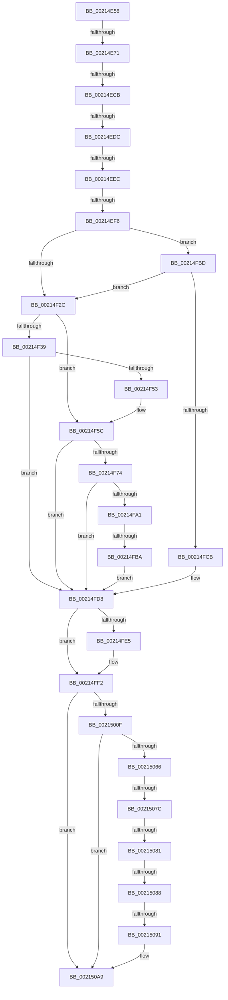

# sub_00214E58

- RVA: `0x00214E58`–`0x002150DB` (길이 `643` bytes)
- VA: `0x0000000140214E58`
- 실행 섹션: `.text`
- PDB 이름 있음: `아니요`; PDB Function 태그: `아니요`
- unwind 정보 RVA: `0x0005E158`
- 디코드: `152`개 명령, `643/643` bytes 표시
- 미해석 바이트: `0` (있으면 어셈블리에 `.byte`로 보존)

> 이 문서는 커널 이미지의 기계어와 PDB 기호를 분석해 생성했습니다. 4번과 5번은 함수 원형과 자료형을 바이너리 사용 방식에서 추정한 C 해석이며 원본 소스 복구 결과는 아닙니다.

## 1. Dependencies

- 직접 호출 지점: **6**; 고유 호출 대상: **6**
- 직접 호출자로 확인된 함수: **0**
- RIP 상대 이미지 참조: **6**

### Outgoing calls
- `0x00214F57` → [KxWaitForLockChainValid](KxWaitForLockChainValid_function_00217AA0.md) (function, `0x00217AA0`)
- `0x00214F88` → [KeDisableInterrupts](KeDisableInterrupts_function_00217BE0.md) (function, `0x00217BE0`)
- `0x00214F97` → [KiHaltOnAddressWakeEntireList](KiHaltOnAddressWakeEntireList_function_00217AF4.md) (function, `0x00217AF4`)
- `0x00214FD3` → [KiReleaseQueuedSpinLockInstrumented](KiReleaseQueuedSpinLockInstrumented_function_002179F0.md) (function, `0x002179F0`)
- `0x00214FED` → [KiLowerIrqlProcessIrqlFlags](../4F/KiLowerIrqlProcessIrqlFlags_function_004F5698.md) (function, `0x004F5698`)
- `0x0021505C` → [EtwpGetTrackingLockSlotForThread](EtwpGetTrackingLockSlotForThread_function_00215B34.md) (function, `0x00215B34`)

### Direct callers
- 이 함수 시작 RVA로 연결되는 직접 call은 확인되지 않았습니다. 간접 호출은 완전히 역산할 수 없습니다.

### Static image references
- `0x00214E92` → RVA `0x00FC6B04` (`ALMOSTRO`; read)
- `0x00214EBE` → RVA `0x00FC6D20` (`ALMOSTRO`; read)
- `0x00214ECB` → RVA `0x00FC6B06` (`ALMOSTRO`; read)
- `0x00214F1F` → RVA `0x00FC6B06` (`ALMOSTRO`; reference)
- `0x00214F7D` → RVA `0x00F21B20` (`.data`; read)
- `0x00214FBD` → RVA `0x00F0DE58` (`.data`; read)

## 2. Other-region calls and transfers

- 다른 실행 섹션으로 향하는 call: **0**
- call이 아닌 외부 분기/꼬리 이동: **10**
  - `0x00214E6B` → [sub_00215166 + 0x8F6](Unknown_function_00215166.md) (`tail-transfer`)
  - `0x00214EC5` → [sub_002150DC + 0x29](Unknown_function_002150DC.md) (`tail-transfer`)
  - `0x00214ED6` → [sub_002150DC](Unknown_function_002150DC.md) (`tail-transfer`)
  - `0x00214EE6` → [sub_002150DC + 0x3A](Unknown_function_002150DC.md) (`tail-transfer`)
  - `0x00214EF0` → [sub_00215166](Unknown_function_00215166.md) (`tail-transfer`)
  - `0x00214FB4` → [sub_002150DC + 0x48](Unknown_function_002150DC.md) (`tail-transfer`)
  - `0x00215076` → [sub_002150DC + 0x24](Unknown_function_002150DC.md) (`tail-transfer`)
  - `0x0021507F` → [sub_002150DC + 0x24](Unknown_function_002150DC.md) (`tail-transfer`)
  - `0x00215086` → [sub_002150DC + 0x1F](Unknown_function_002150DC.md) (`tail-transfer`)
  - `0x0021508F` → [sub_002150DC + 0x1F](Unknown_function_002150DC.md) (`tail-transfer`)

## 3. Assembly (complete function range)

```asm
00214E58  49 89 73 10                     mov qword ptr [r11 + 0x10], rsi
00214E5C  49 89 7B 18                     mov qword ptr [r11 + 0x18], rdi
00214E60  4D 89 6B 20                     mov qword ptr [r11 + 0x20], r13
00214E64  4D 89 73 D8                     mov qword ptr [r11 - 0x28], r14
00214E68  F6 C1 01                        test cl, 1
00214E6B  0F 85 EB 0B 00 00               jne 0x140215a5c
00214E71  33 C0                           xor eax, eax
00214E73  4C 89 7D BF                     mov qword ptr [rbp - 0x41], r15
00214E77  48 89 45 AF                     mov qword ptr [rbp - 0x51], rax
00214E7B  48 8D 7B 60                     lea rdi, [rbx + 0x60]
00214E7F  88 45 D2                        mov byte ptr [rbp - 0x2e], al
00214E82  0F 57 C0                        xorps xmm0, xmm0
00214E85  0F 11 45 9F                     movups xmmword ptr [rbp - 0x61], xmm0
00214E89  65 4C 8B 2C 25 88 01 00 00      mov r13, qword ptr gs:[0x188]
00214E92  44 8B 35 6B 1C DB 00            mov r14d, dword ptr [rip + 0xdb1c6b]
00214E99  41 81 E6 00 00 02 00            and r14d, 0x20000
00214EA0  65 FF 04 25 78 90 00 00         inc dword ptr gs:[0x9078]
00214EA8  48 89 7D A7                     mov qword ptr [rbp - 0x59], rdi
00214EAC  4C 89 7D 9F                     mov qword ptr [rbp - 0x61], r15
00214EB0  90                              nop
00214EB1  44 0F 20 C6                     mov rsi, cr8
00214EB5  B8 02 00 00 00                  mov eax, 2
00214EBA  44 0F 22 C0                     mov cr8, rax
00214EBE  44 39 3D 5B 1E DB 00            cmp dword ptr [rip + 0xdb1e5b], r15d
00214EC5  0F 85 3A 02 00 00               jne 0x140215105
00214ECB  F6 05 34 1C DB 00 21            test byte ptr [rip + 0xdb1c34], 0x21
00214ED2  40 88 75 AF                     mov byte ptr [rbp - 0x51], sil
00214ED6  0F 85 00 02 00 00               jne 0x1402150dc
00214EDC  48 8D 55 9F                     lea rdx, [rbp - 0x61]
00214EE0  48 87 17                        xchg qword ptr [rdi], rdx
00214EE3  48 85 D2                        test rdx, rdx
00214EE6  0F 85 2A 02 00 00               jne 0x140215116
00214EEC  44 39 7B 40                     cmp dword ptr [rbx + 0x40], r15d
00214EF0  0F 85 70 02 00 00               jne 0x140215166
00214EF6  BE 01 00 00 00                  mov esi, 1
00214EFB  4C 89 6B 30                     mov qword ptr [rbx + 0x30], r13
00214EFF  B8 80 00 00 00                  mov eax, 0x80
00214F04  66 89 73 18                     mov word ptr [rbx + 0x18], si
00214F08  66 09 43 1A                     or word ptr [rbx + 0x1a], ax
00214F0C  44 0F B6 E6                     movzx r12d, sil
00214F10  8B 43 38                        mov eax, dword ptr [rbx + 0x38]
00214F13  83 E0 07                        and eax, 7
00214F16  89 73 40                        mov dword ptr [rbx + 0x40], esi
00214F19  83 C8 08                        or eax, 8
00214F1C  89 43 38                        mov dword ptr [rbx + 0x38], eax
00214F1F  40 84 35 E0 1B DB 00            test byte ptr [rip + 0xdb1be0], sil
00214F26  0F 85 91 00 00 00               jne 0x140214fbd
00214F2C  0F 0D 4D 9F                     prefetchw byte ptr [rbp - 0x61]
00214F30  48 8B 45 9F                     mov rax, qword ptr [rbp - 0x61]
00214F34  48 85 C0                        test rax, rax
00214F37  75 23                           jne 0x140214f5c
00214F39  48 8B 4D A7                     mov rcx, qword ptr [rbp - 0x59]
00214F3D  48 8D 45 9F                     lea rax, [rbp - 0x61]
00214F41  F0 4C 0F B1 39                  lock cmpxchg qword ptr [rcx], r15
00214F46  48 8D 4D 9F                     lea rcx, [rbp - 0x61]
00214F4A  48 3B C1                        cmp rax, rcx
00214F4D  0F 84 85 00 00 00               je 0x140214fd8
00214F53  48 8D 4D 9F                     lea rcx, [rbp - 0x61]
00214F57  E8 44 2B 00 00                  call 0x140217aa0
00214F5C  4C 8D 40 08                     lea r8, [rax + 8]
00214F60  4C 89 7D 9F                     mov qword ptr [rbp - 0x61], r15
00214F64  48 8B 4D A7                     mov rcx, qword ptr [rbp - 0x59]
00214F68  48 8B C1                        mov rax, rcx
00214F6B  49 87 00                        xchg qword ptr [r8], rax
00214F6E  32 C1                           xor al, cl
00214F70  A8 04                           test al, 4
00214F72  74 64                           je 0x140214fd8
00214F74  F0 44 09 3C 24                  lock or dword ptr [rsp], r15d
00214F79  49 C1 E8 05                     shr r8, 5
00214F7D  4C 8D 0D 9C CB D0 00            lea r9, [rip + 0xd0cb9c]
00214F84  41 83 E0 7F                     and r8d, 0x7f
00214F88  E8 53 2C 00 00                  call 0x140217be0
00214F8D  49 8B D7                        mov rdx, r15
00214F90  0F B6 F8                        movzx edi, al
00214F93  4B 87 14 C1                     xchg qword ptr [r9 + r8*8], rdx
00214F97  E8 58 2B 00 00                  call 0x140217af4
00214F9C  40 84 FF                        test dil, dil
00214F9F  74 37                           je 0x140214fd8
00214FA1  65 48 8B 0C 25 20 00 00 00      mov rcx, qword ptr gs:[0x20]
00214FAA  4C 8B 81 B8 8E 00 00            mov r8, qword ptr [rcx + 0x8eb8]
00214FB1  4D 85 C0                        test r8, r8
00214FB4  0F 85 6A 01 00 00               jne 0x140215124
00214FBA  FB                              sti
00214FBB  EB 1B                           jmp 0x140214fd8
00214FBD  8B 05 95 8E CF 00               mov eax, dword ptr [rip + 0xcf8e95]
00214FC3  85 C0                           test eax, eax
00214FC5  0F 85 61 FF FF FF               jne 0x140214f2c
00214FCB  48 8B 55 5F                     mov rdx, qword ptr [rbp + 0x5f]
00214FCF  48 8D 4D 9F                     lea rcx, [rbp - 0x61]
00214FD3  E8 18 2A 00 00                  call 0x1402179f0
00214FD8  44 39 3D 41 1D DB 00            cmp dword ptr [rip + 0xdb1d41], r15d
00214FDF  0F B6 7D AF                     movzx edi, byte ptr [rbp - 0x51]
00214FE3  74 0D                           je 0x140214ff2
00214FE5  44 0F 20 C1                     mov rcx, cr8
00214FE9  40 0F B6 D7                     movzx edx, dil
00214FED  E8 A6 06 2E 00                  call 0x1404f5698
00214FF2  44 0F 22 C7                     mov cr8, rdi
00214FF6  65 FF 04 25 7C 90 00 00         inc dword ptr gs:[0x907c]
00214FFE  65 FF 04 25 64 90 00 00         inc dword ptr gs:[0x9064]
00215006  45 85 F6                        test r14d, r14d
00215009  0F 84 9A 00 00 00               je 0x1402150a9
0021500F  8B 43 44                        mov eax, dword ptr [rbx + 0x44]
00215012  89 45 97                        mov dword ptr [rbp - 0x69], eax
00215015  44 89 7D 87                     mov dword ptr [rbp - 0x79], r15d
00215019  0F 31                           rdtsc
0021501B  65 4C 8B 34 25 20 00 00 00      mov r14, qword ptr gs:[0x20]
00215024  48 8B CB                        mov rcx, rbx
00215027  48 C1 E2 20                     shl rdx, 0x20
0021502B  48 0B C2                        or rax, rdx
0021502E  44 88 7D 8A                     mov byte ptr [rbp - 0x76], r15b
00215032  48 8B F8                        mov rdi, rax
00215035  BA 00 00 01 00                  mov edx, 0x10000
0021503A  41 0F B6 86 D1 00 00 00         movzx eax, byte ptr [r14 + 0xd1]
00215042  45 0F B6 AE D0 00 00 00         movzx r13d, byte ptr [r14 + 0xd0]
0021504A  41 FF 86 70 8F 00 00            inc dword ptr [r14 + 0x8f70]
00215051  66 44 89 6D 87                  mov word ptr [rbp - 0x79], r13w
00215056  88 45 8F                        mov byte ptr [rbp - 0x71], al
00215059  88 45 89                        mov byte ptr [rbp - 0x77], al
0021505C  E8 D3 0A 00 00                  call 0x140215b34
00215061  48 85 C0                        test rax, rax
00215064  74 43                           je 0x1402150a9
00215066  41 FF 86 74 8F 00 00            inc dword ptr [r14 + 0x8f74]
0021506D  8B 48 20                        mov ecx, dword ptr [rax + 0x20]
00215070  48 89 78 08                     mov qword ptr [rax + 8], rdi
00215074  85 C9                           test ecx, ecx
00215076  0F 84 84 00 00 00               je 0x140215100
0021507C  83 F9 04                        cmp ecx, 4
0021507F  75 7F                           jne 0x140215100
00215081  66 44 39 68 18                  cmp word ptr [rax + 0x18], r13w
00215086  75 73                           jne 0x1402150fb
00215088  0F B6 4D 8F                     movzx ecx, byte ptr [rbp - 0x71]
0021508C  38 48 1A                        cmp byte ptr [rax + 0x1a], cl
0021508F  75 6A                           jne 0x1402150fb
00215091  48 2B 38                        sub rdi, qword ptr [rax]
00215094  48 89 38                        mov qword ptr [rax], rdi
00215097  8B 4D 87                        mov ecx, dword ptr [rbp - 0x79]
0021509A  89 48 18                        mov dword ptr [rax + 0x18], ecx
0021509D  8B 4D 97                        mov ecx, dword ptr [rbp - 0x69]
002150A0  89 48 2C                        mov dword ptr [rax + 0x2c], ecx
002150A3  89 70 20                        mov dword ptr [rax + 0x20], esi
002150A6  89 70 24                        mov dword ptr [rax + 0x24], esi
002150A9  41 0F B6 C4                     movzx eax, r12b
002150AD  4C 8B AC 24 28 01 00 00         mov r13, qword ptr [rsp + 0x128]
002150B5  48 8B BC 24 20 01 00 00         mov rdi, qword ptr [rsp + 0x120]
002150BD  48 8B B4 24 18 01 00 00         mov rsi, qword ptr [rsp + 0x118]
002150C5  4C 8B B4 24 E0 00 00 00         mov r14, qword ptr [rsp + 0xe0]
002150CD  48 81 C4 E8 00 00 00            add rsp, 0xe8
002150D4  41 5F                           pop r15
002150D6  41 5C                           pop r12
002150D8  5B                              pop rbx
002150D9  5D                              pop rbp
002150DA  C3                              ret
```

## 4. C-style interpretation (structured pseudocode)

```c
__int64 __fastcall sub_00214E58(unsigned __int8 a1, __int64 a2, __int64 a3, __int64 a4, __int64 a5, __int64 a6, __int64 a7, __int64 a8, __int64 a9, __int64 a10, __int64 a11, __int64 a12, __int64 a13, __int64 a14, __int64 a15, __int64 a16, __int64 a17, __int64 a18, __int64 a19, __int64 a20, __int64 a21, __int64 a22, __int64 a23, __int64 a24, __int64 a25, __int64 a26, __int64 a27, __int64 a28, __int64 a29, __int64 a30, __int64 a31, __int64 a32, __int64 a33, __int64 a34, __int64 a35, __int64 a36, __int64 a37)
{
    __int64 result;
    __int64 v_r14;
    __int64 v_rdi;
    __int64 v_rsp;
    unsigned int v_stack_p0;

    *(unsigned __int64 *)(v_r11 + 16) = v_rsi;
    *(unsigned __int64 *)(v_r11 + 24) = v_rdi;
    *(unsigned __int64 *)(v_r11 + 32) = v_r13;
    *(unsigned __int64 *)(v_r11 - 40) = v_r14;
    result = 0;
    *(unsigned __int64 *)(v_rbp - 65) = v_r15;
    *(unsigned __int64 *)(v_rbp - 81) = 0;
    *(unsigned __int8 *)(v_rbp - 46) = 0;
    *(unsigned __int64 *)(v_rbp - 97) = v_xmm0;
    v_r14 = (unsigned int)(((unsigned int)(*(unsigned int *)(v_rip + 14359659))) & (0x20000ULL));
    *(unsigned __int64 *)(v_rbp - 89) = v_rbx + 96;
    *(unsigned __int64 *)(v_rbp - 97) = v_r15;
    *(unsigned __int8 *)(v_rbp - 81) = (unsigned __int8)(v_cr8);
    *(unsigned __int64 *)(v_rbx + 48) = *(unsigned __int64 *)(gs_base + (0 + 392));
    *(unsigned __int16 *)(v_rbx + 24) = 1;
    result = (unsigned int)(((unsigned int)(*(unsigned int *)(v_rbx + 56))) & (7));
    *(unsigned int *)(v_rbx + 64) = 1;
    result = (unsigned int)((result) | (8));
    *(unsigned int *)(v_rbx + 56) = (unsigned int)(result);
    if (((*(unsigned __int8 *)(v_rip + 14359520)) & (1)) != 0) goto loc_00214FBD;
loc_00214F2C:
    if (*(unsigned __int64 *)(v_rbp - 97) != 0) goto loc_00214F5C;
    if ((v_rbp - 97) == (v_rbp - 97)) goto loc_00214FD8;
    result = KxWaitForLockChainValid(v_rbp - 97, v_rbp - 97, a3, a4);
loc_00214F5C:
    *(unsigned __int64 *)(v_rbp - 97) = v_r15;
    result = (unsigned __int8)((*(unsigned __int64 *)(v_rbp - 89)) ^ ((unsigned __int8)(*(unsigned __int64 *)(v_rbp - 89))));
    if ((((unsigned __int8)(result)) & (4)) == 0) goto loc_00214FD8;
    a3 = (result + 8) >> (5);
    a3 = (unsigned int)((a3) & (127));
    result = KeDisableInterrupts(*(unsigned __int64 *)(v_rbp - 89), v_rbp - 97, a3, v_rip + 13683612);
    result = KiHaltOnAddressWakeEntireList(*(unsigned __int64 *)(v_rbp - 89), v_r15, a3, v_rip + 13683612);
    if ((unsigned __int8)((unsigned __int8)(result)) == 0) goto loc_00214FD8;
    goto loc_00214FD8;
loc_00214FBD:
    if ((unsigned int)((unsigned int)(*(unsigned int *)(v_rip + 13602453))) != 0) goto loc_00214F2C;
    result = KiReleaseQueuedSpinLockInstrumented(v_rbp - 97, *(unsigned __int64 *)(v_rbp + 95), *(unsigned __int64 *)(*(unsigned __int64 *)(gs_base + (0 + 32)) + 36536), v_rip + 13683612);
loc_00214FD8:
    if ((*(unsigned int *)(v_rip + 14359873)) != ((unsigned int)(v_r15))) {
        a1 = 2;
        a2 = (unsigned __int8)(*(unsigned __int8 *)(v_rbp - 81));
        result = KiLowerIrqlProcessIrqlFlags(a1, a2, *(unsigned __int64 *)(*(unsigned __int64 *)(gs_base + (0 + 32)) + 36536), v_rip + 13683612);
    }
    if ((unsigned int)(v_r14) == 0) goto loc_002150A9;
    *(unsigned int *)(v_rbp - 105) = (unsigned int)((unsigned int)(*(unsigned int *)(v_rbx + 68)));
    *(unsigned int *)(v_rbp - 121) = (unsigned int)(v_r15);
    a2 = (a2) << (32);
    result = ((unsigned int)(*(unsigned int *)(v_rbx + 68))) | (a2);
    *(unsigned __int8 *)(v_rbp - 118) = (unsigned __int8)(v_r15);
    *(unsigned __int16 *)(v_rbp - 121) = (unsigned __int16)(*(unsigned __int8 *)(*(unsigned __int64 *)(gs_base + (0 + 32)) + 208));
    *(unsigned __int8 *)(v_rbp - 113) = (unsigned __int8)(*(unsigned __int8 *)(*(unsigned __int64 *)(gs_base + (0 + 32)) + 209));
    *(unsigned __int8 *)(v_rbp - 119) = (unsigned __int8)(*(unsigned __int8 *)(*(unsigned __int64 *)(gs_base + (0 + 32)) + 209));
    result = EtwpGetTrackingLockSlotForThread(v_rbx, (unsigned int)(0x10000ULL), *(unsigned __int64 *)(*(unsigned __int64 *)(gs_base + (0 + 32)) + 36536), v_rip + 13683612);
    if (result == 0) goto loc_002150A9;
    *(unsigned __int64 *)(result + 8) = result;
    v_rdi = (result) - (*(unsigned __int64 *)(result));
    *(unsigned __int64 *)(result) = v_rdi;
    *(unsigned int *)(result + 24) = (unsigned int)((unsigned int)(*(unsigned int *)(v_rbp - 121)));
    *(unsigned int *)(result + 44) = (unsigned int)((unsigned int)(*(unsigned int *)(v_rbp - 105)));
    *(unsigned int *)(result + 32) = 1;
    *(unsigned int *)(result + 36) = 1;
loc_002150A9:
    v_rsp = (v_rsp) + (232);
    return 1;
}
```

## 5. (Beta) C Style

```c
int64_t sub_00214E58(uint8_t Arg1, int64_t Arg2, int64_t Arg3, int64_t Arg4, uint64_t Arg5, uint64_t Arg6, uint64_t Arg7, uint64_t Arg8, uint64_t Arg9, uint64_t Arg10, uint64_t Arg11, uint64_t Arg12, uint64_t Arg13, uint64_t Arg14, uint64_t Arg15, uint64_t Arg16, uint64_t Arg17, uint64_t Arg18, uint64_t Arg19, uint64_t Arg20, uint64_t Arg21, uint64_t Arg22, uint64_t Arg23, uint64_t Arg24, uint64_t Arg25, uint64_t Arg26, uint64_t Arg27, int64_t Arg28, uint64_t Arg29, uint64_t Arg30, uint64_t Arg31, uint64_t Arg32, uint64_t Arg33, uint64_t Arg34, int64_t Arg35, int64_t Arg36, int64_t Arg37)
{
    int64_t result;
    int64_t local_r14;
    int64_t local_rdi;
    int64_t local_rsp;
    uint32_t v_stack_p0;

    *(uint64_t *)(local_r11 + 0x10) = local_rsi;
    *(uint64_t *)(local_r11 + 0x18) = local_rdi;
    *(uint64_t *)(local_r11 + 0x20) = local_r13;
    *(uint64_t *)(local_r11 - 0x28) = local_r14;
    result = 0;
    *(uint64_t *)(local_rbp - 0x41) = local_r15;
    *(uint64_t *)(local_rbp - 0x51) = 0;
    *(uint8_t *)(local_rbp - 0x2E) = 0;
    *(uint64_t *)(local_rbp - 0x61) = v_xmm0;
    local_r14 = (uint32_t)(((uint32_t)(*(uint32_t *)(v_rip + 0xDB1C6B))) & (0x20000ULL));
    *(uint64_t *)(local_rbp - 0x59) = local_rbx + 96;
    *(uint64_t *)(local_rbp - 0x61) = local_r15;
    *(uint8_t *)(local_rbp - 0x51) = (uint8_t)(v_cr8);
    *(uint64_t *)(local_rbx + 0x30) = *(uint64_t *)(gs_base + (0 + 0x188));
    *(uint16_t *)(local_rbx + 0x18) = 1;
    result = (uint32_t)(((uint32_t)(*(uint32_t *)(local_rbx + 0x38))) & (7));
    *(uint32_t *)(local_rbx + 0x40) = 1;
    result = (uint32_t)((result) | (8));
    *(uint32_t *)(local_rbx + 0x38) = (uint32_t)(result);
    if (((*(uint8_t *)(v_rip + 0xDB1BE0)) & (1)) != 0) goto loc_00214FBD;
loc_00214F2C:
    if (*(uint64_t *)(local_rbp - 0x61) != 0) goto loc_00214F5C;
    if ((local_rbp - 97) == (local_rbp - 97)) goto loc_00214FD8;
    result = KxWaitForLockChainValid(local_rbp - 97, local_rbp - 97, Arg3, Arg4);
loc_00214F5C:
    *(uint64_t *)(local_rbp - 0x61) = local_r15;
    result = (uint8_t)((*(uint64_t *)(local_rbp - 0x59)) ^ ((uint8_t)(*(uint64_t *)(local_rbp - 0x59))));
    if ((((uint8_t)(result)) & (4)) == 0) goto loc_00214FD8;
    Arg3 = (result + 8) >> (5);
    Arg3 = (uint32_t)((Arg3) & (127));
    result = KeDisableInterrupts(*(uint64_t *)(local_rbp - 0x59), local_rbp - 97, Arg3, v_rip + 13683612);
    result = KiHaltOnAddressWakeEntireList(*(uint64_t *)(local_rbp - 0x59), local_r15, Arg3, v_rip + 13683612);
    if ((uint8_t)((uint8_t)(result)) == 0) goto loc_00214FD8;
    goto loc_00214FD8;
loc_00214FBD:
    if ((uint32_t)((uint32_t)(*(uint32_t *)(v_rip + 0xCF8E95))) != 0) goto loc_00214F2C;
    result = KiReleaseQueuedSpinLockInstrumented(local_rbp - 97, *(uint64_t *)(local_rbp + 0x5F), *(uint64_t *)(*(uint64_t *)(gs_base + (0 + 0x20)) + 0x8EB8), v_rip + 13683612);
loc_00214FD8:
    if ((*(uint32_t *)(v_rip + 0xDB1D41)) != ((uint32_t)(local_r15))) {
        Arg1 = 2;
        Arg2 = (uint8_t)(*(uint8_t *)(local_rbp - 0x51));
        result = KiLowerIrqlProcessIrqlFlags(Arg1, Arg2, *(uint64_t *)(*(uint64_t *)(gs_base + (0 + 0x20)) + 0x8EB8), v_rip + 13683612);
    }
    if ((uint32_t)(local_r14) == 0) goto loc_002150A9;
    *(uint32_t *)(local_rbp - 0x69) = (uint32_t)((uint32_t)(*(uint32_t *)(local_rbx + 0x44)));
    *(uint32_t *)(local_rbp - 0x79) = (uint32_t)(local_r15);
    Arg2 = (Arg2) << (32);
    result = ((uint32_t)(*(uint32_t *)(local_rbx + 0x44))) | (Arg2);
    *(uint8_t *)(local_rbp - 0x76) = (uint8_t)(local_r15);
    *(uint16_t *)(local_rbp - 0x79) = (uint16_t)(*(uint8_t *)(*(uint64_t *)(gs_base + (0 + 0x20)) + 0xD0));
    *(uint8_t *)(local_rbp - 0x71) = (uint8_t)(*(uint8_t *)(*(uint64_t *)(gs_base + (0 + 0x20)) + 0xD1));
    *(uint8_t *)(local_rbp - 0x77) = (uint8_t)(*(uint8_t *)(*(uint64_t *)(gs_base + (0 + 0x20)) + 0xD1));
    result = EtwpGetTrackingLockSlotForThread(local_rbx, (uint32_t)(0x10000ULL), *(uint64_t *)(*(uint64_t *)(gs_base + (0 + 0x20)) + 0x8EB8), v_rip + 13683612);
    if (result == 0) goto loc_002150A9;
    *(uint64_t *)(result + 0x8) = result;
    local_rdi = (result) - (*(uint64_t *)(result));
    *(uint64_t *)(result) = local_rdi;
    *(uint32_t *)(result + 0x18) = (uint32_t)((uint32_t)(*(uint32_t *)(local_rbp - 0x79)));
    *(uint32_t *)(result + 0x2C) = (uint32_t)((uint32_t)(*(uint32_t *)(local_rbp - 0x69)));
    *(uint32_t *)(result + 0x20) = 1;
    *(uint32_t *)(result + 0x24) = 1;
loc_002150A9:
    local_rsp = (local_rsp) + (232);
    return 1;
}
```

## 6. Execution-region graph

[열기: 2D/3D 그래프와 함수 탐색 컨트롤 패널](../../../control-panel.html?section=text&rva=0x00214E58&view=graph)

- 2D 그래프는 위에서 아래로 흐르고, 3D 그래프는 빈 공간을 드래그해 회전합니다. Shift+드래그는 이동, 휠은 확대·축소, 함수 노드 선택은 대상 보고서 이동입니다.

### Static fallback


