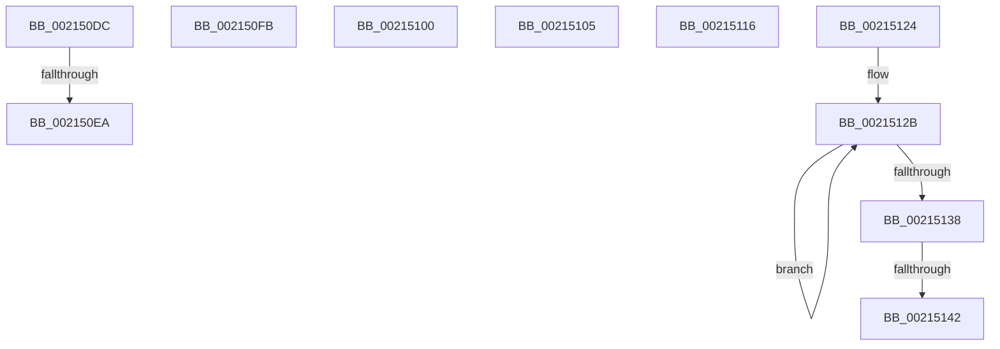

# sub_002150DC

- RVA: `0x002150DC`–`0x0021514C` (길이 `112` bytes)
- VA: `0x00000001402150DC`
- 실행 섹션: `.text`
- PDB 이름 있음: `아니요`; PDB Function 태그: `아니요`
- unwind 정보 RVA: `0x0005E18C`
- 디코드: `28`개 명령, `112/112` bytes 표시
- 미해석 바이트: `0` (있으면 어셈블리에 `.byte`로 보존)

> 이 문서는 커널 이미지의 기계어와 PDB 기호를 분석해 생성했습니다. 4번과 5번은 함수 원형과 자료형을 바이너리 사용 방식에서 추정한 C 해석이며 원본 소스 복구 결과는 아닙니다.

## 1. Dependencies

- 직접 호출 지점: **4**; 고유 호출 대상: **4**
- 직접 호출자로 확인된 함수: **0**
- RIP 상대 이미지 참조: **1**

### Outgoing calls
- `0x002150F1` → [KiAcquireQueuedSpinLockInstrumented](../27/KiAcquireQueuedSpinLockInstrumented_function_00275850.md) (function, `0x00275850`)
- `0x0021510C` → [KiRaiseIrqlProcessIrqlFlags](../4F/KiRaiseIrqlProcessIrqlFlags_function_004F56FC.md) (function, `0x004F56FC`)
- `0x0021511A` → [KxWaitForLockOwnerShip](../25/KxWaitForLockOwnerShip_function_00257EB0.md) (function, `0x00257EB0`)
- `0x00215142` → [KiRemoveSystemWorkPriorityKick](../26/KiRemoveSystemWorkPriorityKick_function_002631D0.md) (function, `0x002631D0`)

### Direct callers
- 이 함수 시작 RVA로 연결되는 직접 call은 확인되지 않았습니다. 간접 호출은 완전히 역산할 수 없습니다.

### Static image references
- `0x002150DC` → RVA `0x00F0DE58` (`.data`; read)

## 2. Other-region calls and transfers

- 다른 실행 섹션으로 향하는 call: **0**
- call이 아닌 외부 분기/꼬리 이동: **8**
  - `0x002150E4` → [sub_00214E58 + 0x84](Unknown_function_00214E58.md) (`tail-transfer`)
  - `0x002150F6` → [sub_00214E58 + 0x94](Unknown_function_00214E58.md) (`tail-transfer`)
  - `0x002150FE` → [sub_00214E58 + 0x23F](Unknown_function_00214E58.md) (`tail-transfer`)
  - `0x00215103` → [sub_00214E58 + 0x23F](Unknown_function_00214E58.md) (`tail-transfer`)
  - `0x00215111` → [sub_00214E58 + 0x73](Unknown_function_00214E58.md) (`tail-transfer`)
  - `0x0021511F` → [sub_00214E58 + 0x94](Unknown_function_00214E58.md) (`tail-transfer`)
  - `0x0021513C` → [sub_00214E58 + 0x162](Unknown_function_00214E58.md) (`tail-transfer`)
  - `0x00215147` → [sub_00214E58 + 0x162](Unknown_function_00214E58.md) (`tail-transfer`)

## 3. Assembly (complete function range)

```asm
002150DC  8B 05 76 8D CF 00               mov eax, dword ptr [rip + 0xcf8d76]
002150E2  85 C0                           test eax, eax
002150E4  0F 85 F2 FD FF FF               jne 0x140214edc
002150EA  48 8B D7                        mov rdx, rdi
002150ED  48 8D 4D 9F                     lea rcx, [rbp - 0x61]
002150F1  E8 5A 07 06 00                  call 0x140275850
002150F6  E9 F1 FD FF FF                  jmp 0x140214eec
002150FB  48 89 30                        mov qword ptr [rax], rsi
002150FE  EB 97                           jmp 0x140215097
00215100  4C 89 38                        mov qword ptr [rax], r15
00215103  EB 92                           jmp 0x140215097
00215105  0F B6 D0                        movzx edx, al
00215108  40 0F B6 CE                     movzx ecx, sil
0021510C  E8 EB 05 2E 00                  call 0x1404f56fc
00215111  E9 B5 FD FF FF                  jmp 0x140214ecb
00215116  48 8D 4D 9F                     lea rcx, [rbp - 0x61]
0021511A  E8 91 2D 04 00                  call 0x140257eb0
0021511F  E9 C8 FD FF FF                  jmp 0x140214eec
00215124  41 0F 0D 08                     prefetchw byte ptr [r8]
00215128  41 8B 00                        mov eax, dword ptr [r8]
0021512B  8B D0                           mov edx, eax
0021512D  0F BA F2 15                     btr edx, 0x15
00215131  F0 41 0F B1 10                  lock cmpxchg dword ptr [r8], edx
00215136  75 F3                           jne 0x14021512b
00215138  0F BA E0 15                     bt eax, 0x15
0021513C  0F 83 78 FE FF FF               jae 0x140214fba
00215142  E8 89 E0 04 00                  call 0x1402631d0
00215147  E9 6E FE FF FF                  jmp 0x140214fba
```

## 4. C-style interpretation (structured pseudocode)

```c
__int64 __fastcall sub_002150DC(__int64 a1, __int64 a2, __int64 a3)
{
    __int64 result;

    result = KiAcquireQueuedSpinLockInstrumented(v_rbp - 97, v_rdi, a3, a4);
}
```

## 5. (Beta) C Style

```c
int64_t sub_002150DC(int64_t Arg1, int64_t Arg2, int64_t Arg3)
{
    int64_t result;

    result = KiAcquireQueuedSpinLockInstrumented(local_rbp - 97, local_rdi, Arg3, a4);
}
```

## 6. Execution-region graph

[열기: 2D/3D 그래프와 함수 탐색 컨트롤 패널](../../../control-panel.html?section=text&rva=0x002150DC&view=graph)

- 2D 그래프는 위에서 아래로 흐르고, 3D 그래프는 빈 공간을 드래그해 회전합니다. Shift+드래그는 이동, 휠은 확대·축소, 함수 노드 선택은 대상 보고서 이동입니다.

### Static fallback


