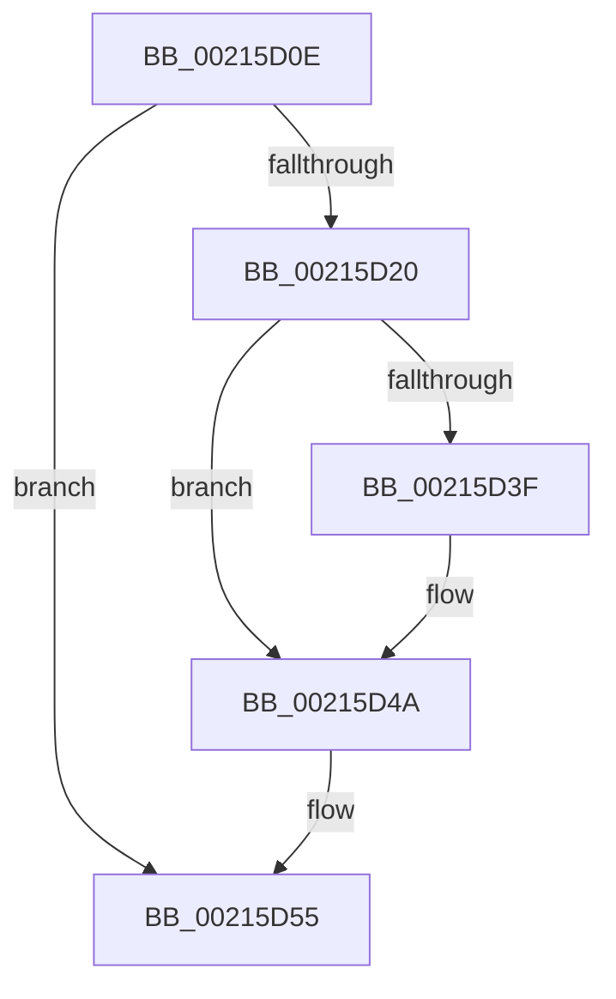

# sub_00215D0E

- RVA: `0x00215D0E`–`0x00215D69` (길이 `91` bytes)
- VA: `0x0000000140215D0E`
- 실행 섹션: `.text`
- PDB 이름 있음: `아니요`; PDB Function 태그: `아니요`
- unwind 정보 RVA: `0x0005E214`
- 디코드: `25`개 명령, `91/91` bytes 표시
- 미해석 바이트: `0` (있으면 어셈블리에 `.byte`로 보존)

> 이 문서는 커널 이미지의 기계어와 PDB 기호를 분석해 생성했습니다. 4번과 5번은 함수 원형과 자료형을 바이너리 사용 방식에서 추정한 C 해석이며 원본 소스 복구 결과는 아닙니다.

## 1. Dependencies

- 직접 호출 지점: **0**; 고유 호출 대상: **0**
- 직접 호출자로 확인된 함수: **0**
- RIP 상대 이미지 참조: **0**

### Outgoing calls
- 직접 디코드된 call 명령이 없습니다.

### Direct callers
- 이 함수 시작 RVA로 연결되는 직접 call은 확인되지 않았습니다. 간접 호출은 완전히 역산할 수 없습니다.

### Static image references
- 디코드된 RIP-relative 메모리 참조가 없습니다.

## 2. Other-region calls and transfers

- 다른 실행 섹션으로 향하는 call: **0**
- call이 아닌 외부 분기/꼬리 이동: **1**
  - `0x00215D63` → [sub_00215EE4](Unknown_function_00215EE4.md) (`tail-transfer`)

## 3. Assembly (complete function range)

```asm
00215D0E  49 89 7B 18                     mov qword ptr [r11 + 0x18], rdi
00215D12  4D 89 63 20                     mov qword ptr [r11 + 0x20], r12
00215D16  45 33 E4                        xor r12d, r12d
00215D19  41 8B D4                        mov edx, r12d
00215D1C  A8 04                           test al, 4
00215D1E  74 35                           je 0x140215d55
00215D20  48 8B 86 20 02 00 00            mov rax, qword ptr [rsi + 0x220]
00215D27  8B 8E A0 05 00 00               mov ecx, dword ptr [rsi + 0x5a0]
00215D2D  C1 E9 09                        shr ecx, 9
00215D30  83 E1 07                        and ecx, 7
00215D33  48 8B 80 A0 02 00 00            mov rax, qword ptr [rax + 0x2a0]
00215D3A  48 85 C0                        test rax, rax
00215D3D  74 0B                           je 0x140215d4a
00215D3F  8B 80 3C 04 00 00               mov eax, dword ptr [rax + 0x43c]
00215D45  3B C8                           cmp ecx, eax
00215D47  0F 4D C8                        cmovge ecx, eax
00215D4A  83 F9 02                        cmp ecx, 2
00215D4D  B8 04 00 00 00                  mov eax, 4
00215D52  0F 4C D0                        cmovl edx, eax
00215D55  8B FA                           mov edi, edx
00215D57  83 CF 02                        or edi, 2
00215D5A  F6 45 1A 02                     test byte ptr [rbp + 0x1a], 2
00215D5E  0F 44 FA                        cmove edi, edx
00215D61  85 FF                           test edi, edi
00215D63  0F 84 7B 01 00 00               je 0x140215ee4
```

## 4. C-style interpretation (structured pseudocode)

```c
__int64 __fastcall sub_00215D0E(void)
{
    __int64 result;
    __int64 v_r12;
    __int64 v_rdi;

    *(unsigned __int64 *)(v_r11 + 24) = v_rdi;
    *(unsigned __int64 *)(v_r11 + 32) = v_r12;
    v_r12 = 0;
    if ((((unsigned __int8)(result)) & (4)) == 0) goto loc_00215D55;
    a1 = (unsigned int)(((unsigned int)(*(unsigned int *)(v_rsi + 1440))) >> (9));
    a1 = (unsigned int)((a1) & (7));
    result = *(unsigned __int64 *)(*(unsigned __int64 *)(v_rsi + 544) + 672);
    if (*(unsigned __int64 *)(*(unsigned __int64 *)(v_rsi + 544) + 672) != 0) {
        result = *(unsigned int *)(*(unsigned __int64 *)(*(unsigned __int64 *)(v_rsi + 544) + 672) + 1084);
        if (((unsigned int)(a1)) >= ((unsigned int)(result))) { a1 = (unsigned int)(result); }
    }
    a2 = 0;
    if (((unsigned int)(a1)) < 2) { a2 = 4; }
loc_00215D55:
    v_rdi = (unsigned int)(((unsigned int)((unsigned int)(a2))) | (2));
    if (((*(unsigned __int8 *)(v_rbp + 26)) & (2)) == 0) { v_rdi = (unsigned int)(a2); }
}
```

## 5. (Beta) C Style

```c
void sub_00215D0E(void)
{
    int64_t result;
    int64_t local_r12;
    int64_t local_rdi;

    *(uint64_t *)(local_r11 + 0x18) = local_rdi;
    *(uint64_t *)(local_r11 + 0x20) = local_r12;
    local_r12 = 0;
    if ((((uint8_t)(result)) & (4)) == 0) goto loc_00215D55;
    a1 = (uint32_t)(((uint32_t)(*(uint32_t *)(local_rsi + 0x5A0))) >> (9));
    a1 = (uint32_t)((a1) & (7));
    result = *(uint64_t *)(*(uint64_t *)(local_rsi + 0x220) + 0x2A0);
    if (*(uint64_t *)(*(uint64_t *)(local_rsi + 0x220) + 0x2A0) != 0) {
        result = *(uint32_t *)(*(uint64_t *)(*(uint64_t *)(local_rsi + 0x220) + 0x2A0) + 0x43C);
        if (((uint32_t)(a1)) >= ((uint32_t)(result))) { a1 = (uint32_t)(result); }
    }
    a2 = 0;
    if (((uint32_t)(a1)) < 2) { a2 = 4; }
loc_00215D55:
    local_rdi = (uint32_t)(((uint32_t)((uint32_t)(a2))) | (2));
    if (((*(uint8_t *)(local_rbp + 0x1A)) & (2)) == 0) { local_rdi = (uint32_t)(a2); }
}
```

## 6. Execution-region graph

[열기: 2D/3D 그래프와 함수 탐색 컨트롤 패널](../../../control-panel.html?section=text&rva=0x00215D0E&view=graph)

- 2D 그래프는 위에서 아래로 흐르고, 3D 그래프는 빈 공간을 드래그해 회전합니다. Shift+드래그는 이동, 휠은 확대·축소, 함수 노드 선택은 대상 보고서 이동입니다.

### Static fallback


