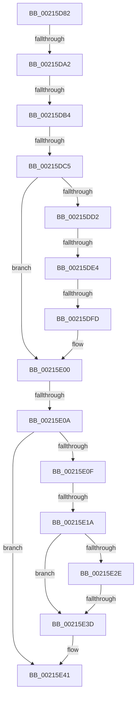

# sub_00215D82

- RVA: `0x00215D82`–`0x00215E53` (길이 `209` bytes)
- VA: `0x0000000140215D82`
- 실행 섹션: `.text`
- PDB 이름 있음: `아니요`; PDB Function 태그: `아니요`
- unwind 정보 RVA: `0x0005E244`
- 디코드: `49`개 명령, `209/209` bytes 표시
- 미해석 바이트: `0` (있으면 어셈블리에 `.byte`로 보존)

> 이 문서는 커널 이미지의 기계어와 PDB 기호를 분석해 생성했습니다. 4번과 5번은 함수 원형과 자료형을 바이너리 사용 방식에서 추정한 C 해석이며 원본 소스 복구 결과는 아닙니다.

## 1. Dependencies

- 직접 호출 지점: **0**; 고유 호출 대상: **0**
- 직접 호출자로 확인된 함수: **0**
- RIP 상대 이미지 참조: **2**

### Outgoing calls
- 직접 디코드된 call 명령이 없습니다.

### Direct callers
- 이 함수 시작 RVA로 연결되는 직접 call은 확인되지 않았습니다. 간접 호출은 완전히 역산할 수 없습니다.

### Static image references
- `0x00215D95` → RVA `0x00FC6D20` (`ALMOSTRO`; read)
- `0x00215DA2` → RVA `0x00FC6B06` (`ALMOSTRO`; read)

## 2. Other-region calls and transfers

- 다른 실행 섹션으로 향하는 call: **0**
- call이 아닌 외부 분기/꼬리 이동: **9**
  - `0x00215D9C` → [sub_00215F5C + 0x96](Unknown_function_00215F5C.md) (`tail-transfer`)
  - `0x00215DAE` → [sub_00215F5C](Unknown_function_00215F5C.md) (`tail-transfer`)
  - `0x00215DBF` → [sub_00215F5C + 0xC6](Unknown_function_00215F5C.md) (`tail-transfer`)
  - `0x00215DDE` → [sub_00215F5C + 0x20](Unknown_function_00215F5C.md) (`tail-transfer`)
  - `0x00215DF7` → [sub_00215F5C + 0x57](Unknown_function_00215F5C.md) (`tail-transfer`)
  - `0x00215E04` → [sub_00215F5C + 0xD5](Unknown_function_00215F5C.md) (`tail-transfer`)
  - `0x00215E14` → [sub_00215F5C + 0x4F](Unknown_function_00215F5C.md) (`tail-transfer`)
  - `0x00215E37` → [sub_00215F5C + 0xFD](Unknown_function_00215F5C.md) (`tail-transfer`)
  - `0x00215E4D` → [sub_00215EFE](Unknown_function_00215EFE.md) (`tail-transfer`)

## 3. Assembly (complete function range)

```asm
00215D82  4C 89 74 24 40                  mov qword ptr [rsp + 0x40], r14
00215D87  45 0F 20 C6                     mov r14, cr8
00215D8B  41 BD 02 00 00 00               mov r13d, 2
00215D91  45 0F 22 C5                     mov cr8, r13
00215D95  44 39 25 84 0F DB 00            cmp dword ptr [rip + 0xdb0f84], r12d
00215D9C  0F 85 50 02 00 00               jne 0x140215ff2
00215DA2  F6 05 5D 0D DB 00 21            test byte ptr [rip + 0xdb0d5d], 0x21
00215DA9  44 88 74 24 30                  mov byte ptr [rsp + 0x30], r14b
00215DAE  0F 85 A8 01 00 00               jne 0x140215f5c
00215DB4  48 8D 54 24 20                  lea rdx, [rsp + 0x20]
00215DB9  48 87 13                        xchg qword ptr [rbx], rdx
00215DBC  48 85 D2                        test rdx, rdx
00215DBF  0F 85 5D 02 00 00               jne 0x140216022
00215DC5  48 8B 45 30                     mov rax, qword ptr [rbp + 0x30]
00215DC9  48 8D 5D 30                     lea rbx, [rbp + 0x30]
00215DCD  48 3B C6                        cmp rax, rsi
00215DD0  74 2E                           je 0x140215e00
00215DD2  48 85 C0                        test rax, rax
00215DD5  49 8B CC                        mov rcx, r12
00215DD8  0F 95 C1                        setne cl
00215DDB  45 85 FF                        test r15d, r15d
00215DDE  0F 85 98 01 00 00               jne 0x140215f7c
00215DE4  48 8B 5D 10                     mov rbx, qword ptr [rbp + 0x10]
00215DE8  8B 55 48                        mov edx, dword ptr [rbp + 0x48]
00215DEB  4C 8B CB                        mov r9, rbx
00215DEE  8B 45 40                        mov eax, dword ptr [rbp + 0x40]
00215DF1  48 03 D0                        add rdx, rax
00215DF4  48 85 DB                        test rbx, rbx
00215DF7  0F 85 B6 01 00 00               jne 0x140215fb3
00215DFD  49 8B DC                        mov rbx, r12
00215E00  40 F6 C7 04                     test dil, 4
00215E04  0F 85 27 02 00 00               jne 0x140216031
00215E0A  41 84 FD                        test r13b, dil
00215E0D  74 32                           je 0x140215e41
00215E0F  8B 43 08                        mov eax, dword ptr [rbx + 8]
00215E12  A8 04                           test al, 4
00215E14  0F 85 91 01 00 00               jne 0x140215fab
00215E1A  B8 01 00 00 00                  mov eax, 1
00215E1F  F0 0F C1 86 E4 05 00 00         lock xadd dword ptr [rsi + 0x5e4], eax
00215E27  FF C0                           inc eax
00215E29  83 F8 01                        cmp eax, 1
00215E2C  75 0F                           jne 0x140215e3d
00215E2E  0F B6 86 18 03 00 00            movzx eax, byte ptr [rsi + 0x318]
00215E35  84 C0                           test al, al
00215E37  0F 85 1C 02 00 00               jne 0x140216059
00215E3D  83 4B 08 04                     or dword ptr [rbx + 8], 4
00215E41  F6 05 BE 0C DB 00 01            test byte ptr [rip + 0xdb0cbe], 1
00215E48  4C 8B 74 24 40                  mov r14, qword ptr [rsp + 0x40]
00215E4D  0F 84 AB 00 00 00               je 0x140215efe
```

## 4. C-style interpretation (structured pseudocode)

```c
__int64 __fastcall sub_00215D82(__int64 a1, __int64 a2, __int64 a3, __int64 a4, __int64 a5, __int64 a6, __int64 a7, __int64 a8)
{
    __int64 result;
    unsigned __int64 v_stack_p20;
    unsigned __int8 v_stack_p30;
    unsigned __int64 v_stack_p40;

    v_stack_p40 = v_r14;
    v_stack_p30 = (unsigned __int8)(v_cr8);
    if ((*(unsigned __int64 *)(v_rbp + 48)) == v_rsi) goto loc_00215E00;
    a1 = (*(unsigned __int64 *)(v_rbp + 48) != 0) ? 1 : 0;
    a2 = ((unsigned int)(*(unsigned int *)(v_rbp + 72))) + ((unsigned int)(*(unsigned int *)(v_rbp + 64)));
loc_00215E00:
    if (((2) & ((unsigned __int8)(v_rdi))) == 0) goto loc_00215E41;
    result = (unsigned int)((1) + 1);
    if (((unsigned int)(result)) != 1) goto loc_00215E3D;
loc_00215E3D:
loc_00215E41:
}
```

## 5. (Beta) C Style

```c
int64_t sub_00215D82(int64_t Arg1, int64_t Arg2, int64_t Arg3, int64_t Arg4, uint64_t Arg5, uint64_t Arg6, uint64_t Arg7, int64_t Arg8)
{
    int64_t result;
    uint64_t v_stack_p20;
    uint8_t v_stack_p30;
    uint64_t v_stack_p40;

    v_stack_p40 = local_r14;
    v_stack_p30 = (uint8_t)(v_cr8);
    if ((*(uint64_t *)(local_rbp + 0x30)) == local_rsi) goto loc_00215E00;
    Arg1 = (*(uint64_t *)(local_rbp + 0x30) != 0) ? 1 : 0;
    Arg2 = ((uint32_t)(*(uint32_t *)(local_rbp + 0x48))) + ((uint32_t)(*(uint32_t *)(local_rbp + 0x40)));
loc_00215E00:
    if (((2) & ((uint8_t)(local_rdi))) == 0) goto loc_00215E41;
    result = (uint32_t)((1) + 1);
    if (((uint32_t)(result)) != 1) goto loc_00215E3D;
loc_00215E3D:
loc_00215E41:
}
```

## 6. Execution-region graph

[열기: 2D/3D 그래프와 함수 탐색 컨트롤 패널](../../../control-panel.html?section=text&rva=0x00215D82&view=graph)

- 2D 그래프는 위에서 아래로 흐르고, 3D 그래프는 빈 공간을 드래그해 회전합니다. Shift+드래그는 이동, 휠은 확대·축소, 함수 노드 선택은 대상 보고서 이동입니다.

### Static fallback


