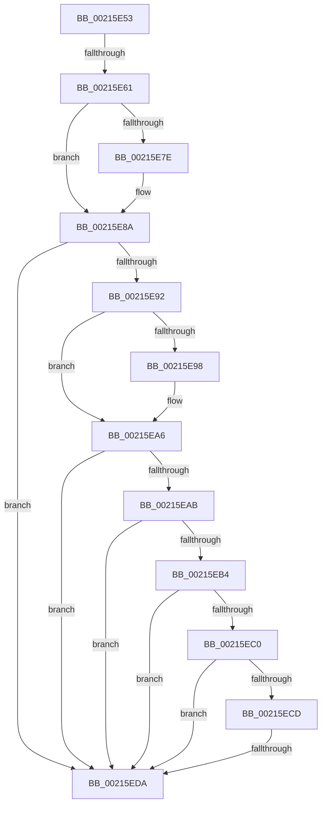

# sub_00215E53

- RVA: `0x00215E53`–`0x00215EE4` (길이 `145` bytes)
- VA: `0x0000000140215E53`
- 실행 섹션: `.text`
- PDB 이름 있음: `아니요`; PDB Function 태그: `아니요`
- unwind 정보 RVA: `0x0005E258`
- 디코드: `37`개 명령, `145/145` bytes 표시
- 미해석 바이트: `0` (있으면 어셈블리에 `.byte`로 보존)

> 이 문서는 커널 이미지의 기계어와 PDB 기호를 분석해 생성했습니다. 4번과 5번은 함수 원형과 자료형을 바이너리 사용 방식에서 추정한 C 해석이며 원본 소스 복구 결과는 아닙니다.

## 1. Dependencies

- 직접 호출 지점: **4**; 고유 호출 대상: **4**
- 직접 호출자로 확인된 함수: **0**
- RIP 상대 이미지 참조: **3**

### Outgoing calls
- `0x00215E6B` → [KiReleaseQueuedSpinLockInstrumented](KiReleaseQueuedSpinLockInstrumented_function_002179F0.md) (function, `0x002179F0`)
- `0x00215E85` → [KiLowerIrqlProcessIrqlFlags](../4F/KiLowerIrqlProcessIrqlFlags_function_004F5698.md) (function, `0x004F5698`)
- `0x00215EA1` → [IoBoostThreadIoPriority](IoBoostThreadIoPriority_function_00216110.md) (function, `0x00216110`)
- `0x00215EC4` → [ExAcquireRundownProtection](ExAcquireRundownProtection_function_00216620.md) (function, `0x00216620`)

### Direct callers
- 이 함수 시작 RVA로 연결되는 직접 call은 확인되지 않았습니다. 간접 호출은 완전히 역산할 수 없습니다.

### Static image references
- `0x00215E53` → RVA `0x00F0DE58` (`.data`; read)
- `0x00215E70` → RVA `0x00FC6D20` (`ALMOSTRO`; read)
- `0x00215EB4` → RVA `0x00F8D130` (`.data`; read)

## 2. Other-region calls and transfers

- 다른 실행 섹션으로 향하는 call: **0**
- call이 아닌 외부 분기/꼬리 이동: **2**
  - `0x00215E5B` → [sub_00215EFE](Unknown_function_00215EFE.md) (`tail-transfer`)
  - `0x00215ED4` → [sub_002160C7](Unknown_function_002160C7.md) (`tail-transfer`)

## 3. Assembly (complete function range)

```asm
00215E53  8B 05 FF 7F CF 00               mov eax, dword ptr [rip + 0xcf7fff]
00215E59  85 C0                           test eax, eax
00215E5B  0F 85 9D 00 00 00               jne 0x140215efe
00215E61  48 8B 54 24 68                  mov rdx, qword ptr [rsp + 0x68]
00215E66  48 8D 4C 24 20                  lea rcx, [rsp + 0x20]
00215E6B  E8 80 1B 00 00                  call 0x1402179f0
00215E70  44 39 25 A9 0E DB 00            cmp dword ptr [rip + 0xdb0ea9], r12d
00215E77  0F B6 5C 24 30                  movzx ebx, byte ptr [rsp + 0x30]
00215E7C  74 0C                           je 0x140215e8a
00215E7E  44 0F 20 C1                     mov rcx, cr8
00215E82  0F B6 D3                        movzx edx, bl
00215E85  E8 0E F8 2D 00                  call 0x1404f5698
00215E8A  44 0F 22 C3                     mov cr8, rbx
00215E8E  85 FF                           test edi, edi
00215E90  74 48                           je 0x140215eda
00215E92  40 F6 C7 04                     test dil, 4
00215E96  74 0E                           je 0x140215ea6
00215E98  45 33 C0                        xor r8d, r8d
00215E9B  41 8B D5                        mov edx, r13d
00215E9E  48 8B CE                        mov rcx, rsi
00215EA1  E8 6A 02 00 00                  call 0x140216110
00215EA6  41 84 FD                        test r13b, dil
00215EA9  74 2F                           je 0x140215eda
00215EAB  44 39 A6 E8 05 00 00            cmp dword ptr [rsi + 0x5e8], r12d
00215EB2  74 26                           je 0x140215eda
00215EB4  48 8B 1D 75 72 D7 00            mov rbx, qword ptr [rip + 0xd77275]
00215EBB  48 85 DB                        test rbx, rbx
00215EBE  74 1A                           je 0x140215eda
00215EC0  48 8D 4B 58                     lea rcx, [rbx + 0x58]
00215EC4  E8 57 07 00 00                  call 0x140216620
00215EC9  84 C0                           test al, al
00215ECB  74 0D                           je 0x140215eda
00215ECD  48 8B 43 60                     mov rax, qword ptr [rbx + 0x60]
00215ED1  48 85 C0                        test rax, rax
00215ED4  0F 85 ED 01 00 00               jne 0x1402160c7
00215EDA  48 8B 5C 24 78                  mov rbx, qword ptr [rsp + 0x78]
00215EDF  4C 8B 6C 24 48                  mov r13, qword ptr [rsp + 0x48]
```

## 4. C-style interpretation (structured pseudocode)

```c
__int64 __fastcall sub_00215E53(__int64 a1, __int64 a2, int a3, __int64 a4, __int64 a5, unsigned __int8 a6, __int64 a7, __int64 a8, __int64 a9, __int64 a10, __int64 a11, __int64 a12, __int64 a13, __int64 a14, __int64 a15)
{
    __int64 result;
    unsigned __int64 v_stack_p20;

    result = KiReleaseQueuedSpinLockInstrumented(v_stack_p20, a13, a3, a4);
    if ((*(unsigned int *)(v_rip + 14356137)) != ((unsigned int)(v_r12))) {
        a1 = v_cr8;
        a2 = a6;
        result = KiLowerIrqlProcessIrqlFlags(a1, a2, a3, a4);
    }
    if ((unsigned int)(v_rdi) == 0) goto loc_00215EDA;
    if ((((unsigned __int8)(v_rdi)) & (4)) != 0) {
        a3 = 0;
        a2 = (unsigned int)(v_r13);
        a1 = v_rsi;
        result = IoBoostThreadIoPriority(a1, a2, a3, a4);
    }
    if ((((unsigned __int8)(v_r13)) & ((unsigned __int8)(v_rdi))) == 0) goto loc_00215EDA;
    if ((*(unsigned int *)(v_rsi + 1512)) == ((unsigned int)(v_r12))) goto loc_00215EDA;
    if (*(unsigned __int64 *)(v_rip + 14119541) == 0) goto loc_00215EDA;
    result = ExAcquireRundownProtection(*(unsigned __int64 *)(v_rip + 14119541) + 88, a2, a3, a4);
    if ((unsigned __int8)(result) == 0) goto loc_00215EDA;
loc_00215EDA:
    return *(unsigned __int64 *)(*(unsigned __int64 *)(v_rip + 14119541) + 96);
}
```

## 5. (Beta) C Style

```c
int64_t sub_00215E53(int64_t Arg1, int64_t Arg2, int32_t Arg3, int64_t Arg4, uint64_t Arg5, uint8_t Arg6, uint64_t Arg7, uint64_t Arg8, int64_t Arg9, uint64_t Arg10, uint64_t Arg11, uint64_t Arg12, int64_t Arg13, uint64_t Arg14, int64_t Arg15)
{
    int64_t result;
    uint64_t v_stack_p20;

    result = KiReleaseQueuedSpinLockInstrumented(v_stack_p20, Arg13, Arg3, Arg4);
    if ((*(uint32_t *)(v_rip + 0xDB0EA9)) != ((uint32_t)(local_r12))) {
        Arg1 = v_cr8;
        Arg2 = Arg6;
        result = KiLowerIrqlProcessIrqlFlags(Arg1, Arg2, Arg3, Arg4);
    }
    if ((uint32_t)(local_rdi) == 0) goto loc_00215EDA;
    if ((((uint8_t)(local_rdi)) & (4)) != 0) {
        Arg3 = 0;
        Arg2 = (uint32_t)(local_r13);
        Arg1 = local_rsi;
        result = IoBoostThreadIoPriority(Arg1, Arg2, Arg3, Arg4);
    }
    if ((((uint8_t)(local_r13)) & ((uint8_t)(local_rdi))) == 0) goto loc_00215EDA;
    if ((*(uint32_t *)(local_rsi + 0x5E8)) == ((uint32_t)(local_r12))) goto loc_00215EDA;
    if (*(uint64_t *)(v_rip + 0xD77275) == 0) goto loc_00215EDA;
    result = ExAcquireRundownProtection(*(uint64_t *)(v_rip + 0xD77275) + 88, Arg2, Arg3, Arg4);
    if ((uint8_t)(result) == 0) goto loc_00215EDA;
loc_00215EDA:
    return *(uint64_t *)(*(uint64_t *)(v_rip + 0xD77275) + 0x60);
}
```

## 6. Execution-region graph

[열기: 2D/3D 그래프와 함수 탐색 컨트롤 패널](../../../control-panel.html?section=text&rva=0x00215E53&view=graph)

- 2D 그래프는 위에서 아래로 흐르고, 3D 그래프는 빈 공간을 드래그해 회전합니다. Shift+드래그는 이동, 휠은 확대·축소, 함수 노드 선택은 대상 보고서 이동입니다.

### Static fallback


