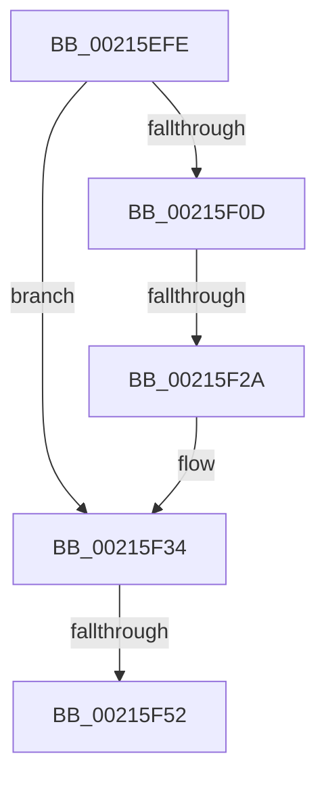

# sub_00215EFE

- RVA: `0x00215EFE`–`0x00215F5C` (길이 `94` bytes)
- VA: `0x0000000140215EFE`
- 실행 섹션: `.text`
- PDB 이름 있음: `아니요`; PDB Function 태그: `아니요`
- unwind 정보 RVA: `0x0005E28C`
- 디코드: `22`개 명령, `94/94` bytes 표시
- 미해석 바이트: `0` (있으면 어셈블리에 `.byte`로 보존)

> 이 문서는 커널 이미지의 기계어와 PDB 기호를 분석해 생성했습니다. 4번과 5번은 함수 원형과 자료형을 바이너리 사용 방식에서 추정한 C 해석이며 원본 소스 복구 결과는 아닙니다.

## 1. Dependencies

- 직접 호출 지점: **2**; 고유 호출 대상: **2**
- 직접 호출자로 확인된 함수: **0**
- RIP 상대 이미지 참조: **0**

### Outgoing calls
- `0x00215F2F` → [KxWaitForLockChainValid](KxWaitForLockChainValid_function_00217AA0.md) (function, `0x00217AA0`)
- `0x00215F52` → [KeWakeAddressAll](KeWakeAddressAll_function_00217C20.md) (function, `0x00217C20`)

### Direct callers
- 이 함수 시작 RVA로 연결되는 직접 call은 확인되지 않았습니다. 간접 호출은 완전히 역산할 수 없습니다.

### Static image references
- 디코드된 RIP-relative 메모리 참조가 없습니다.

## 2. Other-region calls and transfers

- 다른 실행 섹션으로 향하는 call: **0**
- call이 아닌 외부 분기/꼬리 이동: **3**
  - `0x00215F24` → [sub_00215E53 + 0x1D](Unknown_function_00215E53.md) (`tail-transfer`)
  - `0x00215F4C` → [sub_00215E53 + 0x1D](Unknown_function_00215E53.md) (`tail-transfer`)
  - `0x00215F57` → [sub_00215E53 + 0x1D](Unknown_function_00215E53.md) (`tail-transfer`)

## 3. Assembly (complete function range)

```asm
00215EFE  0F 0D 4C 24 20                  prefetchw byte ptr [rsp + 0x20]
00215F03  48 8B 44 24 20                  mov rax, qword ptr [rsp + 0x20]
00215F08  48 85 C0                        test rax, rax
00215F0B  75 27                           jne 0x140215f34
00215F0D  48 8B 4C 24 28                  mov rcx, qword ptr [rsp + 0x28]
00215F12  48 8D 44 24 20                  lea rax, [rsp + 0x20]
00215F17  F0 4C 0F B1 21                  lock cmpxchg qword ptr [rcx], r12
00215F1C  48 8D 4C 24 20                  lea rcx, [rsp + 0x20]
00215F21  48 3B C1                        cmp rax, rcx
00215F24  0F 84 46 FF FF FF               je 0x140215e70
00215F2A  48 8D 4C 24 20                  lea rcx, [rsp + 0x20]
00215F2F  E8 6C 1B 00 00                  call 0x140217aa0
00215F34  48 8D 48 08                     lea rcx, [rax + 8]
00215F38  4C 89 64 24 20                  mov qword ptr [rsp + 0x20], r12
00215F3D  48 8B 54 24 28                  mov rdx, qword ptr [rsp + 0x28]
00215F42  48 8B C2                        mov rax, rdx
00215F45  48 87 01                        xchg qword ptr [rcx], rax
00215F48  32 C2                           xor al, dl
00215F4A  A8 04                           test al, 4
00215F4C  0F 84 1E FF FF FF               je 0x140215e70
00215F52  E8 C9 1C 00 00                  call 0x140217c20
00215F57  E9 14 FF FF FF                  jmp 0x140215e70
```

## 4. C-style interpretation (structured pseudocode)

```c
__int64 __fastcall sub_00215EFE(__int64 a1, __int64 a2, __int64 a3, __int64 a4, __int64 a5)
{
    __int64 result;
    unsigned __int8 v_stack_p20;

    if (v_stack_p20 != 0) goto loc_00215F34;
    result = KxWaitForLockChainValid(v_stack_p20, a2, a3, a4);
loc_00215F34:
    v_stack_p20 = v_r12;
    result = (unsigned __int8)((a5) ^ ((unsigned __int8)(a5)));
    result = KeWakeAddressAll(result + 8, a5, a3, a4);
}
```

## 5. (Beta) C Style

```c
int64_t sub_00215EFE(int64_t Arg1, int64_t Arg2, int64_t Arg3, int64_t Arg4, void *Arg5)
{
    uint8_t *arg5 = (uint8_t *)Arg5;

    int64_t result;
    uint8_t v_stack_p20;

    if (v_stack_p20 != 0) goto loc_00215F34;
    result = KxWaitForLockChainValid(v_stack_p20, Arg2, Arg3, Arg4);
loc_00215F34:
    v_stack_p20 = local_r12;
    result = (uint8_t)((Arg5) ^ ((uint8_t)(Arg5)));
    result = KeWakeAddressAll(result + 8, Arg5, Arg3, Arg4);
}
```

### 관측된 메모리 오프셋

구조체 형식이 확인되지 않은 접근은 인자 기준의 오프셋으로만 기록했습니다.

| 기준 인자 | 오프셋 표현 | 폭 (bit) | 접근 |
|---|---:|---:|---|
| `Arg5` | `+ 0x0` | `64` | `R` |

## 6. Execution-region graph

[열기: 2D/3D 그래프와 함수 탐색 컨트롤 패널](../../../control-panel.html?section=text&rva=0x00215EFE&view=graph)

- 2D 그래프는 위에서 아래로 흐르고, 3D 그래프는 빈 공간을 드래그해 회전합니다. Shift+드래그는 이동, 휠은 확대·축소, 함수 노드 선택은 대상 보고서 이동입니다.

### Static fallback


