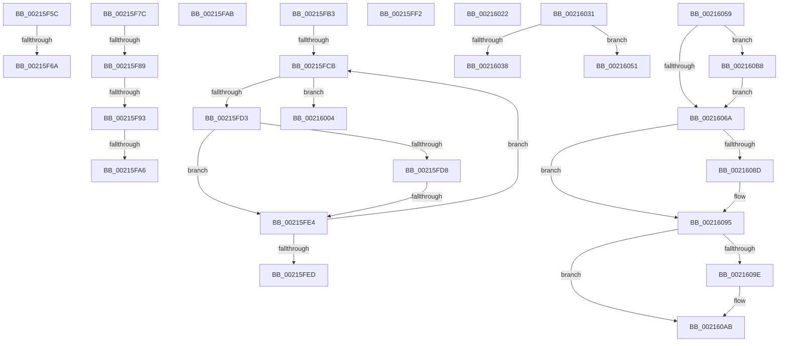

# sub_00215F5C

- RVA: `0x00215F5C`–`0x002160C7` (길이 `363` bytes)
- VA: `0x0000000140215F5C`
- 실행 섹션: `.text`
- PDB 이름 있음: `아니요`; PDB Function 태그: `아니요`
- unwind 정보 RVA: `0x0005E2AC`
- 디코드: `88`개 명령, `363/363` bytes 표시
- 미해석 바이트: `0` (있으면 어셈블리에 `.byte`로 보존)

> 이 문서는 커널 이미지의 기계어와 PDB 기호를 분석해 생성했습니다. 4번과 5번은 함수 원형과 자료형을 바이너리 사용 방식에서 추정한 C 해석이며 원본 소스 복구 결과는 아닙니다.

## 1. Dependencies

- 직접 호출 지점: **8**; 고유 호출 대상: **7**
- 직접 호출자로 확인된 함수: **0**
- RIP 상대 이미지 참조: **2**

### Outgoing calls
- `0x00215F72` → [KiAcquireQueuedSpinLockInstrumented](../27/KiAcquireQueuedSpinLockInstrumented_function_00275850.md) (function, `0x00275850`)
- `0x00215FFA` → [KiRaiseIrqlProcessIrqlFlags](../4F/KiRaiseIrqlProcessIrqlFlags_function_004F56FC.md) (function, `0x004F56FC`)
- `0x00216027` → [KxWaitForLockOwnerShip](../25/KxWaitForLockOwnerShip_function_00257EB0.md) (function, `0x00257EB0`)
- `0x00216043` → [PsBoostThreadIoEx](../39/PsBoostThreadIoEx_function_00392C00.md) (function, `0x00392C00`)
- `0x00216084` → [KiAbThreadInsertList](KiAbThreadInsertList_function_0021F0E0.md) (function, `0x0021F0E0`)
- `0x00216090` → [KiAbQueueAutoBoostDpc](../20/KiAbQueueAutoBoostDpc_function_002074D0.md) (function, `0x002074D0`)
- `0x002160A6` → [KiLowerIrqlProcessIrqlFlags](../4F/KiLowerIrqlProcessIrqlFlags_function_004F5698.md) (function, `0x004F5698`)
- `0x002160C0` → [KiRaiseIrqlProcessIrqlFlags](../4F/KiRaiseIrqlProcessIrqlFlags_function_004F56FC.md) (function, `0x004F56FC`)

### Direct callers
- 이 함수 시작 RVA로 연결되는 직접 call은 확인되지 않았습니다. 간접 호출은 완전히 역산할 수 없습니다.

### Static image references
- `0x00215F5C` → RVA `0x00F0DE58` (`.data`; read)
- `0x00216061` → RVA `0x00FC6D20` (`ALMOSTRO`; read)

## 2. Other-region calls and transfers

- 다른 실행 섹션으로 향하는 call: **0**
- call이 아닌 외부 분기/꼬리 이동: **16**
  - `0x00215F64` → [sub_00215D82 + 0x32](Unknown_function_00215D82.md) (`tail-transfer`)
  - `0x00215F77` → [sub_00215D82 + 0x43](Unknown_function_00215D82.md) (`tail-transfer`)
  - `0x00215F83` → [sub_00215D82 + 0x62](Unknown_function_00215D82.md) (`tail-transfer`)
  - `0x00215F8D` → [sub_00215D82 + 0x62](Unknown_function_00215D82.md) (`tail-transfer`)
  - `0x00215FA0` → [sub_00215D82 + 0x62](Unknown_function_00215D82.md) (`tail-transfer`)
  - `0x00215FA6` → [sub_00215D82 + 0x7E](Unknown_function_00215D82.md) (`tail-transfer`)
  - `0x00215FAE` → [sub_00215D82 + 0xBF](Unknown_function_00215D82.md) (`tail-transfer`)
  - `0x00215FC5` → [sub_00215D82 + 0x7B](Unknown_function_00215D82.md) (`tail-transfer`)
  - `0x00215FDE` → [sub_00215D82 + 0x7B](Unknown_function_00215D82.md) (`tail-transfer`)
  - `0x00215FED` → [sub_00215D82 + 0x7B](Unknown_function_00215D82.md) (`tail-transfer`)
  - `0x00215FFF` → [sub_00215D82 + 0x20](Unknown_function_00215D82.md) (`tail-transfer`)
  - `0x0021601D` → [sub_00215D82 + 0x7E](Unknown_function_00215D82.md) (`tail-transfer`)
  - `0x0021602C` → [sub_00215D82 + 0x43](Unknown_function_00215D82.md) (`tail-transfer`)
  - `0x0021604C` → [sub_00215D82 + 0x88](Unknown_function_00215D82.md) (`tail-transfer`)
  - `0x00216054` → [sub_00215D82 + 0x88](Unknown_function_00215D82.md) (`tail-transfer`)
  - `0x002160B3` → [sub_00215D82 + 0xBB](Unknown_function_00215D82.md) (`tail-transfer`)

## 3. Assembly (complete function range)

```asm
00215F5C  8B 05 F6 7E CF 00               mov eax, dword ptr [rip + 0xcf7ef6]
00215F62  85 C0                           test eax, eax
00215F64  0F 85 4A FE FF FF               jne 0x140215db4
00215F6A  48 8B D3                        mov rdx, rbx
00215F6D  48 8D 4C 24 20                  lea rcx, [rsp + 0x20]
00215F72  E8 D9 F8 05 00                  call 0x140275850
00215F77  E9 49 FE FF FF                  jmp 0x140215dc5
00215F7C  48 8B 45 10                     mov rax, qword ptr [rbp + 0x10]
00215F80  48 85 C0                        test rax, rax
00215F83  0F 84 5B FE FF FF               je 0x140215de4
00215F89  44 3B 78 08                     cmp r15d, dword ptr [rax + 8]
00215F8D  0F 83 51 FE FF FF               jae 0x140215de4
00215F93  49 8B DF                        mov rbx, r15
00215F96  48 C1 E3 04                     shl rbx, 4
00215F9A  48 03 D8                        add rbx, rax
00215F9D  48 39 33                        cmp qword ptr [rbx], rsi
00215FA0  0F 85 3E FE FF FF               jne 0x140215de4
00215FA6  E9 55 FE FF FF                  jmp 0x140215e00
00215FAB  83 E7 FD                        and edi, 0xfffffffd
00215FAE  E9 8E FE FF FF                  jmp 0x140215e41
00215FB3  44 8B 43 08                     mov r8d, dword ptr [rbx + 8]
00215FB7  49 C1 E0 04                     shl r8, 4
00215FBB  4C 03 C3                        add r8, rbx
00215FBE  48 83 C3 10                     add rbx, 0x10
00215FC2  48 3B CA                        cmp rcx, rdx
00215FC5  0F 83 32 FE FF FF               jae 0x140215dfd
00215FCB  48 8B 03                        mov rax, qword ptr [rbx]
00215FCE  48 3B C6                        cmp rax, rsi
00215FD1  74 31                           je 0x140216004
00215FD3  48 85 C0                        test rax, rax
00215FD6  74 0C                           je 0x140215fe4
00215FD8  48 FF C1                        inc rcx
00215FDB  48 3B CA                        cmp rcx, rdx
00215FDE  0F 84 19 FE FF FF               je 0x140215dfd
00215FE4  48 83 C3 10                     add rbx, 0x10
00215FE8  49 3B D8                        cmp rbx, r8
00215FEB  75 DE                           jne 0x140215fcb
00215FED  E9 0B FE FF FF                  jmp 0x140215dfd
00215FF2  41 0F B6 D5                     movzx edx, r13b
00215FF6  41 0F B6 CE                     movzx ecx, r14b
00215FFA  E8 FD F6 2D 00                  call 0x1404f56fc
00215FFF  E9 9E FD FF FF                  jmp 0x140215da2
00216004  65 48 8B 0C 25 88 01 00 00      mov rcx, qword ptr gs:[0x188]
0021600D  48 8B C3                        mov rax, rbx
00216010  49 2B C1                        sub rax, r9
00216013  48 C1 F8 04                     sar rax, 4
00216017  88 81 60 04 00 00               mov byte ptr [rcx + 0x460], al
0021601D  E9 DE FD FF FF                  jmp 0x140215e00
00216022  48 8D 4C 24 20                  lea rcx, [rsp + 0x20]
00216027  E8 84 1E 04 00                  call 0x140257eb0
0021602C  E9 94 FD FF FF                  jmp 0x140215dc5
00216031  8B 43 08                        mov eax, dword ptr [rbx + 8]
00216034  A8 01                           test al, 1
00216036  75 19                           jne 0x140216051
00216038  45 33 C9                        xor r9d, r9d
0021603B  45 33 C0                        xor r8d, r8d
0021603E  33 D2                           xor edx, edx
00216040  48 8B CE                        mov rcx, rsi
00216043  E8 B8 CB 17 00                  call 0x140392c00
00216048  83 4B 08 01                     or dword ptr [rbx + 8], 1
0021604C  E9 B9 FD FF FF                  jmp 0x140215e0a
00216051  83 E7 FB                        and edi, 0xfffffffb
00216054  E9 B1 FD FF FF                  jmp 0x140215e0a
00216059  44 0F 20 C5                     mov rbp, cr8
0021605D  45 0F 22 C5                     mov cr8, r13
00216061  44 39 25 B8 0C DB 00            cmp dword ptr [rip + 0xdb0cb8], r12d
00216068  75 4E                           jne 0x1402160b8
0021606A  65 4C 8B 34 25 20 00 00 00      mov r14, qword ptr gs:[0x20]
00216073  4C 8D 86 28 03 00 00            lea r8, [rsi + 0x328]
0021607A  48 8B CE                        mov rcx, rsi
0021607D  49 8D 96 78 91 00 00            lea rdx, [r14 + 0x9178]
00216084  E8 57 90 00 00                  call 0x14021f0e0
00216089  85 C0                           test eax, eax
0021608B  74 08                           je 0x140216095
0021608D  49 8B CE                        mov rcx, r14
00216090  E8 3B 14 FF FF                  call 0x1402074d0
00216095  44 39 25 84 0C DB 00            cmp dword ptr [rip + 0xdb0c84], r12d
0021609C  74 0D                           je 0x1402160ab
0021609E  44 0F 20 C1                     mov rcx, cr8
002160A2  40 0F B6 D5                     movzx edx, bpl
002160A6  E8 ED F5 2D 00                  call 0x1404f5698
002160AB  40 0F B6 C5                     movzx eax, bpl
002160AF  44 0F 22 C0                     mov cr8, rax
002160B3  E9 85 FD FF FF                  jmp 0x140215e3d
002160B8  41 0F B6 D5                     movzx edx, r13b
002160BC  40 0F B6 CD                     movzx ecx, bpl
002160C0  E8 37 F6 2D 00                  call 0x1404f56fc
002160C5  EB A3                           jmp 0x14021606a
```

## 4. C-style interpretation (structured pseudocode)

```c
__int64 __fastcall sub_00215F5C(__int64 a1, __int64 a2, __int64 a3, __int64 a4)
{
    __int64 result;
    unsigned __int64 v_stack_p20;

    result = KiAcquireQueuedSpinLockInstrumented(v_stack_p20, v_rbx, a3, a4);
}
```

## 5. (Beta) C Style

```c
int64_t sub_00215F5C(int64_t Arg1, int64_t Arg2, int64_t Arg3, int64_t Arg4)
{
    int64_t result;
    uint64_t v_stack_p20;

    result = KiAcquireQueuedSpinLockInstrumented(v_stack_p20, local_rbx, Arg3, Arg4);
}
```

## 6. Execution-region graph

[열기: 2D/3D 그래프와 함수 탐색 컨트롤 패널](../../../control-panel.html?section=text&rva=0x00215F5C&view=graph)

- 2D 그래프는 위에서 아래로 흐르고, 3D 그래프는 빈 공간을 드래그해 회전합니다. Shift+드래그는 이동, 휠은 확대·축소, 함수 노드 선택은 대상 보고서 이동입니다.

### Static fallback


