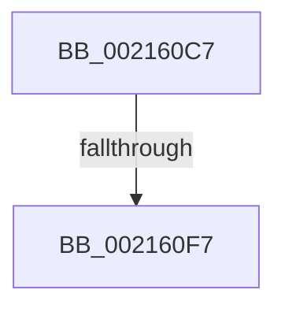

# sub_002160C7

- RVA: `0x002160C7`–`0x00216101` (길이 `58` bytes)
- VA: `0x00000001402160C7`
- 실행 섹션: `.text`
- PDB 이름 있음: `아니요`; PDB Function 태그: `아니요`
- unwind 정보 RVA: `0x0005E2D0`
- 디코드: `13`개 명령, `58/58` bytes 표시
- 미해석 바이트: `0` (있으면 어셈블리에 `.byte`로 보존)

> 이 문서는 커널 이미지의 기계어와 PDB 기호를 분석해 생성했습니다. 4번과 5번은 함수 원형과 자료형을 바이너리 사용 방식에서 추정한 C 해석이며 원본 소스 복구 결과는 아닙니다.

## 1. Dependencies

- 직접 호출 지점: **2**; 고유 호출 대상: **2**
- 직접 호출자로 확인된 함수: **0**
- RIP 상대 이미지 참조: **1**

### Outgoing calls
- `0x002160CE` → [guard_dispatch_icall](../6B/guard_dispatch_icall_function_006BAAD0.md) (function, `0x006BAAD0`)
- `0x002160F7` → [ExfReleaseRundownProtection](../34/ExfReleaseRundownProtection_function_00349EB0.md) (function, `0x00349EB0`)

### Direct callers
- 이 함수 시작 RVA로 연결되는 직접 call은 확인되지 않았습니다. 간접 호출은 완전히 역산할 수 없습니다.

### Static image references
- `0x002160D3` → RVA `0x00F8D130` (`.data`; read)

## 2. Other-region calls and transfers

- 다른 실행 섹션으로 향하는 call: **0**
- call이 아닌 외부 분기/꼬리 이동: **2**
  - `0x002160F1` → [sub_00215E53 + 0x87](Unknown_function_00215E53.md) (`tail-transfer`)
  - `0x002160FC` → [sub_00215E53 + 0x87](Unknown_function_00215E53.md) (`tail-transfer`)

## 3. Assembly (complete function range)

```asm
002160C7  48 8B 40 10                     mov rax, qword ptr [rax + 0x10]
002160CB  48 8B CE                        mov rcx, rsi
002160CE  E8 FD 49 4A 00                  call 0x1406baad0
002160D3  48 8B 0D 56 70 D7 00            mov rcx, qword ptr [rip + 0xd77056]
002160DA  48 83 C1 58                     add rcx, 0x58
002160DE  0F 0D 09                        prefetchw byte ptr [rcx]
002160E1  48 8B 01                        mov rax, qword ptr [rcx]
002160E4  48 83 E0 FE                     and rax, 0xfffffffffffffffe
002160E8  48 8D 50 FE                     lea rdx, [rax - 2]
002160EC  F0 48 0F B1 11                  lock cmpxchg qword ptr [rcx], rdx
002160F1  0F 84 E3 FD FF FF               je 0x140215eda
002160F7  E8 B4 3D 13 00                  call 0x140349eb0
002160FC  E9 D9 FD FF FF                  jmp 0x140215eda
```

## 4. C-style interpretation (structured pseudocode)

```c
__int64 __fastcall sub_002160C7(void)
{
    __int64 result;

    result = guard_dispatch_icall(v_rsi, a2, a3, a4);
    a1 = (*(unsigned __int64 *)(v_rip + 14118998)) + (88);
    result = (*(unsigned __int64 *)(a1)) & (-2);
    result = ExfReleaseRundownProtection(a1, result - 2, a3, a4);
}
```

## 5. (Beta) C Style

```c
void sub_002160C7(void)
{
    int64_t result;

    result = guard_dispatch_icall(local_rsi, a2, a3, a4);
    a1 = (*(uint64_t *)(v_rip + 0xD77056)) + (88);
    result = (*(uint64_t *)(a1)) & (-2);
    result = ExfReleaseRundownProtection(a1, result - 2, a3, a4);
}
```

## 6. Execution-region graph

[열기: 2D/3D 그래프와 함수 탐색 컨트롤 패널](../../../control-panel.html?section=text&rva=0x002160C7&view=graph)

- 2D 그래프는 위에서 아래로 흐르고, 3D 그래프는 빈 공간을 드래그해 회전합니다. Shift+드래그는 이동, 휠은 확대·축소, 함수 노드 선택은 대상 보고서 이동입니다.

### Static fallback


