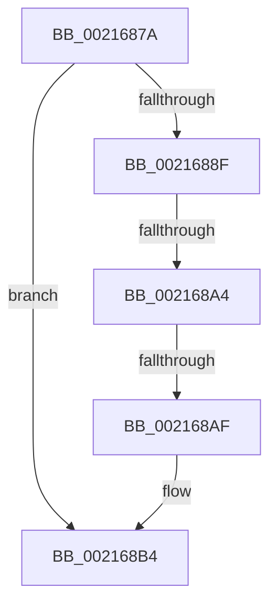

# sub_0021687A

- RVA: `0x0021687A`–`0x002168C6` (길이 `76` bytes)
- VA: `0x000000014021687A`
- 실행 섹션: `.text`
- PDB 이름 있음: `아니요`; PDB Function 태그: `아니요`
- unwind 정보 RVA: `0x0005E390`
- 디코드: `16`개 명령, `76/76` bytes 표시
- 미해석 바이트: `0` (있으면 어셈블리에 `.byte`로 보존)

> 이 문서는 커널 이미지의 기계어와 PDB 기호를 분석해 생성했습니다. 4번과 5번은 함수 원형과 자료형을 바이너리 사용 방식에서 추정한 C 해석이며 원본 소스 복구 결과는 아닙니다.

## 1. Dependencies

- 직접 호출 지점: **0**; 고유 호출 대상: **0**
- 직접 호출자로 확인된 함수: **0**
- RIP 상대 이미지 참조: **1**

### Outgoing calls
- 직접 디코드된 call 명령이 없습니다.

### Direct callers
- 이 함수 시작 RVA로 연결되는 직접 call은 확인되지 않았습니다. 간접 호출은 완전히 역산할 수 없습니다.

### Static image references
- `0x00216897` → RVA `0x00FC6D20` (`ALMOSTRO`; read)

## 2. Other-region calls and transfers

- 다른 실행 섹션으로 향하는 call: **0**
- call이 아닌 외부 분기/꼬리 이동: **2**
  - `0x0021689E` → [sub_00216B16](Unknown_function_00216B16.md) (`tail-transfer`)
  - `0x002168AD` → [sub_00216920](Unknown_function_00216920.md) (`tail-transfer`)

## 3. Assembly (complete function range)

```asm
0021687A  48 89 7C 24 60                  mov qword ptr [rsp + 0x60], rdi
0021687F  4C 89 7C 24 30                  mov qword ptr [rsp + 0x30], r15
00216884  41 BF 02 00 00 00               mov r15d, 2
0021688A  45 85 C9                        test r9d, r9d
0021688D  75 25                           jne 0x1402168b4
0021688F  44 0F 20 C5                     mov rbp, cr8
00216893  45 0F 22 C7                     mov cr8, r15
00216897  44 39 0D 82 04 DB 00            cmp dword ptr [rip + 0xdb0482], r9d
0021689E  0F 85 72 02 00 00               jne 0x140216b16
002168A4  33 FF                           xor edi, edi
002168A6  F0 48 0F BA 6B 40 00            lock bts qword ptr [rbx + 0x40], 0
002168AD  72 71                           jb 0x140216920
002168AF  4C 8B 54 24 70                  mov r10, qword ptr [rsp + 0x70]
002168B4  80 BB 4A 02 00 00 00            cmp byte ptr [rbx + 0x24a], 0
002168BB  48 8D 93 98 00 00 00            lea rdx, [rbx + 0x98]
002168C2  48 8B 42 20                     mov rax, qword ptr [rdx + 0x20]
```

## 4. C-style interpretation (structured pseudocode)

```c
__int64 __fastcall sub_0021687A(__int64 a1, __int64 a2, __int64 a3, int a4, __int64 a5, __int64 a6, __int64 a7, __int64 a8, __int64 a9, __int64 a10, __int64 a11, __int64 a12, __int64 a13, __int64 a14)
{
    __int64 v_rdi;
    unsigned __int64 v_stack_p30;
    unsigned __int64 v_stack_p60;

    v_stack_p60 = v_rdi;
    v_stack_p30 = v_r15;
    if (a4 != 0) goto loc_002168B4;
    v_rdi = 0;
loc_002168B4:
    return *(unsigned __int64 *)(v_rbx + 152 + 32);
}
```

## 5. (Beta) C Style

```c
int64_t sub_0021687A(int64_t Arg1, int64_t Arg2, int64_t Arg3, int32_t Arg4, uint64_t Arg5, uint64_t Arg6, uint64_t Arg7, uint64_t Arg8, uint64_t Arg9, uint64_t Arg10, uint64_t Arg11, uint64_t Arg12, uint64_t Arg13, int64_t Arg14)
{
    int64_t local_rdi;
    uint64_t v_stack_p30;
    uint64_t v_stack_p60;

    v_stack_p60 = local_rdi;
    v_stack_p30 = local_r15;
    if (Arg4 != 0) goto loc_002168B4;
    local_rdi = 0;
loc_002168B4:
    return *(uint64_t *)(local_rbx + 0x98 + 0x20);
}
```

## 6. Execution-region graph

[열기: 2D/3D 그래프와 함수 탐색 컨트롤 패널](../../../control-panel.html?section=text&rva=0x0021687A&view=graph)

- 2D 그래프는 위에서 아래로 흐르고, 3D 그래프는 빈 공간을 드래그해 회전합니다. Shift+드래그는 이동, 휠은 확대·축소, 함수 노드 선택은 대상 보고서 이동입니다.

### Static fallback


