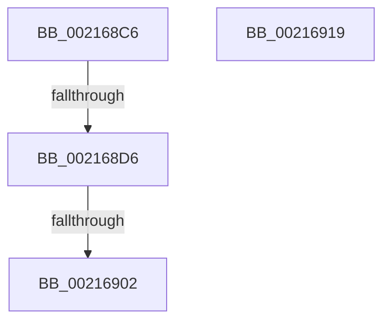

# sub_002168C6

- RVA: `0x002168C6`–`0x00216920` (길이 `90` bytes)
- VA: `0x00000001402168C6`
- 실행 섹션: `.text`
- PDB 이름 있음: `아니요`; PDB Function 태그: `아니요`
- unwind 정보 RVA: `0x0005E3A8`
- 디코드: `21`개 명령, `90/90` bytes 표시
- 미해석 바이트: `0` (있으면 어셈블리에 `.byte`로 보존)

> 이 문서는 커널 이미지의 기계어와 PDB 기호를 분석해 생성했습니다. 4번과 5번은 함수 원형과 자료형을 바이너리 사용 방식에서 추정한 C 해석이며 원본 소스 복구 결과는 아닙니다.

## 1. Dependencies

- 직접 호출 지점: **0**; 고유 호출 대상: **0**
- 직접 호출자로 확인된 함수: **0**
- RIP 상대 이미지 참조: **0**

### Outgoing calls
- 직접 디코드된 call 명령이 없습니다.

### Direct callers
- 이 함수 시작 RVA로 연결되는 직접 call은 확인되지 않았습니다. 간접 호출은 완전히 역산할 수 없습니다.

### Static image references
- 디코드된 RIP-relative 메모리 참조가 없습니다.

## 2. Other-region calls and transfers

- 다른 실행 섹션으로 향하는 call: **0**
- call이 아닌 외부 분기/꼬리 이동: **3**
  - `0x002168D0` → [sub_00216B4F](Unknown_function_00216B4F.md) (`tail-transfer`)
  - `0x002168FC` → [sub_00216AAF](Unknown_function_00216AAF.md) (`tail-transfer`)
  - `0x00216914` → [sub_00216AAF + 0xB](Unknown_function_00216AAF.md) (`tail-transfer`)

## 3. Assembly (complete function range)

```asm
002168C6  4C 89 64 24 68                  mov qword ptr [rsp + 0x68], r12
002168CB  4C 89 6C 24 78                  mov qword ptr [rsp + 0x78], r13
002168D0  0F 85 79 02 00 00               jne 0x140216b4f
002168D6  48 8D BB 58 02 00 00            lea rdi, [rbx + 0x258]
002168DD  48 89 47 20                     mov qword ptr [rdi + 0x20], rax
002168E1  0F B6 42 28                     movzx eax, byte ptr [rdx + 0x28]
002168E5  88 47 28                        mov byte ptr [rdi + 0x28], al
002168E8  0F B6 42 29                     movzx eax, byte ptr [rdx + 0x29]
002168EC  88 47 29                        mov byte ptr [rdi + 0x29], al
002168EF  0F B6 42 2A                     movzx eax, byte ptr [rdx + 0x2a]
002168F3  88 47 2A                        mov byte ptr [rdi + 0x2a], al
002168F6  48 8B 0A                        mov rcx, qword ptr [rdx]
002168F9  48 3B CA                        cmp rcx, rdx
002168FC  0F 84 AD 01 00 00               je 0x140216aaf
00216902  48 8B 42 08                     mov rax, qword ptr [rdx + 8]
00216906  48 89 0F                        mov qword ptr [rdi], rcx
00216909  48 89 47 08                     mov qword ptr [rdi + 8], rax
0021690D  48 89 79 08                     mov qword ptr [rcx + 8], rdi
00216911  48 89 38                        mov qword ptr [rax], rdi
00216914  E9 A1 01 00 00                  jmp 0x140216aba
00216919  0F 1F 80 00 00 00 00            nop dword ptr [rax]
```

## 4. C-style interpretation (structured pseudocode)

```c
__int64 __fastcall sub_002168C6(__int64 a1, __int64 a2)
{
    unsigned __int64 v_stack_p68;
    unsigned __int64 v_stack_p78;

    v_stack_p68 = v_r12;
    v_stack_p78 = v_r13;
    *(unsigned __int64 *)(v_rbx + 600 + 32) = result;
    *(unsigned __int8 *)(v_rbx + 600 + 40) = (unsigned __int8)(*(unsigned __int8 *)(a2 + 40));
    *(unsigned __int8 *)(v_rbx + 600 + 41) = (unsigned __int8)(*(unsigned __int8 *)(a2 + 41));
    *(unsigned __int8 *)(v_rbx + 600 + 42) = (unsigned __int8)(*(unsigned __int8 *)(a2 + 42));
    *(unsigned __int64 *)(v_rbx + 600) = *(unsigned __int64 *)(a2);
    *(unsigned __int64 *)(v_rbx + 600 + 8) = *(unsigned __int64 *)(a2 + 8);
    *(unsigned __int64 *)(*(unsigned __int64 *)(a2) + 8) = v_rbx + 600;
    *(unsigned __int64 *)(*(unsigned __int64 *)(a2 + 8)) = v_rbx + 600;
}
```

## 5. (Beta) C Style

```c
int64_t sub_002168C6(int64_t Arg1, void *Arg2)
{
    uint8_t *arg2 = (uint8_t *)Arg2;

    uint64_t v_stack_p68;
    uint64_t v_stack_p78;

    v_stack_p68 = local_r12;
    v_stack_p78 = local_r13;
    *(uint64_t *)(local_rbx + 0x258 + 0x20) = result;
    *(uint8_t *)(local_rbx + 0x258 + 0x28) = (uint8_t)(*(uint8_t *)(arg2 + 0x28));
    *(uint8_t *)(local_rbx + 0x258 + 0x29) = (uint8_t)(*(uint8_t *)(arg2 + 0x29));
    *(uint8_t *)(local_rbx + 0x258 + 0x2A) = (uint8_t)(*(uint8_t *)(arg2 + 0x2A));
    *(uint64_t *)(local_rbx + 0x258) = *(uint64_t *)(arg2);
    *(uint64_t *)(local_rbx + 0x258 + 0x8) = *(uint64_t *)(arg2 + 0x8);
    *(uint64_t *)(*(uint64_t *)(arg2) + 0x8) = local_rbx + 600;
    *(uint64_t *)(*(uint64_t *)(arg2 + 0x8)) = local_rbx + 600;
}
```

### 관측된 메모리 오프셋

구조체 형식이 확인되지 않은 접근은 인자 기준의 오프셋으로만 기록했습니다.

| 기준 인자 | 오프셋 표현 | 폭 (bit) | 접근 |
|---|---:|---:|---|
| `Arg2` | `+ 0x0` | `64` | `R` |
| `Arg2` | `+ 0x8` | `64` | `R` |
| `Arg2` | `+ 0x28` | `8` | `R` |
| `Arg2` | `+ 0x29` | `8` | `R` |
| `Arg2` | `+ 0x2A` | `8` | `R` |

## 6. Execution-region graph

[열기: 2D/3D 그래프와 함수 탐색 컨트롤 패널](../../../control-panel.html?section=text&rva=0x002168C6&view=graph)

- 2D 그래프는 위에서 아래로 흐르고, 3D 그래프는 빈 공간을 드래그해 회전합니다. Shift+드래그는 이동, 휠은 확대·축소, 함수 노드 선택은 대상 보고서 이동입니다.

### Static fallback


