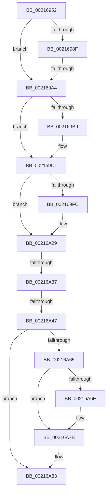

# sub_00216952

- RVA: `0x00216952`–`0x00216AAE` (길이 `348` bytes)
- VA: `0x0000000140216952`
- 실행 섹션: `.text`
- PDB 이름 있음: `아니요`; PDB Function 태그: `아니요`
- unwind 정보 RVA: `0x0005E3E4`
- 디코드: `72`개 명령, `348/348` bytes 표시
- 미해석 바이트: `0` (있으면 어셈블리에 `.byte`로 보존)

> 이 문서는 커널 이미지의 기계어와 PDB 기호를 분석해 생성했습니다. 4번과 5번은 함수 원형과 자료형을 바이너리 사용 방식에서 추정한 C 해석이며 원본 소스 복구 결과는 아닙니다.

## 1. Dependencies

- 직접 호출 지점: **2**; 고유 호출 대상: **2**
- 직접 호출자로 확인된 함수: **0**
- RIP 상대 이미지 참조: **3**

### Outgoing calls
- `0x00216A24` → [KiSetAddressPolicy](KiSetAddressPolicy_function_002178A0.md) (function, `0x002178A0`)
- `0x00216A76` → [KiLowerIrqlProcessIrqlFlags](../4F/KiLowerIrqlProcessIrqlFlags_function_004F5698.md) (function, `0x004F5698`)

### Direct callers
- 이 함수 시작 RVA로 연결되는 직접 call은 확인되지 않았습니다. 간접 호출은 완전히 역산할 수 없습니다.

### Static image references
- `0x002169EF` → RVA `0x01201840` (`CFGRO`; read)
- `0x00216A29` → RVA `0x00FC6AB8` (`ALMOSTRO`; read)
- `0x00216A65` → RVA `0x00FC6D20` (`ALMOSTRO`; read)

## 2. Other-region calls and transfers

- 다른 실행 섹션으로 향하는 call: **0**
- call이 아닌 외부 분기/꼬리 이동: **3**
  - `0x0021699E` → [sub_00216B4F + 0x18F](Unknown_function_00216B4F.md) (`tail-transfer`)
  - `0x00216A31` → [sub_00216B4F + 0x27B](Unknown_function_00216B4F.md) (`tail-transfer`)
  - `0x00216A41` → [sub_00216AAF + 0x37](Unknown_function_00216AAF.md) (`tail-transfer`)

## 3. Assembly (complete function range)

```asm
00216952  48 89 40 08                     mov qword ptr [rax + 8], rax
00216956  48 89 00                        mov qword ptr [rax], rax
00216959  C6 47 2A 00                     mov byte ptr [rdi + 0x2a], 0
0021695D  48 89 52 08                     mov qword ptr [rdx + 8], rdx
00216961  48 8D 83 A8 00 00 00            lea rax, [rbx + 0xa8]
00216968  48 89 12                        mov qword ptr [rdx], rdx
0021696B  48 89 40 08                     mov qword ptr [rax + 8], rax
0021696F  48 89 00                        mov qword ptr [rax], rax
00216972  66 C7 83 C0 00 00 00 00 00      mov word ptr [rbx + 0xc0], 0
0021697B  C6 83 C2 00 00 00 00            mov byte ptr [rbx + 0xc2], 0
00216982  C6 83 4A 02 00 00 01            mov byte ptr [rbx + 0x24a], 1
00216989  41 F6 C6 01                     test r14b, 1
0021698D  75 15                           jne 0x1402169a4
0021698F  B8 08 00 00 00                  mov eax, 8
00216994  F0 0F C1 86 08 01 00 00         lock xadd dword ptr [rsi + 0x108], eax
0021699C  A8 07                           test al, 7
0021699E  0F 85 3A 03 00 00               jne 0x140216cde
002169A4  81 4B 74 00 08 00 00            or dword ptr [rbx + 0x74], 0x800
002169AB  90                              nop
002169AC  48 89 B3 B8 00 00 00            mov qword ptr [rbx + 0xb8], rsi
002169B3  41 F6 C6 02                     test r14b, 2
002169B7  75 08                           jne 0x1402169c1
002169B9  48 C7 43 40 00 00 00 00         mov qword ptr [rbx + 0x40], 0
002169C1  65 48 8B 04 25 20 00 00 00      mov rax, qword ptr gs:[0x20]
002169CA  4C 8B 6F 20                     mov r13, qword ptr [rdi + 0x20]
002169CE  44 0F B6 B8 D1 00 00 00         movzx r15d, byte ptr [rax + 0xd1]
002169D6  44 0F B6 A0 D0 00 00 00         movzx r12d, byte ptr [rax + 0xd0]
002169DE  41 8B CF                        mov ecx, r15d
002169E1  48 8B 86 80 00 00 00            mov rax, qword ptr [rsi + 0x80]
002169E8  F0 4A 0F AB 4C E0 08            lock bts qword ptr [rax + r12*8 + 8], rcx
002169EF  80 3D 4A AE FE 00 00            cmp byte ptr [rip + 0xfeae4a], 0
002169F6  48 8B 7E 28                     mov rdi, qword ptr [rsi + 0x28]
002169FA  74 2D                           je 0x140216a29
002169FC  49 B8 00 00 00 00 00 00 00 80   movabs r8, 0x8000000000000000
00216A06  48 8B C7                        mov rax, rdi
00216A09  49 0B C0                        or rax, r8
00216A0C  40 F6 C7 02                     test dil, 2
00216A10  48 0F 44 C7                     cmove rax, rdi
00216A14  65 48 89 04 25 00 B0 00 00      mov qword ptr gs:[0xb000], rax
00216A1D  0F B6 8E 60 01 00 00            movzx ecx, byte ptr [rsi + 0x160]
00216A24  E8 77 0E 00 00                  call 0x1402178a0
00216A29  8B 05 89 00 DB 00               mov eax, dword ptr [rip + 0xdb0089]
00216A2F  A8 01                           test al, 1
00216A31  0F 85 93 03 00 00               jne 0x140216dca
00216A37  0F 22 DF                        mov cr3, rdi
00216A3A  80 3D FF AD FE 00 00            cmp byte ptr [rip + 0xfeadff], 0
00216A41  0F 85 9F 00 00 00               jne 0x140216ae6
00216A47  49 8B 85 80 00 00 00            mov rax, qword ptr [r13 + 0x80]
00216A4E  49 8B D7                        mov rdx, r15
00216A51  F0 4A 0F B3 54 E0 08            lock btr qword ptr [rax + r12*8 + 8], rdx
00216A58  81 63 74 FF F7 FF FF            and dword ptr [rbx + 0x74], 0xfffff7ff
00216A5F  41 F6 C6 02                     test r14b, 2
00216A63  75 1E                           jne 0x140216a83
00216A65  83 3D B4 02 DB 00 00            cmp dword ptr [rip + 0xdb02b4], 0
00216A6C  74 0D                           je 0x140216a7b
00216A6E  44 0F 20 C1                     mov rcx, cr8
00216A72  40 0F B6 D5                     movzx edx, bpl
00216A76  E8 1D EC 2D 00                  call 0x1404f5698
00216A7B  40 0F B6 C5                     movzx eax, bpl
00216A7F  44 0F 22 C0                     mov cr8, rax
00216A83  48 8B 44 24 70                  mov rax, qword ptr [rsp + 0x70]
00216A88  48 C7 40 20 00 00 00 00         mov qword ptr [rax + 0x20], 0
00216A90  4C 8B 6C 24 78                  mov r13, qword ptr [rsp + 0x78]
00216A95  4C 8B 64 24 68                  mov r12, qword ptr [rsp + 0x68]
00216A9A  48 8B 7C 24 60                  mov rdi, qword ptr [rsp + 0x60]
00216A9F  4C 8B 7C 24 30                  mov r15, qword ptr [rsp + 0x30]
00216AA4  48 83 C4 38                     add rsp, 0x38
00216AA8  41 5E                           pop r14
00216AAA  5E                              pop rsi
00216AAB  5D                              pop rbp
00216AAC  5B                              pop rbx
00216AAD  C3                              ret
```

## 4. C-style interpretation (structured pseudocode)

```c
__int64 __fastcall sub_00216952(__int64 a1, __int64 a2, __int64 a3, __int64 a4, __int64 a5, __int64 a6, __int64 a7, __int64 a8, __int64 a9, __int64 a10, __int64 a11, __int64 a12, __int64 a13, __int64 a14, __int64 a15)
{
    __int64 result;
    __int64 v_rsp;

    *(unsigned __int64 *)(result + 8) = result;
    *(unsigned __int64 *)(result) = result;
    *(unsigned __int8 *)(v_rdi + 42) = 0;
    *(unsigned __int64 *)(a2 + 8) = a2;
    *(unsigned __int64 *)(a2) = a2;
    *(unsigned __int64 *)(v_rbx + 168 + 8) = v_rbx + 168;
    *(unsigned __int64 *)(v_rbx + 168) = v_rbx + 168;
    *(unsigned __int16 *)(v_rbx + 192) = 0;
    *(unsigned __int8 *)(v_rbx + 194) = 0;
    *(unsigned __int8 *)(v_rbx + 586) = 1;
    if ((((unsigned __int8)(v_r14)) & (1)) != 0) goto loc_002169A4;
loc_002169A4:
    *(unsigned __int64 *)(v_rbx + 184) = v_rsi;
    if ((((unsigned __int8)(v_r14)) & (2)) == 0) {
        *(unsigned __int64 *)(v_rbx + 64) = 0;
    }
    result = *(unsigned __int64 *)(v_rsi + 128);
    if ((*(unsigned __int8 *)(v_rip + 16690762)) != 0) {
        result = *(unsigned __int64 *)(v_rsi + 40);
        result = (result) | (a3);
        if ((((unsigned __int8)(*(unsigned __int64 *)(v_rsi + 40))) & (2)) == 0) { result = *(unsigned __int64 *)(v_rsi + 40); }
        *(unsigned __int64 *)(gs_base + (0 + 45056)) = result;
        a1 = *(unsigned __int8 *)(v_rsi + 352);
        result = KiSetAddressPolicy(a1, a2, a3, a4);
    }
    if ((((unsigned __int8)(v_r14)) & (2)) != 0) goto loc_00216A83;
    result = *(unsigned __int64 *)(*(unsigned __int64 *)(v_rdi + 32) + 128);
    if ((*(unsigned int *)(v_rip + 14353076)) != 0) {
        a1 = v_cr8;
        a2 = (unsigned __int8)(v_rbp);
        result = KiLowerIrqlProcessIrqlFlags(a1, a2, a3, a4);
    }
loc_00216A83:
    *(unsigned __int64 *)(a14 + 32) = 0;
    v_rsp = (v_rsp) + (56);
    return a14;
}
```

## 5. (Beta) C Style

```c
void *sub_00216952(int64_t Arg1, void *Arg2, int64_t Arg3, int64_t Arg4, uint64_t Arg5, int64_t Arg6, uint64_t Arg7, uint64_t Arg8, uint64_t Arg9, uint64_t Arg10, uint64_t Arg11, int64_t Arg12, int64_t Arg13, void *Arg14, int64_t Arg15)
{
    uint8_t *arg2 = (uint8_t *)Arg2;
    uint8_t *arg14 = (uint8_t *)Arg14;

    int64_t result;
    int64_t local_rsp;

    *(uint64_t *)(result + 0x8) = result;
    *(uint64_t *)(result) = result;
    *(uint8_t *)(local_rdi + 0x2A) = 0;
    *(void **)(arg2 + 0x8) = Arg2;
    *(void **)(arg2) = Arg2;
    *(uint64_t *)(local_rbx + 0xA8 + 0x8) = local_rbx + 168;
    *(uint64_t *)(local_rbx + 0xA8) = local_rbx + 168;
    *(uint16_t *)(local_rbx + 0xC0) = 0;
    *(uint8_t *)(local_rbx + 0xC2) = 0;
    *(uint8_t *)(local_rbx + 0x24A) = 1;
    if ((((uint8_t)(local_r14)) & (1)) != 0) goto loc_002169A4;
loc_002169A4:
    *(uint64_t *)(local_rbx + 0xB8) = local_rsi;
    if ((((uint8_t)(local_r14)) & (2)) == 0) {
        *(uint64_t *)(local_rbx + 0x40) = 0;
    }
    result = *(uint64_t *)(local_rsi + 0x80);
    if ((*(uint8_t *)(v_rip + 0xFEAE4A)) != 0) {
        result = *(uint64_t *)(local_rsi + 0x28);
        result = (result) | (Arg3);
        if ((((uint8_t)(*(uint64_t *)(local_rsi + 0x28))) & (2)) == 0) { result = *(uint64_t *)(local_rsi + 0x28); }
        *(uint64_t *)(gs_base + (0 + 0xB000)) = result;
        Arg1 = *(uint8_t *)(local_rsi + 0x160);
        result = KiSetAddressPolicy(Arg1, Arg2, Arg3, Arg4);
    }
    if ((((uint8_t)(local_r14)) & (2)) != 0) goto loc_00216A83;
    result = *(uint64_t *)(*(uint64_t *)(local_rdi + 0x20) + 0x80);
    if ((*(uint32_t *)(v_rip + 0xDB02B4)) != 0) {
        Arg1 = v_cr8;
        Arg2 = (uint8_t)(local_rbp);
        result = KiLowerIrqlProcessIrqlFlags(Arg1, Arg2, Arg3, Arg4);
    }
loc_00216A83:
    *(uint64_t *)(arg14 + 0x20) = 0;
    local_rsp = (local_rsp) + (56);
    return Arg14;
}
```

### 관측된 메모리 오프셋

구조체 형식이 확인되지 않은 접근은 인자 기준의 오프셋으로만 기록했습니다.

| 기준 인자 | 오프셋 표현 | 폭 (bit) | 접근 |
|---|---:|---:|---|
| `Arg2` | `+ 0x0` | `64` | `W` |
| `Arg2` | `+ 0x8` | `64` | `W` |
| `Arg14` | `+ 0x20` | `64` | `W` |

## 6. Execution-region graph

[열기: 2D/3D 그래프와 함수 탐색 컨트롤 패널](../../../control-panel.html?section=text&rva=0x00216952&view=graph)

- 2D 그래프는 위에서 아래로 흐르고, 3D 그래프는 빈 공간을 드래그해 회전합니다. Shift+드래그는 이동, 휠은 확대·축소, 함수 노드 선택은 대상 보고서 이동입니다.

### Static fallback


