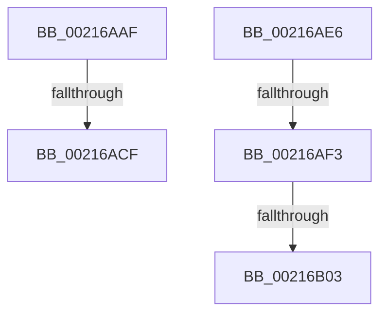

# sub_00216AAF

- RVA: `0x00216AAF`–`0x00216B16` (길이 `103` bytes)
- VA: `0x0000000140216AAF`
- 실행 섹션: `.text`
- PDB 이름 있음: `아니요`; PDB Function 태그: `아니요`
- unwind 정보 RVA: `0x0005E418`
- 디코드: `24`개 명령, `103/103` bytes 표시
- 미해석 바이트: `0` (있으면 어셈블리에 `.byte`로 보존)

> 이 문서는 커널 이미지의 기계어와 PDB 기호를 분석해 생성했습니다. 4번과 5번은 함수 원형과 자료형을 바이너리 사용 방식에서 추정한 C 해석이며 원본 소스 복구 결과는 아닙니다.

## 1. Dependencies

- 직접 호출 지점: **0**; 고유 호출 대상: **0**
- 직접 호출자로 확인된 함수: **0**
- RIP 상대 이미지 참조: **1**

### Outgoing calls
- 직접 디코드된 call 명령이 없습니다.

### Direct callers
- 이 함수 시작 RVA로 연결되는 직접 call은 확인되지 않았습니다. 간접 호출은 완전히 역산할 수 없습니다.

### Static image references
- `0x00216AE6` → RVA `0x00FC6A87` (`ALMOSTRO`; read)

## 2. Other-region calls and transfers

- 다른 실행 섹션으로 향하는 call: **0**
- call이 아닌 외부 분기/꼬리 이동: **5**
  - `0x00216AC9` → [sub_00216952](Unknown_function_00216952.md) (`tail-transfer`)
  - `0x00216AE1` → [sub_00216952 + 0xB](Unknown_function_00216952.md) (`tail-transfer`)
  - `0x00216AED` → [sub_00216952 + 0xF5](Unknown_function_00216952.md) (`tail-transfer`)
  - `0x00216AFD` → [sub_00216B4F + 0x2DC](Unknown_function_00216B4F.md) (`tail-transfer`)
  - `0x00216B11` → [sub_00216952 + 0xF5](Unknown_function_00216952.md) (`tail-transfer`)

## 3. Assembly (complete function range)

```asm
00216AAF  48 89 7F 08                     mov qword ptr [rdi + 8], rdi
00216AB3  48 89 3F                        mov qword ptr [rdi], rdi
00216AB6  C6 47 29 00                     mov byte ptr [rdi + 0x29], 0
00216ABA  4C 8B 42 10                     mov r8, qword ptr [rdx + 0x10]
00216ABE  48 8D 42 10                     lea rax, [rdx + 0x10]
00216AC2  4C 3B C0                        cmp r8, rax
00216AC5  48 8D 47 10                     lea rax, [rdi + 0x10]
00216AC9  0F 84 83 FE FF FF               je 0x140216952
00216ACF  48 8B 4A 18                     mov rcx, qword ptr [rdx + 0x18]
00216AD3  4C 89 00                        mov qword ptr [rax], r8
00216AD6  48 89 4F 18                     mov qword ptr [rdi + 0x18], rcx
00216ADA  49 89 40 08                     mov qword ptr [r8 + 8], rax
00216ADE  48 89 01                        mov qword ptr [rcx], rax
00216AE1  E9 77 FE FF FF                  jmp 0x14021695d
00216AE6  80 3D 9A FF DA 00 00            cmp byte ptr [rip + 0xdaff9a], 0
00216AED  0F 85 54 FF FF FF               jne 0x140216a47
00216AF3  0F 20 E1                        mov rcx, cr4
00216AF6  48 F7 C1 80 00 02 00            test rcx, 0x20080
00216AFD  0F 84 28 03 00 00               je 0x140216e2b
00216B03  48 8B C1                        mov rax, rcx
00216B06  48 0F BA F8 07                  btc rax, 7
00216B0B  0F 22 E0                        mov cr4, rax
00216B0E  0F 22 E1                        mov cr4, rcx
00216B11  E9 31 FF FF FF                  jmp 0x140216a47
```

## 4. C-style interpretation (structured pseudocode)

```c
__int64 __fastcall sub_00216AAF(__int64 a1, __int64 a2)
{
    *(unsigned __int64 *)(v_rdi + 8) = v_rdi;
    *(unsigned __int64 *)(v_rdi) = v_rdi;
    *(unsigned __int8 *)(v_rdi + 41) = 0;
    *(unsigned __int64 *)(v_rdi + 16) = *(unsigned __int64 *)(a2 + 16);
    *(unsigned __int64 *)(v_rdi + 24) = *(unsigned __int64 *)(a2 + 24);
    *(unsigned __int64 *)(*(unsigned __int64 *)(a2 + 16) + 8) = v_rdi + 16;
    *(unsigned __int64 *)(*(unsigned __int64 *)(a2 + 24)) = v_rdi + 16;
}
```

## 5. (Beta) C Style

```c
int64_t sub_00216AAF(int64_t Arg1, void *Arg2)
{
    uint8_t *arg2 = (uint8_t *)Arg2;

    *(uint64_t *)(local_rdi + 0x8) = local_rdi;
    *(uint64_t *)(local_rdi) = local_rdi;
    *(uint8_t *)(local_rdi + 0x29) = 0;
    *(uint64_t *)(local_rdi + 0x10) = *(uint64_t *)(arg2 + 0x10);
    *(uint64_t *)(local_rdi + 0x18) = *(uint64_t *)(arg2 + 0x18);
    *(uint64_t *)(*(uint64_t *)(arg2 + 0x10) + 0x8) = local_rdi + 16;
    *(uint64_t *)(*(uint64_t *)(arg2 + 0x18)) = local_rdi + 16;
}
```

### 관측된 메모리 오프셋

구조체 형식이 확인되지 않은 접근은 인자 기준의 오프셋으로만 기록했습니다.

| 기준 인자 | 오프셋 표현 | 폭 (bit) | 접근 |
|---|---:|---:|---|
| `Arg2` | `+ 0x10` | `64` | `R` |
| `Arg2` | `+ 0x18` | `64` | `R` |

## 6. Execution-region graph

[열기: 2D/3D 그래프와 함수 탐색 컨트롤 패널](../../../control-panel.html?section=text&rva=0x00216AAF&view=graph)

- 2D 그래프는 위에서 아래로 흐르고, 3D 그래프는 빈 공간을 드래그해 회전합니다. Shift+드래그는 이동, 휠은 확대·축소, 함수 노드 선택은 대상 보고서 이동입니다.

### Static fallback


