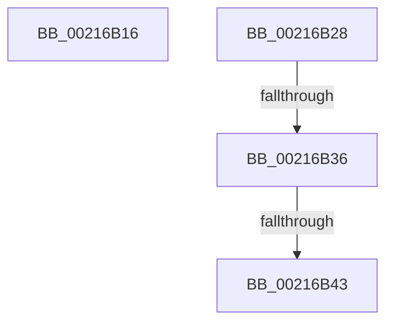

# sub_00216B16

- RVA: `0x00216B16`–`0x00216B4F` (길이 `57` bytes)
- VA: `0x0000000140216B16`
- 실행 섹션: `.text`
- PDB 이름 있음: `아니요`; PDB Function 태그: `아니요`
- unwind 정보 RVA: `0x0005E438`
- 디코드: `13`개 명령, `57/57` bytes 표시
- 미해석 바이트: `0` (있으면 어셈블리에 `.byte`로 보존)

> 이 문서는 커널 이미지의 기계어와 PDB 기호를 분석해 생성했습니다. 4번과 5번은 함수 원형과 자료형을 바이너리 사용 방식에서 추정한 C 해석이며 원본 소스 복구 결과는 아닙니다.

## 1. Dependencies

- 직접 호출 지점: **3**; 고유 호출 대상: **3**
- 직접 호출자로 확인된 함수: **0**
- RIP 상대 이미지 참조: **1**

### Outgoing calls
- `0x00216B1E` → [KiRaiseIrqlProcessIrqlFlags](../4F/KiRaiseIrqlProcessIrqlFlags_function_004F56FC.md) (function, `0x004F56FC`)
- `0x00216B36` → [KiCheckVpBackingLongSpinWaitHypercall](../30/KiCheckVpBackingLongSpinWaitHypercall_function_0030F490.md) (function, `0x0030F490`)
- `0x00216B45` → [HvlNotifyLongSpinWait](../30/HvlNotifyLongSpinWait_function_0030F460.md) (function, `0x0030F460`)

### Direct callers
- 이 함수 시작 RVA로 연결되는 직접 call은 확인되지 않았습니다. 간접 호출은 완전히 역산할 수 없습니다.

### Static image references
- `0x00216B28` → RVA `0x00FC6AB8` (`ALMOSTRO`; read)

## 2. Other-region calls and transfers

- 다른 실행 섹션으로 향하는 call: **0**
- call이 아닌 외부 분기/꼬리 이동: **4**
  - `0x00216B23` → [sub_0021687A + 0x2A](Unknown_function_0021687A.md) (`tail-transfer`)
  - `0x00216B30` → [sub_00216920 + 0xE](Unknown_function_00216920.md) (`tail-transfer`)
  - `0x00216B3D` → [sub_00216920 + 0xE](Unknown_function_00216920.md) (`tail-transfer`)
  - `0x00216B4A` → [sub_00216920 + 0x10](Unknown_function_00216920.md) (`tail-transfer`)

## 3. Assembly (complete function range)

```asm
00216B16  41 0F B6 D7                     movzx edx, r15b
00216B1A  40 0F B6 CD                     movzx ecx, bpl
00216B1E  E8 D9 EB 2D 00                  call 0x1404f56fc
00216B23  E9 7C FD FF FF                  jmp 0x1402168a4
00216B28  8B 05 8A FF DA 00               mov eax, dword ptr [rip + 0xdaff8a]
00216B2E  A8 40                           test al, 0x40
00216B30  0F 84 F8 FD FF FF               je 0x14021692e
00216B36  E8 55 89 0F 00                  call 0x14030f490
00216B3B  84 C0                           test al, al
00216B3D  0F 84 EB FD FF FF               je 0x14021692e
00216B43  8B CF                           mov ecx, edi
00216B45  E8 16 89 0F 00                  call 0x14030f460
00216B4A  E9 E1 FD FF FF                  jmp 0x140216930
```

## 4. C-style interpretation (structured pseudocode)

```c
__int64 __fastcall sub_00216B16(void)
{
    __int64 result;

    result = KiRaiseIrqlProcessIrqlFlags((unsigned __int8)(v_rbp), (unsigned __int8)(v_r15), a3, a4);
}
```

## 5. (Beta) C Style

```c
void sub_00216B16(void)
{
    int64_t result;

    result = KiRaiseIrqlProcessIrqlFlags((uint8_t)(local_rbp), (uint8_t)(local_r15), a3, a4);
}
```

## 6. Execution-region graph

[열기: 2D/3D 그래프와 함수 탐색 컨트롤 패널](../../../control-panel.html?section=text&rva=0x00216B16&view=graph)

- 2D 그래프는 위에서 아래로 흐르고, 3D 그래프는 빈 공간을 드래그해 회전합니다. Shift+드래그는 이동, 휠은 확대·축소, 함수 노드 선택은 대상 보고서 이동입니다.

### Static fallback


