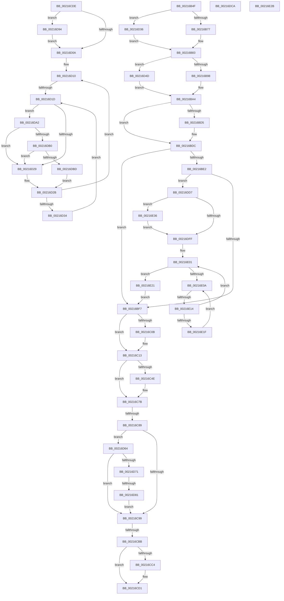

# sub_00216B4F

- RVA: `0x00216B4F`–`0x00216E41` (길이 `754` bytes)
- VA: `0x0000000140216B4F`
- 실행 섹션: `.text`
- PDB 이름 있음: `아니요`; PDB Function 태그: `아니요`
- unwind 정보 RVA: `0x0005E450`
- 디코드: `168`개 명령, `754/754` bytes 표시
- 미해석 바이트: `0` (있으면 어셈블리에 `.byte`로 보존)

> 이 문서는 커널 이미지의 기계어와 PDB 기호를 분석해 생성했습니다. 4번과 5번은 함수 원형과 자료형을 바이너리 사용 방식에서 추정한 C 해석이며 원본 소스 복구 결과는 아닙니다.

## 1. Dependencies

- 직접 호출 지점: **9**; 고유 호출 대상: **7**
- 직접 호출자로 확인된 함수: **0**
- RIP 상대 이미지 참조: **5**

### Outgoing calls
- `0x00216C76` → [KiSetAddressPolicy](KiSetAddressPolicy_function_002178A0.md) (function, `0x002178A0`)
- `0x00216CCC` → [KiLowerIrqlProcessIrqlFlags](../4F/KiLowerIrqlProcessIrqlFlags_function_004F5698.md) (function, `0x004F5698`)
- `0x00216CF0` → [KiInSwapSingleProcess](../35/KiInSwapSingleProcess_function_00355474.md) (function, `0x00355474`)
- `0x00216D98` → [KiRaiseIrqlProcessIrqlFlags](../4F/KiRaiseIrqlProcessIrqlFlags_function_004F56FC.md) (function, `0x004F56FC`)
- `0x00216DB0` → [KiCheckVpBackingLongSpinWaitHypercall](../30/KiCheckVpBackingLongSpinWaitHypercall_function_0030F490.md) (function, `0x0030F490`)
- `0x00216DC0` → [HvlNotifyLongSpinWait](../30/HvlNotifyLongSpinWait_function_0030F460.md) (function, `0x0030F460`)
- `0x00216DCD` → [HvlSwitchVirtualAddressSpace](../3C/HvlSwitchVirtualAddressSpace_function_003C7C60.md) (function, `0x003C7C60`)
- `0x00216DE9` → [KiInSwapSingleProcess](../35/KiInSwapSingleProcess_function_00355474.md) (function, `0x00355474`)
- `0x00216E3A` → [KiRaiseIrqlProcessIrqlFlags](../4F/KiRaiseIrqlProcessIrqlFlags_function_004F56FC.md) (function, `0x004F56FC`)

### Direct callers
- 이 함수 시작 RVA로 연결되는 직접 call은 확인되지 않았습니다. 간접 호출은 완전히 역산할 수 없습니다.

### Static image references
- `0x00216C41` → RVA `0x01201840` (`CFGRO`; read)
- `0x00216C7B` → RVA `0x00FC6AB8` (`ALMOSTRO`; read)
- `0x00216CBB` → RVA `0x00FC6D20` (`ALMOSTRO`; read)
- `0x00216D20` → RVA `0x00FC52AC` (`ALMOSTRO`; reference)
- `0x00216D64` → RVA `0x00FC6A87` (`ALMOSTRO`; read)

## 2. Other-region calls and transfers

- 다른 실행 섹션으로 향하는 call: **0**
- call이 아닌 외부 분기/꼬리 이동: **8**
  - `0x00216C83` → [sub_00216E70 + 0x1C](Unknown_function_00216E70.md) (`tail-transfer`)
  - `0x00216CB5` → [sub_00216952 + 0x13E](Unknown_function_00216952.md) (`tail-transfer`)
  - `0x00216CD9` → [sub_00216952 + 0x13E](Unknown_function_00216952.md) (`tail-transfer`)
  - `0x00216D17` → [sub_00216952 + 0x52](Unknown_function_00216952.md) (`tail-transfer`)
  - `0x00216D7B` → [sub_00216E70 + 0x29](Unknown_function_00216E70.md) (`tail-transfer`)
  - `0x00216DD2` → [sub_00216952 + 0xE8](Unknown_function_00216952.md) (`tail-transfer`)
  - `0x00216E12` → [sub_00216E70](Unknown_function_00216E70.md) (`tail-transfer`)
  - `0x00216E31` → [sub_00216952 + 0xF5](Unknown_function_00216952.md) (`tail-transfer`)

## 3. Assembly (complete function range)

```asm
00216B4F  49 89 42 20                     mov qword ptr [r10 + 0x20], rax
00216B53  0F B6 42 28                     movzx eax, byte ptr [rdx + 0x28]
00216B57  41 88 42 28                     mov byte ptr [r10 + 0x28], al
00216B5B  0F B6 42 29                     movzx eax, byte ptr [rdx + 0x29]
00216B5F  41 88 42 29                     mov byte ptr [r10 + 0x29], al
00216B63  0F B6 42 2A                     movzx eax, byte ptr [rdx + 0x2a]
00216B67  41 88 42 2A                     mov byte ptr [r10 + 0x2a], al
00216B6B  48 8B 0A                        mov rcx, qword ptr [rdx]
00216B6E  48 3B CA                        cmp rcx, rdx
00216B71  0F 85 BF 01 00 00               jne 0x140216d36
00216B77  4D 89 52 08                     mov qword ptr [r10 + 8], r10
00216B7B  4D 89 12                        mov qword ptr [r10], r10
00216B7E  41 C6 42 29 00                  mov byte ptr [r10 + 0x29], 0
00216B83  4C 8B 42 10                     mov r8, qword ptr [rdx + 0x10]
00216B87  48 8D 42 10                     lea rax, [rdx + 0x10]
00216B8B  4C 3B C0                        cmp r8, rax
00216B8E  49 8D 42 10                     lea rax, [r10 + 0x10]
00216B92  0F 85 B5 01 00 00               jne 0x140216d4d
00216B98  48 89 40 08                     mov qword ptr [rax + 8], rax
00216B9C  48 89 00                        mov qword ptr [rax], rax
00216B9F  41 C6 42 2A 00                  mov byte ptr [r10 + 0x2a], 0
00216BA4  48 89 52 08                     mov qword ptr [rdx + 8], rdx
00216BA8  48 8D 83 A8 00 00 00            lea rax, [rbx + 0xa8]
00216BAF  48 89 12                        mov qword ptr [rdx], rdx
00216BB2  48 89 40 08                     mov qword ptr [rax + 8], rax
00216BB6  48 89 00                        mov qword ptr [rax], rax
00216BB9  48 8D 83 58 02 00 00            lea rax, [rbx + 0x258]
00216BC0  66 C7 83 C0 00 00 00 00 00      mov word ptr [rbx + 0xc0], 0
00216BC9  C6 83 C2 00 00 00 00            mov byte ptr [rbx + 0xc2], 0
00216BD0  4C 3B D0                        cmp r10, rax
00216BD3  75 07                           jne 0x140216bdc
00216BD5  C6 83 4A 02 00 00 01            mov byte ptr [rbx + 0x24a], 1
00216BDC  41 F6 C6 01                     test r14b, 1
00216BE0  75 15                           jne 0x140216bf7
00216BE2  B8 08 00 00 00                  mov eax, 8
00216BE7  F0 0F C1 86 08 01 00 00         lock xadd dword ptr [rsi + 0x108], eax
00216BEF  A8 07                           test al, 7
00216BF1  0F 85 E0 01 00 00               jne 0x140216dd7
00216BF7  81 4B 74 00 08 00 00            or dword ptr [rbx + 0x74], 0x800
00216BFE  90                              nop
00216BFF  48 89 B3 B8 00 00 00            mov qword ptr [rbx + 0xb8], rsi
00216C06  45 84 F7                        test r15b, r14b
00216C09  75 08                           jne 0x140216c13
00216C0B  48 C7 43 40 00 00 00 00         mov qword ptr [rbx + 0x40], 0
00216C13  65 48 8B 04 25 20 00 00 00      mov rax, qword ptr gs:[0x20]
00216C1C  4D 8B 6A 20                     mov r13, qword ptr [r10 + 0x20]
00216C20  44 0F B6 B8 D1 00 00 00         movzx r15d, byte ptr [rax + 0xd1]
00216C28  44 0F B6 A0 D0 00 00 00         movzx r12d, byte ptr [rax + 0xd0]
00216C30  41 8B CF                        mov ecx, r15d
00216C33  48 8B 86 80 00 00 00            mov rax, qword ptr [rsi + 0x80]
00216C3A  F0 4A 0F AB 4C E0 08            lock bts qword ptr [rax + r12*8 + 8], rcx
00216C41  80 3D F8 AB FE 00 00            cmp byte ptr [rip + 0xfeabf8], 0
00216C48  48 8B 7E 28                     mov rdi, qword ptr [rsi + 0x28]
00216C4C  74 2D                           je 0x140216c7b
00216C4E  49 B8 00 00 00 00 00 00 00 80   movabs r8, 0x8000000000000000
00216C58  48 8B C7                        mov rax, rdi
00216C5B  49 0B C0                        or rax, r8
00216C5E  40 F6 C7 02                     test dil, 2
00216C62  48 0F 44 C7                     cmove rax, rdi
00216C66  65 48 89 04 25 00 B0 00 00      mov qword ptr gs:[0xb000], rax
00216C6F  0F B6 8E 60 01 00 00            movzx ecx, byte ptr [rsi + 0x160]
00216C76  E8 25 0C 00 00                  call 0x1402178a0
00216C7B  8B 05 37 FE DA 00               mov eax, dword ptr [rip + 0xdafe37]
00216C81  A8 01                           test al, 1
00216C83  0F 85 03 02 00 00               jne 0x140216e8c
00216C89  0F 22 DF                        mov cr3, rdi
00216C8C  80 3D AD AB FE 00 00            cmp byte ptr [rip + 0xfeabad], 0
00216C93  0F 85 CB 00 00 00               jne 0x140216d64
00216C99  49 8B 85 80 00 00 00            mov rax, qword ptr [r13 + 0x80]
00216CA0  49 8B D7                        mov rdx, r15
00216CA3  F0 4A 0F B3 54 E0 08            lock btr qword ptr [rax + r12*8 + 8], rdx
00216CAA  81 63 74 FF F7 FF FF            and dword ptr [rbx + 0x74], 0xfffff7ff
00216CB1  41 F6 C6 02                     test r14b, 2
00216CB5  0F 85 D5 FD FF FF               jne 0x140216a90
00216CBB  83 3D 5E 00 DB 00 00            cmp dword ptr [rip + 0xdb005e], 0
00216CC2  74 0D                           je 0x140216cd1
00216CC4  44 0F 20 C1                     mov rcx, cr8
00216CC8  40 0F B6 D5                     movzx edx, bpl
00216CCC  E8 C7 E9 2D 00                  call 0x1404f5698
00216CD1  40 0F B6 C5                     movzx eax, bpl
00216CD5  44 0F 22 C0                     mov cr8, rax
00216CD9  E9 B2 FD FF FF                  jmp 0x140216a90
00216CDE  44 0F B6 C5                     movzx r8d, bpl
00216CE2  48 C7 43 40 00 00 00 00         mov qword ptr [rbx + 0x40], 0
00216CEA  48 8B D6                        mov rdx, rsi
00216CED  48 8B CB                        mov rcx, rbx
00216CF0  E8 7F E7 13 00                  call 0x140355474
00216CF5  44 0F 20 C1                     mov rcx, cr8
00216CF9  45 0F 22 C7                     mov cr8, r15
00216CFD  83 3D 1C 00 DB 00 00            cmp dword ptr [rip + 0xdb001c], 0
00216D04  0F 85 8A 00 00 00               jne 0x140216d94
00216D0A  45 33 FF                        xor r15d, r15d
00216D0D  0F 1F 00                        nop dword ptr [rax]
00216D10  F0 48 0F BA 6B 40 00            lock bts qword ptr [rbx + 0x40], 0
00216D17  0F 83 87 FC FF FF               jae 0x1402169a4
00216D1D  41 FF C7                        inc r15d
00216D20  44 85 3D 85 E5 DA 00            test dword ptr [rip + 0xdae585], r15d
00216D27  74 79                           je 0x140216da2
00216D29  F3 90                           pause
00216D2B  48 8B 43 40                     mov rax, qword ptr [rbx + 0x40]
00216D2F  48 85 C0                        test rax, rax
00216D32  74 DC                           je 0x140216d10
00216D34  EB E7                           jmp 0x140216d1d
00216D36  48 8B 42 08                     mov rax, qword ptr [rdx + 8]
00216D3A  49 89 0A                        mov qword ptr [r10], rcx
00216D3D  49 89 42 08                     mov qword ptr [r10 + 8], rax
00216D41  4C 89 51 08                     mov qword ptr [rcx + 8], r10
00216D45  4C 89 10                        mov qword ptr [rax], r10
00216D48  E9 36 FE FF FF                  jmp 0x140216b83
00216D4D  48 8B 4A 18                     mov rcx, qword ptr [rdx + 0x18]
00216D51  4C 89 00                        mov qword ptr [rax], r8
00216D54  49 89 4A 18                     mov qword ptr [r10 + 0x18], rcx
00216D58  49 89 40 08                     mov qword ptr [r8 + 8], rax
00216D5C  48 89 01                        mov qword ptr [rcx], rax
00216D5F  E9 40 FE FF FF                  jmp 0x140216ba4
00216D64  80 3D 1C FD DA 00 00            cmp byte ptr [rip + 0xdafd1c], 0
00216D6B  0F 85 28 FF FF FF               jne 0x140216c99
00216D71  0F 20 E1                        mov rcx, cr4
00216D74  48 F7 C1 80 00 02 00            test rcx, 0x20080
00216D7B  0F 84 18 01 00 00               je 0x140216e99
00216D81  48 8B C1                        mov rax, rcx
00216D84  48 0F BA F8 07                  btc rax, 7
00216D89  0F 22 E0                        mov cr4, rax
00216D8C  0F 22 E1                        mov cr4, rcx
00216D8F  E9 05 FF FF FF                  jmp 0x140216c99
00216D94  41 0F B6 D7                     movzx edx, r15b
00216D98  E8 5F E9 2D 00                  call 0x1404f56fc
00216D9D  E9 68 FF FF FF                  jmp 0x140216d0a
00216DA2  8B 05 10 FD DA 00               mov eax, dword ptr [rip + 0xdafd10]
00216DA8  A8 40                           test al, 0x40
00216DAA  0F 84 79 FF FF FF               je 0x140216d29
00216DB0  E8 DB 86 0F 00                  call 0x14030f490
00216DB5  84 C0                           test al, al
00216DB7  0F 84 6C FF FF FF               je 0x140216d29
00216DBD  41 8B CF                        mov ecx, r15d
00216DC0  E8 9B 86 0F 00                  call 0x14030f460
00216DC5  E9 61 FF FF FF                  jmp 0x140216d2b
00216DCA  48 8B CF                        mov rcx, rdi
00216DCD  E8 8E 0E 1B 00                  call 0x1403c7c60
00216DD2  E9 63 FC FF FF                  jmp 0x140216a3a
00216DD7  44 0F B6 C5                     movzx r8d, bpl
00216DDB  48 C7 43 40 00 00 00 00         mov qword ptr [rbx + 0x40], 0
00216DE3  48 8B D6                        mov rdx, rsi
00216DE6  48 8B CB                        mov rcx, rbx
00216DE9  E8 86 E6 13 00                  call 0x140355474
00216DEE  44 0F 20 C1                     mov rcx, cr8
00216DF2  45 0F 22 C7                     mov cr8, r15
00216DF6  83 3D 23 FF DA 00 00            cmp dword ptr [rip + 0xdaff23], 0
00216DFD  75 37                           jne 0x140216e36
00216DFF  33 FF                           xor edi, edi
00216E01  F0 48 0F BA 6B 40 00            lock bts qword ptr [rbx + 0x40], 0
00216E08  73 17                           jae 0x140216e21
00216E0A  FF C7                           inc edi
00216E0C  85 3D 9A E4 DA 00               test dword ptr [rip + 0xdae49a], edi
00216E12  74 5C                           je 0x140216e70
00216E14  F3 90                           pause
00216E16  48 8B 43 40                     mov rax, qword ptr [rbx + 0x40]
00216E1A  48 85 C0                        test rax, rax
00216E1D  74 E2                           je 0x140216e01
00216E1F  EB E9                           jmp 0x140216e0a
00216E21  4C 8B 54 24 70                  mov r10, qword ptr [rsp + 0x70]
00216E26  E9 CC FD FF FF                  jmp 0x140216bf7
00216E2B  0F 20 D8                        mov rax, cr3
00216E2E  0F 22 D8                        mov cr3, rax
00216E31  E9 11 FC FF FF                  jmp 0x140216a47
00216E36  41 0F B6 D7                     movzx edx, r15b
00216E3A  E8 BD E8 2D 00                  call 0x1404f56fc
00216E3F  EB BE                           jmp 0x140216dff
```

## 4. C-style interpretation (structured pseudocode)

```c
__int64 __fastcall sub_00216B4F(__int64 a1, __int64 a2, __int64 a3, __int64 a4, __int64 a5, __int64 a6, __int64 a7, __int64 a8, __int64 a9, __int64 a10, __int64 a11, __int64 a12, __int64 a13, __int64 a14)
{
    __int64 result;
    __int64 v_rdi;

    *(unsigned __int64 *)(v_r10 + 32) = result;
    *(unsigned __int8 *)(v_r10 + 40) = (unsigned __int8)(*(unsigned __int8 *)(a2 + 40));
    *(unsigned __int8 *)(v_r10 + 41) = (unsigned __int8)(*(unsigned __int8 *)(a2 + 41));
    *(unsigned __int8 *)(v_r10 + 42) = (unsigned __int8)(*(unsigned __int8 *)(a2 + 42));
    if ((*(unsigned __int64 *)(a2)) != a2) goto loc_00216D36;
    *(unsigned __int64 *)(v_r10 + 8) = v_r10;
    *(unsigned __int64 *)(v_r10) = v_r10;
    *(unsigned __int8 *)(v_r10 + 41) = 0;
loc_00216B83:
    if ((*(unsigned __int64 *)(a2 + 16)) != (a2 + 16)) goto loc_00216D4D;
    *(unsigned __int64 *)(v_r10 + 16 + 8) = v_r10 + 16;
    *(unsigned __int64 *)(v_r10 + 16) = v_r10 + 16;
    *(unsigned __int8 *)(v_r10 + 42) = 0;
loc_00216BA4:
    *(unsigned __int64 *)(a2 + 8) = a2;
    *(unsigned __int64 *)(a2) = a2;
    *(unsigned __int64 *)(v_rbx + 168 + 8) = v_rbx + 168;
    *(unsigned __int64 *)(v_rbx + 168) = v_rbx + 168;
    *(unsigned __int16 *)(v_rbx + 192) = 0;
    *(unsigned __int8 *)(v_rbx + 194) = 0;
    if (v_r10 == (v_rbx + 600)) {
        *(unsigned __int8 *)(v_rbx + 586) = 1;
    }
    if ((((unsigned __int8)(v_r14)) & (1)) != 0) goto loc_00216BF7;
    if (((8) & (7)) != 0) goto loc_00216DD7;
loc_00216BF7:
    *(unsigned __int64 *)(v_rbx + 184) = v_rsi;
    if ((((unsigned __int8)(v_r15)) & ((unsigned __int8)(v_r14))) == 0) {
        *(unsigned __int64 *)(v_rbx + 64) = 0;
    }
    result = *(unsigned __int64 *)(v_rsi + 128);
    if ((*(unsigned __int8 *)(v_rip + 16690168)) != 0) {
        result = *(unsigned __int64 *)(v_rsi + 40);
        result = (result) | (*(unsigned __int64 *)(a2 + 16));
        if ((((unsigned __int8)(*(unsigned __int64 *)(v_rsi + 40))) & (2)) == 0) { result = *(unsigned __int64 *)(v_rsi + 40); }
        *(unsigned __int64 *)(gs_base + (0 + 45056)) = result;
        a1 = *(unsigned __int8 *)(v_rsi + 352);
        result = KiSetAddressPolicy(a1, a2, *(unsigned __int64 *)(a2 + 16), a4);
    }
    if ((*(unsigned __int8 *)(v_rip + 16690093)) != 0) goto loc_00216D64;
loc_00216C99:
    result = *(unsigned __int64 *)(*(unsigned __int64 *)(v_r10 + 32) + 128);
    if ((*(unsigned int *)(v_rip + 14352478)) != 0) {
        a1 = v_cr8;
        a2 = (unsigned __int8)(v_rbp);
        result = KiLowerIrqlProcessIrqlFlags(a1, a2, *(unsigned __int64 *)(a2 + 16), a4);
    }
loc_00216D36:
    *(unsigned __int64 *)(v_r10) = a1;
    *(unsigned __int64 *)(v_r10 + 8) = *(unsigned __int64 *)(a2 + 8);
    *(unsigned __int64 *)(a1 + 8) = v_r10;
    *(unsigned __int64 *)(*(unsigned __int64 *)(a2 + 8)) = v_r10;
    goto loc_00216B83;
loc_00216D4D:
    *(unsigned __int64 *)(*(unsigned __int64 *)(a2 + 8)) = *(unsigned __int64 *)(a2 + 16);
    *(unsigned __int64 *)(v_r10 + 24) = *(unsigned __int64 *)(a2 + 24);
    *(unsigned __int64 *)(*(unsigned __int64 *)(a2 + 16) + 8) = *(unsigned __int64 *)(a2 + 8);
    *(unsigned __int64 *)(*(unsigned __int64 *)(a2 + 24)) = *(unsigned __int64 *)(a2 + 8);
    goto loc_00216BA4;
loc_00216D64:
    if ((*(unsigned __int8 *)(v_rip + 14351644)) != 0) goto loc_00216C99;
    goto loc_00216C99;
loc_00216DD7:
    *(unsigned __int64 *)(v_rbx + 64) = 0;
    result = KiInSwapSingleProcess(v_rbx, v_rsi, (unsigned __int8)(v_rbp), a4);
    if ((*(unsigned int *)(v_rip + 14352163)) != 0) goto loc_00216E36;
loc_00216DFF:
    v_rdi = 0;
loc_00216E01:
    if (condition_is_above_or_equal) goto loc_00216E21;
loc_00216E0A:
    v_rdi = (unsigned int)((v_rdi) + 1);
    if (*(unsigned __int64 *)(v_rbx + 64) == 0) goto loc_00216E01;
    goto loc_00216E0A;
loc_00216E21:
    goto loc_00216BF7;
loc_00216E36:
    result = KiRaiseIrqlProcessIrqlFlags((unsigned __int8)(v_rbp), (unsigned __int8)(*(unsigned __int8 *)(*(unsigned __int64 *)(gs_base + (0 + 32)) + 209)), (unsigned __int8)(v_rbp), a4);
    goto loc_00216DFF;
}
```

## 5. (Beta) C Style

```c
int64_t sub_00216B4F(int64_t Arg1, void *Arg2, int64_t Arg3, int64_t Arg4, uint64_t Arg5, uint64_t Arg6, uint64_t Arg7, uint64_t Arg8, uint64_t Arg9, uint64_t Arg10, uint64_t Arg11, uint64_t Arg12, uint64_t Arg13, int64_t Arg14)
{
    uint8_t *arg2 = (uint8_t *)Arg2;

    int64_t result;
    int64_t local_rdi;

    *(uint64_t *)(local_r10 + 0x20) = result;
    *(uint8_t *)(local_r10 + 0x28) = (uint8_t)(*(uint8_t *)(arg2 + 0x28));
    *(uint8_t *)(local_r10 + 0x29) = (uint8_t)(*(uint8_t *)(arg2 + 0x29));
    *(uint8_t *)(local_r10 + 0x2A) = (uint8_t)(*(uint8_t *)(arg2 + 0x2A));
    if ((*(uint64_t *)(arg2)) != Arg2) goto loc_00216D36;
    *(uint64_t *)(local_r10 + 0x8) = local_r10;
    *(uint64_t *)(local_r10) = local_r10;
    *(uint8_t *)(local_r10 + 0x29) = 0;
loc_00216B83:
    if ((*(uint64_t *)(arg2 + 0x10)) != (Arg2 + 16)) goto loc_00216D4D;
    *(uint64_t *)(local_r10 + 0x10 + 0x8) = local_r10 + 16;
    *(uint64_t *)(local_r10 + 0x10) = local_r10 + 16;
    *(uint8_t *)(local_r10 + 0x2A) = 0;
loc_00216BA4:
    *(void **)(arg2 + 0x8) = Arg2;
    *(void **)(arg2) = Arg2;
    *(uint64_t *)(local_rbx + 0xA8 + 0x8) = local_rbx + 168;
    *(uint64_t *)(local_rbx + 0xA8) = local_rbx + 168;
    *(uint16_t *)(local_rbx + 0xC0) = 0;
    *(uint8_t *)(local_rbx + 0xC2) = 0;
    if (local_r10 == (local_rbx + 600)) {
        *(uint8_t *)(local_rbx + 0x24A) = 1;
    }
    if ((((uint8_t)(local_r14)) & (1)) != 0) goto loc_00216BF7;
    if (((8) & (7)) != 0) goto loc_00216DD7;
loc_00216BF7:
    *(uint64_t *)(local_rbx + 0xB8) = local_rsi;
    if ((((uint8_t)(local_r15)) & ((uint8_t)(local_r14))) == 0) {
        *(uint64_t *)(local_rbx + 0x40) = 0;
    }
    result = *(uint64_t *)(local_rsi + 0x80);
    if ((*(uint8_t *)(v_rip + 0xFEABF8)) != 0) {
        result = *(uint64_t *)(local_rsi + 0x28);
        result = (result) | (*(uint64_t *)(arg2 + 0x10));
        if ((((uint8_t)(*(uint64_t *)(local_rsi + 0x28))) & (2)) == 0) { result = *(uint64_t *)(local_rsi + 0x28); }
        *(uint64_t *)(gs_base + (0 + 0xB000)) = result;
        Arg1 = *(uint8_t *)(local_rsi + 0x160);
        result = KiSetAddressPolicy(Arg1, Arg2, *(uint64_t *)(arg2 + 0x10), Arg4);
    }
    if ((*(uint8_t *)(v_rip + 0xFEABAD)) != 0) goto loc_00216D64;
loc_00216C99:
    result = *(uint64_t *)(*(uint64_t *)(local_r10 + 0x20) + 0x80);
    if ((*(uint32_t *)(v_rip + 0xDB005E)) != 0) {
        Arg1 = v_cr8;
        Arg2 = (uint8_t)(local_rbp);
        result = KiLowerIrqlProcessIrqlFlags(Arg1, Arg2, *(uint64_t *)(arg2 + 0x10), Arg4);
    }
loc_00216D36:
    *(uint64_t *)(local_r10) = Arg1;
    *(uint64_t *)(local_r10 + 0x8) = *(uint64_t *)(arg2 + 0x8);
    *(uint64_t *)(Arg1 + 0x8) = local_r10;
    *(uint64_t *)(*(uint64_t *)(arg2 + 0x8)) = local_r10;
    goto loc_00216B83;
loc_00216D4D:
    *(uint64_t *)(*(uint64_t *)(arg2 + 0x8)) = *(uint64_t *)(arg2 + 0x10);
    *(uint64_t *)(local_r10 + 0x18) = *(uint64_t *)(arg2 + 0x18);
    *(uint64_t *)(*(uint64_t *)(arg2 + 0x10) + 0x8) = *(uint64_t *)(arg2 + 0x8);
    *(uint64_t *)(*(uint64_t *)(arg2 + 0x18)) = *(uint64_t *)(arg2 + 0x8);
    goto loc_00216BA4;
loc_00216D64:
    if ((*(uint8_t *)(v_rip + 0xDAFD1C)) != 0) goto loc_00216C99;
    goto loc_00216C99;
loc_00216DD7:
    *(uint64_t *)(local_rbx + 0x40) = 0;
    result = KiInSwapSingleProcess(local_rbx, local_rsi, (uint8_t)(local_rbp), Arg4);
    if ((*(uint32_t *)(v_rip + 0xDAFF23)) != 0) goto loc_00216E36;
loc_00216DFF:
    local_rdi = 0;
loc_00216E01:
    if (condition_is_above_or_equal) goto loc_00216E21;
loc_00216E0A:
    local_rdi = (uint32_t)((local_rdi) + 1);
    if (*(uint64_t *)(local_rbx + 0x40) == 0) goto loc_00216E01;
    goto loc_00216E0A;
loc_00216E21:
    goto loc_00216BF7;
loc_00216E36:
    result = KiRaiseIrqlProcessIrqlFlags((uint8_t)(local_rbp), (uint8_t)(*(uint8_t *)(*(uint64_t *)(gs_base + (0 + 0x20)) + 0xD1)), (uint8_t)(local_rbp), Arg4);
    goto loc_00216DFF;
}
```

### 관측된 메모리 오프셋

구조체 형식이 확인되지 않은 접근은 인자 기준의 오프셋으로만 기록했습니다.

| 기준 인자 | 오프셋 표현 | 폭 (bit) | 접근 |
|---|---:|---:|---|
| `Arg2` | `+ 0x0` | `64` | `R` |
| `Arg2` | `+ 0x0` | `64` | `W` |
| `Arg2` | `+ 0x8` | `64` | `R` |
| `Arg2` | `+ 0x8` | `64` | `W` |
| `Arg2` | `+ 0x10` | `64` | `R` |
| `Arg2` | `+ 0x18` | `64` | `R` |
| `Arg2` | `+ 0x28` | `8` | `R` |
| `Arg2` | `+ 0x29` | `8` | `R` |
| `Arg2` | `+ 0x2A` | `8` | `R` |

## 6. Execution-region graph

[열기: 2D/3D 그래프와 함수 탐색 컨트롤 패널](../../../control-panel.html?section=text&rva=0x00216B4F&view=graph)

- 2D 그래프는 위에서 아래로 흐르고, 3D 그래프는 빈 공간을 드래그해 회전합니다. Shift+드래그는 이동, 휠은 확대·축소, 함수 노드 선택은 대상 보고서 이동입니다.

### Static fallback


