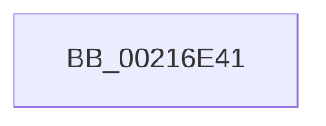

# sub_00216E41

- RVA: `0x00216E41`–`0x00216E70` (길이 `47` bytes)
- VA: `0x0000000140216E41`
- 실행 섹션: `.text`
- PDB 이름 있음: `아니요`; PDB Function 태그: `아니요`
- unwind 정보 RVA: `0x0005E470`
- 디코드: `9`개 명령, `47/47` bytes 표시
- 미해석 바이트: `0` (있으면 어셈블리에 `.byte`로 보존)

> 이 문서는 커널 이미지의 기계어와 PDB 기호를 분석해 생성했습니다. 4번과 5번은 함수 원형과 자료형을 바이너리 사용 방식에서 추정한 C 해석이며 원본 소스 복구 결과는 아닙니다.

## 1. Dependencies

- 직접 호출 지점: **1**; 고유 호출 대상: **1**
- 직접 호출자로 확인된 함수: **0**
- RIP 상대 이미지 참조: **0**

### Outgoing calls
- `0x00216E6A` → [KeBugCheckEx](../4F/KeBugCheckEx_function_004FD660.md) (function, `0x004FD660`)

### Direct callers
- 이 함수 시작 RVA로 연결되는 직접 call은 확인되지 않았습니다. 간접 호출은 완전히 역산할 수 없습니다.

### Static image references
- 디코드된 RIP-relative 메모리 참조가 없습니다.

## 2. Other-region calls and transfers

- 다른 실행 섹션으로 향하는 call: **0**
- 별도 외부 분기/꼬리 이동을 확인하지 못했습니다.

## 3. Assembly (complete function range)

```asm
00216E41  65 8B 04 25 3C 3A 00 00         mov eax, dword ptr gs:[0x3a3c]
00216E49  48 8B D6                        mov rdx, rsi
00216E4C  44 0F B6 8B 4A 02 00 00         movzx r9d, byte ptr [rbx + 0x24a]
00216E54  25 01 00 01 00                  and eax, 0x10001
00216E59  4C 8B 83 B8 00 00 00            mov r8, qword ptr [rbx + 0xb8]
00216E60  B9 05 00 00 00                  mov ecx, 5
00216E65  48 89 44 24 20                  mov qword ptr [rsp + 0x20], rax
00216E6A  E8 F1 67 2E 00                  call 0x1404fd660
00216E6F  CC                              int3
```

## 4. C-style interpretation (structured pseudocode)

```c
__int64 __fastcall sub_00216E41(void)
{
    __int64 result;
    unsigned __int64 v_stack_p20;

    result = (unsigned int)(((unsigned int)(*(unsigned int *)(gs_base + (0 + 14908)))) & (0x10001ULL));
    v_stack_p20 = result;
    result = KeBugCheckEx(5, v_rsi, *(unsigned __int64 *)(v_rbx + 184), *(unsigned __int8 *)(v_rbx + 586));
    return result;
}
```

## 5. (Beta) C Style

```c
void sub_00216E41(void)
{
    int64_t result;
    uint64_t v_stack_p20;

    result = (uint32_t)(((uint32_t)(*(uint32_t *)(gs_base + (0 + 0x3A3C)))) & (0x10001ULL));
    v_stack_p20 = result;
    result = KeBugCheckEx(5, local_rsi, *(uint64_t *)(local_rbx + 0xB8), *(uint8_t *)(local_rbx + 0x24A));
    return result;
}
```

## 6. Execution-region graph

[열기: 2D/3D 그래프와 함수 탐색 컨트롤 패널](../../../control-panel.html?section=text&rva=0x00216E41&view=graph)

- 2D 그래프는 위에서 아래로 흐르고, 3D 그래프는 빈 공간을 드래그해 회전합니다. Shift+드래그는 이동, 휠은 확대·축소, 함수 노드 선택은 대상 보고서 이동입니다.

### Static fallback


