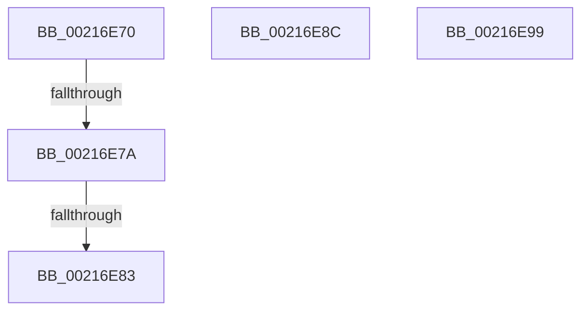

# sub_00216E70

- RVA: `0x00216E70`–`0x00216EA4` (길이 `52` bytes)
- VA: `0x0000000140216E70`
- 실행 섹션: `.text`
- PDB 이름 있음: `아니요`; PDB Function 태그: `아니요`
- unwind 정보 RVA: `0x0005E480`
- 디코드: `15`개 명령, `52/52` bytes 표시
- 미해석 바이트: `0` (있으면 어셈블리에 `.byte`로 보존)

> 이 문서는 커널 이미지의 기계어와 PDB 기호를 분석해 생성했습니다. 4번과 5번은 함수 원형과 자료형을 바이너리 사용 방식에서 추정한 C 해석이며 원본 소스 복구 결과는 아닙니다.

## 1. Dependencies

- 직접 호출 지점: **3**; 고유 호출 대상: **3**
- 직접 호출자로 확인된 함수: **0**
- RIP 상대 이미지 참조: **1**

### Outgoing calls
- `0x00216E7A` → [KiCheckVpBackingLongSpinWaitHypercall](../30/KiCheckVpBackingLongSpinWaitHypercall_function_0030F490.md) (function, `0x0030F490`)
- `0x00216E85` → [HvlNotifyLongSpinWait](../30/HvlNotifyLongSpinWait_function_0030F460.md) (function, `0x0030F460`)
- `0x00216E8F` → [HvlSwitchVirtualAddressSpace](../3C/HvlSwitchVirtualAddressSpace_function_003C7C60.md) (function, `0x003C7C60`)

### Direct callers
- 이 함수 시작 RVA로 연결되는 직접 call은 확인되지 않았습니다. 간접 호출은 완전히 역산할 수 없습니다.

### Static image references
- `0x00216E70` → RVA `0x00FC6AB8` (`ALMOSTRO`; read)

## 2. Other-region calls and transfers

- 다른 실행 섹션으로 향하는 call: **0**
- call이 아닌 외부 분기/꼬리 이동: **5**
  - `0x00216E78` → [sub_00216B4F + 0x2C5](Unknown_function_00216B4F.md) (`tail-transfer`)
  - `0x00216E81` → [sub_00216B4F + 0x2C5](Unknown_function_00216B4F.md) (`tail-transfer`)
  - `0x00216E8A` → [sub_00216B4F + 0x2C7](Unknown_function_00216B4F.md) (`tail-transfer`)
  - `0x00216E94` → [sub_00216B4F + 0x13D](Unknown_function_00216B4F.md) (`tail-transfer`)
  - `0x00216E9F` → [sub_00216B4F + 0x14A](Unknown_function_00216B4F.md) (`tail-transfer`)

## 3. Assembly (complete function range)

```asm
00216E70  8B 05 42 FC DA 00               mov eax, dword ptr [rip + 0xdafc42]
00216E76  A8 40                           test al, 0x40
00216E78  74 9A                           je 0x140216e14
00216E7A  E8 11 86 0F 00                  call 0x14030f490
00216E7F  84 C0                           test al, al
00216E81  74 91                           je 0x140216e14
00216E83  8B CF                           mov ecx, edi
00216E85  E8 D6 85 0F 00                  call 0x14030f460
00216E8A  EB 8A                           jmp 0x140216e16
00216E8C  48 8B CF                        mov rcx, rdi
00216E8F  E8 CC 0D 1B 00                  call 0x1403c7c60
00216E94  E9 F3 FD FF FF                  jmp 0x140216c8c
00216E99  0F 20 D8                        mov rax, cr3
00216E9C  0F 22 D8                        mov cr3, rax
00216E9F  E9 F5 FD FF FF                  jmp 0x140216c99
```

## 4. C-style interpretation (structured pseudocode)

```c
__int64 __fastcall sub_00216E70(void)
{
    __int64 result;

    result = KiCheckVpBackingLongSpinWaitHypercall(a1, a2, a3, a4);
    result = HvlNotifyLongSpinWait((unsigned int)((unsigned int)(v_rdi)), a2, a3, a4);
}
```

## 5. (Beta) C Style

```c
void sub_00216E70(void)
{
    int64_t result;

    result = KiCheckVpBackingLongSpinWaitHypercall(a1, a2, a3, a4);
    result = HvlNotifyLongSpinWait((uint32_t)((uint32_t)(local_rdi)), a2, a3, a4);
}
```

## 6. Execution-region graph

[열기: 2D/3D 그래프와 함수 탐색 컨트롤 패널](../../../control-panel.html?section=text&rva=0x00216E70&view=graph)

- 2D 그래프는 위에서 아래로 흐르고, 3D 그래프는 빈 공간을 드래그해 회전합니다. Shift+드래그는 이동, 휠은 확대·축소, 함수 노드 선택은 대상 보고서 이동입니다.

### Static fallback


