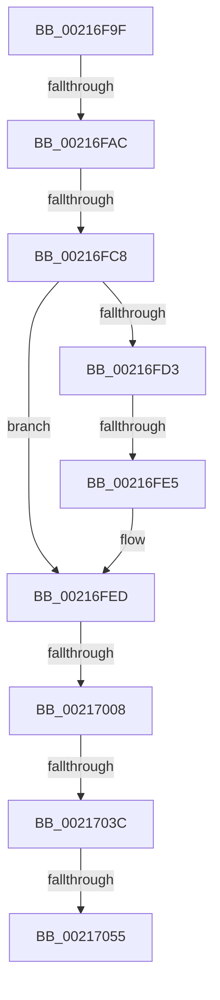

# sub_00216F9F

- RVA: `0x00216F9F`–`0x00217060` (길이 `193` bytes)
- VA: `0x0000000140216F9F`
- 실행 섹션: `.text`
- PDB 이름 있음: `아니요`; PDB Function 태그: `아니요`
- unwind 정보 RVA: `0x0005E4C0`
- 디코드: `44`개 명령, `193/193` bytes 표시
- 미해석 바이트: `0` (있으면 어셈블리에 `.byte`로 보존)

> 이 문서는 커널 이미지의 기계어와 PDB 기호를 분석해 생성했습니다. 4번과 5번은 함수 원형과 자료형을 바이너리 사용 방식에서 추정한 C 해석이며 원본 소스 복구 결과는 아닙니다.

## 1. Dependencies

- 직접 호출 지점: **3**; 고유 호출 대상: **3**
- 직접 호출자로 확인된 함수: **0**
- RIP 상대 이미지 참조: **2**

### Outgoing calls
- `0x00216FE8` → [KxWaitForLockChainValid](KxWaitForLockChainValid_function_00217AA0.md) (function, `0x00217AA0`)
- `0x0021701B` → [KeDisableInterrupts](KeDisableInterrupts_function_00217BE0.md) (function, `0x00217BE0`)
- `0x0021702E` → [KiHaltOnAddressWakeEntireList](KiHaltOnAddressWakeEntireList_function_00217AF4.md) (function, `0x00217AF4`)

### Direct callers
- 이 함수 시작 RVA로 연결되는 직접 call은 확인되지 않았습니다. 간접 호출은 완전히 역산할 수 없습니다.

### Static image references
- `0x00216FBB` → RVA `0x00FC6B06` (`ALMOSTRO`; read)
- `0x00217010` → RVA `0x00000000` (`image boundary/outside`; read)

## 2. Other-region calls and transfers

- 다른 실행 섹션으로 향하는 call: **0**
- call이 아닌 외부 분기/꼬리 이동: **7**
  - `0x00216FA6` → [sub_00217100](Unknown_function_00217100.md) (`tail-transfer`)
  - `0x00216FC2` → [sub_002170BD](Unknown_function_002170BD.md) (`tail-transfer`)
  - `0x00216FDF` → [sub_002170BD + 0x1B](Unknown_function_002170BD.md) (`tail-transfer`)
  - `0x00217002` → [sub_002170BD + 0x1B](Unknown_function_002170BD.md) (`tail-transfer`)
  - `0x00217036` → [sub_002170BD + 0x1B](Unknown_function_002170BD.md) (`tail-transfer`)
  - `0x0021704F` → [sub_00217100 + 0x1E](Unknown_function_00217100.md) (`tail-transfer`)
  - `0x0021705B` → [MiUnlockPageTable + 0x57](MiUnlockPageTable_function_00216EC0.md) (`tail-transfer`)

## 3. Assembly (complete function range)

```asm
00216F9F  48 89 7C 24 40                  mov qword ptr [rsp + 0x40], rdi
00216FA4  24 0F                           and al, 0xf
00216FA6  0F 85 54 01 00 00               jne 0x140217100
00216FAC  BA 30 00 00 00                  mov edx, 0x30
00216FB1  48 8D B9 40 9C 00 00            lea rdi, [rcx + 0x9c40]
00216FB8  48 03 FA                        add rdi, rdx
00216FBB  F6 05 44 FB DA 00 01            test byte ptr [rip + 0xdafb44], 1
00216FC2  0F 85 F5 00 00 00               jne 0x1402170bd
00216FC8  0F 0D 0F                        prefetchw byte ptr [rdi]
00216FCB  48 8B 07                        mov rax, qword ptr [rdi]
00216FCE  48 85 C0                        test rax, rax
00216FD1  75 1A                           jne 0x140216fed
00216FD3  48 8B 4F 08                     mov rcx, qword ptr [rdi + 8]
00216FD7  48 8B C7                        mov rax, rdi
00216FDA  F0 48 0F B1 19                  lock cmpxchg qword ptr [rcx], rbx
00216FDF  0F 84 F3 00 00 00               je 0x1402170d8
00216FE5  48 8B CF                        mov rcx, rdi
00216FE8  E8 B3 0A 00 00                  call 0x140217aa0
00216FED  4C 8D 40 08                     lea r8, [rax + 8]
00216FF1  48 89 1F                        mov qword ptr [rdi], rbx
00216FF4  48 8B 4F 08                     mov rcx, qword ptr [rdi + 8]
00216FF8  48 8B C1                        mov rax, rcx
00216FFB  49 87 00                        xchg qword ptr [r8], rax
00216FFE  32 C1                           xor al, cl
00217000  A8 04                           test al, 4
00217002  0F 84 D0 00 00 00               je 0x1402170d8
00217008  F0 09 1C 24                     lock or dword ptr [rsp], ebx
0021700C  49 C1 E8 05                     shr r8, 5
00217010  4C 8D 0D E9 8F DE FF            lea r9, [rip - 0x217017]
00217017  41 83 E0 7F                     and r8d, 0x7f
0021701B  E8 C0 0B 00 00                  call 0x140217be0
00217020  4B 87 9C C1 20 1B F2 00         xchg qword ptr [r9 + r8*8 + 0xf21b20], rbx
00217028  48 8B D3                        mov rdx, rbx
0021702B  0F B6 F8                        movzx edi, al
0021702E  E8 C1 0A 00 00                  call 0x140217af4
00217033  40 84 FF                        test dil, dil
00217036  0F 84 9C 00 00 00               je 0x1402170d8
0021703C  65 48 8B 0C 25 20 00 00 00      mov rcx, qword ptr gs:[0x20]
00217045  4C 8B 81 B8 8E 00 00            mov r8, qword ptr [rcx + 0x8eb8]
0021704C  4D 85 C0                        test r8, r8
0021704F  0F 85 C9 00 00 00               jne 0x14021711e
00217055  FB                              sti
00217056  48 8B 7C 24 40                  mov rdi, qword ptr [rsp + 0x40]
0021705B  E9 B7 FE FF FF                  jmp 0x140216f17
```

## 4. C-style interpretation (structured pseudocode)

```c
__int64 __fastcall sub_00216F9F(__int64 a1, __int64 a2, __int64 a3, __int64 a4, __int64 a5, __int64 a6, __int64 a7, __int64 a8)
{
    __int64 result;
    __int64 v_rdi;
    unsigned int v_stack_p0;
    unsigned __int64 v_stack_p40;

    v_stack_p40 = v_rdi;
    result = (unsigned __int8)((result) & (15));
    v_rdi = (a1 + 40000) + (48);
    if (*(unsigned __int64 *)(v_rdi) != 0) goto loc_00216FED;
    result = KxWaitForLockChainValid(v_rdi, 48, a3, a4);
loc_00216FED:
    *(unsigned __int64 *)(v_rdi) = v_rbx;
    result = (unsigned __int8)((*(unsigned __int64 *)(v_rdi + 8)) ^ ((unsigned __int8)(*(unsigned __int64 *)(v_rdi + 8))));
    a3 = (result + 8) >> (5);
    a3 = (unsigned int)((a3) & (127));
    result = KeDisableInterrupts(*(unsigned __int64 *)(v_rdi + 8), 48, a3, v_rip - 2191383);
    result = KiHaltOnAddressWakeEntireList(*(unsigned __int64 *)(v_rdi + 8), v_rbx, a3, v_rip - 2191383);
}
```

## 5. (Beta) C Style

```c
int64_t sub_00216F9F(void *Arg1, int64_t Arg2, int64_t Arg3, int64_t Arg4, uint64_t Arg5, uint64_t Arg6, uint64_t Arg7, int64_t Arg8)
{
    uint8_t *arg1 = (uint8_t *)Arg1;

    int64_t result;
    int64_t local_rdi;
    uint32_t v_stack_p0;
    uint64_t v_stack_p40;

    v_stack_p40 = local_rdi;
    result = (uint8_t)((result) & (15));
    local_rdi = (Arg1 + 40000) + (48);
    if (*(uint64_t *)(local_rdi) != 0) goto loc_00216FED;
    result = KxWaitForLockChainValid(local_rdi, 48, Arg3, Arg4);
loc_00216FED:
    *(uint64_t *)(local_rdi) = local_rbx;
    result = (uint8_t)((*(uint64_t *)(local_rdi + 0x8)) ^ ((uint8_t)(*(uint64_t *)(local_rdi + 0x8))));
    Arg3 = (result + 8) >> (5);
    Arg3 = (uint32_t)((Arg3) & (127));
    result = KeDisableInterrupts(*(uint64_t *)(local_rdi + 0x8), 48, Arg3, v_rip - 2191383);
    result = KiHaltOnAddressWakeEntireList(*(uint64_t *)(local_rdi + 0x8), local_rbx, Arg3, v_rip - 2191383);
}
```

### 관측된 메모리 오프셋

구조체 형식이 확인되지 않은 접근은 인자 기준의 오프셋으로만 기록했습니다.

| 기준 인자 | 오프셋 표현 | 폭 (bit) | 접근 |
|---|---:|---:|---|
| `Arg1` | `+ 0x0` | `8` | `R` |
| `Arg1` | `+ 0x0` | `64` | `R` |
| `Arg1` | `+ 0x0` | `64` | `W` |
| `Arg1` | `+ 0x8` | `64` | `R` |
| `Arg1` | `+ 0x9C40` | `64` | `R` |

## 6. Execution-region graph

[열기: 2D/3D 그래프와 함수 탐색 컨트롤 패널](../../../control-panel.html?section=text&rva=0x00216F9F&view=graph)

- 2D 그래프는 위에서 아래로 흐르고, 3D 그래프는 빈 공간을 드래그해 회전합니다. Shift+드래그는 이동, 휠은 확대·축소, 함수 노드 선택은 대상 보고서 이동입니다.

### Static fallback


