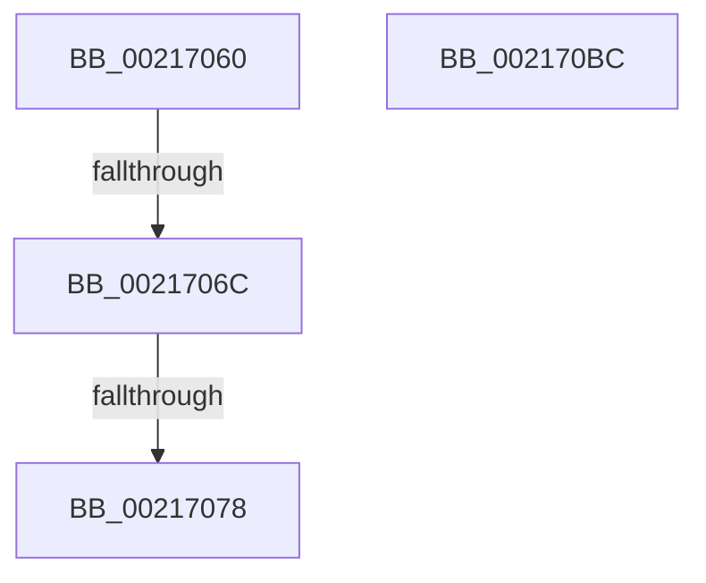

# sub_00217060

- RVA: `0x00217060`–`0x002170BD` (길이 `93` bytes)
- VA: `0x0000000140217060`
- 실행 섹션: `.text`
- PDB 이름 있음: `아니요`; PDB Function 태그: `아니요`
- unwind 정보 RVA: `0x0005E4D4`
- 디코드: `25`개 명령, `93/93` bytes 표시
- 미해석 바이트: `0` (있으면 어셈블리에 `.byte`로 보존)

> 이 문서는 커널 이미지의 기계어와 PDB 기호를 분석해 생성했습니다. 4번과 5번은 함수 원형과 자료형을 바이너리 사용 방식에서 추정한 C 해석이며 원본 소스 복구 결과는 아닙니다.

## 1. Dependencies

- 직접 호출 지점: **0**; 고유 호출 대상: **0**
- 직접 호출자로 확인된 함수: **0**
- RIP 상대 이미지 참조: **1**

### Outgoing calls
- 직접 디코드된 call 명령이 없습니다.

### Direct callers
- 이 함수 시작 RVA로 연결되는 직접 call은 확인되지 않았습니다. 간접 호출은 완전히 역산할 수 없습니다.

### Static image references
- `0x00217089` → RVA `0x00000000` (`image boundary/outside`; read)

## 2. Other-region calls and transfers

- 다른 실행 섹션으로 향하는 call: **0**
- call이 아닌 외부 분기/꼬리 이동: **2**
  - `0x00217066` → [MiUnlockPageTable + 0x49](MiUnlockPageTable_function_00216EC0.md) (`tail-transfer`)
  - `0x00217072` → [MiUnlockPageTable + 0x49](MiUnlockPageTable_function_00216EC0.md) (`tail-transfer`)

## 3. Assembly (complete function range)

```asm
00217060  49 8B C0                        mov rax, r8
00217063  48 3B D0                        cmp rdx, rax
00217066  0F 82 9D FE FF FF               jb 0x140216f09
0021706C  49 8B C2                        mov rax, r10
0021706F  48 3B D0                        cmp rdx, rax
00217072  0F 87 91 FE FF FF               ja 0x140216f09
00217078  49 8B C0                        mov rax, r8
0021707B  48 2B D0                        sub rdx, rax
0021707E  41 8B 81 B8 00 00 00            mov eax, dword ptr [r9 + 0xb8]
00217085  48 C1 FA 03                     sar rdx, 3
00217089  4C 8D 0D 70 8F DE FF            lea r9, [rip - 0x217090]
00217090  44 8D 04 12                     lea r8d, [rdx + rdx]
00217094  BA 02 00 00 00                  mov edx, 2
00217099  41 8B C8                        mov ecx, r8d
0021709C  41 8B C0                        mov eax, r8d
0021709F  83 E1 1F                        and ecx, 0x1f
002170A2  D3 E2                           shl edx, cl
002170A4  F7 D2                           not edx
002170A6  0F B3 CA                        btr edx, ecx
002170A9  48 C1 E8 05                     shr rax, 5
002170AD  F0 41 21 94 81 AC F1 E2 00      lock and dword ptr [r9 + rax*4 + 0xe2f1ac], edx
002170B6  48 83 C4 30                     add rsp, 0x30
002170BA  5B                              pop rbx
002170BB  C3                              ret
002170BC  CC                              int3
```

## 4. C-style interpretation (structured pseudocode)

```c
__int64 __fastcall sub_00217060(__int64 a1, __int64 a2, __int64 a3, __int64 a4)
{
    __int64 result;
    __int64 v_rsp;

    a2 = (a2) - (a3);
    a2 = (a2) >> (3);
    a1 = (unsigned int)(((unsigned int)((unsigned int)(a2 + a2 * 1))) & (31));
    a2 = (unsigned int)((2) << ((unsigned __int8)(a1)));
    a2 = (unsigned int)(~(a2));
    result = ((unsigned int)((unsigned int)(a2 + a2 * 1))) >> (5);
    v_rsp = (v_rsp) + (48);
    return result;
}
```

## 5. (Beta) C Style

```c
int64_t sub_00217060(int64_t Arg1, int64_t Arg2, int64_t Arg3, void *Arg4)
{
    uint8_t *arg4 = (uint8_t *)Arg4;

    int64_t result;
    int64_t local_rsp;

    Arg2 = (Arg2) - (Arg3);
    Arg2 = (Arg2) >> (3);
    Arg1 = (uint32_t)(((uint32_t)((uint32_t)(Arg2 + Arg2 * 1))) & (31));
    Arg2 = (uint32_t)((2) << ((uint8_t)(Arg1)));
    Arg2 = (uint32_t)(~(Arg2));
    result = ((uint32_t)((uint32_t)(Arg2 + Arg2 * 1))) >> (5);
    local_rsp = (local_rsp) + (48);
    return result;
}
```

### 관측된 메모리 오프셋

구조체 형식이 확인되지 않은 접근은 인자 기준의 오프셋으로만 기록했습니다.

| 기준 인자 | 오프셋 표현 | 폭 (bit) | 접근 |
|---|---:|---:|---|
| `Arg4` | `+ 0xB8` | `32` | `R` |

## 6. Execution-region graph

[열기: 2D/3D 그래프와 함수 탐색 컨트롤 패널](../../../control-panel.html?section=text&rva=0x00217060&view=graph)

- 2D 그래프는 위에서 아래로 흐르고, 3D 그래프는 빈 공간을 드래그해 회전합니다. Shift+드래그는 이동, 휠은 확대·축소, 함수 노드 선택은 대상 보고서 이동입니다.

### Static fallback


