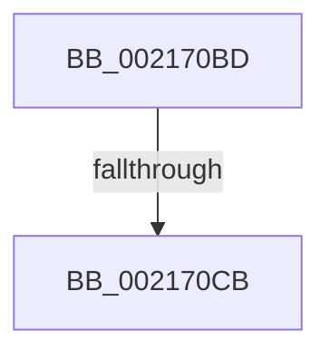

# sub_002170BD

- RVA: `0x002170BD`–`0x002170E2` (길이 `37` bytes)
- VA: `0x00000001402170BD`
- 실행 섹션: `.text`
- PDB 이름 있음: `아니요`; PDB Function 태그: `아니요`
- unwind 정보 RVA: `0x0005E4E8`
- 디코드: `8`개 명령, `37/37` bytes 표시
- 미해석 바이트: `0` (있으면 어셈블리에 `.byte`로 보존)

> 이 문서는 커널 이미지의 기계어와 PDB 기호를 분석해 생성했습니다. 4번과 5번은 함수 원형과 자료형을 바이너리 사용 방식에서 추정한 C 해석이며 원본 소스 복구 결과는 아닙니다.

## 1. Dependencies

- 직접 호출 지점: **1**; 고유 호출 대상: **1**
- 직접 호출자로 확인된 함수: **0**
- RIP 상대 이미지 참조: **1**

### Outgoing calls
- `0x002170D3` → [KiReleaseQueuedSpinLockInstrumented](KiReleaseQueuedSpinLockInstrumented_function_002179F0.md) (function, `0x002179F0`)

### Direct callers
- 이 함수 시작 RVA로 연결되는 직접 call은 확인되지 않았습니다. 간접 호출은 완전히 역산할 수 없습니다.

### Static image references
- `0x002170BD` → RVA `0x00F0DE58` (`.data`; read)

## 2. Other-region calls and transfers

- 다른 실행 섹션으로 향하는 call: **0**
- call이 아닌 외부 분기/꼬리 이동: **2**
  - `0x002170C5` → [sub_00216F9F + 0x29](Unknown_function_00216F9F.md) (`tail-transfer`)
  - `0x002170DD` → [MiUnlockPageTable + 0x57](MiUnlockPageTable_function_00216EC0.md) (`tail-transfer`)

## 3. Assembly (complete function range)

```asm
002170BD  8B 05 95 6D CF 00               mov eax, dword ptr [rip + 0xcf6d95]
002170C3  85 C0                           test eax, eax
002170C5  0F 85 FD FE FF FF               jne 0x140216fc8
002170CB  48 8B 54 24 38                  mov rdx, qword ptr [rsp + 0x38]
002170D0  48 8B CF                        mov rcx, rdi
002170D3  E8 18 09 00 00                  call 0x1402179f0
002170D8  48 8B 7C 24 40                  mov rdi, qword ptr [rsp + 0x40]
002170DD  E9 35 FE FF FF                  jmp 0x140216f17
```

## 4. C-style interpretation (structured pseudocode)

```c
__int64 __fastcall sub_002170BD(__int64 a1, __int64 a2, __int64 a3, __int64 a4, __int64 a5, __int64 a6, __int64 a7, __int64 a8)
{
    __int64 result;

    result = KiReleaseQueuedSpinLockInstrumented(v_rdi, a7, a3, a4);
}
```

## 5. (Beta) C Style

```c
int64_t sub_002170BD(int64_t Arg1, int64_t Arg2, int64_t Arg3, int64_t Arg4, uint64_t Arg5, uint64_t Arg6, int64_t Arg7, int64_t Arg8)
{
    int64_t result;

    result = KiReleaseQueuedSpinLockInstrumented(local_rdi, Arg7, Arg3, Arg4);
}
```

## 6. Execution-region graph

[열기: 2D/3D 그래프와 함수 탐색 컨트롤 패널](../../../control-panel.html?section=text&rva=0x002170BD&view=graph)

- 2D 그래프는 위에서 아래로 흐르고, 3D 그래프는 빈 공간을 드래그해 회전합니다. Shift+드래그는 이동, 휠은 확대·축소, 함수 노드 선택은 대상 보고서 이동입니다.

### Static fallback


