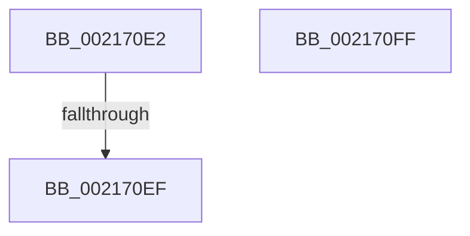

# sub_002170E2

- RVA: `0x002170E2`–`0x00217100` (길이 `30` bytes)
- VA: `0x00000001402170E2`
- 실행 섹션: `.text`
- PDB 이름 있음: `아니요`; PDB Function 태그: `아니요`
- unwind 정보 RVA: `0x0005E4FC`
- 디코드: `8`개 명령, `30/30` bytes 표시
- 미해석 바이트: `0` (있으면 어셈블리에 `.byte`로 보존)

> 이 문서는 커널 이미지의 기계어와 PDB 기호를 분석해 생성했습니다. 4번과 5번은 함수 원형과 자료형을 바이너리 사용 방식에서 추정한 C 해석이며 원본 소스 복구 결과는 아닙니다.

## 1. Dependencies

- 직접 호출 지점: **0**; 고유 호출 대상: **0**
- 직접 호출자로 확인된 함수: **0**
- RIP 상대 이미지 참조: **1**

### Outgoing calls
- 직접 디코드된 call 명령이 없습니다.

### Direct callers
- 이 함수 시작 RVA로 연결되는 직접 call은 확인되지 않았습니다. 간접 호출은 완전히 역산할 수 없습니다.

### Static image references
- `0x002170E2` → RVA `0x00FC6B06` (`ALMOSTRO`; read)

## 2. Other-region calls and transfers

- 다른 실행 섹션으로 향하는 call: **0**
- call이 아닌 외부 분기/꼬리 이동: **1**
  - `0x002170E9` → [sub_00217146 + 0x3B](Unknown_function_00217146.md) (`tail-transfer`)

## 3. Assembly (complete function range)

```asm
002170E2  F6 05 1D FA DA 00 01            test byte ptr [rip + 0xdafa1d], 1
002170E9  0F 85 92 00 00 00               jne 0x140217181
002170EF  F0 81 21 FF FF FF BF            lock and dword ptr [rcx], 0xbfffffff
002170F6  F0 FF 09                        lock dec dword ptr [rcx]
002170F9  48 83 C4 30                     add rsp, 0x30
002170FD  5B                              pop rbx
002170FE  C3                              ret
002170FF  CC                              int3
```

## 4. C-style interpretation (structured pseudocode)

```c
void __fastcall sub_002170E2(__int64 a1)
{
    __int64 v_rsp;

    v_rsp = (v_rsp) + (48);
    return;
}
```

## 5. (Beta) C Style

```c
void sub_002170E2(void *Arg1)
{
    uint8_t *arg1 = (uint8_t *)Arg1;

    int64_t local_rsp;

    local_rsp = (local_rsp) + (48);
    return;
}
```

### 관측된 메모리 오프셋

구조체 형식이 확인되지 않은 접근은 인자 기준의 오프셋으로만 기록했습니다.

| 기준 인자 | 오프셋 표현 | 폭 (bit) | 접근 |
|---|---:|---:|---|
| `Arg1` | `+ 0x0` | `32` | `R/W` |

## 6. Execution-region graph

[열기: 2D/3D 그래프와 함수 탐색 컨트롤 패널](../../../control-panel.html?section=text&rva=0x002170E2&view=graph)

- 2D 그래프는 위에서 아래로 흐르고, 3D 그래프는 빈 공간을 드래그해 회전합니다. Shift+드래그는 이동, 휠은 확대·축소, 함수 노드 선택은 대상 보고서 이동입니다.

### Static fallback


