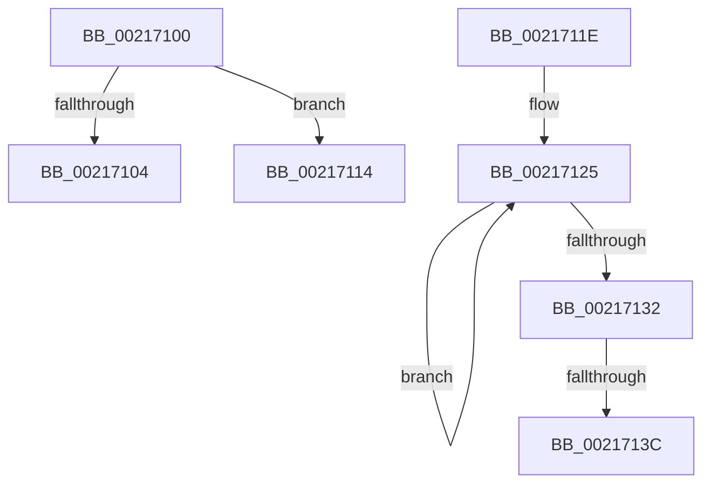

# sub_00217100

- RVA: `0x00217100`–`0x00217146` (길이 `70` bytes)
- VA: `0x0000000140217100`
- 실행 섹션: `.text`
- PDB 이름 있음: `아니요`; PDB Function 태그: `아니요`
- unwind 정보 RVA: `0x0005E510`
- 디코드: `18`개 명령, `70/70` bytes 표시
- 미해석 바이트: `0` (있으면 어셈블리에 `.byte`로 보존)

> 이 문서는 커널 이미지의 기계어와 PDB 기호를 분석해 생성했습니다. 4번과 5번은 함수 원형과 자료형을 바이너리 사용 방식에서 추정한 C 해석이며 원본 소스 복구 결과는 아닙니다.

## 1. Dependencies

- 직접 호출 지점: **1**; 고유 호출 대상: **1**
- 직접 호출자로 확인된 함수: **0**
- RIP 상대 이미지 참조: **0**

### Outgoing calls
- `0x0021713C` → [KiRemoveSystemWorkPriorityKick](../26/KiRemoveSystemWorkPriorityKick_function_002631D0.md) (function, `0x002631D0`)

### Direct callers
- 이 함수 시작 RVA로 연결되는 직접 call은 확인되지 않았습니다. 간접 호출은 완전히 역산할 수 없습니다.

### Static image references
- 디코드된 RIP-relative 메모리 참조가 없습니다.

## 2. Other-region calls and transfers

- 다른 실행 섹션으로 향하는 call: **0**
- call이 아닌 외부 분기/꼬리 이동: **4**
  - `0x0021710F` → [sub_00216F9F + 0x12](Unknown_function_00216F9F.md) (`tail-transfer`)
  - `0x00217119` → [sub_00216F9F + 0x12](Unknown_function_00216F9F.md) (`tail-transfer`)
  - `0x00217136` → [sub_00216F9F + 0xB6](Unknown_function_00216F9F.md) (`tail-transfer`)
  - `0x00217141` → [sub_00216F9F + 0xB6](Unknown_function_00216F9F.md) (`tail-transfer`)

## 3. Assembly (complete function range)

```asm
00217100  3C 07                           cmp al, 7
00217102  74 10                           je 0x140217114
00217104  3C 05                           cmp al, 5
00217106  BA 48 00 00 00                  mov edx, 0x48
0021710B  48 0F 44 D3                     cmove rdx, rbx
0021710F  E9 9D FE FF FF                  jmp 0x140216fb1
00217114  BA 18 00 00 00                  mov edx, 0x18
00217119  E9 93 FE FF FF                  jmp 0x140216fb1
0021711E  41 0F 0D 08                     prefetchw byte ptr [r8]
00217122  41 8B 00                        mov eax, dword ptr [r8]
00217125  8B D0                           mov edx, eax
00217127  0F BA F2 15                     btr edx, 0x15
0021712B  F0 41 0F B1 10                  lock cmpxchg dword ptr [r8], edx
00217130  75 F3                           jne 0x140217125
00217132  0F BA E0 15                     bt eax, 0x15
00217136  0F 83 19 FF FF FF               jae 0x140217055
0021713C  E8 8F C0 04 00                  call 0x1402631d0
00217141  E9 0F FF FF FF                  jmp 0x140217055
```

## 4. C-style interpretation (structured pseudocode)

```c
__int64 __fastcall sub_00217100(__int64 a1, __int64 a2, __int64 a3)
{
    if (((unsigned __int8)(result)) == 7) goto loc_00217114;
    a2 = 72;
    if (((unsigned __int8)(result)) == 5) { a2 = v_rbx; }
loc_00217114:
}
```

## 5. (Beta) C Style

```c
int64_t sub_00217100(int64_t Arg1, int64_t Arg2, int64_t Arg3)
{
    if (((uint8_t)(result)) == 7) goto loc_00217114;
    Arg2 = 72;
    if (((uint8_t)(result)) == 5) { Arg2 = local_rbx; }
loc_00217114:
}
```

## 6. Execution-region graph

[열기: 2D/3D 그래프와 함수 탐색 컨트롤 패널](../../../control-panel.html?section=text&rva=0x00217100&view=graph)

- 2D 그래프는 위에서 아래로 흐르고, 3D 그래프는 빈 공간을 드래그해 회전합니다. Shift+드래그는 이동, 휠은 확대·축소, 함수 노드 선택은 대상 보고서 이동입니다.

### Static fallback


