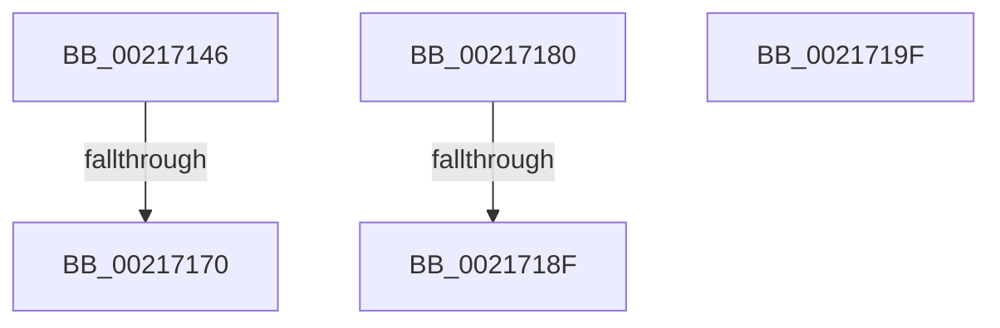

# sub_00217146

- RVA: `0x00217146`–`0x002171A0` (길이 `90` bytes)
- VA: `0x0000000140217146`
- 실행 섹션: `.text`
- PDB 이름 있음: `아니요`; PDB Function 태그: `아니요`
- unwind 정보 RVA: `0x0005E524`
- 디코드: `26`개 명령, `90/90` bytes 표시
- 미해석 바이트: `0` (있으면 어셈블리에 `.byte`로 보존)

> 이 문서는 커널 이미지의 기계어와 PDB 기호를 분석해 생성했습니다. 4번과 5번은 함수 원형과 자료형을 바이너리 사용 방식에서 추정한 C 해석이며 원본 소스 복구 결과는 아닙니다.

## 1. Dependencies

- 직접 호출 지점: **3**; 고유 호출 대상: **3**
- 직접 호출자로 확인된 함수: **0**
- RIP 상대 이미지 참조: **1**

### Outgoing calls
- `0x0021715C` → [KeBugCheckEx](../4F/KeBugCheckEx_function_004FD660.md) (function, `0x004FD660`)
- `0x00217175` → [ExpReleaseSpinLockExclusiveFromDpcLevelInstrumented](../2C/ExpReleaseSpinLockExclusiveFromDpcLevelInstrumented_function_002C0F44.md) (function, `0x002C0F44`)
- `0x00217194` → [ExpReleaseSpinLockSharedFromDpcLevelInstrumented](../2F/ExpReleaseSpinLockSharedFromDpcLevelInstrumented_function_002F0F48.md) (function, `0x002F0F48`)

### Direct callers
- 이 함수 시작 RVA로 연결되는 직접 call은 확인되지 않았습니다. 간접 호출은 완전히 역산할 수 없습니다.

### Static image references
- `0x00217162` → RVA `0x00F0DE58` (`.data`; read)

## 2. Other-region calls and transfers

- 다른 실행 섹션으로 향하는 call: **0**
- call이 아닌 외부 분기/꼬리 이동: **2**
  - `0x0021716A` → [MiUnlockPageTable + 0xC2](MiUnlockPageTable_function_00216EC0.md) (`tail-transfer`)
  - `0x00217189` → [sub_002170E2 + 0xD](Unknown_function_002170E2.md) (`tail-transfer`)

## 3. Assembly (complete function range)

```asm
00217146  33 DB                           xor ebx, ebx
00217148  48 8B D1                        mov rdx, rcx
0021714B  45 33 C9                        xor r9d, r9d
0021714E  48 89 5C 24 20                  mov qword ptr [rsp + 0x20], rbx
00217153  41 B8 00 01 00 00               mov r8d, 0x100
00217159  8D 4B 10                        lea ecx, [rbx + 0x10]
0021715C  E8 FF 64 2E 00                  call 0x1404fd660
00217161  CC                              int3
00217162  8B 05 F0 6C CF 00               mov eax, dword ptr [rip + 0xcf6cf0]
00217168  85 C0                           test eax, eax
0021716A  0F 85 12 FE FF FF               jne 0x140216f82
00217170  48 8B 54 24 38                  mov rdx, qword ptr [rsp + 0x38]
00217175  E8 CA 9D 0A 00                  call 0x1402c0f44
0021717A  48 83 C4 30                     add rsp, 0x30
0021717E  5B                              pop rbx
0021717F  C3                              ret
00217180  CC                              int3
00217181  8B 05 D1 6C CF 00               mov eax, dword ptr [rip + 0xcf6cd1]
00217187  85 C0                           test eax, eax
00217189  0F 85 60 FF FF FF               jne 0x1402170ef
0021718F  48 8B 54 24 38                  mov rdx, qword ptr [rsp + 0x38]
00217194  E8 AF 9D 0D 00                  call 0x1402f0f48
00217199  48 83 C4 30                     add rsp, 0x30
0021719D  5B                              pop rbx
0021719E  C3                              ret
0021719F  CC                              int3
```

## 4. C-style interpretation (structured pseudocode)

```c
__int64 __fastcall sub_00217146(__int64 a1, __int64 a2, __int64 a3, int a4, __int64 a5, __int64 a6, __int64 a7)
{
    __int64 result;
    __int64 v_rbx;
    __int64 v_rsp;
    unsigned __int64 v_stack_p20;
    unsigned __int64 v_stack_p70;

    v_rbx = 0;
    a4 = 0;
    v_stack_p20 = 0;
    result = KeBugCheckEx(v_rbx + 16, a1, 256, a4);
    result = ExpReleaseSpinLockExclusiveFromDpcLevelInstrumented(v_rbx + 16, a7, 256, a4);
    v_rsp = (v_rsp) + (48);
    return result;
}
```

## 5. (Beta) C Style

```c
int64_t sub_00217146(int64_t Arg1, int64_t Arg2, int64_t Arg3, int32_t Arg4, uint64_t Arg5, uint64_t Arg6, int64_t Arg7)
{
    int64_t result;
    int64_t local_rbx;
    int64_t local_rsp;
    uint64_t v_stack_p20;
    uint64_t v_stack_p70;

    local_rbx = 0;
    Arg4 = 0;
    v_stack_p20 = 0;
    result = KeBugCheckEx(local_rbx + 16, Arg1, 256, Arg4);
    result = ExpReleaseSpinLockExclusiveFromDpcLevelInstrumented(local_rbx + 16, Arg7, 256, Arg4);
    local_rsp = (local_rsp) + (48);
    return result;
}
```

## 6. Execution-region graph

[열기: 2D/3D 그래프와 함수 탐색 컨트롤 패널](../../../control-panel.html?section=text&rva=0x00217146&view=graph)

- 2D 그래프는 위에서 아래로 흐르고, 3D 그래프는 빈 공간을 드래그해 회전합니다. Shift+드래그는 이동, 휠은 확대·축소, 함수 노드 선택은 대상 보고서 이동입니다.

### Static fallback


