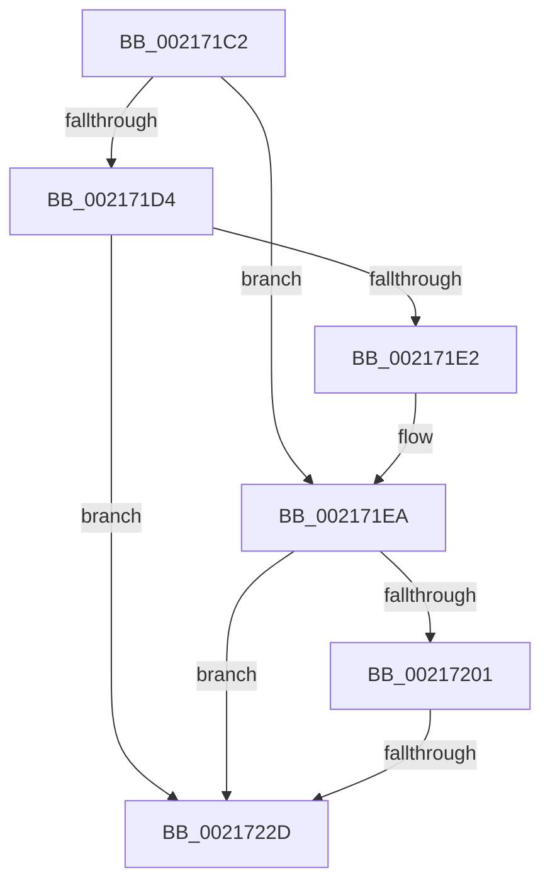

# sub_002171C2

- RVA: `0x002171C2`–`0x00217238` (길이 `118` bytes)
- VA: `0x00000001402171C2`
- 실행 섹션: `.text`
- PDB 이름 있음: `아니요`; PDB Function 태그: `아니요`
- unwind 정보 RVA: `0x0005E544`
- 디코드: `35`개 명령, `118/118` bytes 표시
- 미해석 바이트: `0` (있으면 어셈블리에 `.byte`로 보존)

> 이 문서는 커널 이미지의 기계어와 PDB 기호를 분석해 생성했습니다. 4번과 5번은 함수 원형과 자료형을 바이너리 사용 방식에서 추정한 C 해석이며 원본 소스 복구 결과는 아닙니다.

## 1. Dependencies

- 직접 호출 지점: **3**; 고유 호출 대상: **3**
- 직접 호출자로 확인된 함수: **0**
- RIP 상대 이미지 참조: **1**

### Outgoing calls
- `0x002171E5` → [KxWaitForLockChainValid](KxWaitForLockChainValid_function_00217AA0.md) (function, `0x00217AA0`)
- `0x00217214` → [KeDisableInterrupts](KeDisableInterrupts_function_00217BE0.md) (function, `0x00217BE0`)
- `0x00217223` → [KiHaltOnAddressWakeEntireList](KiHaltOnAddressWakeEntireList_function_00217AF4.md) (function, `0x00217AF4`)

### Direct callers
- 이 함수 시작 RVA로 연결되는 직접 call은 확인되지 않았습니다. 간접 호출은 완전히 역산할 수 없습니다.

### Static image references
- `0x00217209` → RVA `0x00F21B20` (`.data`; read)

## 2. Other-region calls and transfers

- 다른 실행 섹션으로 향하는 call: **0**
- call이 아닌 외부 분기/꼬리 이동: **1**
  - `0x0021722B` → [sub_00217258](Unknown_function_00217258.md) (`tail-transfer`)

## 3. Assembly (complete function range)

```asm
002171C2  48 89 5C 24 30                  mov qword ptr [rsp + 0x30], rbx
002171C7  0F 0D 09                        prefetchw byte ptr [rcx]
002171CA  48 8B 01                        mov rax, qword ptr [rcx]
002171CD  33 DB                           xor ebx, ebx
002171CF  48 85 C0                        test rax, rax
002171D2  75 16                           jne 0x1402171ea
002171D4  48 8B 49 08                     mov rcx, qword ptr [rcx + 8]
002171D8  48 8B C7                        mov rax, rdi
002171DB  F0 48 0F B1 19                  lock cmpxchg qword ptr [rcx], rbx
002171E0  74 4B                           je 0x14021722d
002171E2  48 8B CF                        mov rcx, rdi
002171E5  E8 B6 08 00 00                  call 0x140217aa0
002171EA  4C 8D 40 08                     lea r8, [rax + 8]
002171EE  48 89 1F                        mov qword ptr [rdi], rbx
002171F1  48 8B 4F 08                     mov rcx, qword ptr [rdi + 8]
002171F5  48 8B C1                        mov rax, rcx
002171F8  49 87 00                        xchg qword ptr [r8], rax
002171FB  32 C1                           xor al, cl
002171FD  A8 04                           test al, 4
002171FF  74 2C                           je 0x14021722d
00217201  F0 09 1C 24                     lock or dword ptr [rsp], ebx
00217205  49 C1 E8 05                     shr r8, 5
00217209  4C 8D 0D 10 A9 D0 00            lea r9, [rip + 0xd0a910]
00217210  41 83 E0 7F                     and r8d, 0x7f
00217214  E8 C7 09 00 00                  call 0x140217be0
00217219  4B 87 1C C1                     xchg qword ptr [r9 + r8*8], rbx
0021721D  48 8B D3                        mov rdx, rbx
00217220  0F B6 F8                        movzx edi, al
00217223  E8 CC 08 00 00                  call 0x140217af4
00217228  40 84 FF                        test dil, dil
0021722B  75 2B                           jne 0x140217258
0021722D  48 8B 5C 24 30                  mov rbx, qword ptr [rsp + 0x30]
00217232  48 83 C4 20                     add rsp, 0x20
00217236  5F                              pop rdi
00217237  C3                              ret
```

## 4. C-style interpretation (structured pseudocode)

```c
__int64 __fastcall sub_002171C2(__int64 a1, __int64 a2, __int64 a3, __int64 a4, __int64 a5, __int64 a6)
{
    __int64 result;
    __int64 v_rbx;
    __int64 v_rsp;
    unsigned int v_stack_p0;
    unsigned __int64 v_stack_p30;

    v_stack_p30 = v_rbx;
    v_rbx = 0;
    if (*(unsigned __int64 *)(a1) != 0) goto loc_002171EA;
    if (*(unsigned __int64 *)(a1) == 0) goto loc_0021722D;
    result = KxWaitForLockChainValid(v_rdi, a2, a3, a4);
loc_002171EA:
    *(unsigned __int64 *)(v_rdi) = 0;
    result = (unsigned __int8)((*(unsigned __int64 *)(v_rdi + 8)) ^ ((unsigned __int8)(*(unsigned __int64 *)(v_rdi + 8))));
    if ((((unsigned __int8)(result)) & (4)) == 0) goto loc_0021722D;
    a3 = (result + 8) >> (5);
    a3 = (unsigned int)((a3) & (127));
    result = KeDisableInterrupts(*(unsigned __int64 *)(v_rdi + 8), a2, a3, v_rip + 13674768);
    result = KiHaltOnAddressWakeEntireList(*(unsigned __int64 *)(v_rdi + 8), 0, a3, v_rip + 13674768);
loc_0021722D:
    v_rsp = (v_rsp) + (32);
    return result;
}
```

## 5. (Beta) C Style

```c
int64_t sub_002171C2(void *Arg1, int64_t Arg2, int64_t Arg3, int64_t Arg4, uint64_t Arg5, int64_t Arg6)
{
    uint8_t *arg1 = (uint8_t *)Arg1;

    int64_t result;
    int64_t local_rbx;
    int64_t local_rsp;
    uint32_t v_stack_p0;
    uint64_t v_stack_p30;

    v_stack_p30 = local_rbx;
    local_rbx = 0;
    if (*(uint64_t *)(arg1) != 0) goto loc_002171EA;
    if (*(uint64_t *)(arg1) == 0) goto loc_0021722D;
    result = KxWaitForLockChainValid(local_rdi, Arg2, Arg3, Arg4);
loc_002171EA:
    *(uint64_t *)(local_rdi) = 0;
    result = (uint8_t)((*(uint64_t *)(local_rdi + 0x8)) ^ ((uint8_t)(*(uint64_t *)(local_rdi + 0x8))));
    if ((((uint8_t)(result)) & (4)) == 0) goto loc_0021722D;
    Arg3 = (result + 8) >> (5);
    Arg3 = (uint32_t)((Arg3) & (127));
    result = KeDisableInterrupts(*(uint64_t *)(local_rdi + 0x8), Arg2, Arg3, v_rip + 13674768);
    result = KiHaltOnAddressWakeEntireList(*(uint64_t *)(local_rdi + 0x8), 0, Arg3, v_rip + 13674768);
loc_0021722D:
    local_rsp = (local_rsp) + (32);
    return result;
}
```

### 관측된 메모리 오프셋

구조체 형식이 확인되지 않은 접근은 인자 기준의 오프셋으로만 기록했습니다.

| 기준 인자 | 오프셋 표현 | 폭 (bit) | 접근 |
|---|---:|---:|---|
| `Arg1` | `+ 0x0` | `8` | `R` |
| `Arg1` | `+ 0x0` | `64` | `R` |
| `Arg1` | `+ 0x8` | `64` | `R` |

## 6. Execution-region graph

[열기: 2D/3D 그래프와 함수 탐색 컨트롤 패널](../../../control-panel.html?section=text&rva=0x002171C2&view=graph)

- 2D 그래프는 위에서 아래로 흐르고, 3D 그래프는 빈 공간을 드래그해 회전합니다. Shift+드래그는 이동, 휠은 확대·축소, 함수 노드 선택은 대상 보고서 이동입니다.

### Static fallback


