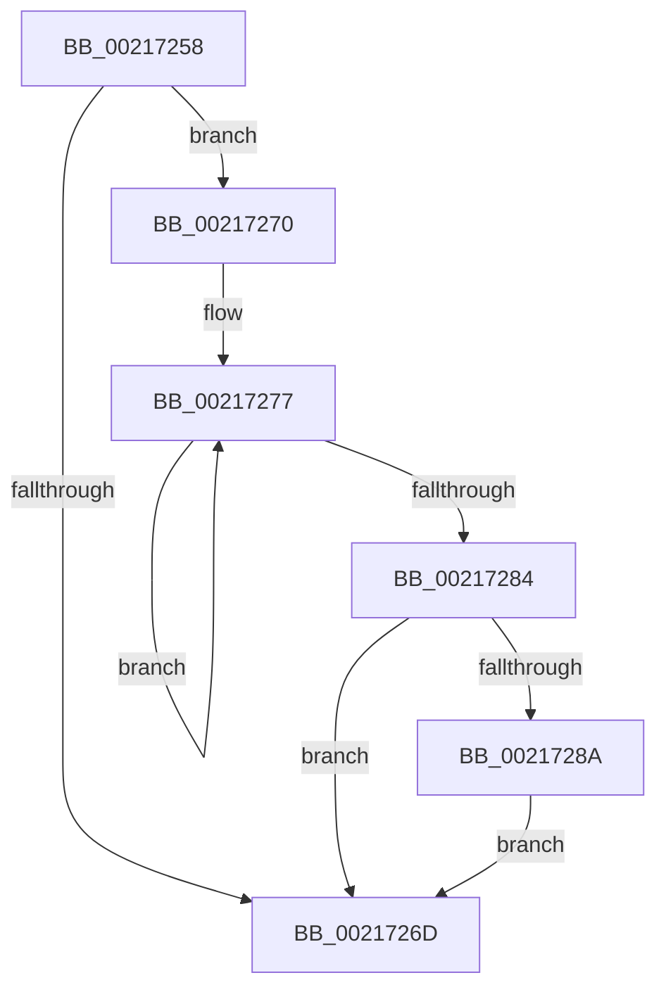

# sub_00217258

- RVA: `0x00217258`–`0x00217291` (길이 `57` bytes)
- VA: `0x0000000140217258`
- 실행 섹션: `.text`
- PDB 이름 있음: `아니요`; PDB Function 태그: `아니요`
- unwind 정보 RVA: `0x0005E570`
- 디코드: `16`개 명령, `57/57` bytes 표시
- 미해석 바이트: `0` (있으면 어셈블리에 `.byte`로 보존)

> 이 문서는 커널 이미지의 기계어와 PDB 기호를 분석해 생성했습니다. 4번과 5번은 함수 원형과 자료형을 바이너리 사용 방식에서 추정한 C 해석이며 원본 소스 복구 결과는 아닙니다.

## 1. Dependencies

- 직접 호출 지점: **1**; 고유 호출 대상: **1**
- 직접 호출자로 확인된 함수: **0**
- RIP 상대 이미지 참조: **0**

### Outgoing calls
- `0x0021728A` → [KiRemoveSystemWorkPriorityKick](../26/KiRemoveSystemWorkPriorityKick_function_002631D0.md) (function, `0x002631D0`)

### Direct callers
- 이 함수 시작 RVA로 연결되는 직접 call은 확인되지 않았습니다. 간접 호출은 완전히 역산할 수 없습니다.

### Static image references
- 디코드된 RIP-relative 메모리 참조가 없습니다.

## 2. Other-region calls and transfers

- 다른 실행 섹션으로 향하는 call: **0**
- call이 아닌 외부 분기/꼬리 이동: **1**
  - `0x0021726E` → [sub_002171C2 + 0x6B](Unknown_function_002171C2.md) (`tail-transfer`)

## 3. Assembly (complete function range)

```asm
00217258  65 48 8B 0C 25 20 00 00 00      mov rcx, qword ptr gs:[0x20]
00217261  4C 8B 81 B8 8E 00 00            mov r8, qword ptr [rcx + 0x8eb8]
00217268  4D 85 C0                        test r8, r8
0021726B  75 03                           jne 0x140217270
0021726D  FB                              sti
0021726E  EB BD                           jmp 0x14021722d
00217270  41 0F 0D 08                     prefetchw byte ptr [r8]
00217274  41 8B 00                        mov eax, dword ptr [r8]
00217277  8B D0                           mov edx, eax
00217279  0F BA F2 15                     btr edx, 0x15
0021727D  F0 41 0F B1 10                  lock cmpxchg dword ptr [r8], edx
00217282  75 F3                           jne 0x140217277
00217284  0F BA E0 15                     bt eax, 0x15
00217288  73 E3                           jae 0x14021726d
0021728A  E8 41 BF 04 00                  call 0x1402631d0
0021728F  EB DC                           jmp 0x14021726d
```

## 4. C-style interpretation (structured pseudocode)

```c
__int64 __fastcall sub_00217258(void)
{
    __int64 result;

    if (*(unsigned __int64 *)(*(unsigned __int64 *)(gs_base + (0 + 32)) + 36536) != 0) goto loc_00217270;
loc_0021726D:
loc_00217270:
loc_00217277:
    if (*(unsigned __int64 *)(*(unsigned __int64 *)(gs_base + (0 + 32)) + 36536) != 0) goto loc_00217277;
    if (condition_is_above_or_equal) goto loc_0021726D;
    result = KiRemoveSystemWorkPriorityKick(*(unsigned __int64 *)(gs_base + (0 + 32)), (unsigned int)((unsigned int)((unsigned int)(*(unsigned int *)(*(unsigned __int64 *)(*(unsigned __int64 *)(gs_base + (0 + 32)) + 36536))))), *(unsigned __int64 *)(*(unsigned __int64 *)(gs_base + (0 + 32)) + 36536), a4);
    goto loc_0021726D;
}
```

## 5. (Beta) C Style

```c
void sub_00217258(void)
{
    int64_t result;

    if (*(uint64_t *)(*(uint64_t *)(gs_base + (0 + 0x20)) + 0x8EB8) != 0) goto loc_00217270;
loc_0021726D:
loc_00217270:
loc_00217277:
    if (*(uint64_t *)(*(uint64_t *)(gs_base + (0 + 0x20)) + 0x8EB8) != 0) goto loc_00217277;
    if (condition_is_above_or_equal) goto loc_0021726D;
    result = KiRemoveSystemWorkPriorityKick(*(uint64_t *)(gs_base + (0 + 0x20)), (uint32_t)((uint32_t)((uint32_t)(*(uint32_t *)(*(uint64_t *)(*(uint64_t *)(gs_base + (0 + 0x20)) + 0x8EB8))))), *(uint64_t *)(*(uint64_t *)(gs_base + (0 + 0x20)) + 0x8EB8), a4);
    goto loc_0021726D;
}
```

## 6. Execution-region graph

[열기: 2D/3D 그래프와 함수 탐색 컨트롤 패널](../../../control-panel.html?section=text&rva=0x00217258&view=graph)

- 2D 그래프는 위에서 아래로 흐르고, 3D 그래프는 빈 공간을 드래그해 회전합니다. Shift+드래그는 이동, 휠은 확대·축소, 함수 노드 선택은 대상 보고서 이동입니다.

### Static fallback


