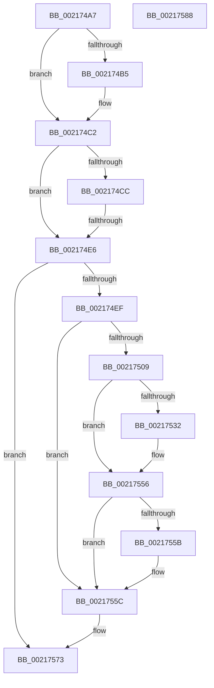

# sub_002174A7

- RVA: `0x002174A7`–`0x00217589` (길이 `226` bytes)
- VA: `0x00000001402174A7`
- 실행 섹션: `.text`
- PDB 이름 있음: `아니요`; PDB Function 태그: `아니요`
- unwind 정보 RVA: `0x0005E5C4`
- 디코드: `56`개 명령, `226/226` bytes 표시
- 미해석 바이트: `0` (있으면 어셈블리에 `.byte`로 보존)

> 이 문서는 커널 이미지의 기계어와 PDB 기호를 분석해 생성했습니다. 4번과 5번은 함수 원형과 자료형을 바이너리 사용 방식에서 추정한 C 해석이며 원본 소스 복구 결과는 아닙니다.

## 1. Dependencies

- 직접 호출 지점: **3**; 고유 호출 대상: **3**
- 직접 호출자로 확인된 함수: **0**
- RIP 상대 이미지 참조: **2**

### Outgoing calls
- `0x002174BD` → [KiLowerIrqlProcessIrqlFlags](../4F/KiLowerIrqlProcessIrqlFlags_function_004F5698.md) (function, `0x004F5698`)
- `0x00217512` → [HalpDisableInterrupts](../25/HalpDisableInterrupts_function_002521A0.md) (function, `0x002521A0`)
- `0x0021756E` → [HalpInterruptSendIpi](../25/HalpInterruptSendIpi_function_00252310.md) (function, `0x00252310`)

### Direct callers
- 이 함수 시작 RVA로 연결되는 직접 call은 확인되지 않았습니다. 간접 호출은 완전히 역산할 수 없습니다.

### Static image references
- `0x002174A7` → RVA `0x00FC6D20` (`ALMOSTRO`; read)
- `0x002174F8` → RVA `0x00FC6BC5` (`ALMOSTRO`; read)

## 2. Other-region calls and transfers

- 다른 실행 섹션으로 향하는 call: **0**
- call이 아닌 외부 분기/꼬리 이동: **1**
  - `0x002174E0` → [sub_002175E7 + 0x38](Unknown_function_002175E7.md) (`tail-transfer`)

## 3. Assembly (complete function range)

```asm
002174A7  83 3D 72 F8 DA 00 00            cmp dword ptr [rip + 0xdaf872], 0
002174AE  0F B6 74 24 78                  movzx esi, byte ptr [rsp + 0x78]
002174B3  74 0D                           je 0x1402174c2
002174B5  44 0F 20 C1                     mov rcx, cr8
002174B9  40 0F B6 D6                     movzx edx, sil
002174BD  E8 D6 E1 2D 00                  call 0x1404f5698
002174C2  44 0F 22 C6                     mov cr8, rsi
002174C6  41 F6 C4 01                     test r12b, 1
002174CA  75 1A                           jne 0x1402174e6
002174CC  B8 F8 FF FF FF                  mov eax, 0xfffffff8
002174D1  F0 41 0F C1 85 08 01 00 00      lock xadd dword ptr [r13 + 0x108], eax
002174DA  83 E0 F8                        and eax, 0xfffffff8
002174DD  83 F8 08                        cmp eax, 8
002174E0  0F 84 39 01 00 00               je 0x14021761f
002174E6  48 39 3F                        cmp qword ptr [rdi], rdi
002174E9  0F 84 84 00 00 00               je 0x140217573
002174EF  33 C0                           xor eax, eax
002174F1  C6 83 C1 00 00 00 01            mov byte ptr [rbx + 0xc1], 1
002174F8  38 05 C7 F6 DA 00               cmp byte ptr [rip + 0xdaf6c7], al
002174FE  0F 57 C0                        xorps xmm0, xmm0
00217501  F3 0F 7F 44 24 24               movdqu xmmword ptr [rsp + 0x24], xmm0
00217507  74 53                           je 0x14021755c
00217509  65 4C 8B 04 25 20 00 00 00      mov r8, qword ptr gs:[0x20]
00217512  E8 89 AC 03 00                  call 0x1402521a0
00217517  41 8B 90 A8 00 00 00            mov edx, dword ptr [r8 + 0xa8]
0021751E  44 0F B6 C8                     movzx r9d, al
00217522  8B CA                           mov ecx, edx
00217524  83 C9 02                        or ecx, 2
00217527  41 89 88 A8 00 00 00            mov dword ptr [r8 + 0xa8], ecx
0021752E  85 D2                           test edx, edx
00217530  75 24                           jne 0x140217556
00217532  B9 15 00 01 C0                  mov ecx, 0xc0010015
00217537  0F 32                           rdmsr
00217539  48 C1 E2 20                     shl rdx, 0x20
0021753D  48 0B C2                        or rax, rdx
00217540  48 BA 00 00 00 00 01 00 00 00   movabs rdx, 0x100000000
0021754A  48 0B C2                        or rax, rdx
0021754D  48 8B D0                        mov rdx, rax
00217550  48 C1 EA 20                     shr rdx, 0x20
00217554  0F 30                           wrmsr
00217556  45 84 C9                        test r9b, r9b
00217559  74 01                           je 0x14021755c
0021755B  FB                              sti
0021755C  BA 1F 00 00 00                  mov edx, 0x1f
00217561  C7 44 24 20 05 00 00 00         mov dword ptr [rsp + 0x20], 5
00217569  48 8D 4C 24 20                  lea rcx, [rsp + 0x20]
0021756E  E8 9D AD 03 00                  call 0x140252310
00217573  48 8B 9C 24 88 00 00 00         mov rbx, qword ptr [rsp + 0x88]
0021757B  48 83 C4 40                     add rsp, 0x40
0021757F  41 5E                           pop r14
00217581  41 5D                           pop r13
00217583  41 5C                           pop r12
00217585  5F                              pop rdi
00217586  5E                              pop rsi
00217587  C3                              ret
00217588  CC                              int3
```

## 4. C-style interpretation (structured pseudocode)

```c
__int64 __fastcall sub_002174A7(__int64 a1, __int64 a2, __int64 a3, __int64 a4, __int64 a5, __int64 a6, __int64 a7, __int64 a8, __int64 a9, __int64 a10, __int64 a11, __int64 a12, __int64 a13, __int64 a14, unsigned __int8 a15, __int64 a16, __int64 a17)
{
    __int64 result;
    __int64 v_rsp;
    unsigned int v_stack_p20;
    unsigned __int64 v_stack_p24;

    if ((*(unsigned int *)(v_rip + 14350450)) != 0) {
        a1 = v_cr8;
        a2 = a15;
        result = KiLowerIrqlProcessIrqlFlags(a1, a2, a3, a4);
    }
    if ((((unsigned __int8)(v_r12)) & (1)) != 0) goto loc_002174E6;
    result = (unsigned int)(((unsigned int)(0xFFFFFFF8ULL)) & (0xFFFFFFF8ULL));
loc_002174E6:
    if ((*(unsigned __int64 *)(v_rdi)) == v_rdi) goto loc_00217573;
    result = 0;
    *(unsigned __int8 *)(v_rbx + 193) = 1;
    v_stack_p24 = v_xmm0;
    if ((*(unsigned __int8 *)(v_rip + 14350023)) == 0) goto loc_0021755C;
    result = HalpDisableInterrupts(a1, a2, *(unsigned __int64 *)(gs_base + (0 + 32)), a4);
    a1 = (unsigned int)(((unsigned int)((unsigned int)((unsigned int)(*(unsigned int *)(*(unsigned __int64 *)(gs_base + (0 + 32)) + 168))))) | (2));
    *(unsigned int *)(*(unsigned __int64 *)(gs_base + (0 + 32)) + 168) = (unsigned int)(a1);
    if ((unsigned int)((unsigned int)(*(unsigned int *)(*(unsigned __int64 *)(gs_base + (0 + 32)) + 168))) == 0) {
        a1 = 0xC0010015ULL;
        a2 = ((unsigned int)(*(unsigned int *)(*(unsigned __int64 *)(gs_base + (0 + 32)) + 168))) << (32);
        result = (result) | (a2);
        result = (result) | (a2);
        a2 = result;
        a2 = (a2) >> (32);
    }
    if ((unsigned __int8)((unsigned __int8)(result)) != 0) {
    }
    v_stack_p20 = 5;
    result = HalpInterruptSendIpi(v_stack_p20, 31, *(unsigned __int64 *)(gs_base + (0 + 32)), (unsigned __int8)(result));
loc_00217573:
    v_rsp = (v_rsp) + (64);
    return result;
}
```

## 5. (Beta) C Style

```c
int64_t sub_002174A7(int64_t Arg1, int64_t Arg2, int64_t Arg3, int64_t Arg4, uint64_t Arg5, uint64_t Arg6, uint64_t Arg7, uint64_t Arg8, uint64_t Arg9, uint64_t Arg10, uint64_t Arg11, uint64_t Arg12, uint64_t Arg13, uint64_t Arg14, uint8_t Arg15, uint64_t Arg16, int64_t Arg17)
{
    int64_t result;
    int64_t local_rsp;
    uint32_t v_stack_p20;
    uint64_t v_stack_p24;

    if ((*(uint32_t *)(v_rip + 0xDAF872)) != 0) {
        Arg1 = v_cr8;
        Arg2 = Arg15;
        result = KiLowerIrqlProcessIrqlFlags(Arg1, Arg2, Arg3, Arg4);
    }
    if ((((uint8_t)(local_r12)) & (1)) != 0) goto loc_002174E6;
    result = (uint32_t)(((uint32_t)(0xFFFFFFF8ULL)) & (0xFFFFFFF8ULL));
loc_002174E6:
    if ((*(uint64_t *)(local_rdi)) == local_rdi) goto loc_00217573;
    result = 0;
    *(uint8_t *)(local_rbx + 0xC1) = 1;
    v_stack_p24 = v_xmm0;
    if ((*(uint8_t *)(v_rip + 0xDAF6C7)) == 0) goto loc_0021755C;
    result = HalpDisableInterrupts(Arg1, Arg2, *(uint64_t *)(gs_base + (0 + 0x20)), Arg4);
    Arg1 = (uint32_t)(((uint32_t)((uint32_t)((uint32_t)(*(uint32_t *)(*(uint64_t *)(gs_base + (0 + 0x20)) + 0xA8))))) | (2));
    *(uint32_t *)(*(uint64_t *)(gs_base + (0 + 0x20)) + 0xA8) = (uint32_t)(Arg1);
    if ((uint32_t)((uint32_t)(*(uint32_t *)(*(uint64_t *)(gs_base + (0 + 0x20)) + 0xA8))) == 0) {
        Arg1 = 0xC0010015ULL;
        Arg2 = ((uint32_t)(*(uint32_t *)(*(uint64_t *)(gs_base + (0 + 0x20)) + 0xA8))) << (32);
        result = (result) | (Arg2);
        result = (result) | (Arg2);
        Arg2 = result;
        Arg2 = (Arg2) >> (32);
    }
    if ((uint8_t)((uint8_t)(result)) != 0) {
    }
    v_stack_p20 = 5;
    result = HalpInterruptSendIpi(v_stack_p20, 31, *(uint64_t *)(gs_base + (0 + 0x20)), (uint8_t)(result));
loc_00217573:
    local_rsp = (local_rsp) + (64);
    return result;
}
```

## 6. Execution-region graph

[열기: 2D/3D 그래프와 함수 탐색 컨트롤 패널](../../../control-panel.html?section=text&rva=0x002174A7&view=graph)

- 2D 그래프는 위에서 아래로 흐르고, 3D 그래프는 빈 공간을 드래그해 회전합니다. Shift+드래그는 이동, 휠은 확대·축소, 함수 노드 선택은 대상 보고서 이동입니다.

### Static fallback


