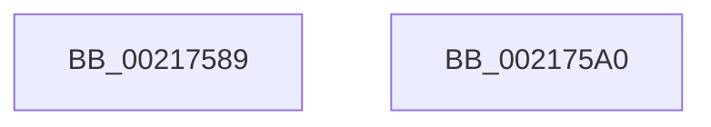

# sub_00217589

- RVA: `0x00217589`–`0x002175B7` (길이 `46` bytes)
- VA: `0x0000000140217589`
- 실행 섹션: `.text`
- PDB 이름 있음: `아니요`; PDB Function 태그: `아니요`
- unwind 정보 RVA: `0x0005E5D8`
- 디코드: `12`개 명령, `46/46` bytes 표시
- 미해석 바이트: `0` (있으면 어셈블리에 `.byte`로 보존)

> 이 문서는 커널 이미지의 기계어와 PDB 기호를 분석해 생성했습니다. 4번과 5번은 함수 원형과 자료형을 바이너리 사용 방식에서 추정한 C 해석이며 원본 소스 복구 결과는 아닙니다.

## 1. Dependencies

- 직접 호출 지점: **0**; 고유 호출 대상: **0**
- 직접 호출자로 확인된 함수: **0**
- RIP 상대 이미지 참조: **0**

### Outgoing calls
- 직접 디코드된 call 명령이 없습니다.

### Direct callers
- 이 함수 시작 RVA로 연결되는 직접 call은 확인되지 않았습니다. 간접 호출은 완전히 역산할 수 없습니다.

### Static image references
- 디코드된 RIP-relative 메모리 참조가 없습니다.

## 2. Other-region calls and transfers

- 다른 실행 섹션으로 향하는 call: **0**
- call이 아닌 외부 분기/꼬리 이동: **2**
  - `0x0021759B` → [sub_0021736A + 0x4B](Unknown_function_0021736A.md) (`tail-transfer`)
  - `0x002175B2` → [sub_0021736A + 0x6B](Unknown_function_0021736A.md) (`tail-transfer`)

## 3. Assembly (complete function range)

```asm
00217589  48 8B 41 08                     mov rax, qword ptr [rcx + 8]
0021758D  48 89 17                        mov qword ptr [rdi], rdx
00217590  48 89 47 08                     mov qword ptr [rdi + 8], rax
00217594  48 89 7A 08                     mov qword ptr [rdx + 8], rdi
00217598  48 89 38                        mov qword ptr [rax], rdi
0021759B  E9 15 FE FF FF                  jmp 0x1402173b5
002175A0  48 8B 49 18                     mov rcx, qword ptr [rcx + 0x18]
002175A4  48 89 10                        mov qword ptr [rax], rdx
002175A7  48 89 4F 18                     mov qword ptr [rdi + 0x18], rcx
002175AB  48 89 42 08                     mov qword ptr [rdx + 8], rax
002175AF  48 89 01                        mov qword ptr [rcx], rax
002175B2  E9 1E FE FF FF                  jmp 0x1402173d5
```

## 4. C-style interpretation (structured pseudocode)

```c
__int64 __fastcall sub_00217589(__int64 a1, __int64 a2)
{
    *(unsigned __int64 *)(v_rdi) = a2;
    *(unsigned __int64 *)(v_rdi + 8) = *(unsigned __int64 *)(a1 + 8);
    *(unsigned __int64 *)(a2 + 8) = v_rdi;
    *(unsigned __int64 *)(*(unsigned __int64 *)(a1 + 8)) = v_rdi;
}
```

## 5. (Beta) C Style

```c
int64_t sub_00217589(void *Arg1, void *Arg2)
{
    uint8_t *arg1 = (uint8_t *)Arg1;
    uint8_t *arg2 = (uint8_t *)Arg2;

    *(void **)(local_rdi) = Arg2;
    *(uint64_t *)(local_rdi + 0x8) = *(uint64_t *)(arg1 + 0x8);
    *(uint64_t *)(arg2 + 0x8) = local_rdi;
    *(uint64_t *)(*(uint64_t *)(arg1 + 0x8)) = local_rdi;
}
```

### 관측된 메모리 오프셋

구조체 형식이 확인되지 않은 접근은 인자 기준의 오프셋으로만 기록했습니다.

| 기준 인자 | 오프셋 표현 | 폭 (bit) | 접근 |
|---|---:|---:|---|
| `Arg1` | `+ 0x8` | `64` | `R` |
| `Arg2` | `+ 0x8` | `64` | `W` |

## 6. Execution-region graph

[열기: 2D/3D 그래프와 함수 탐색 컨트롤 패널](../../../control-panel.html?section=text&rva=0x00217589&view=graph)

- 2D 그래프는 위에서 아래로 흐르고, 3D 그래프는 빈 공간을 드래그해 회전합니다. Shift+드래그는 이동, 휠은 확대·축소, 함수 노드 선택은 대상 보고서 이동입니다.

### Static fallback


