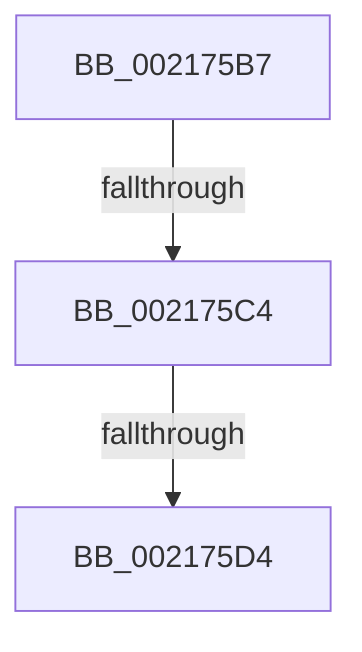

# sub_002175B7

- RVA: `0x002175B7`–`0x002175E7` (길이 `48` bytes)
- VA: `0x00000001402175B7`
- 실행 섹션: `.text`
- PDB 이름 있음: `아니요`; PDB Function 태그: `아니요`
- unwind 정보 RVA: `0x0005E5F0`
- 디코드: `10`개 명령, `48/48` bytes 표시
- 미해석 바이트: `0` (있으면 어셈블리에 `.byte`로 보존)

> 이 문서는 커널 이미지의 기계어와 PDB 기호를 분석해 생성했습니다. 4번과 5번은 함수 원형과 자료형을 바이너리 사용 방식에서 추정한 C 해석이며 원본 소스 복구 결과는 아닙니다.

## 1. Dependencies

- 직접 호출 지점: **0**; 고유 호출 대상: **0**
- 직접 호출자로 확인된 함수: **0**
- RIP 상대 이미지 참조: **1**

### Outgoing calls
- 직접 디코드된 call 명령이 없습니다.

### Direct callers
- 이 함수 시작 RVA로 연결되는 직접 call은 확인되지 않았습니다. 간접 호출은 완전히 역산할 수 없습니다.

### Static image references
- `0x002175B7` → RVA `0x00FC6A87` (`ALMOSTRO`; read)

## 2. Other-region calls and transfers

- 다른 실행 섹션으로 향하는 call: **0**
- call이 아닌 외부 분기/꼬리 이동: **3**
  - `0x002175BE` → [sub_00217486](Unknown_function_00217486.md) (`tail-transfer`)
  - `0x002175CE` → [sub_00217798](Unknown_function_00217798.md) (`tail-transfer`)
  - `0x002175E2` → [sub_00217486](Unknown_function_00217486.md) (`tail-transfer`)

## 3. Assembly (complete function range)

```asm
002175B7  80 3D C9 F4 DA 00 00            cmp byte ptr [rip + 0xdaf4c9], 0
002175BE  0F 85 C2 FE FF FF               jne 0x140217486
002175C4  0F 20 E1                        mov rcx, cr4
002175C7  48 F7 C1 80 00 02 00            test rcx, 0x20080
002175CE  0F 84 C4 01 00 00               je 0x140217798
002175D4  48 8B C1                        mov rax, rcx
002175D7  48 0F BA F8 07                  btc rax, 7
002175DC  0F 22 E0                        mov cr4, rax
002175DF  0F 22 E1                        mov cr4, rcx
002175E2  E9 9F FE FF FF                  jmp 0x140217486
```

## 4. C-style interpretation (structured pseudocode)

```c
__int64 __fastcall sub_002175B7(void)
{
}
```

## 5. (Beta) C Style

```c
void sub_002175B7(void)
{
}
```

## 6. Execution-region graph

[열기: 2D/3D 그래프와 함수 탐색 컨트롤 패널](../../../control-panel.html?section=text&rva=0x002175B7&view=graph)

- 2D 그래프는 위에서 아래로 흐르고, 3D 그래프는 빈 공간을 드래그해 회전합니다. Shift+드래그는 이동, 휠은 확대·축소, 함수 노드 선택은 대상 보고서 이동입니다.

### Static fallback


