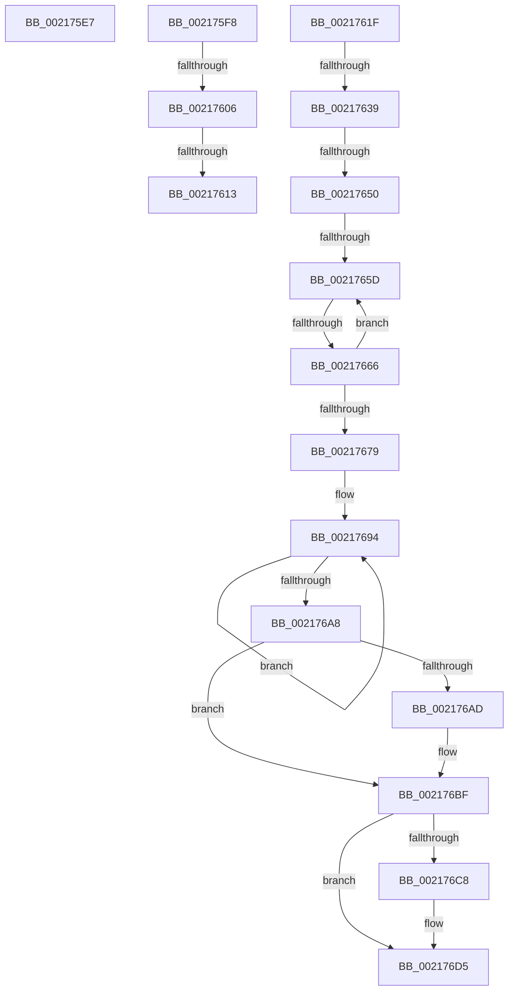

# sub_002175E7

- RVA: `0x002175E7`–`0x002176E2` (길이 `251` bytes)
- VA: `0x00000001402175E7`
- 실행 섹션: `.text`
- PDB 이름 있음: `아니요`; PDB Function 태그: `아니요`
- unwind 정보 RVA: `0x0005E604`
- 디코드: `56`개 명령, `251/251` bytes 표시
- 미해석 바이트: `0` (있으면 어셈블리에 `.byte`로 보존)

> 이 문서는 커널 이미지의 기계어와 PDB 기호를 분석해 생성했습니다. 4번과 5번은 함수 원형과 자료형을 바이너리 사용 방식에서 추정한 C 해석이며 원본 소스 복구 결과는 아닙니다.

## 1. Dependencies

- 직접 호출 지점: **6**; 고유 호출 대상: **6**
- 직접 호출자로 확인된 함수: **0**
- RIP 상대 이미지 참조: **4**

### Outgoing calls
- `0x002175EE` → [KiRaiseIrqlProcessIrqlFlags](../4F/KiRaiseIrqlProcessIrqlFlags_function_004F56FC.md) (function, `0x004F56FC`)
- `0x00217606` → [KiCheckVpBackingLongSpinWaitHypercall](../30/KiCheckVpBackingLongSpinWaitHypercall_function_0030F490.md) (function, `0x0030F490`)
- `0x00217615` → [HvlNotifyLongSpinWait](../30/HvlNotifyLongSpinWait_function_0030F460.md) (function, `0x0030F460`)
- `0x0021763C` → [KiAcquireKobjectLockSafe](../25/KiAcquireKobjectLockSafe_function_00251C90.md) (function, `0x00251C90`)
- `0x002176BA` → [KeSetEvent](../33/KeSetEvent_function_0033F310.md) (function, `0x0033F310`)
- `0x002176D0` → [KiLowerIrqlProcessIrqlFlags](../4F/KiLowerIrqlProcessIrqlFlags_function_004F5698.md) (function, `0x004F5698`)

### Direct callers
- 이 함수 시작 RVA로 연결되는 직접 call은 확인되지 않았습니다. 간접 호출은 완전히 역산할 수 없습니다.

### Static image references
- `0x002175F8` → RVA `0x00FC6AB8` (`ALMOSTRO`; read)
- `0x0021762C` → RVA `0x00FC6D20` (`ALMOSTRO`; read)
- `0x00217686` → RVA `0x00F22D40` (`.data`; read)
- `0x002176B3` → RVA `0x00F22D80` (`.data`; read)

## 2. Other-region calls and transfers

- 다른 실행 섹션으로 향하는 call: **0**
- call이 아닌 외부 분기/꼬리 이동: **9**
  - `0x002175F3` → [KiDetachProcess + 0x4A](KiDetachProcess_function_002172A0.md) (`tail-transfer`)
  - `0x00217600` → [KiDetachProcess + 0x68](KiDetachProcess_function_002172A0.md) (`tail-transfer`)
  - `0x0021760D` → [KiDetachProcess + 0x68](KiDetachProcess_function_002172A0.md) (`tail-transfer`)
  - `0x0021761A` → [KiDetachProcess + 0x6A](KiDetachProcess_function_002172A0.md) (`tail-transfer`)
  - `0x00217633` → [sub_00217761 + 0xE](Unknown_function_00217761.md) (`tail-transfer`)
  - `0x0021764A` → [sub_00217761](Unknown_function_00217761.md) (`tail-transfer`)
  - `0x00217657` → [sub_00217761](Unknown_function_00217761.md) (`tail-transfer`)
  - `0x00217660` → [sub_00217761](Unknown_function_00217761.md) (`tail-transfer`)
  - `0x002176DD` → [sub_002174A7 + 0x3F](Unknown_function_002174A7.md) (`tail-transfer`)

## 3. Assembly (complete function range)

```asm
002175E7  0F B6 D0                        movzx edx, al
002175EA  40 0F B6 CF                     movzx ecx, dil
002175EE  E8 09 E1 2D 00                  call 0x1404f56fc
002175F3  E9 F2 FC FF FF                  jmp 0x1402172ea
002175F8  8B 05 BA F4 DA 00               mov eax, dword ptr [rip + 0xdaf4ba]
002175FE  A8 40                           test al, 0x40
00217600  0F 84 02 FD FF FF               je 0x140217308
00217606  E8 85 7E 0F 00                  call 0x14030f490
0021760B  84 C0                           test al, al
0021760D  0F 84 F5 FC FF FF               je 0x140217308
00217613  8B CF                           mov ecx, edi
00217615  E8 46 7E 0F 00                  call 0x14030f460
0021761A  E9 EB FC FF FF                  jmp 0x14021730a
0021761F  44 0F 20 C6                     mov rsi, cr8
00217623  B8 02 00 00 00                  mov eax, 2
00217628  44 0F 22 C0                     mov cr8, rax
0021762C  83 3D ED F6 DA 00 00            cmp dword ptr [rip + 0xdaf6ed], 0
00217633  0F 85 36 01 00 00               jne 0x14021776f
00217639  49 8B CD                        mov rcx, r13
0021763C  E8 4F A6 03 00                  call 0x140251c90
00217641  41 8B 85 08 01 00 00            mov eax, dword ptr [r13 + 0x108]
00217648  A8 07                           test al, 7
0021764A  0F 85 11 01 00 00               jne 0x140217761
00217650  49 8D 4D 30                     lea rcx, [r13 + 0x30]
00217654  48 39 09                        cmp qword ptr [rcx], rcx
00217657  0F 84 04 01 00 00               je 0x140217761
0021765D  83 F8 08                        cmp eax, 8
00217660  0F 83 FB 00 00 00               jae 0x140217761
00217666  8B C8                           mov ecx, eax
00217668  83 E1 FB                        and ecx, 0xfffffffb
0021766B  83 C9 03                        or ecx, 3
0021766E  F0 41 0F B1 8D 08 01 00 00      lock cmpxchg dword ptr [r13 + 0x108], ecx
00217677  75 E4                           jne 0x14021765d
00217679  F0 41 81 65 00 7F FF FF FF      lock and dword ptr [r13], 0xffffff7f
00217682  49 8D 55 78                     lea rdx, [r13 + 0x78]
00217686  0F 0D 0D B3 B6 D0 00            prefetchw byte ptr [rip + 0xd0b6b3]
0021768D  48 8B 05 AC B6 D0 00            mov rax, qword ptr [rip + 0xd0b6ac]
00217694  48 89 02                        mov qword ptr [rdx], rax
00217697  48 8B C8                        mov rcx, rax
0021769A  F0 48 0F B1 15 9D B6 D0 00      lock cmpxchg qword ptr [rip + 0xd0b69d], rdx
002176A3  48 3B C1                        cmp rax, rcx
002176A6  75 EC                           jne 0x140217694
002176A8  48 85 C0                        test rax, rax
002176AB  75 12                           jne 0x1402176bf
002176AD  45 33 C0                        xor r8d, r8d
002176B0  8D 50 0A                        lea edx, [rax + 0xa]
002176B3  48 8D 0D C6 B6 D0 00            lea rcx, [rip + 0xd0b6c6]
002176BA  E8 51 7C 12 00                  call 0x14033f310
002176BF  83 3D 5A F6 DA 00 00            cmp dword ptr [rip + 0xdaf65a], 0
002176C6  74 0D                           je 0x1402176d5
002176C8  44 0F 20 C1                     mov rcx, cr8
002176CC  40 0F B6 D6                     movzx edx, sil
002176D0  E8 C3 DF 2D 00                  call 0x1404f5698
002176D5  40 0F B6 C6                     movzx eax, sil
002176D9  44 0F 22 C0                     mov cr8, rax
002176DD  E9 04 FE FF FF                  jmp 0x1402174e6
```

## 4. C-style interpretation (structured pseudocode)

```c
__int64 __fastcall sub_002175E7(__int64 a1, __int64 a2, int a3)
{
    __int64 result;

    result = KiRaiseIrqlProcessIrqlFlags((unsigned __int8)(v_rdi), (unsigned __int8)(result), a3, a4);
}
```

## 5. (Beta) C Style

```c
int64_t sub_002175E7(int64_t Arg1, int64_t Arg2, int32_t Arg3)
{
    int64_t result;

    result = KiRaiseIrqlProcessIrqlFlags((uint8_t)(local_rdi), (uint8_t)(result), Arg3, a4);
}
```

## 6. Execution-region graph

[열기: 2D/3D 그래프와 함수 탐색 컨트롤 패널](../../../control-panel.html?section=text&rva=0x002175E7&view=graph)

- 2D 그래프는 위에서 아래로 흐르고, 3D 그래프는 빈 공간을 드래그해 회전합니다. Shift+드래그는 이동, 휠은 확대·축소, 함수 노드 선택은 대상 보고서 이동입니다.

### Static fallback


