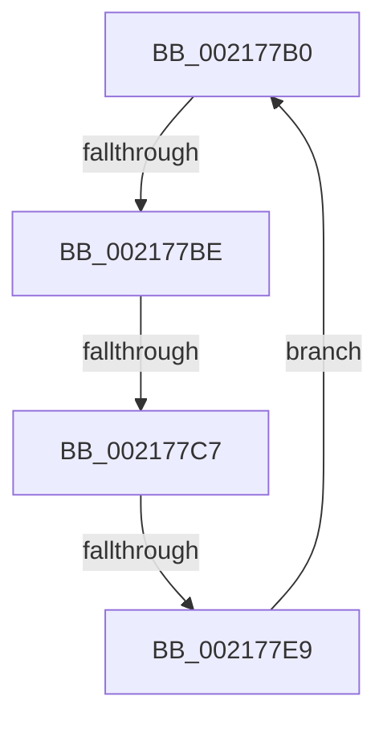

# sub_002177B0

- RVA: `0x002177B0`–`0x002177F0` (길이 `64` bytes)
- VA: `0x00000001402177B0`
- 실행 섹션: `.text`
- PDB 이름 있음: `아니요`; PDB Function 태그: `아니요`
- unwind 정보 RVA: `0x0005E678`
- 디코드: `13`개 명령, `64/64` bytes 표시
- 미해석 바이트: `0` (있으면 어셈블리에 `.byte`로 보존)

> 이 문서는 커널 이미지의 기계어와 PDB 기호를 분석해 생성했습니다. 4번과 5번은 함수 원형과 자료형을 바이너리 사용 방식에서 추정한 C 해석이며 원본 소스 복구 결과는 아닙니다.

## 1. Dependencies

- 직접 호출 지점: **2**; 고유 호출 대상: **2**
- 직접 호출자로 확인된 함수: **0**
- RIP 상대 이미지 참조: **0**

### Outgoing calls
- `0x002177CA` → [KiReleaseThreadLockLowerIrql](../3C/KiReleaseThreadLockLowerIrql_function_003C65D0.md) (function, `0x003C65D0`)
- `0x002177D7` → [KiAcquireThreadLockRaiseToDpc](../39/KiAcquireThreadLockRaiseToDpc_function_00396280.md) (function, `0x00396280`)

### Direct callers
- 이 함수 시작 RVA로 연결되는 직접 call은 확인되지 않았습니다. 간접 호출은 완전히 역산할 수 없습니다.

### Static image references
- 디코드된 RIP-relative 메모리 참조가 없습니다.

## 2. Other-region calls and transfers

- 다른 실행 섹션으로 향하는 call: **0**
- call이 아닌 외부 분기/꼬리 이동: **3**
  - `0x002177B8` → [KiDetachProcess + 0x87](KiDetachProcess_function_002172A0.md) (`tail-transfer`)
  - `0x002177C1` → [KiDetachProcess + 0x87](KiDetachProcess_function_002172A0.md) (`tail-transfer`)
  - `0x002177E3` → [KiDetachProcess + 0x87](KiDetachProcess_function_002172A0.md) (`tail-transfer`)

## 3. Assembly (complete function range)

```asm
002177B0  66 83 BB E6 01 00 00 00         cmp word ptr [rbx + 0x1e6], 0
002177B8  0F 85 69 FB FF FF               jne 0x140217327
002177BE  80 FA 01                        cmp dl, 1
002177C1  0F 83 60 FB FF FF               jae 0x140217327
002177C7  48 8B CB                        mov rcx, rbx
002177CA  E8 01 EE 1A 00                  call 0x1403c65d0
002177CF  48 8D 54 24 78                  lea rdx, [rsp + 0x78]
002177D4  48 8B CB                        mov rcx, rbx
002177D7  E8 A4 EA 17 00                  call 0x140396280
002177DC  80 BB C1 00 00 00 00            cmp byte ptr [rbx + 0xc1], 0
002177E3  0F 84 3E FB FF FF               je 0x140217327
002177E9  0F B6 54 24 78                  movzx edx, byte ptr [rsp + 0x78]
002177EE  EB C0                           jmp 0x1402177b0
```

## 4. C-style interpretation (structured pseudocode)

```c
__int64 __fastcall sub_002177B0(__int64 a1, unsigned __int8 a2, __int64 a3, __int64 a4, __int64 a5, __int64 a6, __int64 a7, __int64 a8, __int64 a9, __int64 a10, __int64 a11, __int64 a12, __int64 a13, __int64 a14, unsigned __int8 a15)
{
    __int64 result;

    result = KiReleaseThreadLockLowerIrql(v_rbx, a2, a3, a4);
    result = KiAcquireThreadLockRaiseToDpc(v_rbx, a15, a3, a4);
    goto loc_002177B0;
}
```

## 5. (Beta) C Style

```c
int64_t sub_002177B0(int64_t Arg1, uint8_t Arg2, int64_t Arg3, int64_t Arg4, uint64_t Arg5, uint64_t Arg6, uint64_t Arg7, uint64_t Arg8, uint64_t Arg9, uint64_t Arg10, uint64_t Arg11, uint64_t Arg12, uint64_t Arg13, uint64_t Arg14, uint8_t Arg15)
{
    int64_t result;

    result = KiReleaseThreadLockLowerIrql(local_rbx, Arg2, Arg3, Arg4);
    result = KiAcquireThreadLockRaiseToDpc(local_rbx, Arg15, Arg3, Arg4);
    goto loc_002177B0;
}
```

## 6. Execution-region graph

[열기: 2D/3D 그래프와 함수 탐색 컨트롤 패널](../../../control-panel.html?section=text&rva=0x002177B0&view=graph)

- 2D 그래프는 위에서 아래로 흐르고, 3D 그래프는 빈 공간을 드래그해 회전합니다. Shift+드래그는 이동, 휠은 확대·축소, 함수 노드 선택은 대상 보고서 이동입니다.

### Static fallback


