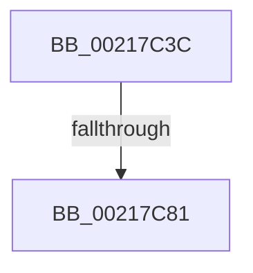

# sub_00217C3C

- RVA: `0x00217C3C`–`0x00217C95` (길이 `89` bytes)
- VA: `0x0000000140217C3C`
- 실행 섹션: `.text`
- PDB 이름 있음: `아니요`; PDB Function 태그: `아니요`
- unwind 정보 RVA: `0x0005E70C`
- 디코드: `21`개 명령, `89/89` bytes 표시
- 미해석 바이트: `0` (있으면 어셈블리에 `.byte`로 보존)

> 이 문서는 커널 이미지의 기계어와 PDB 기호를 분석해 생성했습니다. 4번과 5번은 함수 원형과 자료형을 바이너리 사용 방식에서 추정한 C 해석이며 원본 소스 복구 결과는 아닙니다.

## 1. Dependencies

- 직접 호출 지점: **2**; 고유 호출 대상: **2**
- 직접 호출자로 확인된 함수: **0**
- RIP 상대 이미지 참조: **1**

### Outgoing calls
- `0x00217C5B` → [KeDisableInterrupts](KeDisableInterrupts_function_00217BE0.md) (function, `0x00217BE0`)
- `0x00217C76` → [memset](../6C/memset_function_006C6C40.md) (function, `0x006C6C40`)

### Direct callers
- 이 함수 시작 RVA로 연결되는 직접 call은 확인되지 않았습니다. 간접 호출은 완전히 역산할 수 없습니다.

### Static image references
- `0x00217C50` → RVA `0x00F21B20` (`.data`; read)

## 2. Other-region calls and transfers

- 다른 실행 섹션으로 향하는 call: **0**
- call이 아닌 외부 분기/꼬리 이동: **2**
  - `0x00217C7F` → [sub_00217CE7](Unknown_function_00217CE7.md) (`tail-transfer`)
  - `0x00217C93` → [sub_00217C95 + 0x19](Unknown_function_00217C95.md) (`tail-transfer`)

## 3. Assembly (complete function range)

```asm
00217C3C  49 89 5B 10                     mov qword ptr [r11 + 0x10], rbx
00217C40  4C 8B C1                        mov r8, rcx
00217C43  49 89 7B F8                     mov qword ptr [r11 - 8], rdi
00217C47  F0 83 0C 24 00                  lock or dword ptr [rsp], 0
00217C4C  49 C1 E8 05                     shr r8, 5
00217C50  4C 8D 0D C9 9E D0 00            lea r9, [rip + 0xd09ec9]
00217C57  41 83 E0 7F                     and r8d, 0x7f
00217C5B  E8 80 FF FF FF                  call 0x140217be0
00217C60  33 FF                           xor edi, edi
00217C62  48 8D 4C 24 28                  lea rcx, [rsp + 0x28]
00217C67  4B 87 3C C1                     xchg qword ptr [r9 + r8*8], rdi
00217C6B  41 B8 00 01 00 00               mov r8d, 0x100
00217C71  33 D2                           xor edx, edx
00217C73  0F B6 D8                        movzx ebx, al
00217C76  E8 C5 EF 4A 00                  call 0x1406c6c40
00217C7B  48 83 E7 FC                     and rdi, 0xfffffffffffffffc
00217C7F  75 66                           jne 0x140217ce7
00217C81  48 8B BC 24 40 01 00 00         mov rdi, qword ptr [rsp + 0x140]
00217C89  84 DB                           test bl, bl
00217C8B  48 8B 9C 24 58 01 00 00         mov rbx, qword ptr [rsp + 0x158]
00217C93  75 19                           jne 0x140217cae
```

## 4. C-style interpretation (structured pseudocode)

```c
__int64 __fastcall sub_00217C3C(__int64 a1, int a2, __int64 a3, __int64 a4, __int64 a5, __int64 a6, __int64 a7, __int64 a8, __int64 a9, __int64 a10, __int64 a11, __int64 a12, __int64 a13, __int64 a14, __int64 a15, __int64 a16, __int64 a17, __int64 a18, __int64 a19, __int64 a20, __int64 a21, __int64 a22, __int64 a23, __int64 a24, __int64 a25, __int64 a26, __int64 a27, __int64 a28, __int64 a29, __int64 a30, __int64 a31, __int64 a32, __int64 a33, __int64 a34, __int64 a35, __int64 a36, __int64 a37, __int64 a38, __int64 a39, __int64 a40, __int64 a41, __int64 a42, __int64 a43)
{
    __int64 result;
    __int64 v_rdi;
    unsigned int v_stack_p0;

    *(unsigned __int64 *)(v_r11 + 16) = v_rbx;
    *(unsigned __int64 *)(v_r11 - 8) = v_rdi;
    a3 = (a1) >> (5);
    a3 = (unsigned int)((a3) & (127));
    result = KeDisableInterrupts(a1, a2, a3, v_rip + 13672137);
    v_rdi = 0;
    a2 = 0;
    result = memset(a5, a2, 256, v_rip + 13672137);
    v_rdi = (v_rdi) & (-4);
}
```

## 5. (Beta) C Style

```c
int64_t sub_00217C3C(int64_t Arg1, int32_t Arg2, int64_t Arg3, int64_t Arg4, int64_t Arg5, uint64_t Arg6, uint64_t Arg7, uint64_t Arg8, uint64_t Arg9, uint64_t Arg10, uint64_t Arg11, uint64_t Arg12, uint64_t Arg13, uint64_t Arg14, uint64_t Arg15, uint64_t Arg16, uint64_t Arg17, uint64_t Arg18, uint64_t Arg19, uint64_t Arg20, uint64_t Arg21, uint64_t Arg22, uint64_t Arg23, uint64_t Arg24, uint64_t Arg25, uint64_t Arg26, uint64_t Arg27, uint64_t Arg28, uint64_t Arg29, uint64_t Arg30, uint64_t Arg31, uint64_t Arg32, uint64_t Arg33, uint64_t Arg34, uint64_t Arg35, uint64_t Arg36, uint64_t Arg37, uint64_t Arg38, uint64_t Arg39, int64_t Arg40, uint64_t Arg41, uint64_t Arg42, int64_t Arg43)
{
    int64_t result;
    int64_t local_rdi;
    uint32_t v_stack_p0;

    *(uint64_t *)(local_r11 + 0x10) = local_rbx;
    *(uint64_t *)(local_r11 - 0x8) = local_rdi;
    Arg3 = (Arg1) >> (5);
    Arg3 = (uint32_t)((Arg3) & (127));
    result = KeDisableInterrupts(Arg1, Arg2, Arg3, v_rip + 13672137);
    local_rdi = 0;
    Arg2 = 0;
    result = memset(Arg5, Arg2, 256, v_rip + 13672137);
    local_rdi = (local_rdi) & (-4);
}
```

## 6. Execution-region graph

[열기: 2D/3D 그래프와 함수 탐색 컨트롤 패널](../../../control-panel.html?section=text&rva=0x00217C3C&view=graph)

- 2D 그래프는 위에서 아래로 흐르고, 3D 그래프는 빈 공간을 드래그해 회전합니다. Shift+드래그는 이동, 휠은 확대·축소, 함수 노드 선택은 대상 보고서 이동입니다.

### Static fallback


