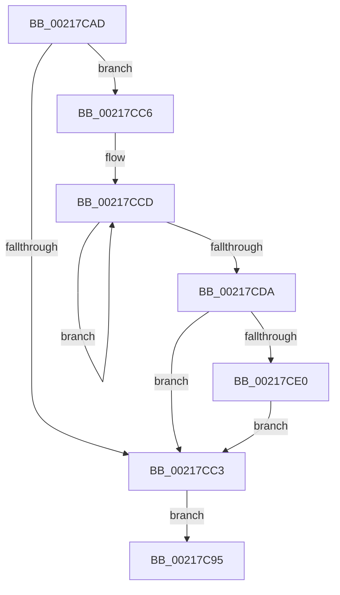

# sub_00217C95

- RVA: `0x00217C95`–`0x00217CE7` (길이 `82` bytes)
- VA: `0x0000000140217C95`
- 실행 섹션: `.text`
- PDB 이름 있음: `아니요`; PDB Function 태그: `아니요`
- unwind 정보 RVA: `0x0005E724`
- 디코드: `22`개 명령, `82/82` bytes 표시
- 미해석 바이트: `0` (있으면 어셈블리에 `.byte`로 보존)

> 이 문서는 커널 이미지의 기계어와 PDB 기호를 분석해 생성했습니다. 4번과 5번은 함수 원형과 자료형을 바이너리 사용 방식에서 추정한 C 해석이며 원본 소스 복구 결과는 아닙니다.

## 1. Dependencies

- 직접 호출 지점: **2**; 고유 호출 대상: **2**
- 직접 호출자로 확인된 함수: **0**
- RIP 상대 이미지 참조: **0**

### Outgoing calls
- `0x00217CA0` → [_security_check_cookie](../6A/_security_check_cookie_function_006AC640.md) (function, `0x006AC640`)
- `0x00217CE0` → [KiRemoveSystemWorkPriorityKick](../26/KiRemoveSystemWorkPriorityKick_function_002631D0.md) (function, `0x002631D0`)

### Direct callers
- 이 함수 시작 RVA로 연결되는 직접 call은 확인되지 않았습니다. 간접 호출은 완전히 역산할 수 없습니다.

### Static image references
- 디코드된 RIP-relative 메모리 참조가 없습니다.

## 2. Other-region calls and transfers

- 다른 실행 섹션으로 향하는 call: **0**
- 별도 외부 분기/꼬리 이동을 확인하지 못했습니다.

## 3. Assembly (complete function range)

```asm
00217C95  48 8B 8C 24 30 01 00 00         mov rcx, qword ptr [rsp + 0x130]
00217C9D  48 33 CC                        xor rcx, rsp
00217CA0  E8 9B 49 49 00                  call 0x1406ac640
00217CA5  48 81 C4 48 01 00 00            add rsp, 0x148
00217CAC  C3                              ret
00217CAD  CC                              int3
00217CAE  65 48 8B 0C 25 20 00 00 00      mov rcx, qword ptr gs:[0x20]
00217CB7  4C 8B 81 B8 8E 00 00            mov r8, qword ptr [rcx + 0x8eb8]
00217CBE  4D 85 C0                        test r8, r8
00217CC1  75 03                           jne 0x140217cc6
00217CC3  FB                              sti
00217CC4  EB CF                           jmp 0x140217c95
00217CC6  41 0F 0D 08                     prefetchw byte ptr [r8]
00217CCA  41 8B 00                        mov eax, dword ptr [r8]
00217CCD  8B D0                           mov edx, eax
00217CCF  0F BA F2 15                     btr edx, 0x15
00217CD3  F0 41 0F B1 10                  lock cmpxchg dword ptr [r8], edx
00217CD8  75 F3                           jne 0x140217ccd
00217CDA  0F BA E0 15                     bt eax, 0x15
00217CDE  73 E3                           jae 0x140217cc3
00217CE0  E8 EB B4 04 00                  call 0x1402631d0
00217CE5  EB DC                           jmp 0x140217cc3
```

## 4. C-style interpretation (structured pseudocode)

```c
__int64 __fastcall sub_00217C95(__int64 a1, __int64 a2, __int64 a3, __int64 a4, __int64 a5, __int64 a6, __int64 a7, __int64 a8, __int64 a9, __int64 a10, __int64 a11, __int64 a12, __int64 a13, __int64 a14, __int64 a15, __int64 a16, __int64 a17, __int64 a18, __int64 a19, __int64 a20, __int64 a21, __int64 a22, __int64 a23, __int64 a24, __int64 a25, __int64 a26, __int64 a27, __int64 a28, __int64 a29, __int64 a30, __int64 a31, __int64 a32, __int64 a33, __int64 a34, __int64 a35, __int64 a36, __int64 a37, __int64 a38)
{
    __int64 result;
    __int64 v_rsp;

    a1 = (a38) ^ (v_rsp);
    result = _security_check_cookie(a1, a2, a3, a4);
    v_rsp = (v_rsp) + (328);
    return result;
}
```

## 5. (Beta) C Style

```c
int64_t sub_00217C95(int64_t Arg1, int64_t Arg2, int64_t Arg3, int64_t Arg4, uint64_t Arg5, uint64_t Arg6, uint64_t Arg7, uint64_t Arg8, uint64_t Arg9, uint64_t Arg10, uint64_t Arg11, uint64_t Arg12, uint64_t Arg13, uint64_t Arg14, uint64_t Arg15, uint64_t Arg16, uint64_t Arg17, uint64_t Arg18, uint64_t Arg19, uint64_t Arg20, uint64_t Arg21, uint64_t Arg22, uint64_t Arg23, uint64_t Arg24, uint64_t Arg25, uint64_t Arg26, uint64_t Arg27, uint64_t Arg28, uint64_t Arg29, uint64_t Arg30, uint64_t Arg31, uint64_t Arg32, uint64_t Arg33, uint64_t Arg34, uint64_t Arg35, uint64_t Arg36, uint64_t Arg37, int64_t Arg38)
{
    int64_t result;
    int64_t local_rsp;

    Arg1 = (Arg38) ^ (local_rsp);
    result = _security_check_cookie(Arg1, Arg2, Arg3, Arg4);
    local_rsp = (local_rsp) + (328);
    return result;
}
```

## 6. Execution-region graph

[열기: 2D/3D 그래프와 함수 탐색 컨트롤 패널](../../../control-panel.html?section=text&rva=0x00217C95&view=graph)

- 2D 그래프는 위에서 아래로 흐르고, 3D 그래프는 빈 공간을 드래그해 회전합니다. Shift+드래그는 이동, 휠은 확대·축소, 함수 노드 선택은 대상 보고서 이동입니다.

### Static fallback


