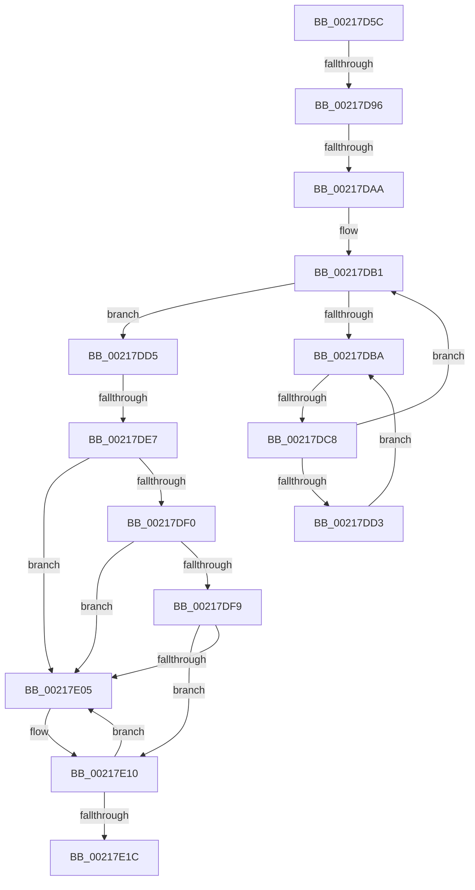

# sub_00217D5C

- RVA: `0x00217D5C`–`0x00217E2A` (길이 `206` bytes)
- VA: `0x0000000140217D5C`
- 실행 섹션: `.text`
- PDB 이름 있음: `아니요`; PDB Function 태그: `아니요`
- unwind 정보 RVA: `0x0005E798`
- 디코드: `46`개 명령, `206/206` bytes 표시
- 미해석 바이트: `0` (있으면 어셈블리에 `.byte`로 보존)

> 이 문서는 커널 이미지의 기계어와 PDB 기호를 분석해 생성했습니다. 4번과 5번은 함수 원형과 자료형을 바이너리 사용 방식에서 추정한 C 해석이며 원본 소스 복구 결과는 아닙니다.

## 1. Dependencies

- 직접 호출 지점: **1**; 고유 호출 대상: **1**
- 직접 호출자로 확인된 함수: **0**
- RIP 상대 이미지 참조: **2**

### Outgoing calls
- `0x00217E0A` → [KeBugCheck](../4F/KeBugCheck_function_004FD640.md) (function, `0x004FD640`)

### Direct callers
- 이 함수 시작 RVA로 연결되는 직접 call은 확인되지 않았습니다. 간접 호출은 완전히 역산할 수 없습니다.

### Static image references
- `0x00217D9E` → RVA `0x00FC6D20` (`ALMOSTRO`; read)
- `0x00217DBC` → RVA `0x00FC52AC` (`ALMOSTRO`; reference)

## 2. Other-region calls and transfers

- 다른 실행 섹션으로 향하는 call: **0**
- call이 아닌 외부 분기/꼬리 이동: **4**
  - `0x00217D90` → [sub_00218269](Unknown_function_00218269.md) (`tail-transfer`)
  - `0x00217DA4` → [sub_002180B5](Unknown_function_002180B5.md) (`tail-transfer`)
  - `0x00217DC2` → [sub_002180B5 + 0x11](Unknown_function_002180B5.md) (`tail-transfer`)
  - `0x00217DE1` → [sub_00218280](Unknown_function_00218280.md) (`tail-transfer`)

## 3. Assembly (complete function range)

```asm
00217D5C  49 89 5B 10                     mov qword ptr [r11 + 0x10], rbx
00217D60  65 48 8B 1C 25 88 01 00 00      mov rbx, qword ptr gs:[0x188]
00217D69  49 89 73 20                     mov qword ptr [r11 + 0x20], rsi
00217D6D  8B F2                           mov esi, edx
00217D6F  4D 89 6B E0                     mov qword ptr [r11 - 0x20], r13
00217D73  4D 89 7B D8                     mov qword ptr [r11 - 0x28], r15
00217D77  4C 8D B8 58 02 00 00            lea r15, [rax + 0x258]
00217D7E  4C 8B AB B8 00 00 00            mov r13, qword ptr [rbx + 0xb8]
00217D85  B8 02 00 00 00                  mov eax, 2
00217D8A  49 89 7B F0                     mov qword ptr [r11 - 0x10], rdi
00217D8E  23 F0                           and esi, eax
00217D90  0F 85 D3 04 00 00               jne 0x140218269
00217D96  44 0F 20 C7                     mov rdi, cr8
00217D9A  44 0F 22 C0                     mov cr8, rax
00217D9E  39 35 7C EF DA 00               cmp dword ptr [rip + 0xdaef7c], esi
00217DA4  0F 85 0B 03 00 00               jne 0x1402180b5
00217DAA  40 88 7C 24 70                  mov byte ptr [rsp + 0x70], dil
00217DAF  33 FF                           xor edi, edi
00217DB1  F0 48 0F BA 6B 40 00            lock bts qword ptr [rbx + 0x40], 0
00217DB8  73 1B                           jae 0x140217dd5
00217DBA  FF C7                           inc edi
00217DBC  85 3D EA D4 DA 00               test dword ptr [rip + 0xdad4ea], edi
00217DC2  0F 84 FE 02 00 00               je 0x1402180c6
00217DC8  F3 90                           pause
00217DCA  48 8B 43 40                     mov rax, qword ptr [rbx + 0x40]
00217DCE  48 85 C0                        test rax, rax
00217DD1  74 DE                           je 0x140217db1
00217DD3  EB E5                           jmp 0x140217dba
00217DD5  0F B6 54 24 70                  movzx edx, byte ptr [rsp + 0x70]
00217DDA  80 BB C1 00 00 00 00            cmp byte ptr [rbx + 0xc1], 0
00217DE1  0F 85 99 04 00 00               jne 0x140218280
00217DE7  80 BB 4A 02 00 00 00            cmp byte ptr [rbx + 0x24a], 0
00217DEE  74 15                           je 0x140217e05
00217DF0  F6 83 C0 00 00 00 01            test byte ptr [rbx + 0xc0], 1
00217DF7  75 0C                           jne 0x140217e05
00217DF9  48 8D BB 98 00 00 00            lea rdi, [rbx + 0x98]
00217E00  48 39 3F                        cmp qword ptr [rdi], rdi
00217E03  74 0B                           je 0x140217e10
00217E05  B9 06 00 00 00                  mov ecx, 6
00217E0A  E8 31 58 2E 00                  call 0x1404fd640
00217E0F  CC                              int3
00217E10  48 8D 83 A8 00 00 00            lea rax, [rbx + 0xa8]
00217E17  48 39 00                        cmp qword ptr [rax], rax
00217E1A  75 E9                           jne 0x140217e05
00217E1C  81 4B 74 00 08 00 00            or dword ptr [rbx + 0x74], 0x800
00217E23  48 8D 8B 58 02 00 00            lea rcx, [rbx + 0x258]
```

## 4. C-style interpretation (structured pseudocode)

```c
__int64 __fastcall sub_00217D5C(__int64 a1, int a2, __int64 a3, __int64 a4, __int64 a5, __int64 a6, __int64 a7, __int64 a8, __int64 a9, __int64 a10, __int64 a11, __int64 a12, __int64 a13, unsigned __int8 a14)
{
    __int64 result;
    __int64 v_rdi;
    __int64 v_rsi;
    unsigned __int8 v_stack_p70;

    *(unsigned __int64 *)(v_r11 + 16) = v_rbx;
    *(unsigned __int64 *)(v_r11 + 32) = v_rsi;
    *(unsigned __int64 *)(v_r11 - 32) = v_r13;
    *(unsigned __int64 *)(v_r11 - 40) = v_r15;
    *(unsigned __int64 *)(v_r11 - 16) = v_rdi;
    v_rsi = (unsigned int)(((unsigned int)(a2)) & (2));
    v_stack_p70 = (unsigned __int8)(v_cr8);
    v_rdi = 0;
loc_00217DB1:
    if (condition_is_above_or_equal) goto loc_00217DD5;
loc_00217DBA:
    v_rdi = (unsigned int)((v_rdi) + 1);
    if (*(unsigned __int64 *)(*(unsigned __int64 *)(gs_base + (0 + 392)) + 64) == 0) goto loc_00217DB1;
    goto loc_00217DBA;
loc_00217DD5:
    if ((*(unsigned __int8 *)(*(unsigned __int64 *)(gs_base + (0 + 392)) + 586)) == 0) goto loc_00217E05;
    if (((*(unsigned __int8 *)(*(unsigned __int64 *)(gs_base + (0 + 392)) + 192)) & (1)) != 0) goto loc_00217E05;
    result = *(unsigned __int64 *)(*(unsigned __int64 *)(gs_base + (0 + 392)) + 64);
    if ((*(unsigned __int64 *)(*(unsigned __int64 *)(gs_base + (0 + 392)) + 152)) != (*(unsigned __int64 *)(gs_base + (0 + 392)) + 152)) {
        a1 = 6;
        result = KeBugCheck(a1, a14, a3, a4);
    }
    if ((*(unsigned __int64 *)(*(unsigned __int64 *)(gs_base + (0 + 392)) + 168)) != (*(unsigned __int64 *)(gs_base + (0 + 392)) + 168)) goto loc_00217E05;
    return *(unsigned __int64 *)(gs_base + (0 + 392)) + 168;
}
```

## 5. (Beta) C Style

```c
int64_t sub_00217D5C(int64_t Arg1, int32_t Arg2, int64_t Arg3, int64_t Arg4, uint64_t Arg5, uint64_t Arg6, uint64_t Arg7, uint64_t Arg8, uint64_t Arg9, uint64_t Arg10, uint64_t Arg11, uint64_t Arg12, uint64_t Arg13, uint8_t Arg14)
{
    int64_t result;
    int64_t local_rdi;
    int64_t local_rsi;
    uint8_t v_stack_p70;

    *(uint64_t *)(local_r11 + 0x10) = local_rbx;
    *(uint64_t *)(local_r11 + 0x20) = local_rsi;
    *(uint64_t *)(local_r11 - 0x20) = local_r13;
    *(uint64_t *)(local_r11 - 0x28) = local_r15;
    *(uint64_t *)(local_r11 - 0x10) = local_rdi;
    local_rsi = (uint32_t)(((uint32_t)(Arg2)) & (2));
    v_stack_p70 = (uint8_t)(v_cr8);
    local_rdi = 0;
loc_00217DB1:
    if (condition_is_above_or_equal) goto loc_00217DD5;
loc_00217DBA:
    local_rdi = (uint32_t)((local_rdi) + 1);
    if (*(uint64_t *)(*(uint64_t *)(gs_base + (0 + 0x188)) + 0x40) == 0) goto loc_00217DB1;
    goto loc_00217DBA;
loc_00217DD5:
    if ((*(uint8_t *)(*(uint64_t *)(gs_base + (0 + 0x188)) + 0x24A)) == 0) goto loc_00217E05;
    if (((*(uint8_t *)(*(uint64_t *)(gs_base + (0 + 0x188)) + 0xC0)) & (1)) != 0) goto loc_00217E05;
    result = *(uint64_t *)(*(uint64_t *)(gs_base + (0 + 0x188)) + 0x40);
    if ((*(uint64_t *)(*(uint64_t *)(gs_base + (0 + 0x188)) + 0x98)) != (*(uint64_t *)(gs_base + (0 + 0x188)) + 152)) {
        Arg1 = 6;
        result = KeBugCheck(Arg1, Arg14, Arg3, Arg4);
    }
    if ((*(uint64_t *)(*(uint64_t *)(gs_base + (0 + 0x188)) + 0xA8)) != (*(uint64_t *)(gs_base + (0 + 0x188)) + 168)) goto loc_00217E05;
    return *(uint64_t *)(gs_base + (0 + 0x188)) + 168;
}
```

## 6. Execution-region graph

[열기: 2D/3D 그래프와 함수 탐색 컨트롤 패널](../../../control-panel.html?section=text&rva=0x00217D5C&view=graph)

- 2D 그래프는 위에서 아래로 흐르고, 3D 그래프는 빈 공간을 드래그해 회전합니다. Shift+드래그는 이동, 휠은 확대·축소, 함수 노드 선택은 대상 보고서 이동입니다.

### Static fallback


