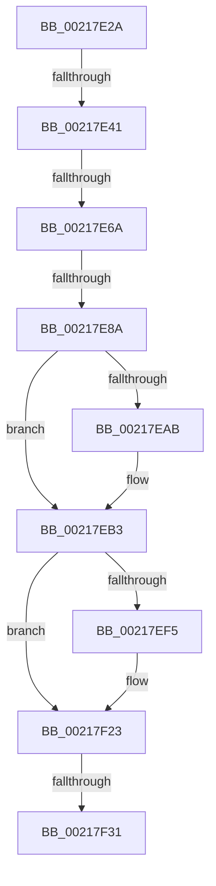

# sub_00217E2A

- RVA: `0x00217E2A`–`0x00217F49` (길이 `287` bytes)
- VA: `0x0000000140217E2A`
- 실행 섹션: `.text`
- PDB 이름 있음: `아니요`; PDB Function 태그: `아니요`
- unwind 정보 RVA: `0x0005E7BC`
- 디코드: `57`개 명령, `287/287` bytes 표시
- 미해석 바이트: `0` (있으면 어셈블리에 `.byte`로 보존)

> 이 문서는 커널 이미지의 기계어와 PDB 기호를 분석해 생성했습니다. 4번과 5번은 함수 원형과 자료형을 바이너리 사용 방식에서 추정한 C 해석이며 원본 소스 복구 결과는 아닙니다.

## 1. Dependencies

- 직접 호출 지점: **1**; 고유 호출 대상: **1**
- 직접 호출자로 확인된 함수: **0**
- RIP 상대 이미지 참조: **2**

### Outgoing calls
- `0x00217F1E` → [KiSetAddressPolicy](KiSetAddressPolicy_function_002178A0.md) (function, `0x002178A0`)

### Direct callers
- 이 함수 시작 RVA로 연결되는 직접 call은 확인되지 않았습니다. 간접 호출은 완전히 역산할 수 없습니다.

### Static image references
- `0x00217EE8` → RVA `0x01201840` (`CFGRO`; read)
- `0x00217F23` → RVA `0x00FC6AB8` (`ALMOSTRO`; read)

## 2. Other-region calls and transfers

- 다른 실행 섹션으로 향하는 call: **0**
- call이 아닌 외부 분기/꼬리 이동: **5**
  - `0x00217E3B` → [sub_002181B1](Unknown_function_002181B1.md) (`tail-transfer`)
  - `0x00217E64` → [sub_00218057](Unknown_function_00218057.md) (`tail-transfer`)
  - `0x00217E84` → [sub_00218057 + 0x17](Unknown_function_00218057.md) (`tail-transfer`)
  - `0x00217F2B` → [sub_0021824F](Unknown_function_0021824F.md) (`tail-transfer`)
  - `0x00217F43` → [sub_00218085](Unknown_function_00218085.md) (`tail-transfer`)

## 3. Assembly (complete function range)

```asm
00217E2A  48 89 AC 24 80 00 00 00         mov qword ptr [rsp + 0x80], rbp
00217E32  90                              nop
00217E33  4C 89 64 24 50                  mov qword ptr [rsp + 0x50], r12
00217E38  4C 3B F9                        cmp r15, rcx
00217E3B  0F 85 70 03 00 00               jne 0x1402181b1
00217E41  48 8B 41 20                     mov rax, qword ptr [rcx + 0x20]
00217E45  48 89 47 20                     mov qword ptr [rdi + 0x20], rax
00217E49  0F B6 41 28                     movzx eax, byte ptr [rcx + 0x28]
00217E4D  88 47 28                        mov byte ptr [rdi + 0x28], al
00217E50  0F B6 41 29                     movzx eax, byte ptr [rcx + 0x29]
00217E54  88 47 29                        mov byte ptr [rdi + 0x29], al
00217E57  0F B6 41 2A                     movzx eax, byte ptr [rcx + 0x2a]
00217E5B  88 47 2A                        mov byte ptr [rdi + 0x2a], al
00217E5E  48 8B 11                        mov rdx, qword ptr [rcx]
00217E61  48 3B D1                        cmp rdx, rcx
00217E64  0F 85 ED 01 00 00               jne 0x140218057
00217E6A  48 89 7F 08                     mov qword ptr [rdi + 8], rdi
00217E6E  48 89 3F                        mov qword ptr [rdi], rdi
00217E71  C6 47 29 00                     mov byte ptr [rdi + 0x29], 0
00217E75  48 8B 51 10                     mov rdx, qword ptr [rcx + 0x10]
00217E79  48 8D 41 10                     lea rax, [rcx + 0x10]
00217E7D  48 3B D0                        cmp rdx, rax
00217E80  48 8D 47 10                     lea rax, [rdi + 0x10]
00217E84  0F 85 E4 01 00 00               jne 0x14021806e
00217E8A  48 89 40 08                     mov qword ptr [rax + 8], rax
00217E8E  48 89 00                        mov qword ptr [rax], rax
00217E91  C6 47 2A 00                     mov byte ptr [rdi + 0x2a], 0
00217E95  48 C7 83 78 02 00 00 00 00 00 00  mov qword ptr [rbx + 0x278], 0
00217EA0  C6 83 4A 02 00 00 00            mov byte ptr [rbx + 0x24a], 0
00217EA7  85 F6                           test esi, esi
00217EA9  75 08                           jne 0x140217eb3
00217EAB  48 C7 43 40 00 00 00 00         mov qword ptr [rbx + 0x40], 0
00217EB3  65 48 8B 04 25 20 00 00 00      mov rax, qword ptr gs:[0x20]
00217EBC  4C 8B 83 B8 00 00 00            mov r8, qword ptr [rbx + 0xb8]
00217EC3  44 0F B6 A0 D1 00 00 00         movzx r12d, byte ptr [rax + 0xd1]
00217ECB  0F B6 80 D0 00 00 00            movzx eax, byte ptr [rax + 0xd0]
00217ED2  4C 8D 3C C5 00 00 00 00         lea r15, [rax*8]
00217EDA  49 8B 80 80 00 00 00            mov rax, qword ptr [r8 + 0x80]
00217EE1  F0 4E 0F AB 64 38 08            lock bts qword ptr [rax + r15 + 8], r12
00217EE8  80 3D 51 99 FE 00 00            cmp byte ptr [rip + 0xfe9951], 0
00217EEF  49 8B 68 28                     mov rbp, qword ptr [r8 + 0x28]
00217EF3  74 2E                           je 0x140217f23
00217EF5  48 B9 00 00 00 00 00 00 00 80   movabs rcx, 0x8000000000000000
00217EFF  48 8B C5                        mov rax, rbp
00217F02  48 0B C1                        or rax, rcx
00217F05  40 F6 C5 02                     test bpl, 2
00217F09  48 0F 44 C5                     cmove rax, rbp
00217F0D  65 48 89 04 25 00 B0 00 00      mov qword ptr gs:[0xb000], rax
00217F16  41 0F B6 88 60 01 00 00         movzx ecx, byte ptr [r8 + 0x160]
00217F1E  E8 7D F9 FF FF                  call 0x1402178a0
00217F23  8B 05 8F EB DA 00               mov eax, dword ptr [rip + 0xdaeb8f]
00217F29  A8 01                           test al, 1
00217F2B  0F 85 1E 03 00 00               jne 0x14021824f
00217F31  0F 22 DD                        mov cr3, rbp
00217F34  80 3D 05 99 FE 00 00            cmp byte ptr [rip + 0xfe9905], 0
00217F3B  48 8B AC 24 80 00 00 00         mov rbp, qword ptr [rsp + 0x80]
00217F43  0F 85 3C 01 00 00               jne 0x140218085
```

## 4. C-style interpretation (structured pseudocode)

```c
__int64 __fastcall sub_00217E2A(__int64 a1, __int64 a2, __int64 a3, __int64 a4, __int64 a5, __int64 a6, __int64 a7, __int64 a8, __int64 a9, __int64 a10, __int64 a11, __int64 a12, __int64 a13, __int64 a14, __int64 a15, __int64 a16)
{
    __int64 result;
    unsigned __int64 v_stack_p50;
    unsigned __int64 v_stack_p80;

    v_stack_p80 = v_rbp;
    v_stack_p50 = v_r12;
    *(unsigned __int64 *)(v_rdi + 32) = *(unsigned __int64 *)(a1 + 32);
    *(unsigned __int8 *)(v_rdi + 40) = (unsigned __int8)(*(unsigned __int8 *)(a1 + 40));
    *(unsigned __int8 *)(v_rdi + 41) = (unsigned __int8)(*(unsigned __int8 *)(a1 + 41));
    *(unsigned __int8 *)(v_rdi + 42) = (unsigned __int8)(*(unsigned __int8 *)(a1 + 42));
    *(unsigned __int64 *)(v_rdi + 8) = v_rdi;
    *(unsigned __int64 *)(v_rdi) = v_rdi;
    *(unsigned __int8 *)(v_rdi + 41) = 0;
    *(unsigned __int64 *)(v_rdi + 16 + 8) = v_rdi + 16;
    *(unsigned __int64 *)(v_rdi + 16) = v_rdi + 16;
    *(unsigned __int8 *)(v_rdi + 42) = 0;
    *(unsigned __int64 *)(v_rbx + 632) = 0;
    *(unsigned __int8 *)(v_rbx + 586) = 0;
    if ((unsigned int)(v_rsi) == 0) {
        *(unsigned __int64 *)(v_rbx + 64) = 0;
    }
    result = *(unsigned __int64 *)(*(unsigned __int64 *)(v_rbx + 184) + 128);
    if ((*(unsigned __int8 *)(v_rip + 16685393)) != 0) {
        result = *(unsigned __int64 *)(*(unsigned __int64 *)(v_rbx + 184) + 40);
        result = (result) | (a1);
        if ((((unsigned __int8)(*(unsigned __int64 *)(*(unsigned __int64 *)(v_rbx + 184) + 40))) & (2)) == 0) { result = *(unsigned __int64 *)(*(unsigned __int64 *)(v_rbx + 184) + 40); }
        *(unsigned __int64 *)(gs_base + (0 + 45056)) = result;
        a1 = *(unsigned __int8 *)(*(unsigned __int64 *)(v_rbx + 184) + 352);
        result = KiSetAddressPolicy(a1, *(unsigned __int64 *)(a1 + 16), *(unsigned __int64 *)(v_rbx + 184), a4);
    }
}
```

## 5. (Beta) C Style

```c
int64_t sub_00217E2A(void *Arg1, int64_t Arg2, int64_t Arg3, int64_t Arg4, uint64_t Arg5, uint64_t Arg6, uint64_t Arg7, uint64_t Arg8, uint64_t Arg9, uint64_t Arg10, uint64_t Arg11, uint64_t Arg12, uint64_t Arg13, uint64_t Arg14, uint64_t Arg15, int64_t Arg16)
{
    uint8_t *arg1 = (uint8_t *)Arg1;

    int64_t result;
    uint64_t v_stack_p50;
    uint64_t v_stack_p80;

    v_stack_p80 = local_rbp;
    v_stack_p50 = local_r12;
    *(uint64_t *)(local_rdi + 0x20) = *(uint64_t *)(arg1 + 0x20);
    *(uint8_t *)(local_rdi + 0x28) = (uint8_t)(*(uint8_t *)(arg1 + 0x28));
    *(uint8_t *)(local_rdi + 0x29) = (uint8_t)(*(uint8_t *)(arg1 + 0x29));
    *(uint8_t *)(local_rdi + 0x2A) = (uint8_t)(*(uint8_t *)(arg1 + 0x2A));
    *(uint64_t *)(local_rdi + 0x8) = local_rdi;
    *(uint64_t *)(local_rdi) = local_rdi;
    *(uint8_t *)(local_rdi + 0x29) = 0;
    *(uint64_t *)(local_rdi + 0x10 + 0x8) = local_rdi + 16;
    *(uint64_t *)(local_rdi + 0x10) = local_rdi + 16;
    *(uint8_t *)(local_rdi + 0x2A) = 0;
    *(uint64_t *)(local_rbx + 0x278) = 0;
    *(uint8_t *)(local_rbx + 0x24A) = 0;
    if ((uint32_t)(local_rsi) == 0) {
        *(uint64_t *)(local_rbx + 0x40) = 0;
    }
    result = *(uint64_t *)(*(uint64_t *)(local_rbx + 0xB8) + 0x80);
    if ((*(uint8_t *)(v_rip + 0xFE9951)) != 0) {
        result = *(uint64_t *)(*(uint64_t *)(local_rbx + 0xB8) + 0x28);
        result = (result) | (Arg1);
        if ((((uint8_t)(*(uint64_t *)(*(uint64_t *)(local_rbx + 0xB8) + 0x28))) & (2)) == 0) { result = *(uint64_t *)(*(uint64_t *)(local_rbx + 0xB8) + 0x28); }
        *(uint64_t *)(gs_base + (0 + 0xB000)) = result;
        Arg1 = *(uint8_t *)(*(uint64_t *)(local_rbx + 0xB8) + 0x160);
        result = KiSetAddressPolicy(Arg1, *(uint64_t *)(arg1 + 0x10), *(uint64_t *)(local_rbx + 0xB8), Arg4);
    }
}
```

### 관측된 메모리 오프셋

구조체 형식이 확인되지 않은 접근은 인자 기준의 오프셋으로만 기록했습니다.

| 기준 인자 | 오프셋 표현 | 폭 (bit) | 접근 |
|---|---:|---:|---|
| `Arg1` | `+ 0x0` | `64` | `R` |
| `Arg1` | `+ 0x10` | `64` | `R` |
| `Arg1` | `+ 0x20` | `64` | `R` |
| `Arg1` | `+ 0x28` | `8` | `R` |
| `Arg1` | `+ 0x29` | `8` | `R` |
| `Arg1` | `+ 0x2A` | `8` | `R` |

## 6. Execution-region graph

[열기: 2D/3D 그래프와 함수 탐색 컨트롤 패널](../../../control-panel.html?section=text&rva=0x00217E2A&view=graph)

- 2D 그래프는 위에서 아래로 흐르고, 3D 그래프는 빈 공간을 드래그해 회전합니다. Shift+드래그는 이동, 휠은 확대·축소, 함수 노드 선택은 대상 보고서 이동입니다.

### Static fallback


