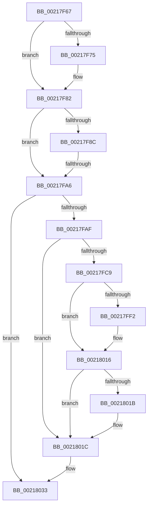

# sub_00217F67

- RVA: `0x00217F67`–`0x0021804F` (길이 `232` bytes)
- VA: `0x0000000140217F67`
- 실행 섹션: `.text`
- PDB 이름 있음: `아니요`; PDB Function 태그: `아니요`
- unwind 정보 RVA: `0x0005E7E8`
- 디코드: `52`개 명령, `232/232` bytes 표시
- 미해석 바이트: `0` (있으면 어셈블리에 `.byte`로 보존)

> 이 문서는 커널 이미지의 기계어와 PDB 기호를 분석해 생성했습니다. 4번과 5번은 함수 원형과 자료형을 바이너리 사용 방식에서 추정한 C 해석이며 원본 소스 복구 결과는 아닙니다.

## 1. Dependencies

- 직접 호출 지점: **3**; 고유 호출 대상: **3**
- 직접 호출자로 확인된 함수: **0**
- RIP 상대 이미지 참조: **2**

### Outgoing calls
- `0x00217F7D` → [KiLowerIrqlProcessIrqlFlags](../4F/KiLowerIrqlProcessIrqlFlags_function_004F5698.md) (function, `0x004F5698`)
- `0x00217FD2` → [HalpDisableInterrupts](../25/HalpDisableInterrupts_function_002521A0.md) (function, `0x002521A0`)
- `0x0021802E` → [HalpInterruptSendIpi](../25/HalpInterruptSendIpi_function_00252310.md) (function, `0x00252310`)

### Direct callers
- 이 함수 시작 RVA로 연결되는 직접 call은 확인되지 않았습니다. 간접 호출은 완전히 역산할 수 없습니다.

### Static image references
- `0x00217F67` → RVA `0x00FC6D20` (`ALMOSTRO`; read)
- `0x00217FB8` → RVA `0x00FC6BC5` (`ALMOSTRO`; read)

## 2. Other-region calls and transfers

- 다른 실행 섹션으로 향하는 call: **0**
- call이 아닌 외부 분기/꼬리 이동: **1**
  - `0x00217FA0` → [sub_002180B5 + 0x38](Unknown_function_002180B5.md) (`tail-transfer`)

## 3. Assembly (complete function range)

```asm
00217F67  83 3D B2 ED DA 00 00            cmp dword ptr [rip + 0xdaedb2], 0
00217F6E  0F B6 74 24 70                  movzx esi, byte ptr [rsp + 0x70]
00217F73  74 0D                           je 0x140217f82
00217F75  44 0F 20 C1                     mov rcx, cr8
00217F79  40 0F B6 D6                     movzx edx, sil
00217F7D  E8 16 D7 2D 00                  call 0x1404f5698
00217F82  44 0F 22 C6                     mov cr8, rsi
00217F86  41 F6 C6 01                     test r14b, 1
00217F8A  75 1A                           jne 0x140217fa6
00217F8C  B8 F8 FF FF FF                  mov eax, 0xfffffff8
00217F91  F0 41 0F C1 85 08 01 00 00      lock xadd dword ptr [r13 + 0x108], eax
00217F9A  83 E0 F8                        and eax, 0xfffffff8
00217F9D  83 F8 08                        cmp eax, 8
00217FA0  0F 84 47 01 00 00               je 0x1402180ed
00217FA6  48 39 3F                        cmp qword ptr [rdi], rdi
00217FA9  0F 84 84 00 00 00               je 0x140218033
00217FAF  33 C0                           xor eax, eax
00217FB1  C6 83 C1 00 00 00 01            mov byte ptr [rbx + 0xc1], 1
00217FB8  38 05 07 EC DA 00               cmp byte ptr [rip + 0xdaec07], al
00217FBE  0F 57 C0                        xorps xmm0, xmm0
00217FC1  F3 0F 7F 44 24 24               movdqu xmmword ptr [rsp + 0x24], xmm0
00217FC7  74 53                           je 0x14021801c
00217FC9  65 4C 8B 04 25 20 00 00 00      mov r8, qword ptr gs:[0x20]
00217FD2  E8 C9 A1 03 00                  call 0x1402521a0
00217FD7  41 8B 90 A8 00 00 00            mov edx, dword ptr [r8 + 0xa8]
00217FDE  44 0F B6 C8                     movzx r9d, al
00217FE2  8B CA                           mov ecx, edx
00217FE4  83 C9 02                        or ecx, 2
00217FE7  41 89 88 A8 00 00 00            mov dword ptr [r8 + 0xa8], ecx
00217FEE  85 D2                           test edx, edx
00217FF0  75 24                           jne 0x140218016
00217FF2  B9 15 00 01 C0                  mov ecx, 0xc0010015
00217FF7  0F 32                           rdmsr
00217FF9  48 C1 E2 20                     shl rdx, 0x20
00217FFD  48 0B C2                        or rax, rdx
00218000  48 BA 00 00 00 00 01 00 00 00   movabs rdx, 0x100000000
0021800A  48 0B C2                        or rax, rdx
0021800D  48 8B D0                        mov rdx, rax
00218010  48 C1 EA 20                     shr rdx, 0x20
00218014  0F 30                           wrmsr
00218016  45 84 C9                        test r9b, r9b
00218019  74 01                           je 0x14021801c
0021801B  FB                              sti
0021801C  BA 1F 00 00 00                  mov edx, 0x1f
00218021  C7 44 24 20 05 00 00 00         mov dword ptr [rsp + 0x20], 5
00218029  48 8D 4C 24 20                  lea rcx, [rsp + 0x20]
0021802E  E8 DD A2 03 00                  call 0x140252310
00218033  48 8B 7C 24 58                  mov rdi, qword ptr [rsp + 0x58]
00218038  4C 8B 6C 24 48                  mov r13, qword ptr [rsp + 0x48]
0021803D  48 8B B4 24 88 00 00 00         mov rsi, qword ptr [rsp + 0x88]
00218045  48 8B 5C 24 78                  mov rbx, qword ptr [rsp + 0x78]
0021804A  4C 8B 7C 24 40                  mov r15, qword ptr [rsp + 0x40]
```

## 4. C-style interpretation (structured pseudocode)

```c
__int64 __fastcall sub_00217F67(__int64 a1, __int64 a2, __int64 a3, __int64 a4, __int64 a5, __int64 a6, __int64 a7, __int64 a8, __int64 a9, __int64 a10, __int64 a11, __int64 a12, __int64 a13, unsigned __int8 a14, __int64 a15, __int64 a16, __int64 a17)
{
    __int64 result;
    unsigned int v_stack_p20;
    unsigned __int64 v_stack_p24;

    if ((*(unsigned int *)(v_rip + 14347698)) != 0) {
        a1 = v_cr8;
        a2 = a14;
        result = KiLowerIrqlProcessIrqlFlags(a1, a2, a3, a4);
    }
    if ((((unsigned __int8)(v_r14)) & (1)) != 0) goto loc_00217FA6;
    result = (unsigned int)(((unsigned int)(0xFFFFFFF8ULL)) & (0xFFFFFFF8ULL));
loc_00217FA6:
    if ((*(unsigned __int64 *)(v_rdi)) == v_rdi) goto loc_00218033;
    result = 0;
    *(unsigned __int8 *)(v_rbx + 193) = 1;
    v_stack_p24 = v_xmm0;
    if ((*(unsigned __int8 *)(v_rip + 14347271)) == 0) goto loc_0021801C;
    result = HalpDisableInterrupts(a1, a2, *(unsigned __int64 *)(gs_base + (0 + 32)), a4);
    a1 = (unsigned int)(((unsigned int)((unsigned int)((unsigned int)(*(unsigned int *)(*(unsigned __int64 *)(gs_base + (0 + 32)) + 168))))) | (2));
    *(unsigned int *)(*(unsigned __int64 *)(gs_base + (0 + 32)) + 168) = (unsigned int)(a1);
    if ((unsigned int)((unsigned int)(*(unsigned int *)(*(unsigned __int64 *)(gs_base + (0 + 32)) + 168))) == 0) {
        a1 = 0xC0010015ULL;
        a2 = ((unsigned int)(*(unsigned int *)(*(unsigned __int64 *)(gs_base + (0 + 32)) + 168))) << (32);
        result = (result) | (a2);
        result = (result) | (a2);
        a2 = result;
        a2 = (a2) >> (32);
    }
    if ((unsigned __int8)((unsigned __int8)(result)) != 0) {
    }
    v_stack_p20 = 5;
    result = HalpInterruptSendIpi(v_stack_p20, 31, *(unsigned __int64 *)(gs_base + (0 + 32)), (unsigned __int8)(result));
loc_00218033:
    return result;
}
```

## 5. (Beta) C Style

```c
int64_t sub_00217F67(int64_t Arg1, int64_t Arg2, int64_t Arg3, int64_t Arg4, uint64_t Arg5, uint64_t Arg6, uint64_t Arg7, int64_t Arg8, int64_t Arg9, uint64_t Arg10, int64_t Arg11, uint64_t Arg12, uint64_t Arg13, uint8_t Arg14, int64_t Arg15, uint64_t Arg16, int64_t Arg17)
{
    int64_t result;
    uint32_t v_stack_p20;
    uint64_t v_stack_p24;

    if ((*(uint32_t *)(v_rip + 0xDAEDB2)) != 0) {
        Arg1 = v_cr8;
        Arg2 = Arg14;
        result = KiLowerIrqlProcessIrqlFlags(Arg1, Arg2, Arg3, Arg4);
    }
    if ((((uint8_t)(local_r14)) & (1)) != 0) goto loc_00217FA6;
    result = (uint32_t)(((uint32_t)(0xFFFFFFF8ULL)) & (0xFFFFFFF8ULL));
loc_00217FA6:
    if ((*(uint64_t *)(local_rdi)) == local_rdi) goto loc_00218033;
    result = 0;
    *(uint8_t *)(local_rbx + 0xC1) = 1;
    v_stack_p24 = v_xmm0;
    if ((*(uint8_t *)(v_rip + 0xDAEC07)) == 0) goto loc_0021801C;
    result = HalpDisableInterrupts(Arg1, Arg2, *(uint64_t *)(gs_base + (0 + 0x20)), Arg4);
    Arg1 = (uint32_t)(((uint32_t)((uint32_t)((uint32_t)(*(uint32_t *)(*(uint64_t *)(gs_base + (0 + 0x20)) + 0xA8))))) | (2));
    *(uint32_t *)(*(uint64_t *)(gs_base + (0 + 0x20)) + 0xA8) = (uint32_t)(Arg1);
    if ((uint32_t)((uint32_t)(*(uint32_t *)(*(uint64_t *)(gs_base + (0 + 0x20)) + 0xA8))) == 0) {
        Arg1 = 0xC0010015ULL;
        Arg2 = ((uint32_t)(*(uint32_t *)(*(uint64_t *)(gs_base + (0 + 0x20)) + 0xA8))) << (32);
        result = (result) | (Arg2);
        result = (result) | (Arg2);
        Arg2 = result;
        Arg2 = (Arg2) >> (32);
    }
    if ((uint8_t)((uint8_t)(result)) != 0) {
    }
    v_stack_p20 = 5;
    result = HalpInterruptSendIpi(v_stack_p20, 31, *(uint64_t *)(gs_base + (0 + 0x20)), (uint8_t)(result));
loc_00218033:
    return result;
}
```

## 6. Execution-region graph

[열기: 2D/3D 그래프와 함수 탐색 컨트롤 패널](../../../control-panel.html?section=text&rva=0x00217F67&view=graph)

- 2D 그래프는 위에서 아래로 흐르고, 3D 그래프는 빈 공간을 드래그해 회전합니다. Shift+드래그는 이동, 휠은 확대·축소, 함수 노드 선택은 대상 보고서 이동입니다.

### Static fallback


