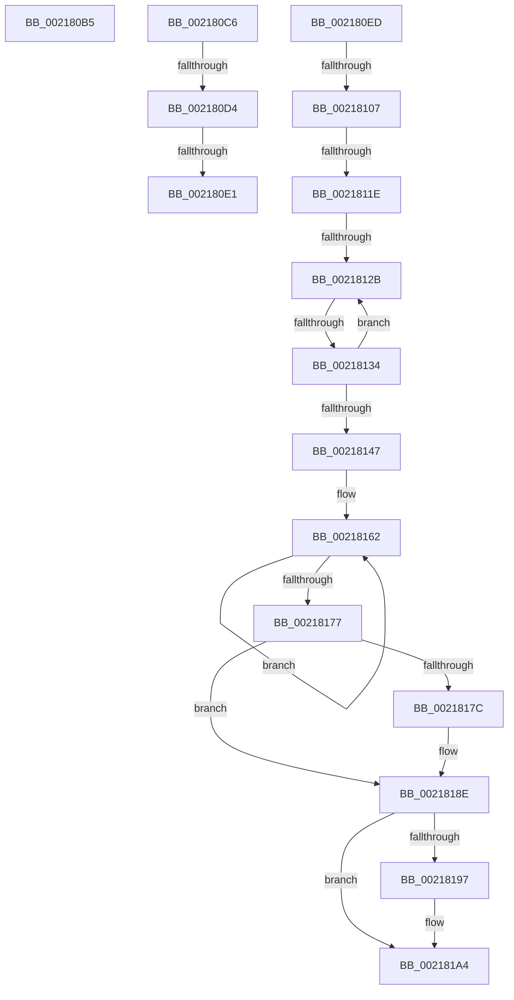

# sub_002180B5

- RVA: `0x002180B5`–`0x002181B1` (길이 `252` bytes)
- VA: `0x00000001402180B5`
- 실행 섹션: `.text`
- PDB 이름 있음: `아니요`; PDB Function 태그: `아니요`
- unwind 정보 RVA: `0x0005E860`
- 디코드: `56`개 명령, `252/252` bytes 표시
- 미해석 바이트: `0` (있으면 어셈블리에 `.byte`로 보존)

> 이 문서는 커널 이미지의 기계어와 PDB 기호를 분석해 생성했습니다. 4번과 5번은 함수 원형과 자료형을 바이너리 사용 방식에서 추정한 C 해석이며 원본 소스 복구 결과는 아닙니다.

## 1. Dependencies

- 직접 호출 지점: **6**; 고유 호출 대상: **6**
- 직접 호출자로 확인된 함수: **0**
- RIP 상대 이미지 참조: **4**

### Outgoing calls
- `0x002180BC` → [KiRaiseIrqlProcessIrqlFlags](../4F/KiRaiseIrqlProcessIrqlFlags_function_004F56FC.md) (function, `0x004F56FC`)
- `0x002180D4` → [KiCheckVpBackingLongSpinWaitHypercall](../30/KiCheckVpBackingLongSpinWaitHypercall_function_0030F490.md) (function, `0x0030F490`)
- `0x002180E3` → [HvlNotifyLongSpinWait](../30/HvlNotifyLongSpinWait_function_0030F460.md) (function, `0x0030F460`)
- `0x0021810A` → [KiAcquireKobjectLockSafe](../25/KiAcquireKobjectLockSafe_function_00251C90.md) (function, `0x00251C90`)
- `0x00218189` → [KeSetEvent](../33/KeSetEvent_function_0033F310.md) (function, `0x0033F310`)
- `0x0021819F` → [KiLowerIrqlProcessIrqlFlags](../4F/KiLowerIrqlProcessIrqlFlags_function_004F5698.md) (function, `0x004F5698`)

### Direct callers
- 이 함수 시작 RVA로 연결되는 직접 call은 확인되지 않았습니다. 간접 호출은 완전히 역산할 수 없습니다.

### Static image references
- `0x002180C6` → RVA `0x00FC6AB8` (`ALMOSTRO`; read)
- `0x002180FA` → RVA `0x00FC6D20` (`ALMOSTRO`; read)
- `0x00218154` → RVA `0x00F22D40` (`.data`; read)
- `0x00218182` → RVA `0x00F22D80` (`.data`; read)

## 2. Other-region calls and transfers

- 다른 실행 섹션으로 향하는 call: **0**
- call이 아닌 외부 분기/꼬리 이동: **9**
  - `0x002180C1` → [sub_00217D5C + 0x4E](Unknown_function_00217D5C.md) (`tail-transfer`)
  - `0x002180CE` → [sub_00217D5C + 0x6C](Unknown_function_00217D5C.md) (`tail-transfer`)
  - `0x002180DB` → [sub_00217D5C + 0x6C](Unknown_function_00217D5C.md) (`tail-transfer`)
  - `0x002180E8` → [sub_00217D5C + 0x6E](Unknown_function_00217D5C.md) (`tail-transfer`)
  - `0x00218101` → [sub_00218230 + 0xE](Unknown_function_00218230.md) (`tail-transfer`)
  - `0x00218118` → [sub_00218230](Unknown_function_00218230.md) (`tail-transfer`)
  - `0x00218125` → [sub_00218230](Unknown_function_00218230.md) (`tail-transfer`)
  - `0x0021812E` → [sub_00218230](Unknown_function_00218230.md) (`tail-transfer`)
  - `0x002181AC` → [sub_00217F67 + 0x3F](Unknown_function_00217F67.md) (`tail-transfer`)

## 3. Assembly (complete function range)

```asm
002180B5  0F B6 D0                        movzx edx, al
002180B8  40 0F B6 CF                     movzx ecx, dil
002180BC  E8 3B D6 2D 00                  call 0x1404f56fc
002180C1  E9 E4 FC FF FF                  jmp 0x140217daa
002180C6  8B 05 EC E9 DA 00               mov eax, dword ptr [rip + 0xdae9ec]
002180CC  A8 40                           test al, 0x40
002180CE  0F 84 F4 FC FF FF               je 0x140217dc8
002180D4  E8 B7 73 0F 00                  call 0x14030f490
002180D9  84 C0                           test al, al
002180DB  0F 84 E7 FC FF FF               je 0x140217dc8
002180E1  8B CF                           mov ecx, edi
002180E3  E8 78 73 0F 00                  call 0x14030f460
002180E8  E9 DD FC FF FF                  jmp 0x140217dca
002180ED  44 0F 20 C6                     mov rsi, cr8
002180F1  B8 02 00 00 00                  mov eax, 2
002180F6  44 0F 22 C0                     mov cr8, rax
002180FA  83 3D 1F EC DA 00 00            cmp dword ptr [rip + 0xdaec1f], 0
00218101  0F 85 37 01 00 00               jne 0x14021823e
00218107  49 8B CD                        mov rcx, r13
0021810A  E8 81 9B 03 00                  call 0x140251c90
0021810F  41 8B 85 08 01 00 00            mov eax, dword ptr [r13 + 0x108]
00218116  A8 07                           test al, 7
00218118  0F 85 12 01 00 00               jne 0x140218230
0021811E  49 8D 4D 30                     lea rcx, [r13 + 0x30]
00218122  48 39 09                        cmp qword ptr [rcx], rcx
00218125  0F 84 05 01 00 00               je 0x140218230
0021812B  83 F8 08                        cmp eax, 8
0021812E  0F 83 FC 00 00 00               jae 0x140218230
00218134  8B C8                           mov ecx, eax
00218136  83 E1 FB                        and ecx, 0xfffffffb
00218139  83 C9 03                        or ecx, 3
0021813C  F0 41 0F B1 8D 08 01 00 00      lock cmpxchg dword ptr [r13 + 0x108], ecx
00218145  75 E4                           jne 0x14021812b
00218147  F0 41 81 65 00 7F FF FF FF      lock and dword ptr [r13], 0xffffff7f
00218150  49 83 C5 78                     add r13, 0x78
00218154  0F 0D 0D E5 AB D0 00            prefetchw byte ptr [rip + 0xd0abe5]
0021815B  48 8B 05 DE AB D0 00            mov rax, qword ptr [rip + 0xd0abde]
00218162  49 89 45 00                     mov qword ptr [r13], rax
00218166  48 8B C8                        mov rcx, rax
00218169  F0 4C 0F B1 2D CE AB D0 00      lock cmpxchg qword ptr [rip + 0xd0abce], r13
00218172  48 3B C1                        cmp rax, rcx
00218175  75 EB                           jne 0x140218162
00218177  48 85 C0                        test rax, rax
0021817A  75 12                           jne 0x14021818e
0021817C  45 33 C0                        xor r8d, r8d
0021817F  8D 50 0A                        lea edx, [rax + 0xa]
00218182  48 8D 0D F7 AB D0 00            lea rcx, [rip + 0xd0abf7]
00218189  E8 82 71 12 00                  call 0x14033f310
0021818E  83 3D 8B EB DA 00 00            cmp dword ptr [rip + 0xdaeb8b], 0
00218195  74 0D                           je 0x1402181a4
00218197  44 0F 20 C1                     mov rcx, cr8
0021819B  40 0F B6 D6                     movzx edx, sil
0021819F  E8 F4 D4 2D 00                  call 0x1404f5698
002181A4  40 0F B6 C6                     movzx eax, sil
002181A8  44 0F 22 C0                     mov cr8, rax
002181AC  E9 F5 FD FF FF                  jmp 0x140217fa6
```

## 4. C-style interpretation (structured pseudocode)

```c
__int64 __fastcall sub_002180B5(__int64 a1, __int64 a2, int a3)
{
    __int64 result;

    result = KiRaiseIrqlProcessIrqlFlags((unsigned __int8)(v_rdi), (unsigned __int8)(result), a3, a4);
}
```

## 5. (Beta) C Style

```c
int64_t sub_002180B5(int64_t Arg1, int64_t Arg2, int32_t Arg3)
{
    int64_t result;

    result = KiRaiseIrqlProcessIrqlFlags((uint8_t)(local_rdi), (uint8_t)(result), Arg3, a4);
}
```

## 6. Execution-region graph

[열기: 2D/3D 그래프와 함수 탐색 컨트롤 패널](../../../control-panel.html?section=text&rva=0x002180B5&view=graph)

- 2D 그래프는 위에서 아래로 흐르고, 3D 그래프는 빈 공간을 드래그해 회전합니다. Shift+드래그는 이동, 휠은 확대·축소, 함수 노드 선택은 대상 보고서 이동입니다.

### Static fallback


