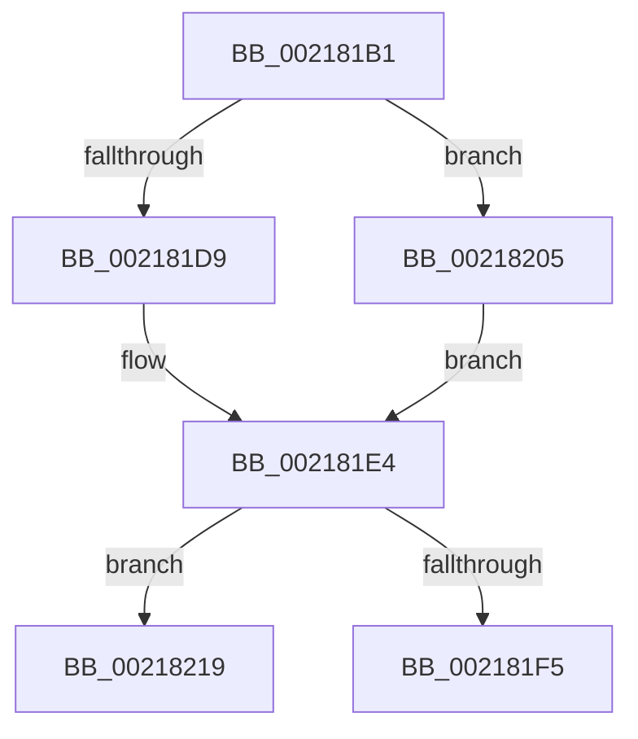

# sub_002181B1

- RVA: `0x002181B1`–`0x00218230` (길이 `127` bytes)
- VA: `0x00000001402181B1`
- 실행 섹션: `.text`
- PDB 이름 있음: `아니요`; PDB Function 태그: `아니요`
- unwind 정보 RVA: `0x0005E884`
- 디코드: `35`개 명령, `127/127` bytes 표시
- 미해석 바이트: `0` (있으면 어셈블리에 `.byte`로 보존)

> 이 문서는 커널 이미지의 기계어와 PDB 기호를 분석해 생성했습니다. 4번과 5번은 함수 원형과 자료형을 바이너리 사용 방식에서 추정한 C 해석이며 원본 소스 복구 결과는 아닙니다.

## 1. Dependencies

- 직접 호출 지점: **0**; 고유 호출 대상: **0**
- 직접 호출자로 확인된 함수: **0**
- RIP 상대 이미지 참조: **0**

### Outgoing calls
- 직접 디코드된 call 명령이 없습니다.

### Direct callers
- 이 함수 시작 RVA로 연결되는 직접 call은 확인되지 않았습니다. 간접 호출은 완전히 역산할 수 없습니다.

### Static image references
- 디코드된 RIP-relative 메모리 참조가 없습니다.

## 2. Other-region calls and transfers

- 다른 실행 섹션으로 향하는 call: **0**
- call이 아닌 외부 분기/꼬리 이동: **2**
  - `0x00218200` → [sub_00217E2A + 0x7D](Unknown_function_00217E2A.md) (`tail-transfer`)
  - `0x0021822B` → [sub_00217E2A + 0x7D](Unknown_function_00217E2A.md) (`tail-transfer`)

## 3. Assembly (complete function range)

```asm
002181B1  49 8B 47 20                     mov rax, qword ptr [r15 + 0x20]
002181B5  48 89 47 20                     mov qword ptr [rdi + 0x20], rax
002181B9  41 0F B6 47 28                  movzx eax, byte ptr [r15 + 0x28]
002181BE  88 47 28                        mov byte ptr [rdi + 0x28], al
002181C1  41 0F B6 47 29                  movzx eax, byte ptr [r15 + 0x29]
002181C6  88 47 29                        mov byte ptr [rdi + 0x29], al
002181C9  41 0F B6 47 2A                  movzx eax, byte ptr [r15 + 0x2a]
002181CE  88 47 2A                        mov byte ptr [rdi + 0x2a], al
002181D1  49 8B 0F                        mov rcx, qword ptr [r15]
002181D4  49 3B CF                        cmp rcx, r15
002181D7  75 2C                           jne 0x140218205
002181D9  48 89 7F 08                     mov qword ptr [rdi + 8], rdi
002181DD  48 89 3F                        mov qword ptr [rdi], rdi
002181E0  C6 47 29 00                     mov byte ptr [rdi + 0x29], 0
002181E4  49 8B 57 10                     mov rdx, qword ptr [r15 + 0x10]
002181E8  49 8D 47 10                     lea rax, [r15 + 0x10]
002181EC  48 3B D0                        cmp rdx, rax
002181EF  48 8D 47 10                     lea rax, [rdi + 0x10]
002181F3  75 24                           jne 0x140218219
002181F5  48 89 40 08                     mov qword ptr [rax + 8], rax
002181F9  48 89 00                        mov qword ptr [rax], rax
002181FC  C6 47 2A 00                     mov byte ptr [rdi + 0x2a], 0
00218200  E9 A2 FC FF FF                  jmp 0x140217ea7
00218205  49 8B 47 08                     mov rax, qword ptr [r15 + 8]
00218209  48 89 0F                        mov qword ptr [rdi], rcx
0021820C  48 89 47 08                     mov qword ptr [rdi + 8], rax
00218210  48 89 79 08                     mov qword ptr [rcx + 8], rdi
00218214  48 89 38                        mov qword ptr [rax], rdi
00218217  EB CB                           jmp 0x1402181e4
00218219  49 8B 4F 18                     mov rcx, qword ptr [r15 + 0x18]
0021821D  48 89 10                        mov qword ptr [rax], rdx
00218220  48 89 4F 18                     mov qword ptr [rdi + 0x18], rcx
00218224  48 89 42 08                     mov qword ptr [rdx + 8], rax
00218228  48 89 01                        mov qword ptr [rcx], rax
0021822B  E9 77 FC FF FF                  jmp 0x140217ea7
```

## 4. C-style interpretation (structured pseudocode)

```c
__int64 __fastcall sub_002181B1(void)
{
    *(unsigned __int64 *)(v_rdi + 32) = *(unsigned __int64 *)(v_r15 + 32);
    *(unsigned __int8 *)(v_rdi + 40) = (unsigned __int8)(*(unsigned __int8 *)(v_r15 + 40));
    *(unsigned __int8 *)(v_rdi + 41) = (unsigned __int8)(*(unsigned __int8 *)(v_r15 + 41));
    *(unsigned __int8 *)(v_rdi + 42) = (unsigned __int8)(*(unsigned __int8 *)(v_r15 + 42));
    if ((*(unsigned __int64 *)(v_r15)) != v_r15) goto loc_00218205;
    *(unsigned __int64 *)(v_rdi + 8) = v_rdi;
    *(unsigned __int64 *)(v_rdi) = v_rdi;
    *(unsigned __int8 *)(v_rdi + 41) = 0;
loc_002181E4:
    if ((*(unsigned __int64 *)(v_r15 + 16)) != (v_r15 + 16)) goto loc_00218219;
    *(unsigned __int64 *)(v_rdi + 16 + 8) = v_rdi + 16;
    *(unsigned __int64 *)(v_rdi + 16) = v_rdi + 16;
    *(unsigned __int8 *)(v_rdi + 42) = 0;
loc_00218205:
    *(unsigned __int64 *)(v_rdi) = *(unsigned __int64 *)(v_r15);
    *(unsigned __int64 *)(v_rdi + 8) = *(unsigned __int64 *)(v_r15 + 8);
    *(unsigned __int64 *)(*(unsigned __int64 *)(v_r15) + 8) = v_rdi;
    *(unsigned __int64 *)(*(unsigned __int64 *)(v_r15 + 8)) = v_rdi;
    goto loc_002181E4;
loc_00218219:
    *(unsigned __int64 *)(*(unsigned __int64 *)(v_r15 + 8)) = *(unsigned __int64 *)(v_r15 + 16);
    *(unsigned __int64 *)(v_rdi + 24) = *(unsigned __int64 *)(v_r15 + 24);
    *(unsigned __int64 *)(*(unsigned __int64 *)(v_r15 + 16) + 8) = *(unsigned __int64 *)(v_r15 + 8);
    *(unsigned __int64 *)(*(unsigned __int64 *)(v_r15 + 24)) = *(unsigned __int64 *)(v_r15 + 8);
}
```

## 5. (Beta) C Style

```c
void sub_002181B1(void)
{
    *(uint64_t *)(local_rdi + 0x20) = *(uint64_t *)(local_r15 + 0x20);
    *(uint8_t *)(local_rdi + 0x28) = (uint8_t)(*(uint8_t *)(local_r15 + 0x28));
    *(uint8_t *)(local_rdi + 0x29) = (uint8_t)(*(uint8_t *)(local_r15 + 0x29));
    *(uint8_t *)(local_rdi + 0x2A) = (uint8_t)(*(uint8_t *)(local_r15 + 0x2A));
    if ((*(uint64_t *)(local_r15)) != local_r15) goto loc_00218205;
    *(uint64_t *)(local_rdi + 0x8) = local_rdi;
    *(uint64_t *)(local_rdi) = local_rdi;
    *(uint8_t *)(local_rdi + 0x29) = 0;
loc_002181E4:
    if ((*(uint64_t *)(local_r15 + 0x10)) != (local_r15 + 16)) goto loc_00218219;
    *(uint64_t *)(local_rdi + 0x10 + 0x8) = local_rdi + 16;
    *(uint64_t *)(local_rdi + 0x10) = local_rdi + 16;
    *(uint8_t *)(local_rdi + 0x2A) = 0;
loc_00218205:
    *(uint64_t *)(local_rdi) = *(uint64_t *)(local_r15);
    *(uint64_t *)(local_rdi + 0x8) = *(uint64_t *)(local_r15 + 0x8);
    *(uint64_t *)(*(uint64_t *)(local_r15) + 0x8) = local_rdi;
    *(uint64_t *)(*(uint64_t *)(local_r15 + 0x8)) = local_rdi;
    goto loc_002181E4;
loc_00218219:
    *(uint64_t *)(*(uint64_t *)(local_r15 + 0x8)) = *(uint64_t *)(local_r15 + 0x10);
    *(uint64_t *)(local_rdi + 0x18) = *(uint64_t *)(local_r15 + 0x18);
    *(uint64_t *)(*(uint64_t *)(local_r15 + 0x10) + 0x8) = *(uint64_t *)(local_r15 + 0x8);
    *(uint64_t *)(*(uint64_t *)(local_r15 + 0x18)) = *(uint64_t *)(local_r15 + 0x8);
}
```

## 6. Execution-region graph

[열기: 2D/3D 그래프와 함수 탐색 컨트롤 패널](../../../control-panel.html?section=text&rva=0x002181B1&view=graph)

- 2D 그래프는 위에서 아래로 흐르고, 3D 그래프는 빈 공간을 드래그해 회전합니다. Shift+드래그는 이동, 휠은 확대·축소, 함수 노드 선택은 대상 보고서 이동입니다.

### Static fallback


