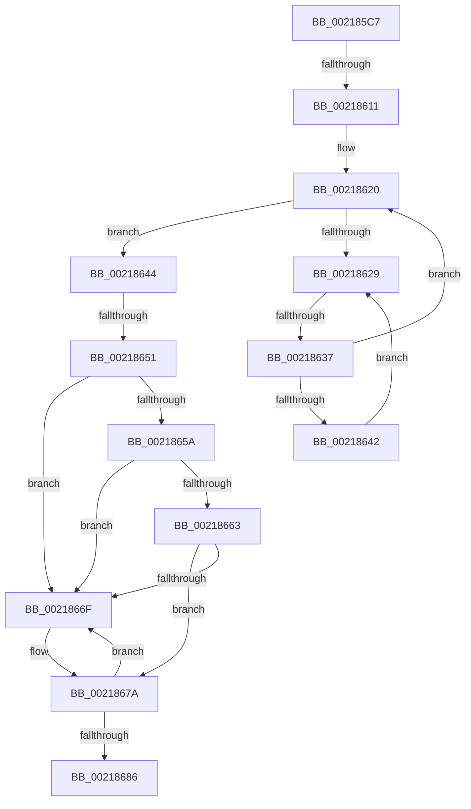

# sub_002185C7

- RVA: `0x002185C7`–`0x00218694` (길이 `205` bytes)
- VA: `0x00000001402185C7`
- 실행 섹션: `.text`
- PDB 이름 있음: `아니요`; PDB Function 태그: `아니요`
- unwind 정보 RVA: `0x0005E9AC`
- 디코드: `45`개 명령, `205/205` bytes 표시
- 미해석 바이트: `0` (있으면 어셈블리에 `.byte`로 보존)

> 이 문서는 커널 이미지의 기계어와 PDB 기호를 분석해 생성했습니다. 4번과 5번은 함수 원형과 자료형을 바이너리 사용 방식에서 추정한 C 해석이며 원본 소스 복구 결과는 아닙니다.

## 1. Dependencies

- 직접 호출 지점: **1**; 고유 호출 대상: **1**
- 직접 호출자로 확인된 함수: **0**
- RIP 상대 이미지 참조: **2**

### Outgoing calls
- `0x00218674` → [KeBugCheck](../4F/KeBugCheck_function_004FD640.md) (function, `0x004FD640`)

### Direct callers
- 이 함수 시작 RVA로 연결되는 직접 call은 확인되지 않았습니다. 간접 호출은 완전히 역산할 수 없습니다.

### Static image references
- `0x00218604` → RVA `0x00FC6D20` (`ALMOSTRO`; read)
- `0x0021862B` → RVA `0x00FC52AC` (`ALMOSTRO`; reference)

## 2. Other-region calls and transfers

- 다른 실행 섹션으로 향하는 call: **0**
- call이 아닌 외부 분기/꼬리 이동: **3**
  - `0x0021860B` → [sub_002188FB](Unknown_function_002188FB.md) (`tail-transfer`)
  - `0x00218631` → [sub_002188FB + 0x12](Unknown_function_002188FB.md) (`tail-transfer`)
  - `0x0021864B` → [sub_00218AB1](Unknown_function_00218AB1.md) (`tail-transfer`)

## 3. Assembly (complete function range)

```asm
002185C7  49 89 5B 10                     mov qword ptr [r11 + 0x10], rbx
002185CB  65 48 8B 1C 25 88 01 00 00      mov rbx, qword ptr gs:[0x188]
002185D4  49 89 6B 18                     mov qword ptr [r11 + 0x18], rbp
002185D8  49 89 73 F8                     mov qword ptr [r11 - 8], rsi
002185DC  48 8D B0 58 02 00 00            lea rsi, [rax + 0x258]
002185E3  49 89 7B F0                     mov qword ptr [r11 - 0x10], rdi
002185E7  4D 89 63 E8                     mov qword ptr [r11 - 0x18], r12
002185EB  4D 89 7B D8                     mov qword ptr [r11 - 0x28], r15
002185EF  4C 8B BB B8 00 00 00            mov r15, qword ptr [rbx + 0xb8]
002185F6  44 0F 20 C7                     mov rdi, cr8
002185FA  41 BC 02 00 00 00               mov r12d, 2
00218600  45 0F 22 C4                     mov cr8, r12
00218604  83 3D 15 E7 DA 00 00            cmp dword ptr [rip + 0xdae715], 0
0021860B  0F 85 EA 02 00 00               jne 0x1402188fb
00218611  33 ED                           xor ebp, ebp
00218613  40 88 7C 24 70                  mov byte ptr [rsp + 0x70], dil
00218618  8B FD                           mov edi, ebp
0021861A  66 0F 1F 44 00 00               nop word ptr [rax + rax]
00218620  F0 48 0F BA 6B 40 00            lock bts qword ptr [rbx + 0x40], 0
00218627  73 1B                           jae 0x140218644
00218629  FF C7                           inc edi
0021862B  85 3D 7B CC DA 00               test dword ptr [rip + 0xdacc7b], edi
00218631  0F 84 D6 02 00 00               je 0x14021890d
00218637  F3 90                           pause
00218639  48 8B 43 40                     mov rax, qword ptr [rbx + 0x40]
0021863D  48 85 C0                        test rax, rax
00218640  74 DE                           je 0x140218620
00218642  EB E5                           jmp 0x140218629
00218644  40 38 AB C1 00 00 00            cmp byte ptr [rbx + 0xc1], bpl
0021864B  0F 85 60 04 00 00               jne 0x140218ab1
00218651  40 38 AB 4A 02 00 00            cmp byte ptr [rbx + 0x24a], bpl
00218658  74 15                           je 0x14021866f
0021865A  F6 83 C0 00 00 00 01            test byte ptr [rbx + 0xc0], 1
00218661  75 0C                           jne 0x14021866f
00218663  48 8D BB 98 00 00 00            lea rdi, [rbx + 0x98]
0021866A  48 39 3F                        cmp qword ptr [rdi], rdi
0021866D  74 0B                           je 0x14021867a
0021866F  B9 06 00 00 00                  mov ecx, 6
00218674  E8 C7 4F 2E 00                  call 0x1404fd640
00218679  CC                              int3
0021867A  48 8D 83 A8 00 00 00            lea rax, [rbx + 0xa8]
00218681  48 39 00                        cmp qword ptr [rax], rax
00218684  75 E9                           jne 0x14021866f
00218686  81 4B 74 00 08 00 00            or dword ptr [rbx + 0x74], 0x800
0021868D  48 8D 8B 58 02 00 00            lea rcx, [rbx + 0x258]
```

## 4. C-style interpretation (structured pseudocode)

```c
__int64 __fastcall sub_002185C7(void)
{
    __int64 result;
    __int64 v_rbp;
    __int64 v_rdi;
    unsigned __int8 v_stack_p70;

    *(unsigned __int64 *)(v_r11 + 16) = v_rbx;
    *(unsigned __int64 *)(v_r11 + 24) = v_rbp;
    *(unsigned __int64 *)(v_r11 - 8) = v_rsi;
    *(unsigned __int64 *)(v_r11 - 16) = v_rdi;
    *(unsigned __int64 *)(v_r11 - 24) = v_r12;
    *(unsigned __int64 *)(v_r11 - 40) = v_r15;
    v_rbp = 0;
    v_stack_p70 = (unsigned __int8)(v_cr8);
loc_00218620:
    if (condition_is_above_or_equal) goto loc_00218644;
loc_00218629:
    v_rdi = (unsigned int)((0) + 1);
    if (*(unsigned __int64 *)(*(unsigned __int64 *)(gs_base + (0 + 392)) + 64) == 0) goto loc_00218620;
    goto loc_00218629;
loc_00218644:
    if ((*(unsigned __int8 *)(*(unsigned __int64 *)(gs_base + (0 + 392)) + 586)) == 0) goto loc_0021866F;
    if (((*(unsigned __int8 *)(*(unsigned __int64 *)(gs_base + (0 + 392)) + 192)) & (1)) != 0) goto loc_0021866F;
    result = *(unsigned __int64 *)(*(unsigned __int64 *)(gs_base + (0 + 392)) + 64);
    if ((*(unsigned __int64 *)(*(unsigned __int64 *)(gs_base + (0 + 392)) + 152)) != (*(unsigned __int64 *)(gs_base + (0 + 392)) + 152)) {
        a1 = 6;
        result = KeBugCheck(a1, a2, a3, a4);
    }
    if ((*(unsigned __int64 *)(*(unsigned __int64 *)(gs_base + (0 + 392)) + 168)) != (*(unsigned __int64 *)(gs_base + (0 + 392)) + 168)) goto loc_0021866F;
    return *(unsigned __int64 *)(gs_base + (0 + 392)) + 168;
}
```

## 5. (Beta) C Style

```c
void sub_002185C7(void)
{
    int64_t result;
    int64_t local_rbp;
    int64_t local_rdi;
    uint8_t v_stack_p70;

    *(uint64_t *)(local_r11 + 0x10) = local_rbx;
    *(uint64_t *)(local_r11 + 0x18) = local_rbp;
    *(uint64_t *)(local_r11 - 0x8) = local_rsi;
    *(uint64_t *)(local_r11 - 0x10) = local_rdi;
    *(uint64_t *)(local_r11 - 0x18) = local_r12;
    *(uint64_t *)(local_r11 - 0x28) = local_r15;
    local_rbp = 0;
    v_stack_p70 = (uint8_t)(v_cr8);
loc_00218620:
    if (condition_is_above_or_equal) goto loc_00218644;
loc_00218629:
    local_rdi = (uint32_t)((0) + 1);
    if (*(uint64_t *)(*(uint64_t *)(gs_base + (0 + 0x188)) + 0x40) == 0) goto loc_00218620;
    goto loc_00218629;
loc_00218644:
    if ((*(uint8_t *)(*(uint64_t *)(gs_base + (0 + 0x188)) + 0x24A)) == 0) goto loc_0021866F;
    if (((*(uint8_t *)(*(uint64_t *)(gs_base + (0 + 0x188)) + 0xC0)) & (1)) != 0) goto loc_0021866F;
    result = *(uint64_t *)(*(uint64_t *)(gs_base + (0 + 0x188)) + 0x40);
    if ((*(uint64_t *)(*(uint64_t *)(gs_base + (0 + 0x188)) + 0x98)) != (*(uint64_t *)(gs_base + (0 + 0x188)) + 152)) {
        a1 = 6;
        result = KeBugCheck(a1, a2, a3, a4);
    }
    if ((*(uint64_t *)(*(uint64_t *)(gs_base + (0 + 0x188)) + 0xA8)) != (*(uint64_t *)(gs_base + (0 + 0x188)) + 168)) goto loc_0021866F;
    return *(uint64_t *)(gs_base + (0 + 0x188)) + 168;
}
```

## 6. Execution-region graph

[열기: 2D/3D 그래프와 함수 탐색 컨트롤 패널](../../../control-panel.html?section=text&rva=0x002185C7&view=graph)

- 2D 그래프는 위에서 아래로 흐르고, 3D 그래프는 빈 공간을 드래그해 회전합니다. Shift+드래그는 이동, 휠은 확대·축소, 함수 노드 선택은 대상 보고서 이동입니다.

### Static fallback


