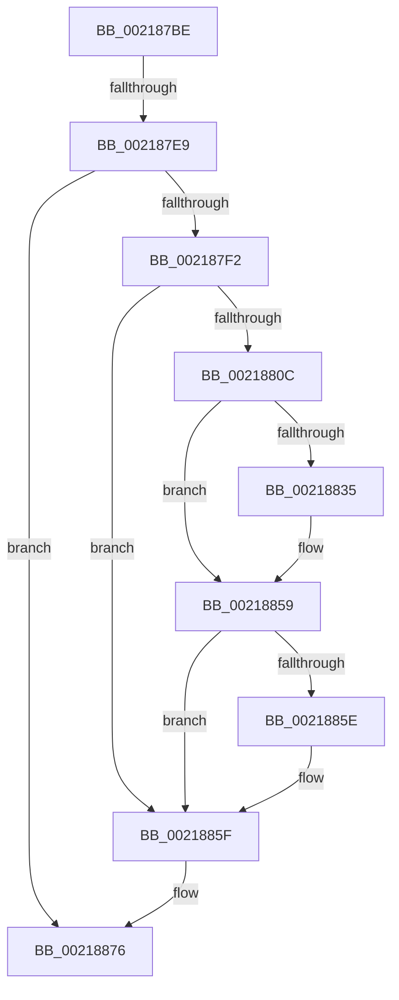

# sub_002187BE

- RVA: `0x002187BE`–`0x00218897` (길이 `217` bytes)
- VA: `0x00000001402187BE`
- 실행 섹션: `.text`
- PDB 이름 있음: `아니요`; PDB Function 태그: `아니요`
- unwind 정보 RVA: `0x0005E9E8`
- 디코드: `48`개 명령, `217/217` bytes 표시
- 미해석 바이트: `0` (있으면 어셈블리에 `.byte`로 보존)

> 이 문서는 커널 이미지의 기계어와 PDB 기호를 분석해 생성했습니다. 4번과 5번은 함수 원형과 자료형을 바이너리 사용 방식에서 추정한 C 해석이며 원본 소스 복구 결과는 아닙니다.

## 1. Dependencies

- 직접 호출 지점: **3**; 고유 호출 대상: **3**
- 직접 호출자로 확인된 함수: **0**
- RIP 상대 이미지 참조: **1**

### Outgoing calls
- `0x002187C6` → [KiLowerIrqlProcessIrqlFlags](../4F/KiLowerIrqlProcessIrqlFlags_function_004F5698.md) (function, `0x004F5698`)
- `0x00218815` → [HalpDisableInterrupts](../25/HalpDisableInterrupts_function_002521A0.md) (function, `0x002521A0`)
- `0x00218871` → [HalpInterruptSendIpi](../25/HalpInterruptSendIpi_function_00252310.md) (function, `0x00252310`)

### Direct callers
- 이 함수 시작 RVA로 연결되는 직접 call은 확인되지 않았습니다. 간접 호출은 완전히 역산할 수 없습니다.

### Static image references
- `0x002187FB` → RVA `0x00FC6BC5` (`ALMOSTRO`; read)

## 2. Other-region calls and transfers

- 다른 실행 섹션으로 향하는 call: **0**
- call이 아닌 외부 분기/꼬리 이동: **1**
  - `0x002187E3` → [sub_002188FB + 0x39](Unknown_function_002188FB.md) (`tail-transfer`)

## 3. Assembly (complete function range)

```asm
002187BE  44 0F 20 C1                     mov rcx, cr8
002187C2  40 0F B6 D6                     movzx edx, sil
002187C6  E8 CD CE 2D 00                  call 0x1404f5698
002187CB  44 0F 22 C6                     mov cr8, rsi
002187CF  B8 F8 FF FF FF                  mov eax, 0xfffffff8
002187D4  F0 41 0F C1 87 08 01 00 00      lock xadd dword ptr [r15 + 0x108], eax
002187DD  83 E0 F8                        and eax, 0xfffffff8
002187E0  83 F8 08                        cmp eax, 8
002187E3  0F 84 4B 01 00 00               je 0x140218934
002187E9  48 39 3F                        cmp qword ptr [rdi], rdi
002187EC  0F 84 84 00 00 00               je 0x140218876
002187F2  33 C0                           xor eax, eax
002187F4  C6 83 C1 00 00 00 01            mov byte ptr [rbx + 0xc1], 1
002187FB  38 05 C4 E3 DA 00               cmp byte ptr [rip + 0xdae3c4], al
00218801  0F 57 C0                        xorps xmm0, xmm0
00218804  F3 0F 7F 44 24 24               movdqu xmmword ptr [rsp + 0x24], xmm0
0021880A  74 53                           je 0x14021885f
0021880C  65 4C 8B 04 25 20 00 00 00      mov r8, qword ptr gs:[0x20]
00218815  E8 86 99 03 00                  call 0x1402521a0
0021881A  41 8B 90 A8 00 00 00            mov edx, dword ptr [r8 + 0xa8]
00218821  44 0F B6 C8                     movzx r9d, al
00218825  8B CA                           mov ecx, edx
00218827  41 0B CC                        or ecx, r12d
0021882A  41 89 88 A8 00 00 00            mov dword ptr [r8 + 0xa8], ecx
00218831  85 D2                           test edx, edx
00218833  75 24                           jne 0x140218859
00218835  B9 15 00 01 C0                  mov ecx, 0xc0010015
0021883A  0F 32                           rdmsr
0021883C  48 C1 E2 20                     shl rdx, 0x20
00218840  48 0B C2                        or rax, rdx
00218843  48 BA 00 00 00 00 01 00 00 00   movabs rdx, 0x100000000
0021884D  48 0B C2                        or rax, rdx
00218850  48 8B D0                        mov rdx, rax
00218853  48 C1 EA 20                     shr rdx, 0x20
00218857  0F 30                           wrmsr
00218859  45 84 C9                        test r9b, r9b
0021885C  74 01                           je 0x14021885f
0021885E  FB                              sti
0021885F  BA 1F 00 00 00                  mov edx, 0x1f
00218864  C7 44 24 20 05 00 00 00         mov dword ptr [rsp + 0x20], 5
0021886C  48 8D 4C 24 20                  lea rcx, [rsp + 0x20]
00218871  E8 9A 9A 03 00                  call 0x140252310
00218876  4C 8B 64 24 50                  mov r12, qword ptr [rsp + 0x50]
0021887B  48 8B 7C 24 58                  mov rdi, qword ptr [rsp + 0x58]
00218880  48 8B 74 24 60                  mov rsi, qword ptr [rsp + 0x60]
00218885  48 8B AC 24 80 00 00 00         mov rbp, qword ptr [rsp + 0x80]
0021888D  48 8B 5C 24 78                  mov rbx, qword ptr [rsp + 0x78]
00218892  4C 8B 7C 24 40                  mov r15, qword ptr [rsp + 0x40]
```

## 4. C-style interpretation (structured pseudocode)

```c
__int64 __fastcall sub_002187BE(__int64 a1, __int64 a2, __int64 a3, __int64 a4, __int64 a5, __int64 a6, __int64 a7, __int64 a8, __int64 a9, __int64 a10, __int64 a11, __int64 a12, __int64 a13, __int64 a14, __int64 a15, __int64 a16)
{
    __int64 result;
    unsigned int v_stack_p20;
    unsigned __int64 v_stack_p24;

    result = KiLowerIrqlProcessIrqlFlags(v_cr8, (unsigned __int8)(v_rsi), a3, a4);
    result = (unsigned int)(((unsigned int)(0xFFFFFFF8ULL)) & (0xFFFFFFF8ULL));
    if ((*(unsigned __int64 *)(v_rdi)) == v_rdi) goto loc_00218876;
    result = 0;
    *(unsigned __int8 *)(v_rbx + 193) = 1;
    v_stack_p24 = v_xmm0;
    if ((*(unsigned __int8 *)(v_rip + 14345156)) == 0) goto loc_0021885F;
    result = HalpDisableInterrupts(v_cr8, (unsigned __int8)(v_rsi), *(unsigned __int64 *)(gs_base + (0 + 32)), a4);
    a1 = (unsigned int)(((unsigned int)((unsigned int)((unsigned int)(*(unsigned int *)(*(unsigned __int64 *)(gs_base + (0 + 32)) + 168))))) | ((unsigned int)(v_r12)));
    *(unsigned int *)(*(unsigned __int64 *)(gs_base + (0 + 32)) + 168) = (unsigned int)(a1);
    if ((unsigned int)((unsigned int)(*(unsigned int *)(*(unsigned __int64 *)(gs_base + (0 + 32)) + 168))) == 0) {
        a1 = 0xC0010015ULL;
        a2 = ((unsigned int)(*(unsigned int *)(*(unsigned __int64 *)(gs_base + (0 + 32)) + 168))) << (32);
        result = (result) | (a2);
        result = (result) | (a2);
        a2 = result;
        a2 = (a2) >> (32);
    }
    if ((unsigned __int8)((unsigned __int8)(result)) != 0) {
    }
    v_stack_p20 = 5;
    result = HalpInterruptSendIpi(v_stack_p20, 31, *(unsigned __int64 *)(gs_base + (0 + 32)), (unsigned __int8)(result));
loc_00218876:
    return result;
}
```

## 5. (Beta) C Style

```c
int64_t sub_002187BE(int64_t Arg1, int64_t Arg2, int64_t Arg3, int64_t Arg4, uint64_t Arg5, uint64_t Arg6, uint64_t Arg7, int64_t Arg8, uint64_t Arg9, int64_t Arg10, int64_t Arg11, int64_t Arg12, uint64_t Arg13, uint64_t Arg14, int64_t Arg15, int64_t Arg16)
{
    int64_t result;
    uint32_t v_stack_p20;
    uint64_t v_stack_p24;

    result = KiLowerIrqlProcessIrqlFlags(v_cr8, (uint8_t)(local_rsi), Arg3, Arg4);
    result = (uint32_t)(((uint32_t)(0xFFFFFFF8ULL)) & (0xFFFFFFF8ULL));
    if ((*(uint64_t *)(local_rdi)) == local_rdi) goto loc_00218876;
    result = 0;
    *(uint8_t *)(local_rbx + 0xC1) = 1;
    v_stack_p24 = v_xmm0;
    if ((*(uint8_t *)(v_rip + 0xDAE3C4)) == 0) goto loc_0021885F;
    result = HalpDisableInterrupts(v_cr8, (uint8_t)(local_rsi), *(uint64_t *)(gs_base + (0 + 0x20)), Arg4);
    Arg1 = (uint32_t)(((uint32_t)((uint32_t)((uint32_t)(*(uint32_t *)(*(uint64_t *)(gs_base + (0 + 0x20)) + 0xA8))))) | ((uint32_t)(local_r12)));
    *(uint32_t *)(*(uint64_t *)(gs_base + (0 + 0x20)) + 0xA8) = (uint32_t)(Arg1);
    if ((uint32_t)((uint32_t)(*(uint32_t *)(*(uint64_t *)(gs_base + (0 + 0x20)) + 0xA8))) == 0) {
        Arg1 = 0xC0010015ULL;
        Arg2 = ((uint32_t)(*(uint32_t *)(*(uint64_t *)(gs_base + (0 + 0x20)) + 0xA8))) << (32);
        result = (result) | (Arg2);
        result = (result) | (Arg2);
        Arg2 = result;
        Arg2 = (Arg2) >> (32);
    }
    if ((uint8_t)((uint8_t)(result)) != 0) {
    }
    v_stack_p20 = 5;
    result = HalpInterruptSendIpi(v_stack_p20, 31, *(uint64_t *)(gs_base + (0 + 0x20)), (uint8_t)(result));
loc_00218876:
    return result;
}
```

## 6. Execution-region graph

[열기: 2D/3D 그래프와 함수 탐색 컨트롤 패널](../../../control-panel.html?section=text&rva=0x002187BE&view=graph)

- 2D 그래프는 위에서 아래로 흐르고, 3D 그래프는 빈 공간을 드래그해 회전합니다. Shift+드래그는 이동, 휠은 확대·축소, 함수 노드 선택은 대상 보고서 이동입니다.

### Static fallback


