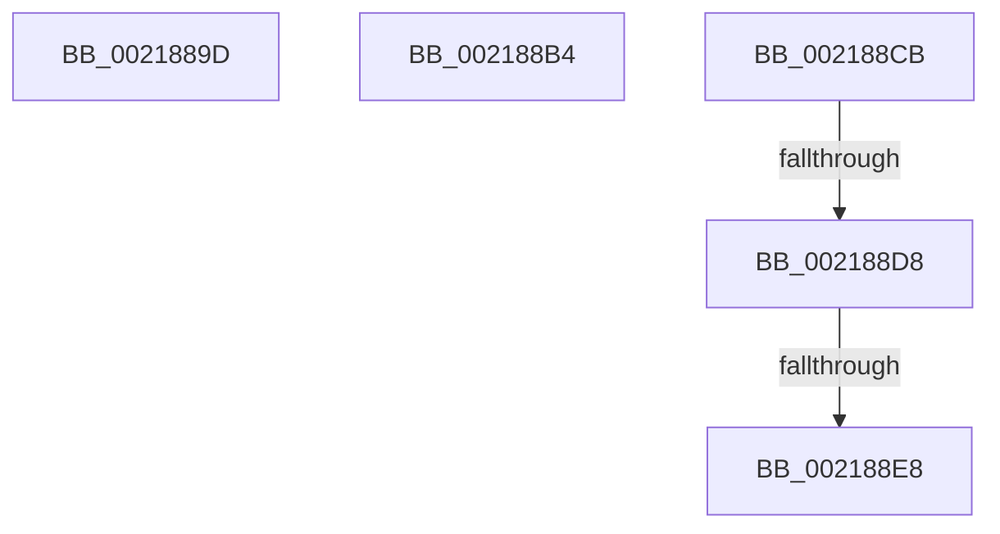

# sub_0021889D

- RVA: `0x0021889D`–`0x002188FB` (길이 `94` bytes)
- VA: `0x000000014021889D`
- 실행 섹션: `.text`
- PDB 이름 있음: `아니요`; PDB Function 태그: `아니요`
- unwind 정보 RVA: `0x0005EA0C`
- 디코드: `22`개 명령, `94/94` bytes 표시
- 미해석 바이트: `0` (있으면 어셈블리에 `.byte`로 보존)

> 이 문서는 커널 이미지의 기계어와 PDB 기호를 분석해 생성했습니다. 4번과 5번은 함수 원형과 자료형을 바이너리 사용 방식에서 추정한 C 해석이며 원본 소스 복구 결과는 아닙니다.

## 1. Dependencies

- 직접 호출 지점: **0**; 고유 호출 대상: **0**
- 직접 호출자로 확인된 함수: **0**
- RIP 상대 이미지 참조: **1**

### Outgoing calls
- 직접 디코드된 call 명령이 없습니다.

### Direct callers
- 이 함수 시작 RVA로 연결되는 직접 call은 확인되지 않았습니다. 간접 호출은 완전히 역산할 수 없습니다.

### Static image references
- `0x002188CB` → RVA `0x00FC6A87` (`ALMOSTRO`; read)

## 2. Other-region calls and transfers

- 다른 실행 섹션으로 향하는 call: **0**
- call이 아닌 외부 분기/꼬리 이동: **5**
  - `0x002188AF` → [sub_00218694 + 0x43](Unknown_function_00218694.md) (`tail-transfer`)
  - `0x002188C6` → [sub_00218694 + 0x63](Unknown_function_00218694.md) (`tail-transfer`)
  - `0x002188D2` → [sub_00218694 + 0x102](Unknown_function_00218694.md) (`tail-transfer`)
  - `0x002188E2` → [sub_00218AA6](Unknown_function_00218AA6.md) (`tail-transfer`)
  - `0x002188F6` → [sub_00218694 + 0x102](Unknown_function_00218694.md) (`tail-transfer`)

## 3. Assembly (complete function range)

```asm
0021889D  48 8B 41 08                     mov rax, qword ptr [rcx + 8]
002188A1  48 89 17                        mov qword ptr [rdi], rdx
002188A4  48 89 47 08                     mov qword ptr [rdi + 8], rax
002188A8  48 89 7A 08                     mov qword ptr [rdx + 8], rdi
002188AC  48 89 38                        mov qword ptr [rax], rdi
002188AF  E9 23 FE FF FF                  jmp 0x1402186d7
002188B4  48 8B 49 18                     mov rcx, qword ptr [rcx + 0x18]
002188B8  48 89 10                        mov qword ptr [rax], rdx
002188BB  48 89 4F 18                     mov qword ptr [rdi + 0x18], rcx
002188BF  48 89 42 08                     mov qword ptr [rdx + 8], rax
002188C3  48 89 01                        mov qword ptr [rcx], rax
002188C6  E9 2C FE FF FF                  jmp 0x1402186f7
002188CB  80 3D B5 E1 DA 00 00            cmp byte ptr [rip + 0xdae1b5], 0
002188D2  0F 85 BE FE FF FF               jne 0x140218796
002188D8  0F 20 E1                        mov rcx, cr4
002188DB  48 F7 C1 80 00 02 00            test rcx, 0x20080
002188E2  0F 84 BE 01 00 00               je 0x140218aa6
002188E8  48 8B C1                        mov rax, rcx
002188EB  48 0F BA F8 07                  btc rax, 7
002188F0  0F 22 E0                        mov cr4, rax
002188F3  0F 22 E1                        mov cr4, rcx
002188F6  E9 9B FE FF FF                  jmp 0x140218796
```

## 4. C-style interpretation (structured pseudocode)

```c
__int64 __fastcall sub_0021889D(__int64 a1, __int64 a2)
{
    *(unsigned __int64 *)(v_rdi) = a2;
    *(unsigned __int64 *)(v_rdi + 8) = *(unsigned __int64 *)(a1 + 8);
    *(unsigned __int64 *)(a2 + 8) = v_rdi;
    *(unsigned __int64 *)(*(unsigned __int64 *)(a1 + 8)) = v_rdi;
}
```

## 5. (Beta) C Style

```c
int64_t sub_0021889D(void *Arg1, void *Arg2)
{
    uint8_t *arg1 = (uint8_t *)Arg1;
    uint8_t *arg2 = (uint8_t *)Arg2;

    *(void **)(local_rdi) = Arg2;
    *(uint64_t *)(local_rdi + 0x8) = *(uint64_t *)(arg1 + 0x8);
    *(uint64_t *)(arg2 + 0x8) = local_rdi;
    *(uint64_t *)(*(uint64_t *)(arg1 + 0x8)) = local_rdi;
}
```

### 관측된 메모리 오프셋

구조체 형식이 확인되지 않은 접근은 인자 기준의 오프셋으로만 기록했습니다.

| 기준 인자 | 오프셋 표현 | 폭 (bit) | 접근 |
|---|---:|---:|---|
| `Arg1` | `+ 0x8` | `64` | `R` |
| `Arg2` | `+ 0x8` | `64` | `W` |

## 6. Execution-region graph

[열기: 2D/3D 그래프와 함수 탐색 컨트롤 패널](../../../control-panel.html?section=text&rva=0x0021889D&view=graph)

- 2D 그래프는 위에서 아래로 흐르고, 3D 그래프는 빈 공간을 드래그해 회전합니다. Shift+드래그는 이동, 휠은 확대·축소, 함수 노드 선택은 대상 보고서 이동입니다.

### Static fallback


